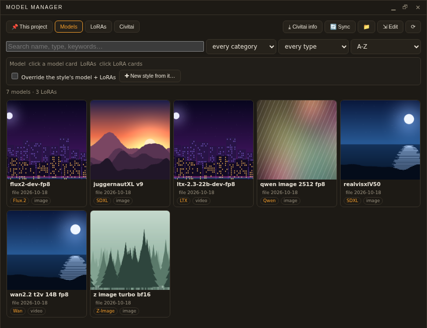
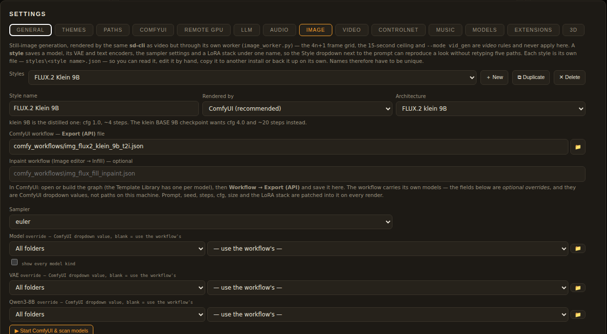
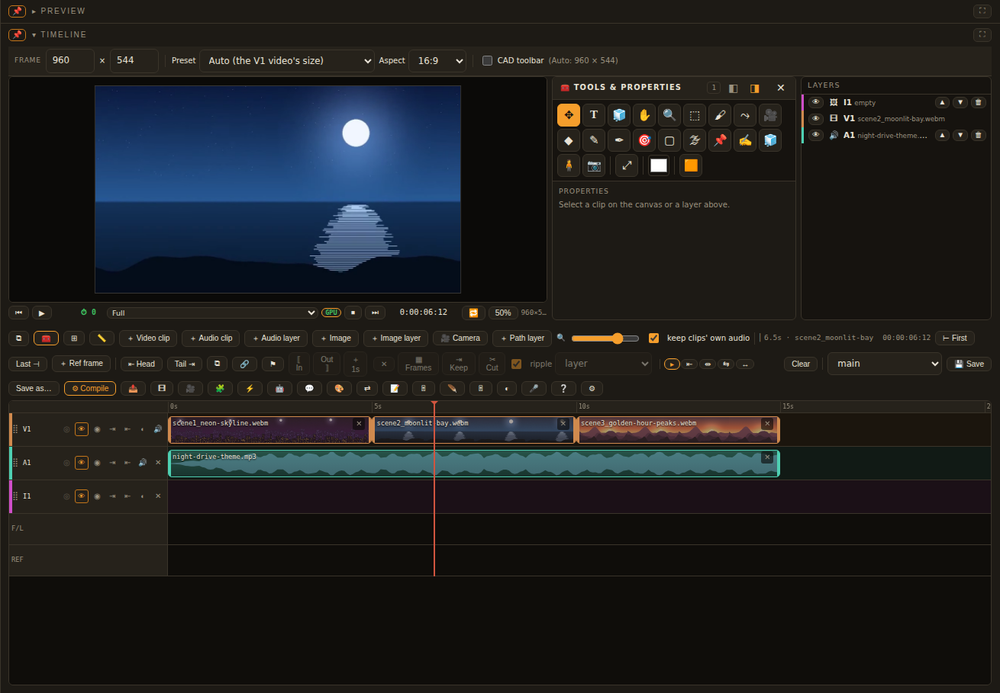
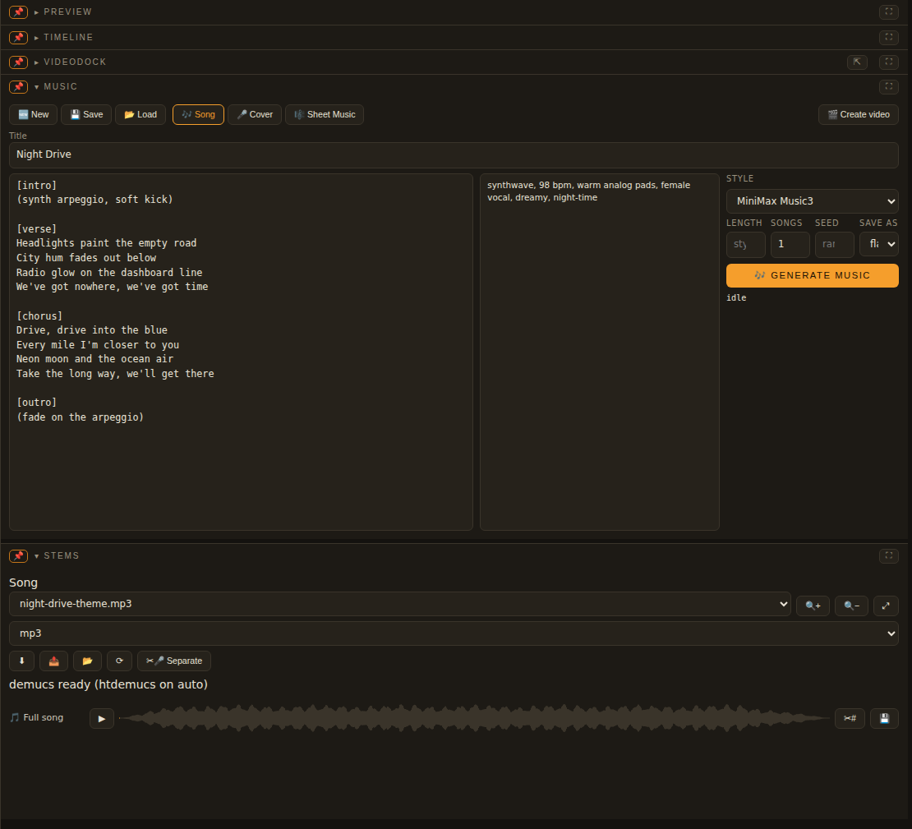
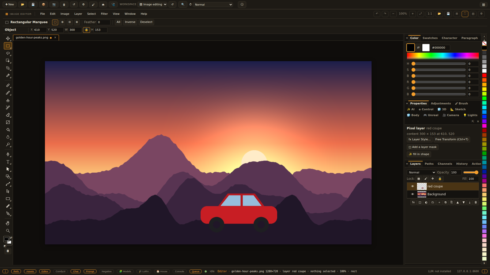
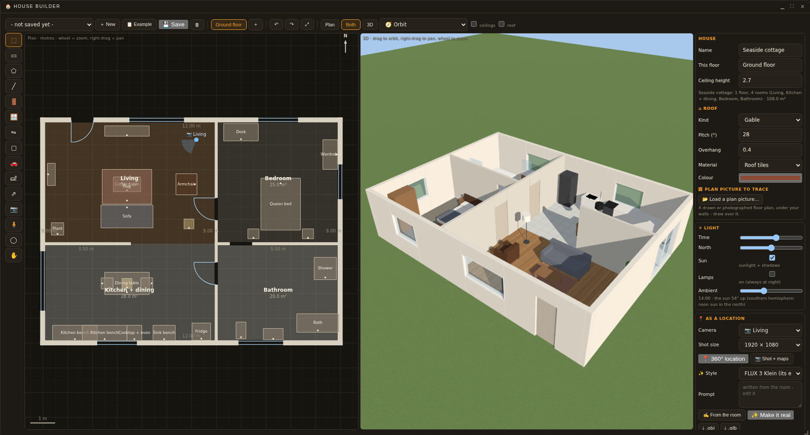

# bitGen Studio

**A local, self-hosted AI film and design studio.** Write a screenplay with a local LLM, render scenes with MiniMax H3, LTX and Wan through **ComfyUI**, cut them on a full **timeline**, paint and compose in a layered **image editor**, sketch and model in **CAD** (constrained sketches and parametric 3D bodies), and bring in scenes from **Blender**, **Daz Studio** and **Unreal Engine 5.8**. All of it runs on your own GPU, with no accounts and no cloud, and nothing leaves your machine.

> [!WARNING]
> **Public beta — still in testing.** bitGen Studio is a beta and is still being tested. Expect rough edges and the odd
> bug. **Bug reports and improvements are very welcome**: open an issue (the *Bug report* and *Feature request*
> templates are there to help), or send a pull request. See **[docs/BETA.md](docs/BETA.md)** for how to report a
> problem and **[CONTRIBUTING.md](CONTRIBUTING.md)** for how to help.

### Where testing is up to

| Area | Status |
|---|---|
| 🧩 **Model manager** | ✅ Tested by the developer on real hardware - works |
| 🖼️ **Image generation** (every built-in style) | ✅ Tested on real hardware - works |
| 🎬 **Video generation** | ✅ Tested on real hardware - works |
| 🎵 **Music** | ✅ Tested on real hardware - works |
| 💬 **Local LLM** (chat, screenplays, ✨ Enhance) | ✅ Tested on real hardware - works |
| 📦 **Installing from this repository** (Windows, the setup wizard: ComfyUI, PyTorch, the node packs) | ✅ Tested on a fresh install - works |
| 🖌️ **The editors** (image editor, timeline, CAD sketches and 3D bodies) | ⚠️ Built and covered by the automated tests, but **not yet tested enough with real projects** |
| 🏠 **House builder** | ⚠️ Built and covered by the automated tests, but **not yet tested enough with real projects** |
| 🎮 **Unreal Engine and Daz Studio bridges** | 🧪 Experimental - tested only against stand-in servers, not inside the real programs |

If you try one of the ⚠️ or 🧪 areas, your reports are especially useful.


<p align="center">
  <a href="docs/INSTALL.md"><b>Install</b></a> ·
  <a href="docs/USAGE.md"><b>User guide</b></a> ·
  <a href="docs/bitGen-Studio-Features.pdf"><b>Feature reference (PDF)</b></a> ·
  <a href="docs/bitGen-Studio-Guide.pdf">Guide + shortcut keys (PDF)</a> ·
  <a href="CHANGELOG.md">Changelog</a> ·
  <a href="docs/REFERENCE.md">Technical reference</a> ·
  <a href="LICENSE">MIT licence</a>
</p>

---

## What it does

The **[Feature Reference](docs/bitGen-Studio-Features.pdf)** lists every feature (700+), what it does, where to find it and the version it arrived in. In short:

| | |
|---|---|
| 🎬 **Films and music videos** | A local LLM writes a screenplay, either a film whose characters speak in their own cloned voices or a music video cut to a song's segments. The scene board renders each scene with MiniMax H3 (video *and* sound), LTX 2.3 / 2.5 or Wan 2.1 / 2.2. You keep, redo, upscale and produce one film from the kept takes. |
| 🧑‍🎤 **Characters and swaps** | Character sheets, voices, clothing and identity models that follow a character through every scene. Character swap replaces the person in any video, VR footage included, and keeps the performance and the sound. |
| 🎞️ **Timeline** | A preview canvas with layers, keyframes, effects and adjustment layers. Also: colour grading, masks and tracking, multicam, nesting, proxies, captions, a track mixer, transitions, motion-graphics templates and real-time playback with a render bar. AI tools work inside the timeline, and you can export to FCP7 XML, FCPXML and AAF. |
| 🖌️ **Image editor** | Layers, masks, smart objects with smart filters, and adjustment and fill layers. Selections, painting and retouching, warps (puppet, liquify, perspective) and type with OpenType features. It also has paths and vector shapes, drawing tools, frames, artboards, dimensions, channels, actions (.atn too), documents, PSD and PDF, and ✨ AI generate / fill / edit. |
| 📐 **CAD** | Sketch layers with real constraints and dimensions: trim, extend, fillet, offset, patterns, DXF / SVG in and out, and measure. A **parametric 3D body** layer supports extrude, revolve, fillet, chamfer, shell and split body, with named parameters. It is built by **OpenCascade** in the browser or by **Blender**, and exports STL, glTF and STEP. A CAD ribbon runs along the top of the image editor and the timeline. |
| 🎮 **Unreal Engine 5.8** | A plugin links the Unreal Editor. You get Unreal layers and **MetaHuman** layers in the image editor, and Unreal, MetaHuman and **Unreal camera** layers on the timeline (rendered by the Movie Render Queue). You can move the camera (orbit, look, pan, dolly, roll) and set its lens, f-stop, focus and exposure. You can add **lights, volumetric lights and volumetric fog**, all from inside bitGen. |
| 🧊 **3D, Blender and Daz** | 3D layers on the timeline (models, 3D text, materials, lights, bakes), a Blender add-on and render bake, Daz Studio scenes as 3D layers with a live camera and pose link, and image-to-3D. |
| 🖼️ **Images** | Named image styles (FLUX.2, SDXL, Z-Image, Qwen-Image…), LoRA stacks, ControlNet, face fix and SeedVR2 upscaling. |
| 🎵 **Music and sound** | Songs (MiniMax Music3, YuE2), stems, voice cloning and TTS, speech-to-text, karaoke with a bouncing ball, and SFX. |
| 🖥️ **Yours** | A frameless desktop app (or any browser), a job queue, a gallery, a live console, dockable panels and themes. Projects stay on your disk. |

## Screenshots

*The pictures, video and music in these screenshots are placeholders made for the page. The app was running without
models, so nothing in them was generated.*

<table>
  <tr>
    <td colspan="2"><br><sub><b>The main window (Basic workspace).</b> The References docker holds the pictures a prompt can use, each with a short description (<i>a red sports coupe</i>, <i>a green velvet chesterfield</i>). The prompt refers to them as &lt;Picture 1&gt;, &lt;Picture 2&gt; and so on. The preview plays the selected take, and the gallery keeps every render. The Workspace menu at the top switches between layouts: Basic, Image editing, Video editing, Music video and Expert.</sub></td>
  </tr>
  <tr>
    <td width="50%"><br><sub><b>🧩 Model manager.</b> Every model and LoRA in your ComfyUI folders is shown as a card with its family (FLUX.2, SDXL, LTX, Wan, Qwen, Z-Image…) and kind. Search and filter them, make a new image style from a model, or download from Civitai into the right folder. <i>Tested on real hardware.</i></sub></td>
    <td width="50%"><br><sub><b>🖼️ Image styles</b> (Settings ▸ Image). A style is a model, its ComfyUI workflow, a sampler and a LoRA stack saved under one name. It ships with built-in styles for FLUX.2 / FLUX 3 Klein, SDXL, Pony, Illustrious, Qwen Image Edit, Krea 2, Anima, FLUX Kontext and more. Pick one beside the prompt. <i>All built-in styles tested on real hardware.</i></sub></td>
  </tr>
  <tr>
    <td width="50%"><br><sub><b>🎞️ Timeline</b> (Video editing workspace). Video, audio and image tracks, its own preview canvas, a tools and properties panel and a layers list. Clips can be trimmed, keyed, graded and given effects, then compiled to one film. <i>Beta: needs more real-world testing.</i></sub></td>
    <td width="50%"><br><sub><b>🎵 Music and stems.</b> Write lyrics and a style caption, pick an engine (MiniMax Music3, YuE2) and generate songs. Stems splits a song into voice, drums, bass and the rest. <i>Tested on real hardware.</i></sub></td>
  </tr>
  <tr>
    <td colspan="2"><br><sub><b>🖌️ Image editor</b> (Image editing workspace, full screen). Layers, masks, adjustments, selections, paint and retouch tools, type, paths, CAD sketches and 3D layers, plus ✨ AI generate / fill / edit. Here a picture has a cut-out layer on top of it. <i>Beta: needs more real-world testing.</i></sub></td>
  </tr>
  <tr>
    <td colspan="2"><br><sub><b>🏠 House builder.</b> Draw walls, rooms, doors and windows on a plan, furnish them from a library, see the house in 3D, then place cameras for shots and 360° locations that the video renders can use. <i>Beta: needs more real-world testing.</i></sub></td>
  </tr>
</table>

## Quick start

1. **Install**: download the latest release from the **Releases** page. Unzip `bitgen-studio-v<version>-full.zip` and run `start.bat` (Windows) or `bitgen-studio.sh` (Linux / macOS). You can also **clone** this repository and run the same script. Either way you need Node.js 18+, Python 3.10+ and Git. On first start it installs its Node packages and Python environment; Settings ▸ ComfyUI and the setup wizard bring in ComfyUI, its node packs and the models. To build the one-file installers yourself (they bring their own Node.js, Python, git and ffmpeg), use `scripts/build-installers.sh`. [docs/INSTALL.md](docs/INSTALL.md) has every step, the LLM set-up and troubleshooting.
2. **Make something**: type a prompt and press **Generate**, or ask the assistant to *create a screenplay* and render the scenes on the board. The **[user guide](docs/USAGE.md)** (also as a [PDF](docs/bitGen-Studio-Guide.pdf)) walks through every docker.
3. **Found a bug or have an idea?** Please open an issue. This is a beta, and every report helps.
4. **UI dragged off the screen, or a black window?** Close bitGen Studio and run `reset-layout.bat` (in the app folder). It puts back the default layout and theme, and clears the desktop app's caches. Your projects, settings and models are kept, and everything it resets is copied to `backups\layout-<time>\` first.

**Optional bridges** (each in its own folder):
- `blender/bitgen_bridge`: the Blender add-on.
- `daz/bitgen_bridge`: the Daz Studio scripts.
- `ue/bitGenBridge`: the Unreal Engine 5.8 plugin. Copy it to `<YourProject>/Plugins/`.

## Requirements

| | Minimum / notes |
|---|---|
| OS | Windows 10/11 (developed on Windows 11) or Linux. macOS runs the studio, but MiniMax H3 video is built for NVIDIA CUDA. |
| GPU | NVIDIA with CUDA. Developed on an RTX 5090 (32 GB). 24 GB+ is the realistic floor for MiniMax H3 video; the image editor, CAD and timeline editing run on any GPU. |
| RAM / disk | 32 GB RAM or more; ~100 GB free disk for ComfyUI, the models and your projects. |
| Software | Node.js 18+, Python 3.10+, Git and ffmpeg on the PATH. Optional: Blender 4.x (the Blender engine, bakes, add-on), Daz Studio, Unreal Engine 5.8. |

## How it fits together

```
bitGen Studio window (Electron, or http://127.0.0.1:8311 in a browser)
   │
   server.js ── routes/ + lib/          Node: the API, projects, the job queue (server.js stays minimal)
   │
   ├─ ext/<id>/          the dockers (timeline, image editor, video, music…) - each an extension
   ├─ static/            the page, shared modules, vendored libraries (three.js, pdf.js, OpenCascade…)
   ├─ *_worker.py        Python workers, one per kind of job, each driving ComfyUI over its API
   ├─ llama.cpp          the local LLM: screenplay writer, chat, ✨ Enhance
   └─ bridges            Blender (blender/), Daz Studio (daz/), Unreal Engine 5.8 (ue/)
```

## Tests

`bash scripts/e2e-stub-test.sh` runs the whole suite: 1,400+ legs of unit and real-browser tests. It runs against stub ComfyUI, LLM and Unreal servers, so no GPU or models are needed. GitHub Actions runs a quick subset on every push (`scripts/ci-units.sh`). See [CONTRIBUTING.md](CONTRIBUTING.md).

## Licence

**MIT**: see [LICENSE](LICENSE) and [NOTICE.md](NOTICE.md). Generation software (ComfyUI, llama.cpp, the audio engines) runs as separate programs that the app downloads from their own projects.

The browser libraries in `static/vendor/` keep their own licences, which sit beside them. One of them, OpenCascade (`static/vendor/replicad/`), is LGPL-2.1. NOTICE.md explains how it is shipped.

**Model weights have their own licences.** MiniMax H3, FLUX.2, SDXL, the voice models and others each come with their own terms, and several are non-commercial. Read the licence of the model that rendered your output.

## Acknowledgements

[ComfyUI](https://github.com/Comfy-Org/ComfyUI) · [MiniMax H3](https://huggingface.co/Comfy-Org/MiniMax-H3) · [LTX-Video](https://github.com/Lightricks/LTX-Video) · [Wan](https://github.com/Wan-Video) · [llama.cpp](https://github.com/ggml-org/llama.cpp) · [stable-diffusion.cpp](https://github.com/leejet/stable-diffusion.cpp) · [three.js](https://threejs.org) · [replicad](https://replicad.xyz) + [OpenCascade](https://dev.opencascade.org) · [pdf.js](https://mozilla.github.io/pdf.js/) · [pdf-lib](https://pdf-lib.js.org) · [ag-psd](https://github.com/Agamnentzar/ag-psd) · [fontkit](https://github.com/foliojs/fontkit) · and the ComfyUI node packs listed in [NOTICE.md](NOTICE.md).
