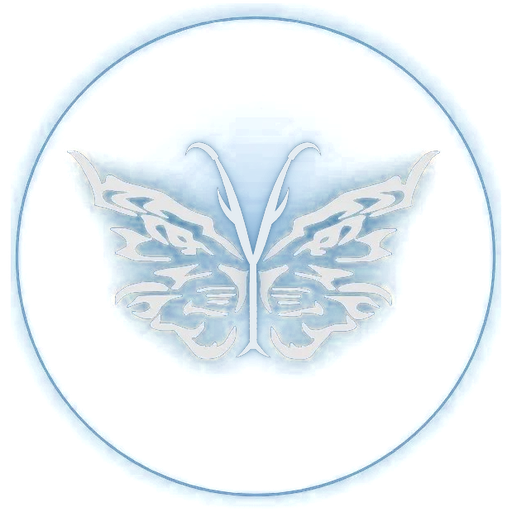

# The bitGen logo

Since 2.751.0, this is **the official bitGen logo**, used everywhere a logo appears (Tim: "make the new logo the official
bitgen logo, we use it for everything that uses a logo").



A tribal butterfly whose two wings are **two tigers facing each other**, and a **tree** growing up between them whose
branches are the butterfly's **antennae**: a butterfly, two tigers and a tree, all in one. White, with a blue glow, inside a
glowing ring.

## Which file to use

| Use | File |
|---|---|
| Anything new (master, transparent, 512 px) | `docs/images/logo-512.png` |
| README, the website (header, footer, favicon, admin) | `docs/images/logo.png` (256 px; the website copies it on refresh) |
| The app window and taskbar | `static/icon.png` (512 px) |
| The app's browser tab | `static/favicon.png` (64 px) |
| The Windows shortcut | `installer/bitgen.ico` (16 – 256 px) |
| Banner, link previews (the website's `og.jpg`) | `docs/images/bitgen-logo-1920x1080.png` |
| Vector: the butterfly + tree (the intro film draws it and adds the ring) | `static/logo.svg` |
| Vector: the small mark without the ring (the title bar, tinted) | `static/logo-mark.svg` |
| The intro (10 s) and the logo film with the credits (15 s) | `docs/images/bitgen-studio-intro.mp4`, `docs/images/bitgen-studio-splash.mp4` |
| The app's start-up splash (since 2.752.0): the bitGen brain film, the logo top left | `static/splash-neural.webm` (+ `static/splash-neural.jpg`, its picture) with `static/icon.png` |
| The brain film for the web, 1280 x 720 (the website's home page copies it) | `docs/images/bitgen-neural.mp4` |

## Making the files

All the picture files come from one source and one script, so they always match:

```
python3 misc/brand/make_logo.py       # docs/images/logo-source.jpg -> the PNGs, the .ico and the banner
node misc/intro/render.js             # the intro film (Playwright + ffmpeg)
node misc/intro/render.js --splash    # the 15 s logo film with the credits
python3 misc/brand/upscale_brain.py SOURCE.mp4   # the brain film: Tim's 960 x 544 clip -> the app's 1920 x 1080 + the web's 1280 x 720
```

The brain film is Tim's LTX clip, upscaled in 2.752.0 with Real-ESRGAN's small general model (realesr-general-x4v3,
BSD-3-Clause) so its titles are sharp. The script runs it with ONNX Runtime on the CPU - no PyTorch - and nothing in the
app uses it.

`docs/images/logo-source.jpg` is Tim's original picture (the navy disc). The script draws the tree on it in the wings'
style (tapered, pointed strokes, the same white and blue glow), keys the navy out to transparency and writes each size.
The tree in the two SVGs is the same shapes, mapped onto the SVG's wings.

## Colours

| | |
|---|---|
| The butterfly | white `#e4ecf2` |
| The glow and the ring | blue `#7fb3d8` |
| The name, "bitGen" | tiger orange `#f59e2c` |

On a light background the white butterfly does not show - put the logo on a dark one.
