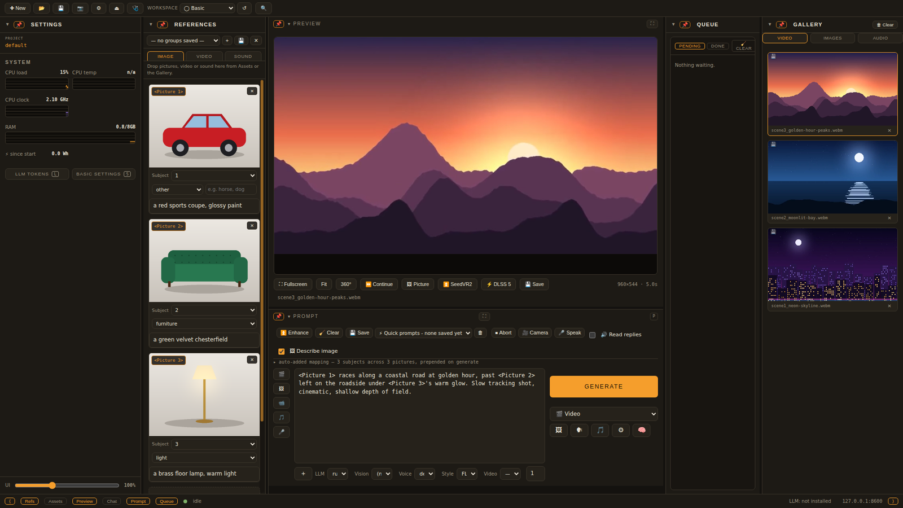
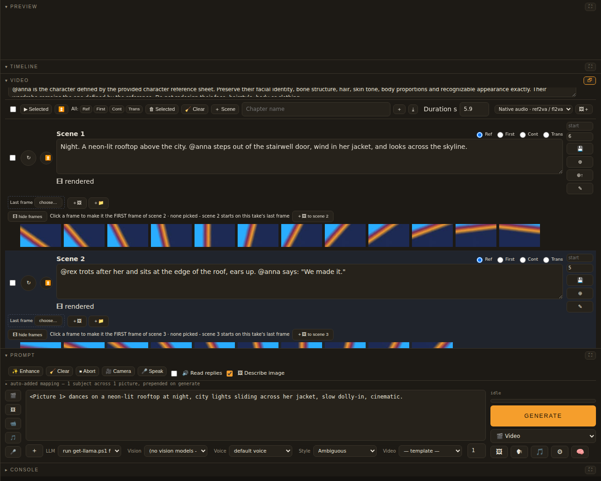
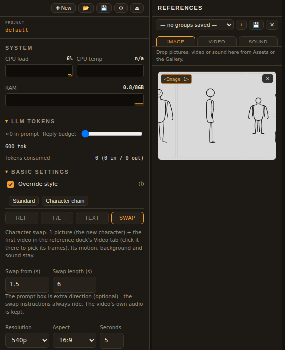
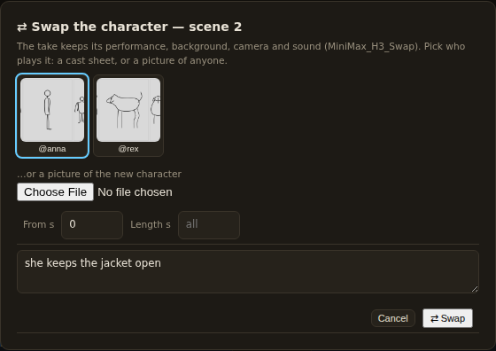
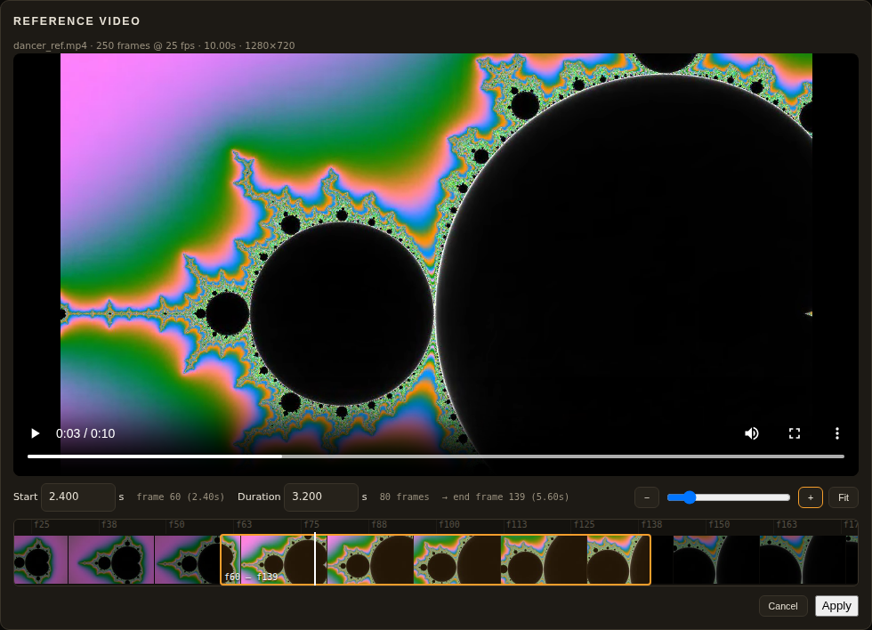
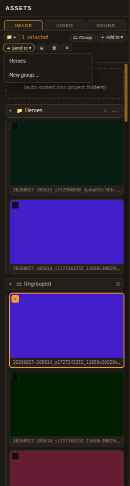
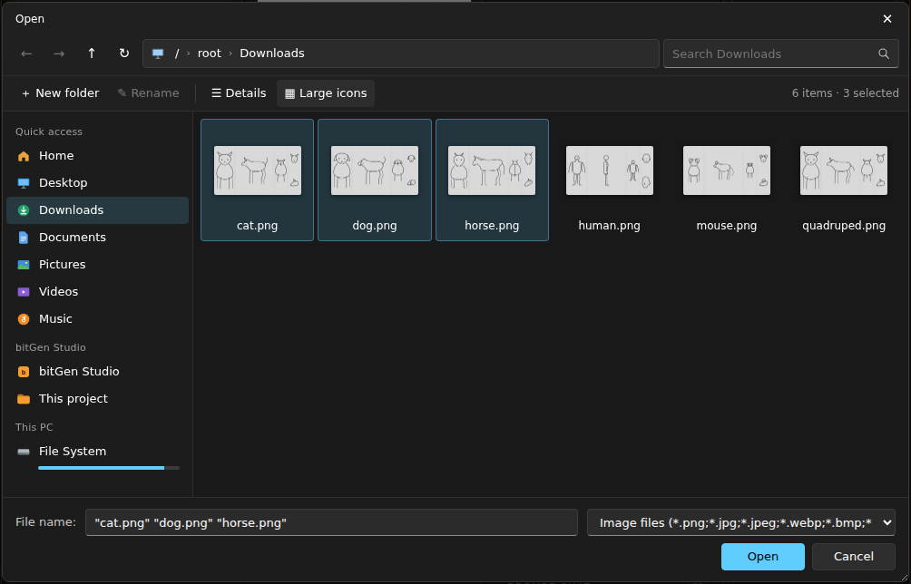

# Using bitGen Studio

A tour of the studio, from a single prompt to a finished film. If it is not
installed yet, start with [INSTALL.md](INSTALL.md).

- [The window](#the-window)
- [One clip from a prompt](#one-clip-from-a-prompt)
- [Characters](#characters)
- [A film on the scene board](#a-film-on-the-scene-board)
- [A music video](#a-music-video)
- [Character swap](#character-swap)
- [Choosing the frames of a reference video](#choosing-the-frames-of-a-reference-video)
- [Images, ControlNet and face fix](#images-controlnet-and-face-fix)
- [Music, stems and voices](#music-stems-and-voices)
- [Timeline and export](#timeline-and-export)
- [Projects, queue and gallery](#projects-queue-and-gallery)
- [The file dialog](#the-file-dialog)
- [Tips](#tips)

---

## The window



| Area | What it is |
|---|---|
| **Left** | system stats, and two buttons that show the floating **LLM tokens** (L) and **Basic Settings** (S) windows. Basic Settings holds the generation mode (Ref · F/L · Text · Swap), resolution, aspect, seconds, steps, CFG, seed, format, LoRAs, ControlNet, face fix |
| **References** | pictures, videos and sounds that ride the next generation (drag them in from Assets or the Gallery) |
| **Assets** | the project's images, videos and sounds — drop files here to import them |
| **Centre dockers** | Preview, Timeline, **Video** (the scene board), Music, Stems, Image editor, ComfyUI, **Prompt**, Prompt chat, Console |
| **Queue** | pending and finished jobs, with their logs |
| **Gallery** | everything you have rendered |

The buttons along the bottom show and hide each docker; every docker can be
collapsed (▾) or maximized (⛶ — Esc restores). The layout is remembered.

## One clip from a prompt

1. In **Basic Settings** (press **S** to show it) pick a mode:
   - **Ref** (ref2va) — up to 9 reference pictures; each tray slot is a
     `<Picture n>` you can refer to in the prompt (click the slot's badge to
     insert its tag). Videos and sounds in the References dock ride too.
   - **F/L** (fl2va) — one picture = the first frame, two = animate from the
     first to the last.
   - **Text** (t2va) — no references.
   - **Swap** — see [Character swap](#character-swap).
   - **Type** under each Ref picture (person, face, clothing, … , 2.340.0:
     **first frame**, **last frame**): set a picture's Type to **first frame**
     and Generate renders **First/Last** (fl2va) from it — to the picture typed
     **last frame** when there is one. The other pictures are not used (the
     console says so). Without a first frame the render stays **Ref**
     (ref2va, at most 9 pictures) and a lone last frame counts as an ordinary
     reference. LTX 2.5 styles use the same Types: the first frame goes first,
     the last frame last.
2. Choose resolution, aspect and **Seconds**. MiniMax H3 renders 24 fps; a clip
   longer than your card can do in one run is split and joined seamlessly.
3. Write the prompt and press **GENERATE** (the dropdown under it says what
   Generate makes: 🎬 Video, 🖼 Image, 🎶 Music, 🗣 Speech, ⚙ Graph, 💬 Chat).

`/br/` on its own line splits the prompt into several jobs that run one after
another. Press **Enter** in the prompt to have the local LLM improve it. **⏫ Enhance** upscales the
selected video (see *Upscaling a video with SeedVR2*).

## Characters

In the **Video** docker's **Characters** section:

- **NEW** — a character with a name, details, a **character sheet** (front /
  side / back picture) and optionally a **voice clip**. Its `@tag` (e.g.
  `@anna`) is how prompts and the screenplay refer to it.
- **🖼 NEW** — make a character *from one picture*: upload a photo or a render
  and a reference sheet is generated (your own pose sheet from the pose_sheets
  folder, photo or illustrated style), then **Keep** it.
- **🎭 Actors** — choose who is in the current scene; only they ride the
  references and the screenplay.
- Each character keeps a dataset folder for **RefMod** (identity models),
  clothing entries that follow the character from scene to scene, and its
  own voice for native-audio dialogue.

## A film on the scene board



1. **Workflow** (top of the StoryBoard): *Native audio · ref2va / fl2va* —
   each scene is its own clip with video **and** sound.
2. **Scenes**: type how many scenes you want, or leave it blank — then
   `projects\<name>\scenes.txt`, the number in your request, or the LLM
   decides.
3. In the prompt, press **🎬** (*create screenplay*) and describe the story,
   e.g. *create screenplay: Anna and Rex reach the rooftop at night…* The LLM
   writes the scenes onto the board, with the characters speaking their lines
   (`@anna says: "We made it."`). No song = a film: the model makes the
   dialogue, effects and ambience itself, in each character's cloned voice.
4. For each scene choose how it follows the one before:

   | | |
   |---|---|
   | **Ref** | a new shot from the references (character sheets, location pictures); on Native audio the previous take's end rides as a transition video |
   | **First** | starts **exactly** on a frame of the previous take (fl2va — no character sheets) |
   | **Cont** | opens on that frame **with** the cast sheets, so the character stays consistent |
   | **Trans** | travels from that frame to the new location's picture |

   **All:** sets every scene at once.
5. Press a scene's round **▶** to render it, or tick scenes and **▶ Selected**.
   Rendering continues in the background; you can keep editing.
6. Under each take is its **filmstrip** — click a frame to make it the first
   frame of the next scene.
   **✎ First frame (Qwen 2.1)** (2.337.0) — open the accordion under a scene's
   First / Last frame slots to *make* its first frame with Qwen Image 2.1:
   tick the **characters** (their sheets), pick a **📍 location** picture and
   up to three **🧸 props**, type a line of direction (or leave it empty to use
   the scene's own prompt) and press **✎ Make first frame**. **Start from**
   chooses the picture Qwen edits: the location (the characters are placed
   into it), **the frame the scene continues from** (same pose and position,
   the location changed — for Cont / First / Trans scenes), or the scene's own
   First picture; *Auto* picks the continue frame when there is one. The
   result lands in the scene's **First** slot (a Ref scene becomes First). It
   needs the Qwen Image 2.1 models (Setup → Models → Image editing).
7. The take bar under the board: **▶** watch · **✔** keep · **↻** redo ·
   **⇄** swap the character. **⏫** upscales a take you like with the ⚙
   upscaler (no new render).
8. **🎬 Compile** (at the top of the StoryBoard) joins the rendered takes
   into one film, in scene order. From 2.391.0 the board no longer has its
   own 🎬 Produce and ⇥ Timeline buttons.

The **info line** at the bottom of the StoryBoard is the same height as the
status bar. It shows the docker's latest message; hover it to read the whole
text.

**The Scenes dropdown (2.391.1).** The scene board (the shared prompt, the
scene menubar and the scene cards) sits in a **Scenes** dropdown like
Characters and Locations. Click its title to open or close it; the title
counts the scenes and how many are rendering.

Inside it, the **scene picker** above the cards shows **All scenes** or just
one scene's card. Each scene is listed with its state (⏳ rendering,
● rendered, ✔ kept, ✕ failed) and the first words of its prompt. **◀** and
**▶** step to the previous or next scene. The picker remembers your choice.

While a scene renders, its card
says **rendering step n of total**, with a progress bar and the time so far.
Before the first step it says **rendering - loading the models**.

A full **PDF guide** with every shortcut key is in `docs\bitGen-Studio-Guide.pdf`.

**⚙** (render settings) sets the scenes' size, steps, LoRAs, the Sage /
Spectrum / Comfy Kitchen accelerators, the upscaler and the tail frames used
for continuity. **🆕 New / 💾 Save / 📂 Load** at the top of the StoryBoard
start, save and reload whole movies (cast, chapters, scenes and renders).

## A music video

1. **📂 Load** a song (or pick it in the **Audio** dropdown). Its waveform
   opens auto-segmented; adjust the cuts and **💾** — one scene per segment,
   each with its start and duration.
2. Press **🎤** (*create music video*) in the prompt dock and describe it;
   the writer uses the song's segments as the scenes and makes the characters
   sing their lines.
3. Every scene lip-syncs its own window of the song.

## LTX 2.5 (first / last frame, lipsync, audio to video)

LTX 2.5 renders through Tim's **LTX 2.5 All-In-One** canvas
(`comfy_workflows/LTX25_All_In_One.json`), one mode per clip. Pick the
**LTX 2.5** video style (Settings → Video styles has it as a starter).

**From the prompt dock.** With the LTX 2.5 style picked, two dropdowns appear
beside the template list:

- **LTX mode** — *Auto* picks from what the reference dock holds:

  | reference dock | mode |
  |---|---|
  | a video (+ picture 1) | video to video (style transfer, pose from the video) |
  | audio + 3 pictures | first / middle / last (pictures 1, 2, 3) |
  | audio + 2 pictures | first / last lipsync |
  | audio + 1 picture | lipsync (picture 1 sings the audio) |
  | audio only | audio to video |
  | 2 pictures | first / last frame |
  | 1 picture | image to video (picture 1 is the first frame) |
  | nothing | text to video |

  Or choose the mode yourself; a mode missing its pictures / audio says what
  to load. Only the first audio and the first video in the dock are used.
- **Transition** — the *ltx2.3-transition* LoRA. *Auto* turns it on only for
  the modes that travel between pictures (first / last, first / last lipsync,
  first / middle / last).

The **Seconds**, **Width / Height** (rounded to multiples of 32) and **Seed**
fields apply; clips are 24 fps, 1–30 s.

**On the scene board.** Set the StoryBoard's **Workflow** to **LTX 2.5**.
Each scene's card decides the mode:

| scene | no song | with the board's song |
|---|---|---|
| **Ref** (nothing set) | text to video | audio to video |
| **First / Cont** (or a First picture) | image to video from that frame | lipsync on the scene's slice of the song |
| **Trans** (or a Last picture) | first / last frame: from the continue frame to the Last picture (else the location picture) | first / last lipsync |

**Which workflow runs (2.401.5).** *Text to video*, *image to video* and
*first / last frame* run on **Comfy-Org's own LTX 2.5 templates**
(`comfy_workflows/ltx25_official_t2v.json`, `_i2v`, `_flf2v`). They use only
nodes built into ComfyUI, so nothing has to be installed from the Manager.
The app fills them in for you: your prompt, seconds, size, seed, the picture(s),
your style's LoRAs and negative. If your model is the GGUF, it is loaded with
ComfyUI-GGUF. They need ComfyUI's LTX 2.5 files: the transformer (int8 or the
GGUF), the Gemma 4 12B text encoder, the video and audio VAEs, and the x2
upscaler (first / last frame does not need the upscaler). If one of them is
missing, the job log says which one and the canvas renders the clip instead.
The canvas keeps the modes only it has (audio to video, lipsync, first / last
lipsync, first / middle / last, style transfer), LTX Ripple, the timeline
camera's exact path, and the *Transition* LoRA when you set it to *On*.
The job log shows which workflow ran: "on Comfy-Org's own template …" or
"converted LTX25_All_In_One.json …".
Keep ComfyUI up to date: the templates use newer core nodes (TextGenerateLTX2Prompt, ComfySwitchNode,
ResizeImageMaskNode).

✎ First frame (Qwen 2.1) works here too — make the opening picture, then
render. @tags in the prompt become the characters' names (LTX has no
reference sheets; the look comes from the first frame). **⏫** upscale is not
available on LTX takes yet.

**Models and nodes.** *Settings → Models → ⤓ Model catalog* (or the setup
wizard's Models page) → *Video - LTX 2.5*:
- the Q4_K_M GGUF (15 GB, what the canvas loads) or the int8 model;
- the Gemma 4 12B text encoder and the Gemma 4 E2B one;
- the video / audio VAEs, the TAE preview VAE and the spatial upscaler;
- (2.341.0) the canvas's LoRAs: OmniNFT RL, Transition, IC-LoRA Union Control
  (style transfer), IC-LoRA Detailer, and LTX Ripple.

The Lightricks repos are gated: accept their licences on Hugging Face and
put your token in the catalog. **Download with** the Hugging Face CLI
(**Install hf CLI** adds it) for the big files. The canvas needs the
node packs ComfyUI-GGUF, KJNodes, VideoHelperSuite, rgthree, mxToolkit,
Easy-Use and controlnet_aux (Setup → Node packs); a missing one is named, with
its pack, when the job starts. Since 2.401.2 the canvas no longer needs ComfyMath
(it has gone from GitHub) or the pysssss math node: its number conversions and
formulas run on ComfyUI's own **Math Expression** node. If you re-export the
canvas from your own ComfyUI with those nodes still in it, the app converts them
when the job starts. Since 2.401.3 it no longer needs ComfyUI-MediaMixer either:
its "last frame" pick runs on KJNodes (Get Image Range From Batch), which the
canvas already uses.

Every video job (MiniMax H3, Wan, LTX, the swap, Viggle, SeedVR2) now shows
ComfyUI's live progress: which node is running and "step n of total" while it
samples. A long silence with "running UNETLoader" or a loader node means
ComfyUI is still loading the model; Wan 2.2's two 14B models can take several
minutes the first time.

## LTX 2.3 and 3D render → real (Blender → photoreal)

Pick the **LTX 2.3** video style (Settings → Video styles has it as a starter). It runs **Comfy-Org's own LTX 2.3
templates**, which use only nodes built into ComfyUI (`comfy_workflows/ltx23_official_*.json`). It has four modes. The
LTX mode dropdown shows only these, and *Auto* picks by what's in the reference dock:

| reference dock | mode |
|---|---|
| a video | **3D render → real**. The video is a render (Blender, a game viewport, any CG clip); fal's **3DREAL** IC-LoRA turns it photoreal with the same layout and camera move. A picture as well = a real first frame (optional). |
| 2 pictures | first / last frame |
| 1 picture | image to video (first frame) |
| nothing | text to video |

Lipsync, audio to video, first / middle / last and style transfer are LTX 2.5 canvas modes. Pick the LTX 2.5 style
for those.

**3DREAL** (huggingface.co/fal/LTX-2.3-3DREAL-LoRA): the select beside the mode picks the variant:

- *strong v2*: the newest (several scenes, audio, better faces);
- *strong*: a harder photoreal push;
- *light*: faithful and gentle;
- *Auto*: the newest one ComfyUI has.

bitGen puts the LoRA's trigger at the front of your prompt ("3DREAL. Make it photorealistic. …"). Describe what the
shot should look like: materials, light, weather, time of day.

**From Blender** (bitgen-blender-addon 1.1): lay the scene out in Blender, then use **sidebar (N) → bitGen → Render
scene (LTX 2.3 · 3DREAL)**. Grey boxes and a camera move are enough. The settings:

- **Looks like**: the prompt.
- **Engine**: *Solid* (the fastest; a blockout is enough), *EEVEE*, or the scene's own engine.
- **3DREAL**: the variant.
- **Strength**: how strongly the render guides LTX (1 = the LoRA's own).
- **Max seconds**: the length cap.
- **Render in bitGen**: when ticked, the job is queued straight away.

**🎬 Render scene → bitGen** renders the frame range through the **scene camera**. The long side is at most 1280,
both sides are multiples of 32, and the output is H.264 .mp4. It's sent to the open project as **Video assets →
blender_<name>.mp4**, and when *Render in bitGen* is ticked the LTX 2.3 job starts at once. Every render setting in
Blender is put back afterwards. Untick *Render in bitGen* to send only the render, then put it in the reference dock
yourself (add a real first picture if you like).

**Models** (*Settings → Models → ⤓ Model catalog → Video - LTX 2.3*), in ComfyUI's folders:

- **checkpoints**: `ltx-2.3-22b-distilled-fp8` runs every mode. Add `ltx-2.3-22b-dev-fp8` +
  `ltx_2.3_22b_distilled_1.1_lora…` (loras) to run text / image the way Comfy-Org's template does.
- **text_encoders**: `gemma_3_12B_it_fp4_mixed`.
- **latent_upscale_models**: `ltx-2.3-spatial-upscaler-x2-1.1` (text / image).
- **loras**: `3DREAL-strong-v2` / `3DREAL-strong` / `3DREAL-light`, and optionally the Gemma "abliterated" LoRA (left out
  when it is missing).

The job log names the checkpoint, the encoder and the 3DREAL file it used, and says what it left out. Keep ComfyUI up
to date: the templates use its newest LTX nodes (GetICLoRAParameters, LTXVAddGuide, LTXAVTextEncoderLoader).

### A .blend in the preview canvas: look around, edit, render a segment to real

Click **🟧** in the timeline canvas's tools and pick a `.blend`. Blender (headless) reads it and the scene appears over
the preview canvas, framed at the scene's render size. bitGen works on a copy: `<project>/blender/<name>.tmp`. The
original isn't touched until you save to it.

- **🎥 Scene camera** looks through the scene's active camera, with its animation playing. **🧭 Free view**: drag to
  orbit, right-drag or Shift-drag to pan, the wheel to zoom, **F** to frame everything.
- **Zoom** (2.546.0): **🔍＋ / 🔍－**, or **Alt+drag** - forward (up) zooms in, back (down) zooms out. **⌖ Zoom to object**
  (or **Z**) brings the view to the picked object from the side you are looking from; with nothing picked it frames the
  whole scene. Zooming from the 🎥 Scene camera switches to the free view at the camera's place first.
- **Select** an object by clicking it, or in the object list in **Tools & Properties** (key 1). **G / R / S** (or ✥ ⟲
  ⤡) switch the widget between move, rotate and scale. The Properties also take X / Y / Z (Blender's axes) and a size.
- **Edits**:
  - Moving an object that Blender animates puts a **key** at the current frame. Moving any other object gives it a new
    place. Tick *Auto-key every move* to key everything.
  - **◆ Key** keys the object here, **✕ Key** removes this frame's key, and the key row (◇ Blender's, ◆ yours) jumps
    to a key.
  - **⧉** duplicates, **◌ Hide** / 👁 hides it in the render, **🗑** deletes, **↺** drops its edits.
  - **Ctrl+Z** undoes. The preview plays between keys in straight lines; Blender eases them.
- **Segment**: scrub the frame bar, then **[ In** and **Out ]**. The bar shows the length; LTX takes up to 30 s.
- **Save to** (in the Properties):
  - *Only in bitGen*: `<project>/blender/<name>.blend`.
  - *Write back to the original .blend*: Blender keeps the old one as `.blend1`.
  - *Copy to a new file*: `<name>_bitgen.blend` beside the original.

  **💾 Save** always writes the project's `<name>.blend` as well, and bakes your edits into the working copy.
- **Render to real**: pick the camera (*the scene camera*, or *this view* for a still camera where you are looking),
  the engine (*Solid* is enough for a blockout), the look, the 3DREAL variant and strength, then **🎬 Render to real**.
  Blender renders the segment to **Video assets → blender_<name>_<in>-<out>.mp4**, and with *Render in bitGen* ticked
  the LTX 2.3 3DREAL job is queued, as with the add-on's Render scene.
- ✕ returns to the timeline canvas. The scene stays open; 🟧 brings it back. **⟲ Reload** drops your edits and reads
  the .blend again.

Blender must be installed (🟧 Blender settings has its path).

### ✨ Build a scene with AI, and 3D models from pictures

The local LLM can lay out a 3D scene for you. Open **🟧** (with no scene open you get **📂 Open a .blend** and **✨ Build
a scene with AI**; with one open, **✨ New scene with AI ▸** sits at the top of the Properties). Describe the shot (what is
there, what moves, how the camera moves), set the length, and press **✨ Build**:

1. The LLM writes a **plan**: every object as a known kind (car, truck, tree, house, building, road, person, dog, lamp
   post, bench, table … 58 in all) with its size in metres, its place, its turn and its colour, what moves when, and the
   camera's path. It never writes code. A reply that isn't a plan is asked for again once.
2. Things no kind fits (an animal, a statue, a special vehicle, a character) become **3D models**. Each is first drawn
   as a picture with the image style picked in Basic Settings (alone, on white), then turned into a .glb in ComfyUI.
   *Max 3D* caps how many; untick *3D models* to draw everything from simple shapes. These are normal jobs in the queue.
3. Blender builds `<project>/blender/ai/<title>.blend` (the plan is saved beside it as `<title>.plan.json`) and it opens
   in the preview: look around, move things, key them, then **Render to real**. Building the same title again makes
   `<title>_2.blend`; nothing is overwritten.

If a picture or a 3D model can't be made, that object becomes a simple stand-in of its kind and the log says why; the
scene is still built. **■ Stop** stops a build.

**Image to 3D** (ComfyUI's own nodes, Comfy-Org's templates):

| choice | what you get | files (Settings → Models → ⤓ Model catalog → **3D models**) |
|---|---|---|
| **Hunyuan3D 2.1** (default) | the shape, no colours; 3DREAL paints the real look anyway | `hunyuan_3d_v2.1.safetensors` (checkpoints), `birefnet.safetensors` (background_removal - cuts the object out first, optional) |
| **TRELLIS.2** | shape + baked texture, slower | `trellis_2_int8_convrot` (diffusion_models), `trellis_2_shape_vae_bf16` + `trellis_2_texture_vae_bf16` (vae), `dino_v3_L_naf_fp32` (clip_vision), `birefnet` |

*Auto* uses Hunyuan3D 2.1 when it's there, otherwise TRELLIS.2. A missing file is named in the job's log.

**🧊 on any picture**: every picture in the Gallery (Images) and the Assets dock (Images) has a 🧊. Pick Hunyuan3D or
TRELLIS.2 and the .glb lands in the project's `models3d/`. From there, **＋ Model** in the .blend preview's Properties
adds it to the open scene (1 m tall, standing where the view looks; scale it with S or the Size box) and 💾 Save puts it
into the .blend. The timeline's 🧊 3D layers can use the same files.

Licences: Hunyuan3D 2.1 is under Tencent's Hunyuan 3D community licence (it excludes the EU, the UK and South Korea);
TRELLIS.2's code is MIT (some of its parts carry their own licences). Check each model's licence before commercial use.

### Daz Studio → bitGen (the bitGen Bridge script)

**Install** `bitgen-daz-bridge-v1.0.0.zip`: copy its `Scripts` folder into one of your Daz content libraries (for example
*Documents/DAZ 3D/Studio/My Library*). In Daz Studio, open **Content Library → (your library) → Scripts → bitGen** and
double-click **bitGen Bridge**. To keep it handy, drag it onto a toolbar with *Window → Workspace → Customize*. It works
with Daz Studio 4.2x and Daz Studio 2025 / 6. bitGen Studio must be running on the same computer; **Test connection**
checks it.

The bridge window (it has its own title bar) offers five sends:

| send | what bitGen does |
|---|---|
| **Render the animation → real** | Daz renders the timeline's play range with *your* render settings (Iray, Filament or 3Delight; Filament is quick). The frames become `daz_<scene>.mp4` in Video assets (long side 1280, up to 30 s). With *Render in bitGen right away* ticked, LTX 2.3 · 3DREAL renders it real, using your *Looks like* text, the 3DREAL variant and the strength. |
| **Render this frame → a picture** | Goes into the Gallery and Images assets, ready for references, first frames or 🧊 3D. |
| **The scene as 3D → open in bitGen's preview** | Daz exports FBX: figures with their rig and animation, props, and lights / cameras as ticked. Blender turns it into `blender/daz/<scene>.blend` and it opens in the 🟧 preview, where you can edit it and render it to real. |
| **The scene as 3D → merge into the scene open in bitGen** | bitGen opens the **Merge** dialog (see below). |
| **The selected figure / prop → a 3D model** | Saved to `models3d/<figure>.glb`, to use with ＋ Model in the preview. Tick *also add it as a 3D layer* to put it on the timeline too. |

**The Merge dialog** pops up in bitGen when a Daz scene arrives to be merged while a .blend is open in the preview. You
can drag it by its title bar; ✕ or Esc closes it and keeps the scene waiting. It lists the Daz scene in three groups:
**Figures & objects**, **Lights** and **Cameras**. Each item has a tick, and each group has *all* / *none*. Then choose:

- **Scene camera**: keep the scene's own camera, or use one of the ticked Daz cameras.
- **Stretch the frame range**: extend the scene to cover the Daz animation.

**Merge** appends the ticked items, each with everything under it (a figure's body and clothing come with its rig), into
a "Daz" collection in the open .blend. Daz animation is respaced to the scene's frame rate, for example 30 fps into a
24 fps scene, and the preview reloads. **Open on its own** opens the Daz scene by itself instead. **Cancel** drops it.

The 3D sends need Blender (bitGen finds it; *🟧 Blender settings* has its path). The bridge sends only the paths of the
files Daz wrote, so Daz and bitGen must run on the same computer. It uses curl, which Windows 10+ and macOS include.

## Editing on the timeline: speed, colour, sound, mix and captions (2.406.0)

Select a clip on the timeline canvas; its **Properties** get three folds. Everything is saved with the timeline, the
canvas previews it, and **⚙ Compile** renders it.

### 🎬 Speed

| control | what it does |
|---|---|
| **Speed %** | 50 = half speed (twice as long on the timeline), 200 = double speed (half as long); 10 – 1000 % |
| **⇄ reverse** | the clip plays backwards |
| **Ramp** | the speed changes along the clip: *slow → fast*, *fast → slow*, *slow middle*, *fast middle* (it replaces Speed %) |
| **Frames** | how slowed frames are made: *repeat* (crisp, steppy), *blend* (neighbours mixed), *optical flow* (smooth; slow to compile) |

The clip's length on the timeline follows its speed. The trim edges still trim the *source*, and keep / cut on a
retimed clip keep the right frames. In the canvas a reversed or ramped clip plays silently (a browser cannot play
sound backwards); the compile renders its sound at the speed (the pitch is kept).

### 🎨 Colour

- **Look**: teal & orange, warm film, cool night, bleach bypass, vivid, faded, mono - a starting point for the sliders.
- **Sliders**: exposure (stops), contrast, saturation, temperature (blue ↔ amber), tint (green ↔ magenta), hue.
- **LUT**: any 3D `.cube` LUT (from a camera maker, a colourist or a LUT pack). **＋ LUT** imports one into the
  project's `luts/` folder; LUTs in the app's own `luts/` folder are offered in every project. **LUT mix** blends it.

The LUT is applied first, then the sliders. The canvas shows the grade with the very table the compile uses (the whole
look is baked into one 33-point LUT), so what you see is what you get.

### 🎧 Sound

On a video clip or a sound clip: **voice clarity** (cuts the rumble, adds a little presence and evens the level),
**denoise** (steady background noise: hum, hiss, fans) and **gain** (dB). **🎧 before / after** plays a few seconds from
the position marker, first as it is, then cleaned up.

### 🎚 Mix

The timeline's **🎚** opens the Mix dialog:

- **Roles**: each layer is 🗣 *voice*, 🎵 *music* or 💥 *sfx* (V1 and video layers start as voice, sound layers as music).
- **Ducking**: the music dips by the chosen amount (3 – 30 dB) whenever a voice speaks, then comes back.
- **Loudness**: the finished movie is measured and evened out to a target: -14 LUFS (YouTube, Spotify), -16 (podcasts,
  Apple), -23 (broadcast, EBU R128) or -24 (US broadcast). The true peak stays under -1.5 dB.

### 💬 Captions

The timeline's **💬** opens the Captions dialog.

1. **✨ From speech** transcribes everything that speaks (V1, the video layers, and any sound layer set to 🗣 voice) on
   this computer with faster-whisper (*Settings → Audio* installs it) and makes the captions - each clip's words placed
   where the clip sits, its trim and speed included. Each file is transcribed once and remembered. *max chars* sets how
   long a caption may be; *language* can be left on auto.
2. Edit them: the start and end times, the words, **＋** a caption at the position marker, **✕** to remove one, **▶** to
   jump there.
3. **Style**: font, size (% of the picture's height), colour, bold, an outline or a **box** behind the words (colour and
   opacity), bottom / middle / top and the margin.
4. **Output**: *burn into the movie* and / or *.srt beside it* (the movie's name with `.srt` - players and YouTube take it
   as a subtitle track). **⬇ .srt** downloads them now. Untick *on* to keep them without using them.

The canvas draws the captions where the compile burns them.

## Edit tools, colour panel, export queue and exchange (2.407.0)


### Edit tools

The timeline's tool buttons: **▸ Select** (move, trim - as before), **⇤ Ripple** (drag an edge: trim it and move
everything after it on that layer), **⇹ Roll** (drag the edge between two touching clips: the cut moves, the total stays),
**⇆ Slip** (drag a clip: it shows other frames of its source, same place and length) and **↔ Slide** (drag a clip: it
moves, the clips either side give and take). A tip beside the pointer shows what the drag will do. Zoom in so each edge
has its own handle. A reversed clip can't be edited with these (its edges run backwards).

**J / L cuts** (V1): in a V1 clip's 🎧 Sound, *J … s early* starts its sound before its picture, *L … s late* runs it on
after; the neighbour's own sound is silenced for that stretch.

**Timecode**: HH:MM:SS:FF beside the position. The start (for example 01:00:00:00) and the frame rate are set in 📤 Export
or ⇄ Exchange.

### 🎨 Colour panel

The timeline's 🎨 (or *🎨 more…* in a clip's Colour fold) opens the Colour dialog for the selected clip:

- **Wheels**: Lift (shadows), Gamma (mid-tones), Gain (highlights). Drag the puck toward a colour; the slider under
  each wheel makes that range darker or brighter; double-click a wheel to centre it.
- **Curves**: Master, R, G, B. Click to add a point, drag to move it, double-click to remove it.
- **HSL secondaries**: up to six hue ranges, each shifted, (de)saturated or lightened on its own (bluer skies, warmer
  skin, calmer greens) - the rest of the picture is untouched.
- **Scopes**: waveform, RGB parade, vectorscope and histogram of the picture at the position marker, as the movie gets it.

All of it is baked into the same colour table as the looks and LUTs, so the canvas and the compile match.

### 📤 Export

Add every format the movie should come out in - one compile makes them all, beside `<project>.mp4`:

| format | for |
|---|---|
| MP4 · H.264 | everywhere |
| MP4 · H.265 / HEVC | about half the size; newer players |
| MOV · ProRes 422 HQ | editing and finishing (large) |
| MOV · DNxHR HQ | Avid, Resolve (large) |
| WebM · VP9 | the web |
| GIF | previews (no sound, 15 fps, 640 wide at most) |
| WAV, MP3 | the sound only |

Each has a **size** (the short side), a **reframe** (9:16, 1:1, 4:5, 21:9 - *crop* the middle, *pad* with black or a
*blur*: a blurred copy behind), a **frame rate** and a **quality**. The packs add a few at once (*social*, *for editing*, *web*).
*make them on every ⚙ Compile* keeps the list on; **⚙ Compile + export** runs it now. **Delivered** lists the files to
download. The start timecode is written into MP4 and MOV files; the captions' `.srt` goes beside each movie.

### ⇄ Exchange

- **Send to another editor**: *Final Cut Pro 7 XML* (opens in DaVinci Resolve, Avid and most other video editors), *CMX3600 EDL*
  (V1 only - the format holds one picture track) or *OpenTimelineIO*. The clips point at the files in this project.
  Kept: clips, trims, layers, stills, speed and reverse, opacity, volume, the timecode. Not carried: moves and
  keyframes, the colour grade, captions, 3D layers.
- **Bring in from another editor**: pick an XML (most editors: *File → Export → Final Cut Pro XML*; Resolve: *Export
  Timeline → FCP 7 XML*) or an EDL. It opens as a new named timeline; clips are matched by file name in this project's
  assets, and any that are missing are listed (add them, then import again).

## Edit by transcript, scene cuts, karaoke word fixes (2.408.0)

### 📝 Transcript

Select a video or sound clip on the timeline, then press the timeline's **📝**. The clip's words appear: its file is
transcribed once on this computer (faster-whisper, *Settings → Audio*) and remembered, the same as for 💬 Captions.

- **Choose words**: click them, shift-click for a run, or drag across them. Double-click a word to jump there.
- **✂ Cut them**: the chosen words are taken out and the gap closes; the clips after it on that layer move up.
- **⇥ Keep only them**: everything but the chosen words is taken out.
- **Remove pauses over … s**: every silence longer than that (the end of the clip included) is cut down to 0.3 s.
- **Remove filler words**: um, uh, erm, hmm and the like (shown in italics) are taken out.
- **↺ Undo** puts back the last cut. The clip becomes pieces of the same file, and the transcript keeps following them,
  so you can keep cutting.
- **✂ Scene cuts** splits the clip wherever its shots change. Lower the *sensitivity* number to find softer changes.

A clip with a changed speed (🎬) has to go back to 100 % before it can be cut by words.

### 🎤 Karaoke: wrong words

- **✎ Edit lyrics**: if a song has no lyrics on file, the box now shows the words speech-to-text heard - the same words
  the karaoke showed - so you can correct the wrong ones (or paste the real lyrics). **Generate** saves them and times
  them against the song again.
- **⏱ Words & timing**: every word the overlay will show, with its start and end. ▶ plays a word. Correct a single word
  or nudge its timing here; **Generate** keeps your corrections for that song (*↺ undo my corrections* removes them).
  Changing the lyrics later starts again from the new lyrics.
- **💾 Save words** keeps the corrections for the song without making an overlay now.
- **From the StoryBoard**: the **✎** beside 🎤 Karaoke opens this dialog on the board's song. After **💾 Save words**,
  every scene that already has a lyrics overlay gets it remade with the corrected words (and the new one replaces the
  old on the timeline's Karaoke layer).

## Override style for every video model (2.409.0)

With **Override style** ticked at the top of Basic Settings, Basic Settings decide for **every** video model - MiniMax
H3, Wan 2.1 / 2.2 and LTX 2.3 / 2.5 - whatever the style says:

| setting | what it does with Override style on |
|---|---|
| **Steps** | that many steps (0 = the model's own). LTX's 8-step schedule is re-drawn with that many steps on the same curve; its short refine pass stays |
| **CFG** | the guidance (LTX: its CFG guiders, LTX 2.5's video CFG - the audio CFG stays) |
| **Seed** | -1 = random, any number = that seed |
| **Model** | the new *Model (override)* box: any model ComfyUI lists; blank = the style's own. Wan 2.2: the high-noise model (the low-noise one stays). A `.gguf` file is loaded with ComfyUI-GGUF's loader |
| **LoRAs** | the *Temporary LoRAs (video)* are added on top of the style's |

The line under the switch says what it is deciding right now. Unticked, each style's own settings rule, as before.
Generate takes the prompt docker's text; the chat's ⬇ To prompt / ▶ buttons and Enhance's **Generate** send theirs the
same way (Enhance's Generate used to fail with an LTX style). The scene board's ▶ also uses the model, steps and CFG
(its scenes keep their own seed rule from the StoryBoard's ⚙). LTX models are distilled for 8 steps and CFG 1 - more
steps or a higher CFG changes the look and takes longer.

## ✨ Effects and ◐ adjustment layers (2.409.0)

**✨ Effects** (a video clip's Properties): blur, sharpen, glow, vignette, grain; **crop** (each edge in %, made
see-through - the picture stays in place); **key** (a green or blue screen: pick the colour, *match* = how close still
keys, *edge* = a soft edge, *spill* = removes the screen's cast from the edges - the layer under it shows through);
**stabilise** (steadies a shaky shot in the compile). The canvas shows the key and the crop exactly and the others
closely.

**◐ Adjustment layer** (the timeline's toolbar): adds a clip on a new top layer at the position marker. Its 🎨 Colour
(looks, sliders, LUTs, wheels, curves, HSL) and ✨ Effects (blur, sharpen, glow, vignette, grain) work on everything
under it, only while it is on the timeline. Trim, move and fade it like a picture; its opacity mixes the adjustment in.

## 🎤 Karaoke: word nudges, the line under the marker (2.433.0)

In 🎤 Karaoke ▸ **⏱ Words & timing** every word has **◀ ▶** (earlier / later) - the word's start and end move together:

| | moves | by |
|---|---|---|
| click | that word | the **nudge** (0.05 s) |
| **Shift**+click | that word | the **larger nudge** (0.25 s) |
| **Ctrl**+click (⌘ on a Mac) | that word **and every word after it** | the nudge |
| **Shift+Ctrl**+click | that word and every word after it | the larger nudge |

The two amounts are the boxes above the list (**Nudge** / **Shift**) - kept for next time. Nothing moves before 0 s:
a move that would is cut short for every word it moves, so their spacing stays (the note says by how much they moved).
Generate (or 💾 Save words) keeps the new times for the song.

**The line under the marker** is lit - every word of the line being sung where the preview marker is (or the next line
when it starts within 1.5 s); the word being sung is lit brighter, and 👁 on canvas draws the same line.

## 🎤 Karaoke and 🧰 Tools as dockers beside the canvas (2.410.0)

Both are **dockers** now, not dialogs. Drag one by its titlebar to the preview canvas's **left or right edge** (that
side lights up) and let go - or click **◧** / **◨** in its titlebar. Docked, it is as tall as the canvas and the canvas
makes room; drag the column's inner edge to make it wider. Drag the titlebar away (or click the lit ◧ / ◨) and it floats
again. The first time 🎤 Karaoke opens it docks on the right (when the canvas is wide enough), so the song can play
while its words are corrected:

- in **⏱ Words & timing** the word being sung is lit and the list follows the preview;
- a word's **time** is a button that puts the preview on it;
- **⤓** beside a start / an end sets it to where the preview is;
- **👁 on canvas** draws the corrected words over the preview (the canvas only, never the movie).

**Space** pauses the preview anywhere in the app - the canvas, the live preview or a video in the Preview docker - unless
you are typing in a box. Paused, it plays again.

## ⌨ Timeline keys, markers, In / Out export, frames (2.410.0)

With the pointer over the timeline's **layers** (the canvas keeps its own keys):

| Key | Does |
|---|---|
| V / B / N / Y / U | ▸ Select / ⇤ Ripple / ⇹ Roll / ⇆ Slip / ↔ Slide |
| I / O | In / Out of the ruler selection at the position marker |
| Ctrl+K | split at the position marker (the selected clip, else the highlighted layer's) |
| ↑ / ↓ | previous / next edit point |
| Home / End | the start / the end |
| M | a marker (on a marker: its name, colour, comment) |
| Shift+M / Alt+M | next / previous marker |
| Ctrl+Shift+E | the frame at the position marker as a PNG (over the canvas too) |

**Markers** are flags on the ruler: click = go there, drag = move, double-click = name / colour / comment / 🗑. 📝 ✂ Scene
cuts **as markers** drops one at every shot change instead of cutting. They travel in ⇄ Exchange (XML `<marker>`, EDL
`* LOC:`, OTIO markers) both ways.

📤 Export's **Range**: *the whole movie* or *In / Out only* - every format then holds just the ruler selection
(`<project>_<format>_io.<ext>`), its timecode starts where the part starts, its .srt is cut to the part. **🖼 Export
frame** saves the picture at the position marker as `<project>_frame_HHhMMmSSsFF.png` beside the movies.


## 🅰 Text effect presets (2.411.0)

A text layer's Properties (timeline) and the image editor's Type tool / text Properties have **Preset**: text effects
made from layered PSD text effects - **Arena Gold 3D** and **Trend Candy 3D** come with the app - plus the classic
looks. The words are drawn with the preset **live as you type** (a quick picture while they change, the sharp one when
you stop); ⚙ Compile always uses the sharp one. **＋ Import a PSD text effect…** turns your own PSD (the word as a smart
object with layer effects) into a preset; backgrounds and decorations are left out. Fonts are not inside a PSD: the note
under Preset names the one it used. From the command line: `node scripts/textfx_build.js <file.psd> "<Name>"` writes a
built-in preset to `textfx/`.

## ⏯ J / K / L, AV1, 10-bit, the graphics card (2.411.0)

| Key (anywhere in the timeline docker) | Does |
|---|---|
| L | play forwards; again 2×, 4×, 8× |
| J | play backwards; again 2×, 4×, 8× (stops at the start) |
| K | stop |
| K + L / K + J | one frame on / back (hold K) |

📤 Export adds **MP4 · AV1** and **MP4 · H.265 10-bit** (and the *smallest* pack). **use the graphics card's encoder when
it has one** makes H.264 / H.265 / AV1 with NVENC, Quick Sync or AMF when one works here, else the software encoder - the
log says which.

## ⏱ Smaller editing jobs (2.412.0)

- **Drop-frame timecode** (29.97 / 59.94): 📤 Export / ⇄ Exchange → *drop-frame*; HH:MM:SS;FF in the files, XML (DF),
  EDL (FCM: DROP FRAME) and the timeline readout.
- **Marker ranges**: the marker editor's *length* (or ⟦ ⟧ = the ruler's In / Out); drag the band's end. **Clip markers**:
  Ctrl+Shift+M on the selected clip - they stay on their frame through trims, slips, speed and reverse.
- **◎ Track targets**: Ctrl+K with no clip selected splits every targeted layer.
- **🔗 Linked sound**: Properties → 🔗 Sound → ⤓ as its own clip; 🔗 linked selection (menu bar) moves the pair together;
  ⛓ Unlink / ↩ Sound back.
- **J / L cuts** on V2+ layers and on retimed clips.
- **🎧 EQ / multiband / reverb** in a clip's Sound section.
- **🎨 H/H and H/S curves** in the colour panel.
- **✨ Effect keyframes**: ◆ key here, then move the sliders elsewhere on the clip.
- **📤 ProRes 4444 (alpha)** (the *overlay* pack), **H.264 10-bit**, **VAAPI** among the graphics-card encoders.

## ✅ Partly-done editing items finished (2.413.0)

- Ripple / roll / slip / slide, the edge handles and Ctrl+K on **reversed** and **ramped** clips, frame-exact.
- **Edit by transcript** and **scene cuts** on retimed clips.
- 📤 fit **follow** = smart reframe (the crop follows faces, people, what stands out).
- ✨ **Stabilise**: *smooth* and *locked*; the compile measures the shake (vidstab); the canvas shows a steady preview.
- ⇄ XML speed in the usual editors' convention (speed-adjusted in / out), verified with OpenTimelineIO.
- 🅰 Text presets: the bevel's profile contour kept (re-import a PSD made before 2.413 for it).

## ✅ Nested sequences, the fuller XML, FCPXML, whole-sequence transcripts (2.414.0)

- **⧉ Nest** (the timeline's menu bar): pick another named timeline - it is compiled into ONE clip on a new layer
  "⧉ name" at the position marker. Trim it, move it, grade it like any clip. When that timeline is saved again the
  clip's badge says **↻ out of date**: Properties → **↻ Re-render** (the clip keeps its place and trim) or **⧉ Open**
  (switch to it to edit). A timeline cannot hold itself, nor one that already uses it.
- ⇄ **The XML carries more**: position / scale / rotation (Basic Motion) and opacity / volume, each with its ◆
  keyframes; the 💬 captions as text titles; the **grade** - each graded clip's whole look is baked into a .cube beside
  the export (`exports/<name>_luts/`), named in the clip's comment; apply it as the clip's input LUT (Resolve: a node's LUT; Final Cut: Custom LUT). bitGen reads its own grade back exactly.
- ⇄ **FCPXML 1.10** for Final Cut Pro X, both ways: V1 is the primary storyline, the other layers connected lanes,
  sound layers below; speed, moves, keyframes, markers, captions, the start timecode.
- 📝 **Transcript scope**: *this clip*, *its whole layer* or *the whole sequence* (V1, the video layers and the 🗣
  voice sound layers as one text, in the order they play). A cut takes the words out of whichever clip says them;
  for the whole sequence every layer after it moves up too, so the music and the pictures stay in step. ↺ undoes it.

## ✅ Track mixer, distort effects, the transitions library, colour match (2.415.0)

- **🎚 Mixer** (the timeline's menu bar): a strip per track - V1, every video layer, every sound layer - and the
  **master**: a fader (−∞ .. +6 dB), **pan** (L 100 .. C .. R 100), **M**ute, **S**olo and a live **level meter**
  (left / right, the peak held) while the canvas plays. Double-click a fader for 0 dB, a pan for the centre. The movie
  pans and mixes the same way (the balance law: panned right, the left side is turned down).
- ✨ **Distort** in a clip's Effects: **lens** (right = barrel / fisheye, left = pincushion), **mirror** (left → right,
  top → bottom, four ways), **warp** (*wave* - a sideways ripple, its size and speed; *twirl* - a swirl at the middle).
  The canvas shows exactly what the movie gets.
- **Transitions**: 59 now (wipes to the corners, soft wipes, covers / reveals, squeezes, irises, barn doors, slices,
  wind, zoom …). A video or picture layer's **entry / exit** is drawn as its shape (a wipe, a slide, an iris) - on the
  canvas and in the movie - instead of always a dissolve.
- 🎨 **🎯 Match**: pick another clip on the timeline - this clip's R / G / B curves are set so its tones match that
  clip's frame (each clip's frame at the position marker when it is there, else its middle). Strength 10 .. 100 %.
  The curves are ordinary curves: tweak them, or reset to undo.

## ✅ Masks + tracking, multi-camera, proxies (2.416.0)

- 🎨 **◯ Mask (power window)** in the Colour panel: an *ellipse* or a *box* - centre, size, rotation, **feather** (the
  soft edge), **invert**. The clip's grade and the effects after it (blur, glow, vignette, distort …) then apply only
  inside it (or only outside). Its outline shows on the canvas while the panel is open. Works on adjustment layers too.
- **🎯 Track**: put the position marker where the mask sits on the thing, press 🎯 - the mask follows it to the clip's end
  (the canvas and the movie). If it loses it (it left the frame) it holds there and says so; **✕ track** removes it.
  Moving a tracked mask's centre shifts the whole track.
- **🎥 Multi-camera**: put every angle of the same moment on the timeline, open 🎥, tick them (the first is the
  reference) and pick whose sound plays → **⇆ Sync by sound**. V1 becomes the program; play it and press **1 - 9** (or
  click an angle in the grid) to cut to that angle there. **⇲ Flatten** keeps the cuts as ordinary clips.
- **🪶 Proxies**: heavy footage (over 1920 wide, HEVC / ProRes / DNx, over 40 Mbit/s) is listed; **Make for the heavy
  ones**, then tick **play proxies on the canvas**. The movie, the deliverables and the exchange files still use the
  originals.

## ✅ HDR, AAF, the sound of reversed clips, motion graphics templates (2.417.0)

- 📤 **HDR**: the 10-bit presets (H.265 10-bit, AV1, ProRes 422 HQ, ProRes 4444) have a **colour**: *SDR* (as the
  master), **HDR10** (PQ, BT.2020, with HDR10 metadata), **HLG** (broadcast HDR) or **Rec.2020 SDR** (wide gamut). The
  master's white lands at 203 nits (the HDR reference white), so it looks as graded on an HDR screen. The **HDR pack**
  adds an HDR10 and an HLG file in one go. An **HDR clip** (a phone's HDR video) on the timeline is tone-mapped into the
  movie - no more washed-out grey.
- ⇄ **AAF** (Exchange → *AAF - Avid Media Composer, Pro Tools*): the cut as an .aaf - every video layer a picture track,
  the sound as mono tracks, gaps, the start timecode; the media is linked where it is. Avid / Pro Tools get the cut, not
  opacity, volume, moves or the grade (use the FCP 7 XML for Resolve and other editors). WebM / MP3 media is linked as it is -
  Avid may want it as .mov / .mxf. Needs `pip install pyaaf2` (requirements.txt).
- 🔊 **Reversed / ramped clips are heard on the canvas**: their sound is rendered once (the movie's own retime) as soon
  as the position marker sits on them, then plays in step with the picture.
- 🧩 **Motion graphics templates** (the menu bar): pick a template, fill in its texts, **⤓ Insert at the playhead** - its
  layers land on the timeline sized to your picture, with their moves and keyframes. Built in: *Lower third*, *Title
  card*, *End card*, *Corner tag*. **💾 Save as a template**: tick the picture / text layers (the ones under the
  position marker are ticked), name the texts, save - every project sees it (★ in the list; 🗑 deletes a saved one).

## ✅ Real-time playback: the render bar, ⚡ Render, ⏱, playback resolution (2.418.0)

- **The render bar** (a thin line under the ruler): no line = the canvas draws that stretch live in real time;
  **yellow** = it may drop frames; **red** = too heavy to draw live (many layers, grades, blurs / glows, masks, reversed
  or ramped clips, 3D, adjustment layers - hover it for why) or it **did** drop frames while playing; **green** = rendered.
- **⚡ Render** (the menu bar): the timeline is compiled once (the real movie, into the project's cache) and every
  stretch turns green; while the canvas **plays** over a green stretch it shows that render - the exact movie at full
  speed. An edit turns only the stretch it touches red / yellow again; ⚡ again to refresh. **Shift+click ⚡** turns the
  previews off / on.
- **⏱** beside ▶: how many frames were drawn late since ▶ (green 0 = smooth).
- **Full / ½ / ¼** beside it: the playback resolution - the clips' grades, effects and masks are worked on a half /
  quarter size picture while playing (paused frames stay full size).

## ✅ One prompt docker, ⊖ the negative prompt docker (2.419.0)

- **One prompt docker for every tool**: the image editor's ✨ AI, the timeline's ✨ Fill, a path layer's subject, ✨ AI
  scene, the 3DREAL look, the character creator, an environment and a VR world no longer have prompt boxes of their own -
  they use what is in the **prompt docker** (P). Where the box was, a line shows the text the tool will use; click it to
  edit in the prompt docker. With the prompt docker empty a tool keeps its own default. (A scene's own prompt, the scene
  editor, lyrics, speech and captions stay where they are - they are that scene's / song's text.)
- **⊖ Negative prompt docker** - press **2** (not while typing; while the 🎥 multi-camera dialog is open 1 - 9 cut
  cameras) or **Negative** in the statusbar. Write what the picture must NOT have. It goes with every image and video
  generation and the AI edits; empty = the style's own negative. Its status line says whether the selected model uses
  one: SDXL / Pony / Illustrious (and ComfyUI image styles at cfg > 1), LTX, Wan 2.1 / 2.2 and MiniMax H3 at cfg > 1
  do; FLUX / Qwen / Z-Image (distilled), music and speech do not. **↺ style** puts the style's own negative there to edit.
- **The LLM's negatives land there**: a reply's "Negative: …" line no longer goes into the prompt - ⬇ To prompt, a
  ```image / ```video reply and Generate itself move it into the ⊖ docker (untick *put the LLM's "Negative:" lines
  here* to keep yours). With an LTX or Wan video style selected the LLM now writes for THAT model (with a Negative line).

## ✅ 🤖 AI inside the timeline (2.420.0)

🤖 in the timeline's menu bar. Every render takes its words from the **prompt docker** and its negative from the **⊖
negative docker**, with the selected video style (MiniMax H3, Wan, or LTX). The dialog shows both before you press.
- **🔁 New take**: select a video clip, press - it is rendered again in its own slot (same start, length, place,
  keyframes); "start from its first frame" keeps the shot's opening picture. The old file stays a take: **⇆** switches.
- **⇥ Extend**: N more seconds continuing from the clip's last frame, right after it; the clips after it move on.
- **🎞 B-roll**: put the position marker in an empty stretch of V1 → a clip fills it (optionally continuing from the
  clip before); or select a range on the ruler and choose *a cutaway* → a new "B-roll" layer over it, its sound off so
  V1's sound carries on.
- **✂ Cut to the beat**: pick the song (a sound layer's clip or V1), **♪ Find the beats** (its tempo is shown), then
  **⚑ Beat markers** (every N beats) or **✂ Cut the selected clip on the beats** (pieces of the same file).

## ✅ The GPU compositor (2.420.0)

While the canvas **plays**, the layers are put together on the graphics card: each clip's picture is a texture drawn
in one pass (moved, scaled, turned, its opacity), and a clip that only has a 🎨 grade is graded in that same pass. A
paused frame, a layer's wipe and an adjustment layer use the 2D path as before. **GPU** beside ⏱ switches it off / on.
## Wan 2.1 and Wan 2.2

Pick **Wan 2.1** or **Wan 2.2** in the Basic Settings video style list. Then render from the prompt docker as
usual.

| Mode | What Wan does |
|---|---|
| **Text** | text to video |
| **F/L**, one picture | the picture is the first frame (image to video) |
| **F/L**, two pictures | first frame and last frame |
| **Ref** | the first picture is the character (Wan VACE). Without a VACE model, the picture becomes the first frame instead, and the log says so |

- **Models:** bitGen builds the Wan graph itself from ComfyUI's own Wan nodes, so no workflow file is needed. It
  picks the model file ComfyUI has for each mode by name (t2v, i2v 480p / 720p, flf2v, vace). For Wan 2.2 it
  picks the high-noise + low-noise pair. If a file is missing, the job tells you its name. Download from
  Comfy-Org's *Wan_2.1_ComfyUI_repackaged* / *Wan_2.2_ComfyUI_Repackaged* into `ComfyUI/models/diffusion_models`,
  with `umt5_xxl_fp8_e4m3fn_scaled.safetensors` (text_encoders), `wan_2.1_vae.safetensors` (vae) and, for Wan 2.1
  picture modes, `clip_vision_h.safetensors` (clip_vision).
- **Forcing a file:** set a model in the style's phase (Settings → Video styles) to use that file whenever it
  fits the mode.
- **Steps and CFG:** blank uses Wan's own (2.1: 30 steps, cfg 6; 2.2: 20 steps, cfg 3.5). With a Lightning,
  lightx2v or CausVid LoRA it uses 4 steps, cfg 1.
- **Sound:** Wan makes no sound. The reference dock's first sound is laid under the clip.
- **Frame rate:** Wan renders 16 fps. The clip is motion-interpolated to 24 fps so it joins your other clips
  smoothly. Up to 10 s per clip; Wan is trained on 5 s, and longer clips can drift.

## 🥽 VR World (a performer inside a 360° / 180° picture)

The StoryBoard's **🥽 VR World** button opens the dialog.

1. **🌐 World:** choose a 360° or 180° picture, or drop one or an Image asset. The type is read from the name
   (`_360`, `_360_TB`, `_360_LR`, `_180_LR`, `SBS`, `TB`...) or the shape. Check the **Type** if the dialog says
   so.
2. **Aim:** click the panorama where the performer stands. **View °** sets how wide the camera is; smaller
   makes the performer bigger and sharper. **Shape** and **Size** set the render (Size 0 = matched to the
   picture's sharpness). *What the camera sees* shows the view.
3. **The performer:** add up to three pictures, a sound (song or voice) with its start, and a prompt.
4. **Engine:**
   - **MiniMax H3** makes its own sound and speech.
   - **H3 + the sound lip-synced** uses MMH3_NativeAudio_MV, so the performer sings or speaks your sound.
   - Any **Wan** style lays your sound under the clip.
5. **✎ First frame** (optional, recommended): the image-edit style (Qwen Image 2.1 edit) puts the performer
   into the view. The render then starts on that frame, so the place stays the place. Without it the render
   starts on the empty view and the prompt brings the performer in.
6. **▶ Render VR.**

The finished `…_vrworld_360` / `_360_TB` / `_360_LR` / `_180_LR` mp4 lands in the gallery with VR metadata. Copy
it to your headset and open it in its player (DeoVR, Skybox, Meta Quest TV...).

Good to know:

- **Only the performer moves.** The area around the performer is animated; the rest of the world is your
  still picture.
- **Lock the background:** outside the performer, both eyes show the picture itself. This removes any shimmer
  or seam, but also loses shadows on the floor.
- **Stereo depth:** the place keeps its own depth (measured from the picture's two eyes). The performer has
  no second eye, so they stand as a flat card at the depth of the ground at their feet. This looks right from
  a couple of metres away.
- **Best results:** a static camera (added to the prompt for you), the performer framed with some margin, a
  View ° of 50–80, and a ✎ first frame.

## Character swap

Put a new person into existing footage — the performance, camera, background
and **the original sound** stay; only the character changes.

**From the Prompt docker**



1. Basic Settings → **SWAP**.
2. References → **Image**: one picture of the new character (`<Picture 1>` —
   H3's name for it; a clear, full-body picture works best).
3. References → **Video**: the footage (the first video is used —
   [trim it](#choosing-the-frames-of-a-reference-video) to the part you want).
4. Optional: **Swap from** / **Swap length** (seconds) and extra direction in
   the prompt box (the swap instructions always ride; the box may stay empty).
5. **GENERATE**.

**Getting the new character to stick** (2.334.0)

- Swap **4–5 second pieces**. The swap dialog's ✂ Auto segment cuts 5 s
  pieces by default; one long 15 s run tends to slide back to the original
  performer after a couple of seconds.
- Install the **H3 Character Swap LoRA** (Setup → Models → Video extras, or
  put `h3_character_swap_pro4500_1000.safetensors` anywhere under ComfyUI's
  `models/loras` folder and restart ComfyUI). The swap adds it to the
  workflow automatically when ComfyUI has it, and the job log says so
  ("swap LoRA: … stacked"). Without it H3 alone rarely holds the new character.
- **Quality** (the swap dialog's menubar, 2.336.0): **Full** (default — no
  turbo LoRA, 20 steps, ComfyUI's own H3 reference settings), **Best** (28
  steps — how the swap LoRA was tested) or **Fast** (the turbo LoRA at 4
  steps — quickest, weakest swap). Full and Best take roughly 5–7× longer
  than Fast. The job log names the quality it used.
- The picture goes to H3 at full detail (`ref_image_size` max) and the prompt
  names it `<Picture 1>`, H3's own tag.

**On a rendered scene**



Select the scene, press **⇄** on the take bar, pick a cast sheet (or choose a
picture file), optionally a window and some direction, then **⇄ Swap**. The
result becomes the scene's next take — the old one stays in your assets.

One run covers up to about 15 seconds; a longer window is cut there and the
log says so (swap the rest with a later start).

**A whole movie — the Swap dialog**

The StoryBoard's **⇄ Swap** button opens the character swap dialog, for
footage longer than one run (about 15 s):

- **Left** — click the box to choose the picture of the new character (or drop
  a picture / an Image asset on it); the prompt box below, with
  **✎ Write prompt** under it (see next).
- **Middle** — the preview plays only the box. The menubar under it:
  **📂 Load video** (or drop a Video asset on the preview), **Start**,
  **Duration** (the box), **Max** (the longest segment), **✂ Auto segment**
  (cuts the *whole* video into back-to-back segments of Max length),
  **⇄ Swap** (the box) and **⇄ Swap all** (every segment not done yet). Below
  it the filmstrip with the box and a coloured band per segment; the chips
  under it select a segment, **▶** swaps just that one, **✕** drops it.
- **Right** — the result preview with **💾 Save** (a copy to the Video
  assets), **↻ Retry** (same window, new seed), **⏫ Upscale** (same window and
  seed with the StoryBoard ⚙ upscaler) and **🎬 Compile**.
  Finished segments land in `projects/<name>/vidTemp`; **✓ Keep** moves one to
  `projects/<name>/vidSwap`; Compile joins the ticked kept segments in time
  order into one video in the Video assets (`<video>_swapped.mp4`).

**Engine: LTX Ripple** (2.339.0) — the dialog's **Engine** dropdown switches
between **MiniMax H3** (the swap above) and **LTX Ripple**. Ripple works in two
steps per segment:

1. **✎ First frame.** Qwen Image 2.1 puts the new character into the frame
   at the segment's start: same pose, framing, light and background. A card
   per segment appears under the segment chips. The first **⇄ Swap** (or
   **✎ First frames** in the menubar) makes them. On each card:
   - **✎** redoes it.
   - **🖌** opens it in the Image editor. The dialog closes; touch it up and
     **💾 Save**, then reopen **⇄** and press **⤓** (the picture you saved
     last in the Image assets).
   - **⤒** uses any picture file.
   - **✕** removes it.
2. **The render.** By default the segment renders as soon as its first
   frame is made, so one **⇄ Swap** does both steps (2.343.0). To check or
   touch up the first frames first, untick **⚙ → ▶ render as soon as the ✎
   first frame is made**, then press **⇄ Swap** again when you're happy.
   The segment renders through Tim's own workflow,
   **LTX_Ripple_FFAF_Edit_v11** (2.342.0; it ships in the full zip's
   `comfy_workflows` folder, together with its API version). It carries your
   first-frame edit through the clip, keeping the motion, timing and camera
   of the original.

The take is trimmed to the segment exactly and gets the original sound, so
✓ Keep and 🎬 Compile work as with H3. (Tim's workflow puts the edited still
at frame 0; the app renders one frame more and drops it, so the take lines up
with the sound.)

**Several first frames** (2.348.0): **✎×N** in the menubar sets how many first frames each ✎ makes (1-4, a new seed each). Every one is kept on the segment's card as a small strip: **click** one to use it, **double-click** to see it big. ✕ removes the one in use. With ✎×2 or more, ⇄ Swap makes the frames and waits for you to pick before rendering.

**✎ First frames** (2.349.0) always makes another ✎×N first frames for the segment the box is on - if the box isn't on a segment yet, it becomes one first. ⇄ Swap makes a first frame only for a segment that has none, and otherwise renders from the one you picked. A segment only has a card while it has first frames: ✕ on its last one removes the card and the others move up.

If a render comes back **all black**, the segment fails with that reason instead of saving a black video (retry with a new seed; if it stays black, restart ComfyUI).

**Looking at what was made** (2.347.0): double-click a ✎ first-frame picture, or a finished segment in the Finished / Kept lists, and it opens in the big preview in the middle (a single click on a segment makes it the Result, so 💾 Save and ↻ Retry act on it). **✕ back to the video** (top left of the preview), Esc, or touching the box goes back to the video you are swapping.

**⚙ Settings** (the icon beside 📂 Load video, 2.342.0):
- **Video size:** "from the video" (its aspect at 768 on the short side, in
  multiples of 32), or your own width × height (⟲ from video fills it).
- **Duration:** the segment length (the same as **Max**; ✂ Auto segment cuts
  the video into these).
- **Steps** (LTX Ripple; 8 is Tim's workflow) and the **Ripple strength**
  (1.35).
- **LoRAs:** ＋ Add LoRA, the same LoRA rows as Basic Settings. They go into
  the Ripple render after the Ripple LoRA.
- **Seed:** Random, or Fixed with its number (🎲 picks one). A fixed seed
  also holds for ↻ Retry.
- **LTX Ripple: ▶ render as soon as the ✎ first frame is made** (on by
  default, 2.343.0).

The app matches the model files a Ripple or Viggle workflow names to the ones your ComfyUI lists (the same file in a subfolder, or the closest file of the same kind), and says so in the job log (2.345.0). Loading a video that doesn't look like VR switches VR off.

If a segment's render fails, its row says why (the worker's own words, for
example a missing node pack or LoRA), and the message line under the menubar
announces it.

The size and seed apply to MiniMax H3 too; H3's steps are its **Quality**.

Ripple needs the LTX 2.5 models, `LTX25_Ripple_v11.safetensors` in ComfyUI's
`models/loras`, the conv video VAE, and the node packs **ComfyUI-LTXVideo**
and **RES4LYF** besides KJNodes and VideoHelperSuite (*Settings → Models → ⤓
Model catalog*; the packs in Setup). A missing node is named, with its pack,
when the render starts.

**Engine: Viggle (H3)** (2.344.0) — Viggle-Animate, a MiniMax H3 finetune
made for character replacement. It works exactly like LTX Ripple: each
segment gets its ✎ first frame (the character repainted into the segment's
first frame by Qwen Image 2.1), and Viggle carries that frame through the
clip, keeping the motion, timing and camera. The workflow is Tim's upload,
`viggle_animate_h3_api.json` (in the full zip's `comfy_workflows` folder).

- **Size:** "from the video" is the video's aspect at **480** on the short
  side (Viggle's own canvas is 480 × 832); set your own in ⚙.
- **Viggle steps** (⚙): **3** is the fast DMD schedule the workflow uses
  ("a 3 step Viggle Animate"); 5 and 7 are its slower, finer presets.
- **Viggle DMD** (⚙): the DMD LoRA's strength (1).
- **Speed patches** (⚙, off by default): the workflow's Sol-Attn attention
  patch and its fp16 accumulation. Both are faster when they work, but
  Sol-Attn crashed ComfyUI in a real test and fp16 accumulation can turn a
  take black, so the app leaves them off unless you tick the box.
- **Safe mode** (⚙, 2.350.0): renders with everything that can make a black
  take switched off. That means no speed patches, no fp16 accumulation,
  ComfyUI's own attention instead of the workflow's attention backend, and
  the fp16 H3 VAE instead of the int8 one when you have both. It is slower.
- **A black take:** when a Viggle take comes back all black, the app renders
  it once more in safe mode with the same seed. If that works, the take is
  filed as done, the line says 🛟, and ⚙ safe mode stays on for the next
  renders (untick it to try the fast settings again). If it is black in safe
  mode too, the row says so: then it is the model files or ComfyUI itself.
  Restart ComfyUI, update it and its custom nodes, and check that the model
  downloads finished.
- ⚙ LoRAs are added after the DMD LoRA. The Direction box is not used (Viggle
  has a fixed text conditioning).
- The take is every frame of the segment with the original sound.
- **Frame counts** (2.351.0): MiniMax H3 only renders 17 × n + 5 frames, at
  least 124 (about 5.2 s) and at most 362 (15.08 s). A shorter or odd-length
  segment is rendered at the next valid count and trimmed back afterwards.
  Before 2.351.0 the segment's own count (for example 120 or 48) was sent,
  which the H3 video VAE cannot encode. That was the likely cause of the
  black takes.

**Engine: Viggle (native)** (2.351.0; its own resident engine since 2.352.0)
is the same Viggle-Animate model run by bitGen's own engine, with no ComfyUI
graph. It is optional: ComfyUI stays the engine for everything else, and the
plain **Viggle (H3)** engine above works without it. It uses Viggle's frozen
prompt embedding, so no text encoder is needed, and renders 4 steps
(3 passes) at flow shift 3, Viggle's own settings.

- **Install:** ⚙ → *Viggle native* → **⤓ Install**. It builds its own
  Python environment (`venvs/native`) and downloads only what is still
  missing.
- **🔍 Use my ComfyUI files:** the engine reads only each file's header and
  uses your ComfyUI Viggle model, its DMD LoRA and the H3 VAE when it can
  (bf16, int8, int8-ConvRot or fp8; nvfp4 cannot be read). The ⚙ block lists
  where each part comes from: your file by name, "ComfyUI file found - 🔍 to
  use it", or missing. Only what is still missing is downloaded.
- **Memory** (2.352.0): the 2.351 engine loaded the 66 GB model in full
  precision *and* a pinned copy, more RAM than a 128 GB machine has, so the
  render sat at "no steps started". The model now stays packed as int8 in
  RAM (about half the size). Each block is unpacked on the GPU just before it
  runs, while the next one is already being copied (Wan2GP's technique,
  written from scratch). A small local server keeps the model loaded between
  segments, so only the first render of a session pays the load, and it
  hands the RAM and GPU back when a ComfyUI job starts. The log shows the
  load in steps ("packing the weights N%").
- **Installed on start** (2.353.0): every start checks whether Viggle
  (native) is installed and records it in `components.txt` in the install
  folder. A 0 starts the install straight away (follow it in the queue). The install reads the
  model files your ComfyUI workflows name (`viggle_animate_h3_api.json`, then
  the H3_Viggle and other workflows): the Viggle model, its DMD LoRA and the
  H3 video and audio VAEs. When those files are in ComfyUI's model folders
  they are used, not downloaded. Once the Python environment is built, each
  one is checked; only a file the engine cannot read is downloaded (one extra
  install, and the DMD LoRA is now its own 2.5 GB download). The rest is
  small: the configs and Viggle's prompt embedding.
- **`components.txt`** (2.355.0): `viggle native=0` installs it on the next
  start, `1` means it is installed (nothing happens), `2` means do not
  install it. The setup wizard writes 0 when you tick **Viggle (native)** and
  2 when you don't; the box shows the download size. A 2 can still be
  installed with ⚙ → Viggle native → ⤓ Install, and becomes 1 once it is
  installed.
- **Native steps / shift** (⚙): 4 and 3. More steps are not better for this
  distilled model.
- The ✎ first frames are still made by Qwen Image in ComfyUI. The native
  render itself does not need ComfyUI running.
- ⚙ LoRAs and the ComfyUI speed / safe-mode switches do not apply to the
  native engine.
- A take is 5 to 14.4 s (124 to 345 frames): a shorter segment is rendered
  at 124 frames and trimmed back.

Viggle needs the node pack **ComfyUI-Viggle-Animate-H3** (Setup), the
Viggle model (`minimax_h3_ref2va_viggle_pruned_int8_convrot.safetensors`,
21 GB, in `models/diffusion_models`), the DMD LoRA
(`viggle_animate_dmd_lora_r64.safetensors`, `models/loras`), the text
conditioning (`fixed_embed_fwd_anyframe.safetensors`, `models/text_cond`)
and the MiniMax H3 video VAE (either the int8 or the fp16 one). All of them
are in *Settings → Models → ⤓ Model catalog* under **Video - Viggle-Animate**.
The workflow's speed patches (Sol-Attn, Chunk FeedForward) are used when your
ComfyUI has them and skipped when it doesn't.

Some limits:

- **Quality** and **⏫ Upscale** are H3-only (not for Ripple or Viggle takes). For a bigger Ripple take, raise
  the size in ⚙ and **↻ Retry**.
- VR is not supported on Ripple or Viggle.
- The Direction box's plain words ride along (e.g. "rain on her coat"); an H3
  prompt with `<Video 1>` tags is ignored.

**✎ Write prompt** (2.335.0) — the vision model looks at the new character's
picture and at the video in the middle of the box, and the LLM (the one picked
under the Prompt docker's prompt) writes a swap prompt into the box: who to
replace ("the man in the purple shirt"), the character's face, hair, outfit
and art style, keep the motion, keep everything else. Anything already in the
box rides along as your wishes ("keep his red cap", "photoreal"), so type a
wish first and press it. It takes about a minute (the two models load in
turn). Edit the result freely. A prompt that names both `<Video 1>` and
`<Picture 1>` is sent as the WHOLE prompt; plain words are added under the
built-in swap instructions instead. Without a vision model the LLM still
writes it (the dialog says the picture was not described). The rules the LLM
follows are the `minimax_h3_swap` guide in `lib/promptGuides.json` — copy it
into `styles/prompt-guides.json` to change them.

Segments are cut on H3's frame grid so they join without a gap; the last
fraction of a second that doesn't fill a grid step is left unswapped (the
dialog says how much). Every segment is its own job in the queue, so you can
close the dialog while they render.

**VR video (360° and 180° stereo)**

Set **VR** on the line under the video menubar: *360° mono*, *360° stereo
(top-bottom)* or *180° stereo (side by side)*. A file whose name says so
(`_360_TB`, `_180_LR`, `_360` …) switches it on by itself.

- The swap never renders the whole sphere. It renders a **virtual camera**
  aimed at the person: click the person in the preview (or type **Yaw** /
  **Pitch**), set **View** (how wide, in degrees) and **Shape** (3:4 or 9:16
  for a standing person). **👁 View** shows exactly what the swap will see —
  frame the person with a little room around them. A narrower view is sharper.
- For stereo, only the left eye is swapped; the right eye is built from it
  through the depth of your original footage, so both eyes show the same
  character at the right distance.
- The swapped view goes back into the untouched full-resolution frame with a
  soft edge. The result keeps the VR layout and size, is H.265 above 4K, is
  named with the players' suffix and carries VR (spherical) metadata. Output
  is 24 fps — the model's frame rate.
- Stereo needs `numpy` and `opencv-python-headless` in the app's Python
  (`start.bat` installs them).

**Loading long movies:** there is no length limit. 📂 Load video opens the
app's file dialog and brings the file in *by path* (a hard link or a copy —
nothing is uploaded through the page). If the player cannot show a movie
(H.265 / 8K), the dialog makes a small preview copy; the swap always uses the
original.

**The swap style — `mmh3_chr_swap`**

Swaps render through the video style **mmh3_chr_swap** (Settings → Video
styles; *Used for: Character swap*, the swap workflow in its ref2va slot).
Picking it in the prompt bar's style dropdown switches to Swap mode. Edit it
like any video style — a different H3 model, load precision, text encoder,
VAE, LoRAs or Sage attention — or **Duplicate** it to keep variants (the copy
stays a swap style). Swap mode uses the style picked in the dropdown when it
is a swap style, otherwise mmh3_chr_swap. A swap style can't be used
for a normal render (the app says so).

## The H3_Viggle style

**H3_Viggle** (2.352.0) renders a scene the Viggle-Animate way, through
ComfyUI. The scene's **motion video** drives the movement, and a picture
says who performs it:

- **ref2va:** the character sheet or picture performs it
  (`comfy_workflows/H3_Viggle_ref2va.json`);
- **fl2va:** the scene's first frame performs it
  (`comfy_workflows/H3_Viggle_fl2va.json`).

Both are Tim's Viggle-Animate graph with the side-by-side comparison taken
out. They need the same ComfyUI files as the swap dialog's Viggle (H3)
engine (see *Character swap* above).

**From the prompt docker:** pick the video style **H3_Viggle** and put the
motion clip in the reference dock's **Video** tab (its first video is the
motion). Then:

- **Ref** (ref2va): the first reference picture performs it. Viggle takes
  one picture; the others are left out and the log says so.
- **F/L** (fl2va): the first frame performs it.
- **t2va** is refused, because there is no one to animate.

**On the scene board:** set the StoryBoard's *Workflow* to **H3_Viggle**.
Each scene then shows a **🎬 Motion** slot. Choose… picks a video from the
project, another scene's take, or a file; ✕ removes it. The scene's type
picks the variant:

- **Ref:** the first cast sheet (or the scene's first picture) performs,
  ref2va.
- **First / Cont / Trans:** the frame the scene starts on performs, fl2va.
  That is its First picture, else the frame it continues from.

A scene without a motion video is refused in words.

How the length and the render work:

- **Length:** the board song's window for the scene, else the scene's own
  length, else the motion clip's length. If the clip is shorter, its last
  frame is held.
- **Frames:** H3 renders 17 × n + 5 frames, and Viggle at least 124. A
  shorter scene is rendered at 124 frames and trimmed. Longer than 15 s is
  chunked: chunk 2 onward continues from the hand-off frame (fl2va) and cuts
  the motion from where the last chunk stopped.
- **The motion clip** is cut per chunk at the render size (scaled to fill,
  centre crop, multiples of 32) at 24 fps, and its own sound stays on the
  take.
- Viggle's 3-step DMD schedule is used, not the ⚙ step count. The style's
  LoRAs are chained after the DMD LoRA. fp16 accumulation is off, because it
  can turn a Viggle take black. An all-black take is refused in words.
- The H3 accelerators, RefMods and the ⏫ upscale stage do not apply.

## The SFX dock

A dock for the project's sound effects, kept in projects/<project>/sfx as 48 kHz stereo WAV files. That
means every cut is sample-exact and cutting again never loses quality.

- **📂 Add** takes audio files (wav, mp3, flac, ogg, m4a, aac, opus, wma, aiff) and video files (.mov,
  .mp4, .m4v, .mkv, .webm, .avi, .wmv, .flv, .mpg, .3gp, .mts/.m2ts, .ts, .mxf). For a video, its audio
  track is extracted. A video with no audio track is refused, with a message saying so.
- **The waveform:** drag across it to select a part, or click it to move the play position. 🔍+ zooms in
  on the selection and ⤢ shows the whole sound again. Start and End take exact seconds. ▶ plays the
  selection, or the whole sound when nothing is selected.
- **Duration** gives the selection a fixed length. Press on the waveform to drop a box of that many
  seconds centred on the pointer, then drag to slide it. Changing the Duration resizes the box from its
  start, and typing Start or End moves the whole box. Leave Duration blank to drag-select any length.
  Any selection can be slid by grabbing it.
- **The gallery:** every saved cut (Keep or Delete) is also copied into the gallery's **Audio** tab as
  sfx_<name>, and the tab opens to show it. Cutting the same sound again, or ↶ Undo, updates that copy.
- **✂ Keep selected** leaves only the selected part. **🗑 Delete selected** cuts it out and joins the two
  sides. Every cut edge gets a 5 ms fade so there is no click.
- **Where cuts go:** a cut changes the file itself, and **↶ Undo** brings back the version before the
  last cut. Tick **as a new file** to write name_keep.wav or name_cut.wav and leave the original alone.
- **→ 🔊** copies the sound effect into the Sound assets, where the timeline and the references can use
  it. **🗑** deletes the file.

## Save and Save as (preview dialog and gallery)

- **Save as** is the small 💾 icon at the top left of every gallery tile (on a song it is in the name
  row); it brightens when you hover the tile. It opens
  the file dialog in Save As mode: pick a folder, change the name if you like, and press Save. If a file
  with that name is already there, the dialog asks once, and pressing Save again replaces it. That
  folder becomes your **last save-as location**.
- **💾 Save** in the preview dialog (next to ↗ Open externally) saves a copy straight into the last
  save-as location under the file's own name, with no dialog. If a file with that name is already
  there, the copy is named "name (2)" and so on: Save never overwrites. The first time, or if the
  folder is gone, it asks with Save as. Shift-click Save to choose a folder anyway. The button's
  tooltip names the folder it will use.
- The location is remembered for the whole install (workspace/save_as.json), across projects.
- From a phone or another computer (the remote page), both buttons download through the browser,
  because saving writes to the computer running bitGen Studio.

## Transitions between song segments (bridge scenes)

On the StoryBoard's song strip, tick **Transition** (before 💾), set its length in seconds (0.1 - 4) and a
type, then press 💾. Every segment except the last gives up that many seconds at its end to a **bridge**
scene, so each segment still starts on the cut you placed. The board then reads, for three segments:
scene 1, bridge, scene 2, bridge, scene 3. The song's .seg file keeps your cuts unchanged.

A bridge goes from the scene before's **last frame** to the scene after's **first frame**, so render both
neighbours first (Render selected queues bridges after the scenes around them). Each bridge card has a
type picker instead of Ref / First / Cont / Trans:

- **AI (fl2va)** - the native-audio board (MMH3_NativeAudio_MV) renders the move with the model, starting on
  the last frame and ending on the first frame. H3 renders 17n+5 frames, so a 0.5 s bridge renders 22
  frames and is then fitted to exactly 0.5 s with the song under it.
- **A standard transition** - cross dissolve, dissolve, dip to black/white, wipes, slides, circle, clock,
  pixelize, blur (the timeline's list). Drawn with ffmpeg between the two frames: no model, and it renders
  in seconds on any workflow.

The music-video writer only writes the segments; the bridges stay where they are. Saving again with the
same type keeps each card's own pick; a new type on the strip applies to every bridge; unticking
Transition and saving removes the bridges.

## Render size on the scene board

Board renders (▶ on a card, ↻ redo, Render selected - the native-audio music video included) are rendered at:

1. the StoryBoard's ⚙ **Resolution**, when it is set to 480p/540p/720p/1080p;
2. otherwise the left **Basic Settings** width x height (its Resolution/Aspect pickers, or the custom fields) -
   sent with every press and kept for the project, so queued and auto-started scenes use it too;
3. otherwise the app default size (Settings).

The job's notes say which one was used ("render size 1280x720 (Basic Settings, the left dock)"). Larger is
sharper but slower and needs more VRAM; 720p plus the ⚙ upscaler (⏫ on a take you like) is a good balance.

## The timeline's preview canvas

The timeline docker now has a preview canvas at the top, a toolbar on its left and a **Layers** panel on its
right. **⧉** in the timeline's menu bar shows or hides them, and the bar under the canvas makes it taller or
shorter. Drag the timeline docker taller if the canvas looks cramped.

- **Drop** videos, pictures or sounds onto the canvas, from the Assets, the gallery or your computer. Each one
  lands on a **new layer** at the position marker, where you dropped it. A video dropped on an empty timeline goes
  on V1.
- **Toolbar:**
  - **✥ Move (V)** — click a layer to select it, then drag to move it. Drag a corner to scale it, or the round
    handle on top to rotate it. Hold Shift to rotate in 15° steps or to move along one axis. V1 is the base
    picture: it always fills the frame and can't be moved.
  - **T Text (T)** — click to add a text layer, then type in the Layers panel. Font, size, colour, bold, italic,
    outline, shadow and alignment are all there. Click a text layer with T, or double-click it, to edit it.
  - **✋ Hand (H, or hold Space)** pans the view. **🔍 Zoom (Z)** zooms in; Alt-click (or Ctrl + wheel) zooms
    out. **⤢** fits the picture.
- **Play:** ▶ / ⏸ under the canvas, or tap Space with the mouse over the canvas. Every layer plays together,
  with sound, and the timeline's position marker follows. 🔁 loops the ruler selection, or the whole timeline.
- **Layers panel:** 👁 shows or hides a layer, ▲ ▼ change its order, 🗑 deletes it, and double-clicking renames
  it. The selected clip's X, Y, Scale, Rotation, Opacity and length are underneath.
- **Compile** draws the moved, scaled and rotated layers and the text exactly where the canvas shows them.

### Generating inside a selection (✨ Fill)

1. Pick **⬚ Select** (M) and drag a box over the area, or **🖌 Mask** (B) and paint it (Alt erases).
2. In the Layers panel's **✨ Fill**, write what should be there, choose **Image** or **Video** (and seconds), then
   **✨ Generate**.
3. The result lands on a new layer exactly over the area, with a soft edge (the feather) so it blends into the
   scene. An image lasts the ruler selection, or 3 s; a video starts at the position marker.

### Animating a layer with keyframes

Keyframes make a layer move, grow, turn, fade or change colour over time. Between two keyframes the canvas
works out every frame for you (a tween), and Compile draws the same animation.

1. Select the layer and move the position marker to where the animation should start.
2. Click **◇ Key** in the Layers panel, under X / Y / Scale / Rot. This saves the layer's position, size,
   rotation, opacity (and a text layer's colour) at that moment. A **◆** appears on the clip in the timeline.
3. Move the position marker later, then change the layer: drag it, scale it, rotate it, or type new X, Y, Scale,
   Rot, Opacity or colour values. A second keyframe is made there automatically.
4. Press ▶. The layer animates from the first keyframe to the second.

Add as many keyframes as you like. Once a property has keyframes, changing it always edits the keyframe at the
position marker, or makes a new one there. Properties without keyframes stay as they are.

- **◀ ▶** next to ◇ Key jump to the previous or next keyframe. On a keyframe, the menu beside them sets how it
  moves to the next one: **linear**, **ease in** (starts slowly), **ease out** (ends slowly), **ease in+out**,
  or **hold** (stays put, then jumps at the next keyframe). **✕◆** deletes that keyframe.
- Click a **◆** on a clip in the timeline to edit that keyframe directly: opacity, volume, X, Y, scale, rotation,
  colour and the ease. Diamonds with an ease are blue; held ones are white.
- Sound clips can have volume keyframes too, and Compile now applies those as well.

## Render size with H3

H3 renders in steps of 32 pixels. In the StoryBoard's ⚙, **H3 size** picks what happens to a size between steps:
**704** rounds down (1280×720 renders as 1280×704), **736** renders 1280×736 and crops the take back to exactly
1280×720 (about 4% slower). Takes rendered before 2.379.2 have a dark strip at the bottom; render them again.

## Scenes and the song

A scene renders against its own part of the song: a scene starting at 15.5 s uses the song from 15.5 s. With a song
on the board, each rendered take is placed on the timeline at that same time, so picture and song stay in sync. To
place each take straight after the previous one instead, untick "Place each rendered scene at its song time" in
⚙ Timeline settings.

## Nudging timeline clips

- **⚙** at the right end of the timeline's menu bar opens **Timeline settings**. Under **Nudge**, set how many
  frames ← / → move a clip (default 1) and how many Shift + ← / → move it (default 24 = 1 second). The dialog
  shows each value in seconds too.
- Click a clip to select it, then press ← or → to nudge it earlier or later on its layer. A clip never goes
  before 0. V1 plays its clips one after another, so a V1 clip stops at the clip ahead of it. Use a video layer
  to overlap clips.
- The arrows are left alone while you type in a field or while a dialog is open.

## Override style and the StoryBoard

With **Override style** ticked in Basic Settings, the StoryBoard's renders use Basic Settings' **Steps** and
**CFG**. They take priority over the StoryBoard's ⚙ and the workflow's own count. With it unticked, the ⚙ decides
(blank = the workflow's own). A render's notes say which one it used. A Steps value of 0 ("auto") leaves the count
to the ⚙ or the workflow.

## Recycle bin and resetting a project

- **🗑 Recycle bin** (left dock menu bar): opens the project's recycle bin. Files you delete from the gallery or
  the assets go there. Each file shows where it came from and when it was deleted.
  - **↩ Restore** puts the selected files back in their folders (double-clicking a file does the same).
  - **✕ Delete** removes the selected files for good. It asks first.
  - **🧹 Empty** deletes everything in the bin for good. It asks first.
- **↺ Reset project** (left dock menu bar): deletes the whole project folder, including its recycle bin, and
  creates it again, empty, with the same name and description. It asks you to confirm first. Every docker then
  starts empty, as if it were a new project: the queue's finished jobs for this project and their cached files are
  cleared too, and any of the project's renders still queued or running are stopped (the confirm box says how many).
- If a file in the project is still open in another program (a media player, Explorer's preview pane, ComfyUI),
  Windows won't let it be deleted. The reset still makes the project new, then tells you which files were in use.
  Those files are deleted the next time bitGen Studio starts.
- After a reset you can add characters (with pictures) straight away; uploads always go to the open project.

## Karaoke: lyrics with a bouncing ball

- **Lyrics file:** every song bitGen makes saves its lyrics as `lyrics/<song name>.txt` in the project folder.
  For a song you brought in yourself, put its lyrics in a txt with the same name in that folder.
- **🎤 Karaoke** (StoryBoard menu bar): when a scene finishes rendering, bitGen makes a second video for it.
  That video has a transparent background and shows the scene's part of the song's lyrics: the current line turns
  from white to yellow as it's sung, the next line waits underneath, and a ball bounces onto each word. The
  scene's own video has no lyrics.
- The lyrics video goes on the timeline's **Karaoke** layer, lined up with its scene. That layer always stays on
  top, and Compile shows the scene through the transparent parts.
- **Timing:** if speech-to-text (faster-whisper, Settings → Audio) is installed, it times your lyrics against
  the singing. Without it, the lyrics are spread evenly over the song as a rough guide.
- Turning 🎤 on also makes lyrics videos for scenes that are already rendered.
- **A bar or captions at the bottom of a scene?** Once the song is timed, each scene's prompt includes the words
  sung in that part (for lip sync). The prompt tells the video model not to show them as text. If a scene still
  has a bar, hide the Karaoke layer (👁) and look at the scene on its own in the gallery: if the bar is there
  too, the model painted it into the video, so re-render that scene.
- **🎤 in the timeline's menu bar** makes a karaoke overlay for any song: pick a sound clip on the timeline (or a sound
  asset), the whole song or the ruler selection, check the lyrics, then **Generate**. The overlay goes on the
  Karaoke layer, lined up with the song.
- **🎤 Karaoke style** (in the StoryBoard's ⚙ and the timeline's ⚙): font, font size, colours, opacity, outline,
  text shadow, a background band (colour, opacity, border, box shadow, height, position from the top) and the ball's
  size and colours. New overlays use it.

## Saving and opening a project

- **💾 Save** keeps everything in the project: the StoryBoard's song and scenes, the prompt, the prompt chat,
  characters, environments, references, assets, the gallery, the timeline and each docker's fields (for example
  the music title and the enhanced prompt). Keep the name as it is to save in place.
- **The reference docker is kept as you change it** (2.548.0): a picture, video or sound added, removed or described
  is written to the project within a couple of seconds, so closing the app keeps it even without 💾 Save. All of
  them are kept - a save used to keep only 9 pictures, and a 10th refused the whole save. Pictures with the same name
  (pasted pictures are all "image.png") get their own names (image_2.png …).
- **F/L, Swap and Text no longer throw pictures away** (2.548.0): the dock keeps them all; F/L sends the first two
  (the rest show faded), Swap the first one, Text none. Back in Ref they are all there.
- **The StoryBoard's shared prompt is kept as you type** (2.548.0) - a moment after you stop, when you leave the box,
  and when the app closes; 💾 beside it still saves at once. Its @tags, the chapter references and each scene's own
  pictures are kept with the project through Save, Save as and closing.
- **Save as**: type a new name in the same box. The whole project is copied under that name, and the app opens
  the copy. The original stays as it was. An existing project's name is refused, so nothing is overwritten.
- **Open**: the project you're leaving is saved first. The app then reopens on the one you picked, with every
  docker exactly as it was saved.

## Starting a new project

**New project** gives you a clean slate. The project you are leaving is saved first, exactly as it was. Then the
app reloads on the new project, so every docker starts empty: references, characters and actors, environments,
scenes, the prompt chat, assets, the gallery, the timeline and the music dock. The queue shows only this project's
finished jobs. Anything still rendering for another project stays listed until it finishes. **Open** a project to
go back to it; everything is where you left it.

## Saving and clearing the prompt chat

- **💾 Save** stores the conversation as **`<subject> - <date>`**, for example `A woman walking in rain - 2026-10-05`.
  If an LLM is already running, it names the subject; otherwise the name comes from the first words you asked.
  A name already taken gets ` (2)`. The chat carries on in a fresh copy.
- **The list** next to it shows every saved chat, newest first. **📂 Load** opens one.
- **🧹** (right after the list) clears the current conversation: both the window and what the model remembers.
  Saved chats are kept. If the chat has messages, it asks first.

## Screenshots and screen recordings (promos, tutorials)

The menu bar (the row of buttons at the top of the window) has two icon buttons, just before ⚙:

- **📷 Screenshot** (Alt+Shift+S): saved to the gallery's Images as `screenshot_<date-time>.png`.
- **⏺ Record** (Alt+Shift+R): click to start. The button turns into a pulsing red ■, and hovering it shows the
  time. Click again to stop. The recording is saved as an H.264 mp4, `screenrec_<date-time>.mp4`, in the
  gallery's Videos, so it is ready for any editor or phone. Recording sends the video to the server every second,
  so long tutorials are fine.

Right-click either button for the options. They are remembered on this computer.

| Option | What it does |
|---|---|
| **App window** / **Whole screen** | Capture just bitGen Studio (the cleanest frame for tutorials) or the whole screen it is on |
| **Computer sound** | Records the sound your computer plays, such as the renders and songs you preview. In the app this works on Windows; a browser tab asks you to tick "share audio" |
| **Microphone** | Records your narration, mixed with the computer sound |
| **Countdown** | Off, 3 s or 5 s before it starts, so you can get the mouse in place |

In the app the window or screen is picked for you. In a browser tab, the browser asks what to share.

## CFG on MiniMax H3

MiniMax H3 is distilled to render at **CFG 1**: one model pass per step, no negative prompt. The H3 graphs
use a guider without a CFG input, so before 2.366.0 the Basic Settings CFG never reached them.

Set CFG **above 1** and the render switches to true CFG: a second, negative pass runs with the same
pictures, voice and video references and a negative text (mumbling, babbling, extra words, repeating the
reference audio). The guidance then strengthens only what your **prompt text** adds, such as the words in
`<d>...</d>` and the acting. Each step runs twice, so the render takes about twice as long.

- Start at **2 to 3**. Higher values over-sharpen and over-saturate.
- Turn **Settings → ComfyUI → 4-step LoRA off** and use **20+ steps**. The turbo LoRA is made for CFG 1,
  and the job log warns when it is on.
- The job log line `true cfg 3: 1 BasicGuider -> CFGGuider ...` confirms CFG was applied.

## Speech with emotion in a character's voice (no song)

On a board without a song, the characters speak their lines, each in their own voice. A character's
voice clip is used for its **timbre only**: pitch, accent, texture and emotional colour. The model is told
never to say the words heard in the clip.

- **How the writer writes lines:** every line carries its emotion and manner, e.g.
  `@anna whispers, voice trembling with fear: "Is someone there?"`. The matching face and body go in the
  beat before the line. It never quotes or reuses what a voice clip says.
- **What the app sends:** at render time each spoken line becomes MiniMax H3's own dialogue syntax. The
  delivery stays outside the marks and the words go inside, e.g.
  `whispers, voice trembling with fear, in the timbre of <Audio 1>: <d>[English] Is someone there?</d>`.
  The prompt ends by saying that only those lines are spoken. Lines in plain prose are what made the
  model babble.
- **Voice clips:** a clip longer than 8 s goes to the model as an 8 s sample with any silence at the start
  removed. That gives it the voice with far less speech to copy. Your file is unchanged, and the scene's
  notes say when a clip was trimmed.
- **Other languages:** write `"[Spanish] ..."` in the quotes and that language is used instead of English.
- **The prompt docker:** the prompt chat (Enter) is taught the same syntax. Local LLMs don't always
  follow it, so the app also fixes their output itself. The enhanced prompt comes back with its spoken
  lines marked, and the console says so. Every prompt render marks any line still in plain quotes, e.g.
  `says with a bright smile: "Thank you!"` becomes `says with a bright smile: <d>[English] Thank you!</d>`.
  Quoted names and signs ("a hotel called "The Palace"") are left alone. The voice is the `<Audio n>` the
  prompt calls her voice, or the one reference sound whose file name says voice.

## How bitGen writes a MiniMax H3 prompt with speech

Every LLM that writes a video prompt (the prompt chat, ✨ Enhance, the reference dock) is taught this shape,
with a worked example:

```
<Subject 1> is the woman in <Picture 1>, the charismatic host of a luxury travel ad.
<Subject 2> is the reception area and desk in <Picture 2>.
<Audio 1> is the voice timbre for <Subject 1> - pitch, accent and tone only.

Medium shot. ... She looks into the camera and says with a bright, welcoming smile, in the timbre of
<Audio 1>, <d>[English] Thank you!</d> She then holds her warm smile in silence as the camera slowly
pushes in. ... Sound: only her line in <d>, then a soft sea breeze and gentle room tone.
```

- Definitions come first, one per line: subjects, then the voice.
- Each spoken line sits inline, with its emotion outside the tags, its words inside, and the language marked.
- After a short line, the speaker does something silent.
- The prompt ends with one Sound line, and never stacks "do not speak" negatives.

Local LLMs drift from that, so the LLM's prompts and every prompt render are put into the shape by the app
itself. The console or job log lists what was changed:

- `<subject n>` becomes `<Subject n>`.
- Quoted speech becomes `<d>`, and a `<d>` without a language gets `[English]`.
- Every `<d>` line goes "in the timbre of" the voice.
- The voice is defined once, after the subject lines.
- Stray "the voice is only the timbre of…" sentences and repeated "do not speak / no murmurs / DO NOT SPEAK
  AUDIO 1" instructions are removed. One closing line takes their place: only the `<d>` lines are spoken.
- A story beat like "she does not speak until the door opens" is kept.

## Lip sync on a music-video board

On the **MMH3_NativeAudio_MV** board the song is the voice: a scene lip-syncs
only when its prompt has the singing line (`… sings the exact supplied vocal
audio with natural, precise lip synchronization …`). A scene that says
`lips remain fully closed` renders **without** lip sync. From 2.356.0:

- **The song's timed transcript decides.** Transcribe the board song's
  lyrics once (Voice / Stems → Transcribe, lyrics mode). It is saved in the
  project's `transcripts` folder as `<song>.srt` / `.lrc`, or you can put
  your own `.srt` / `.lrc` beside the song. Then every scene's window is
  checked when it renders:
  - **words in the window:** a closed-lips line becomes the singing line, and
    the words go into the prompt (`The words sung in this clip: "…"`) to
    help the lips;
  - **no words** (an intro, a solo, a break): a singing line becomes the
    closed-lips line.
- **The writer** sees the same list (which scenes are sung, with their
  words). It must sing every scene and may close the lips only on a stretch
  the transcript (or your brief) says is instrumental. A guitar or a quiet
  mood is no longer a reason to close them.
- **No transcript:** a closed-lips scene stays as written, and the render
  note says it will have no lip sync.

## The prompt LLM and your references

When you chat about a **video**, the LLM is given the
reference dock the way the video model will receive it (2.354.0):

- the pictures in tray order as `<Picture 1>`, `<Picture 2>` …, each with
  its subject number, its role and a one-line description from the local
  vision model (described once, then remembered; 🖼 Describe off skips it);
- the videos as `<Video 1..3>` and the sounds as `<Audio 1..3>`.

It writes prompts like: *`<subject 1> is the woman in <Picture 1>.` Keep the
head, face and hair of the woman in `<Picture 1>`, keep the body of the
woman in `<Picture 2>`. She does the action in `<Video 1>`, her voice is
`<Audio 1>`.* If a model still writes a file name as a tag
(`<photo.png>`), or `<sound 1>`, the reply is corrected to the right tag
before you see it. MiniMax H3 calls sounds `<Audio n>`.

## Reference videos and sounds in a prompt render

The reference dock's **Video** and **Sound** tabs feed MiniMax H3's
reference render (ref2va) as `<Video n>` and `<Audio n>`: up to 3 of each.
From 2.353.0:

- **Slots are added when needed.** If the style's ref2va workflow (for
  example **H3_Video_Ref**) was saved with picture slots only, the render
  adds the video and sound slots itself. A video's own sound goes in with it.
  The log says `the graph had no video reference slot - added 1`.
- **No picture needed.** Reference mode renders with only a video or a
  sound. Text mode with a video or sound loaded is rendered as ref2va so they
  are used, and the queue says so.
- First / Last on a reference workflow (H3_Video_Ref) sends the video and
  sound along too.

## Append / Prepend a reference video (2.388.0)

Under every video in **References → Video** there is a **Use** dropdown:

- **Reference** (default): the model follows the video, as before.
- **Append**: **Generate** (prompt docker) takes the video's **last frame**, upscales it to the video's size (the ⚙ PNG
  upscaler, or lanczos without one) and renders a new part **starting** on it. The result is **video + new part** as one
  clip; the new part alone is kept as `<name>_part.mp4`.
- **Prepend**: the same with the **first frame**: the new part **ends** on it and goes **before** the video.

**Always first / last frame (2.395.0).** Append and Prepend always render **fl2va** (MiniMax H3's first / last frame
model), never References or a plain image-to-video:

- **Picture 1** is the video's frame: its last frame for Append (the start of the new part), its first frame for
  Prepend (the end of the new part).
- **Picture 2** is the first picture in **References → Image**: the end of the new part for Append, its start for
  Prepend. A picture whose Type is **Last frame** (Append) or **First frame** (Prepend) is used instead.
- The Image tab labels that picture **Picture 2 · last frame** (or **· first frame**). fl2va takes two frames, so the
  other pictures are dimmed and marked **not used**. The video's own card says what it gives.
- With no picture, the new part starts on the video's last frame (Append). For Prepend it is made forward from the
  first frame and played backwards, silent, so it lands on the video.
- No `<subject n>` lines are added to the prompt, because the pictures are frames, not subjects.

**The LLM is told.** The prompt chat gets the details:

- that this is an fl2va Append or Prepend of that video;
- that **Picture 1** is its last (or first) frame. The frame is taken out and described by the local vision model,
  like any reference picture;
- that **Picture 2** is your picture and where the new part starts or ends.

They write one continuous shot that carries on from the video, or leads into it, with no mapping lines and no cuts.

One video at a time can be Append / Prepend. It works with MiniMax H3 styles and Wan styles. **Refmods** (a character's
extracted identity mod) also work in fl2va renders - experimental, used by the board's continuation chunks.

## The floating prompt docker (2.389.0)

The prompt docker floats over the app as a window of its own.

- **Move it:** drag its titlebar. Its edges stick to the edges of the other
  dockers and of the window.
- **Resize it (2.398.0):** drag any edge or corner. A side docker's bottom
  edge sizes it there too. Docked in the column, its handle below sizes it.
  If nothing open is below it, the dockers above give it the room.
- **Collapse it:** click its titlebar.
- **Dock it:** drag it over another docker and the edge you are near lights
  up. Drop it there:
  - top or bottom puts it into the column above or below that docker;
  - left or right puts it beside that docker. A splitter between them sets
    its width.
  - A side docker (Settings, References, Assets, Queue, Gallery) takes it at
    its top or bottom.
- **Float it again:** drag its titlebar out of the dock.
- **P** shows and hides it, anywhere in the app. It does nothing while you
  are typing in a box, while a dialog is open, or with Shift held (Shift+P is
  the timeline's Path tool).
- Where it is, and its size, are kept in docker_status.json.

## Basic Settings and LLM tokens float (2.393.0)

**Basic Settings** and **LLM tokens** are no longer in the left docker. Each one
is a floating docker of its own.

- **S** shows and hides Basic Settings. **L** shows and hides LLM tokens.
- The keys do nothing while you type in a box, while a dialog is open, or with
  Ctrl, Alt or Shift held.
- Over the image editor and the timeline canvas, S and L stay those tools'
  keys (Clone Stamp and Lasso in the editor, the 3D Scale widget on the
  canvas). Move the pointer off them first.
- The left docker has two buttons where the sections were: **LLM tokens L** and
  **Basic Settings S**. Click one to show or hide its window. A button is lit
  while its window shows.
- **Move a window:** drag its titlebar. Its edges stick to the dockers' edges,
  to each other and to the window's edges.
- **Resize a window:** drag any edge or corner.
- **✕** hides it.
- Whether each window shows, where it is and its size are kept in
  docker_status.json (`floats`).

**They are dockers (2.398.0).** Drag Basic Settings or LLM tokens by its
titlebar and the place it will go lights up:

- **Inside a docker, as a tab:** drop it on that docker's titlebar. The docker
  gets a row of tabs: its own name, then each panel in it. Click a tab to
  switch. This works for any docker, including Settings on the left.
- **Above or below a bottom docker** (Preview, Video, Music…): drop it near
  that docker's top or bottom edge. It takes its own place in the column, and
  its bottom edge sets its height.
- **Beside a bottom docker:** drop it near the left or right edge. Its inner
  edge sets its width.
- **Stacked in a side docker** (Settings, References, Assets, Queue, Gallery):
  drop it near the top or bottom edge. Its bottom edge sets its height.
- **In the left docker's list** (2.401.4): drag it over the Settings list
  (System, the panel buttons…). A line lights up between two sections and the
  label says where, for example "Dock Basic Settings in Settings - above the
  panel buttons". Drop it and it sits in the list at its full height and scrolls
  with it, like the sections did before. Put LLM tokens and Basic Settings in any
  order. Its titlebar still drags it out again.
- Let go anywhere else and it floats there.
- **Float it again:** drag its titlebar, or its tab, out.
- **S**, **L** and ✕ still hide and show it wherever it is docked.

Where each one is docked, its sizes and which tab is showing are kept in
docker_status.json, so they come back the same after a restart.

## Choosing the frames of a reference video



Click any video in the **References → Video** tab:

- the **preview** plays only the selected frames, looping;
- the **filmstrip** zooms with **− / + / the slider / Ctrl+wheel** (from the
  whole video down to one thumbnail per frame); **Fit** shows it all;
- the **selection box** is as long as the **Duration** — drag it, click the
  strip to centre it, or nudge it with **← →** (one frame; Shift = one
  second). Start and end frames are shown under the preview.

**Apply** cuts exactly those frames into `<name>_sel_f<first>-f<last>.mp4`
beside the original and puts it in the reference slot — Ref, F/L and Swap then
use only that part. Clicking the cut again reopens the original with the box
where you left it. **Cancel** changes nothing.

## Images, ControlNet and face fix

Set the Generate dropdown to **🖼 Image** and pick an image style (FLUX.2
Klein, SDXL, Z-Image, Qwen-Image…; manage them in **Settings → Image**).
In Basic Settings:

- **ControlNet** — renders a first picture, turns it into a control image
  (lineart, depth, pose…) and renders the final with a **second model**
  (e.g. a photoreal SDXL or Klein), with its own prompt, strength and end.
  *Final image only* hides the intermediate pictures.
- **Face fix** — FaceDetailer re-draws each face of the final picture.
- The **Image editor** docker edits pictures with AI; see the next section.
- **Qwen Image 2.1 reads the reference dock** (2.340.0). With **qwen2_1**
  (up to 10 pictures) or **Qwen Image 2.1 edit** (8), Generate Image sends the
  dock's pictures in order as `<image1>`, `<image2>`, …
  - Write `<image2>` etc. in the prompt to point at them. The dock's own
    `<Picture n>` tags are translated for you.
  - If the prompt names none, one line is added saying what each picture is,
    from its Type (e.g. "<image1> is the person, <image2> is the clothing").
  - **qwen2_1** with an empty dock renders from text alone.

## The image editor (with ✨ AI)

From 2.389.0 the editor has a menu bar, an options bar, a tool column and
panels (the same layout as PhotoCraft). Open it with **Editor** in the bottom bar. Drop a picture on it
(from the gallery, assets, references or a file) - 2.549.0: with a picture already open it asks **▦ Add as a layer** or
**🗋 Open as a new document** (Enter = a layer, Esc = neither, Shift while dropping = a layer at once) - or use **File ▸ Open**
(Ctrl+O) or **File ▸ New** (Ctrl+N). **⛶** or **F** gives it the whole
screen. **Tab** shows or hides the panels; **Shift+Tab** hides only the panel
groups.

**Type along a path, warped and 3D text (2.397.0)**

The **T** button now holds three tools; **Shift+T** switches between them:

- **Horizontal Type**, as before.
- **Vertical Type**: one letter under the next. Each new line is a new
  column to the right.
- **Type on a Path**: drag a line across the picture, or click points and
  double-click (or press **Enter**) to finish, then type. The letters follow
  the line. With this tool, drag a point of the path to reshape it. **Start**
  moves the text along the path and **⇅ Flip** puts it on the other side.
  **Esc** cancels a path you are drawing.

The Type options bar has four new buttons: **TT** (all caps), **U** (underline),
**S** (strikethrough) and **↕T** (vertical).

**⌒ Shape / 3D…** (in the options bar, in Properties for a text layer, or
**Layer ▸ Text Shape**) changes a text layer live:

- **Warp**: Arc, Arc Lower, Arc Upper, Arch, Bulge, Flag, Wave, Fish, Rise,
  Squeeze or Inflate, with a Bend from −100 to 100.
- **Round a circle**: the text on a circle. Set the radius, where the text
  is centred, and whether it runs over the top or reads left to right along
  the bottom.
- **Along a drawn path**: for text made with Type on a Path.
- **3D**: the letters are extruded back. Set the depth, the direction,
  the shading to the back and the side colour (the text's own colour, darker,
  unless you pick one). Add **Bevel & Emboss** (below) to round the front.

The text stays editable the whole time: click it with the Type tool to change
the words. **Cancel** puts it back as it was.

**Layer styles: Bevel & Emboss, Satin, Pattern Overlay, blend modes, Styles (2.397.0)**

The Layer Style dialog (**fx**, or **Layer ▸ Layer Style**) now lists
The ten layer styles:

- **Bevel & Emboss**: Inner Bevel, Outer Bevel, Emboss or Pillow Emboss.
  Set the depth, up or down, size, soften, the light's angle and altitude,
  and the highlight and shadow colours and opacities.
- **Satin**: a silky sheen inside the shape.
- **Pattern Overlay**: ten patterns (checkerboard, stripes, diagonal stripes,
  polka dots, grid, bricks, waves, carbon fibre, noise, halftone) in two
  colours you choose, with a scale.
- **Color, Gradient and Pattern Overlay** each have a **blend mode** (Multiply,
  Screen, Overlay, Soft Light and twelve more).
- **Gradient Overlay** has five styles (linear, radial, angle, reflected,
  diamond), plus reverse and scale. It lines up with the layer's own content,
  not the whole picture.
- **Styles** at the top of the dialog gives one-click looks: Gold, Chrome,
  Neon, Embossed, Glass, 3D Pop, Retro, Fire, Ice and Letterpress. Each one
  replaces the layer's styles. You can change any setting afterwards.

Bevel & Emboss and Satin are saved to and read from PSD files. Pattern
overlays in a PSD are still left out.

**New filters (2.397.0)**

- **Filter ▸ Render ▸ Lens Flare**: four lens types (50-300mm Zoom, 35mm
  Prime, 105mm Prime, Movie Prime), brightness and a tint. **Click the picture
  while the dialog is open to place the flare.** On an empty layer it makes its
  own light.
- **Filter ▸ Distort ▸ Swirl**: a whirlpool around a centre. Set the strength,
  radius and falloff, and click the picture to place the centre.
- **Filter ▸ Stylize ▸ Drop Shadow**: a shadow cast by the layer's pixels,
  with angle, distance, blur, spread, opacity and colour. It needs
  transparency around the pixels, for example text or a cut-out.
- **Filter ▸ Stylize ▸ 3D Extrude**: extrudes any layer's pixels with depth,
  direction and shading. The sides are a darker copy or a solid colour.
- Clicking the picture also places the centre for **Radial Blur**.

**Colours, New, the Paint Bucket and gradient fills (2.396.0)**

- **File ▸ New** fills the new picture with the **background colour** (the
  back swatch in the tool column) unless you pick White, Black or
  Transparent. The colour is shown beside the choice.
- **⇄ swap (X)** swaps the foreground and background colours. If the
  picture's **Background** layer is still one plain colour, it is repainted
  with the new background colour. That is one step, so **Ctrl+Z** brings the
  old colour back. A Background you have painted on is left alone. The Color
  panel has a **⇄** button too, and **◩ (D)** sets black / white.
- The colour swatches are bigger and outlined, so a dark colour still shows
  on the dark theme.
- The **Paint Bucket** has its own button under the Gradient tool. **G**
  picks the one you used last and **Shift+G** switches between them. Its
  options bar:
  - **Fill**: Foreground, Background or **Gradient**.
  - With Gradient, a click fills the area from top to bottom. Drag to set
    your own direction. It uses the Gradient tool's colours and shape
    (linear, radial…) and fills only the clicked area.
  - **Tolerance**, **Contiguous** (off = every matching pixel in the
    picture), **All layers** (find the area in everything you see) and
    **Opacity**.
  - A click inside a selection fills the selection. Alt-click picks a colour.

**It looks like bitGen (2.393.0)**

- The editor uses the **bitGen** theme: the app's dark colours and its orange
  accent. Its menu bar is the same height and colour as bitGen's menu bar. Its
  status line is the same height and colour as bitGen's status bar.
- **Full screen (⛶ or F)** keeps bitGen around the editor. bitGen's title bar,
  menu bar and status bar stay where they are; the editor fills the space
  between them. The editor's status line moves into bitGen's status bar
  ("Editor · …"). **Esc**, **F** or **⛶** again puts it back in its docker.
- **Window ▸ Theme** still has Pro (dark), Studio (light) and Classic.

**The layout**

- **The menu bar** holds File, Edit, Image, Layer, Select, Filter, View,
  Window and Help. Every item has its usual shortcut.
- **Ctrl+K** opens the command palette: type part of a command and press
  Enter.
- **Help ▸ Keyboard Shortcuts** lists every key.
- **The options bar** under the menus shows the settings of the current tool.
- **The tool column** has the usual groups and keys:
  - selection and move: Move (V), Marquee (M), Lasso (L), Magic Wand and the
    quick selection brush (W), Crop (C), Eyedropper (I);
  - retouching and painting: Spot Healing and Healing Brush (J), Brush and
    Pencil (B), Clone Stamp (S), History Brush (Y), Eraser (E), Gradient and
    Paint Bucket (G), Blur, Sharpen and Smudge (R), Dodge, Burn and Sponge (O);
  - type and shapes: Type (T), Shape (U);
  - view: Hand (H), Zoom (Z).
- A small triangle on a tool means it has more tools in its group. Press
  Shift with the key to cycle through them, or right-click or long-press the
  button to pick one.
- At the bottom of the column: D sets the default colours, X swaps them, and
  Q (◘) turns Quick Mask on or off.
- **P is not a tool here.** P shows and hides the prompt docker everywhere.
- **The panels** on the right come in three groups:
  - **Color** and **Swatches**;
  - **Properties**, **Adjustments**, **✨ AI** and **◈ Control**;
  - **Layers** and **History**.
- **Window ▸ Theme** picks Pro (dark), Studio (light) or Classic.
- **View** turns on the Rulers (Ctrl+R) and the Grid (Ctrl+').

**Layers**

- **Kinds of layer:**
  - pixel layers;
  - **adjustment layers** (the Adjustments panel, or Layer ▸ New Adjustment
    Layer). They change everything below them without touching any pixels.
    There are 14: Brightness/Contrast, Levels, Curves, Exposure, Vibrance,
    Hue/Saturation, Color Balance, Black & White, Photo Filter, Channel Mixer,
    Gradient Map, Invert, Posterize and Threshold. Their settings are live in
    Properties.
  - **fill layers** (solid colour or gradient);
  - **text layers** (T: click and type; Esc or Ctrl+Enter commits; click the
    text again to edit it);
  - **shape layers** (U: rectangle, rounded rectangle, ellipse, triangle,
    polygon, line), which stay editable;
  - **groups** (Ctrl+G groups the active layer; Shift+Ctrl+G ungroups; 2.549.0: the keys work right after a click in the
    Layers panel too). A
    group set to *Pass Through* lets its adjustment layers reach the layers
    under it. Any other blend mode composites the group on its own.
    2.547.0: with **several layers picked** (Ctrl-click / Shift-click in the Layers panel) **Ctrl+G** puts them all in
    one new group, in their order; with **one group** selected **Ctrl+G** ungroups it. With several layers picked the
    **🗑** button, Layer ▸ Delete Layer and Shift+Del delete them all (one Ctrl+Z brings them back).
- **Layer masks** (◫, or Layer ▸ Layer Mask) show where white and hide where
  black:
  - click the mask thumbnail to paint on it;
  - Alt-click it to view the mask itself;
  - Shift-click it to disable it;
  - Ctrl-click it to load it as the selection.
  - Properties sets its density and feather, and can invert, apply or delete
    it.
- **Clipping** (Alt+Ctrl+G) shows a layer only where the layer below it has
  pixels.
- **Layer styles** (fx, or double-click a thumbnail): Drop Shadow, Inner
  Shadow, Outer Glow, Inner Glow, Stroke (outside, inside or centre), Colour
  Overlay and Gradient Overlay. They can be copied and pasted.
- **Fill opacity** dims the pixels but not their styles.
- **Locks:** transparent pixels, image pixels, position, all.
- **Right-click a layer** to set a colour label and more.
- **Drag layers** in the panel to reorder them, or drop one onto a group to
  put it inside.
- **Arrange:** Ctrl+[ and Ctrl+] move a layer down and up; add Shift for
  back and front.
- **Merging:** Merge Down (Ctrl+E), Merge Visible, Flatten Image, Rasterize.
- **History:** the History panel lists every step (the last 80). Click one to
  go back or forward to it.

**Select first. Everything else respects the selection.**

- **Combining:** Shift adds, Alt subtracts, Shift+Alt intersects (or use the
  buttons in the options bar). The options bar's **Feather** softens the next
  selection.
- **Select menu:**
  - All (Ctrl+A), Deselect (Ctrl+D), Reselect, Inverse (Shift+Ctrl+I);
  - **Color Range**;
  - **Modify:** Border, Smooth, Expand, Contract, Feather (Shift+F6);
  - load a layer's transparency or its mask as the selection.
- **Quick Mask (Q):** the selection shows red where it is not. The brush adds
  to the selection and the eraser removes from it. Press Q again to turn it
  back into the selection.

**Paint and retouch**

- **Brush (B)** uses one of the 20 presets (▾). The keys 1…0 set the
  opacity. Alt-click or Ctrl-click picks a colour. A tablet's pressure
  drives the size and/or flow.
- **Pencil:** a hard edge.
- **Clone Stamp (S):** Alt-click the source, then paint. Choose aligned or
  not, this layer or all layers.
- **Healing Brush:** the same, with the colour matched to the spot it is
  painted on.
- **Spot Healing (J):** paint over a spot and it is filled from around it.
- **History Brush (Y):** paints the layer back as it was opened. Use ⟲ Set
  source to change that point.
- **Dodge, Burn, Sponge (O):** a tone range and an exposure.
- **Blur, Sharpen, Smudge (R):** a strength.
- **Gradient (G):** linear, radial, angle, reflected or diamond. The colours
  can be foreground to background, foreground to transparent, black and
  white, or a spectrum.
- **Paint Bucket (Shift+G):** fills an area of similar colour.
- **Crop (C):** drag a box, pick a ratio, Enter crops (Esc cancels).
- **Free Transform (Ctrl+T, or ⤡ Transform on the Move tool's bar):** drag inside to move. A corner scales and keeps
  the proportions; Shift-drag a corner to scale freely. Drag outside the box
  to rotate (Shift for 15° steps). 2.551.0: a **middle handle skews** it (the cursor turns into a slanted
  arrow; top / bottom = sideways, left / right = up and down); **Shift or Alt + a middle handle** stretches that side. You can also type X, Y, W, H, the angle and the two skews (⇋ ⇵) in the options bar. Enter applies it.
  With a selection that holds none of the layer's pixels, the whole layer is transformed.
- **Move (V) and Paste (2.550.0):** Ctrl+V puts the picture in the middle as a new layer and drops the selection (it sat
  on the copied area, so the Move tool moved an empty part of the new layer). The Move tool moves the selected pixels,
  or the whole layer when there is no selection - or when the selection holds none of the layer's pixels.
- **Edit ▸ Transform** rotates or flips the layer.
- **Image:**
  - Adjustments (all 18, applied directly to the pixels);
  - Auto Tone, Auto Contrast and Auto Color;
  - Image Size and Canvas Size (with an anchor);
  - Image Rotation;
  - Crop to the selection;
  - Trim.
- **Filter:** Blur, Distort, Noise, Pixelate, Render, Sharpen and Stylize
  submenus, 23 filters in all. Each previews live. Ctrl+F repeats the last
  one.
- Painting, filters and fills go onto the mask while the mask thumbnail is
  selected, and onto the selection while in Quick Mask.

**Saving**

- **File ▸ Save to Images** (Ctrl+S) saves the visible picture into the
  project's Images.
- **File ▸ Export As** picks PNG, JPEG or WebP, the quality and the scale. It
  shows a preview and the file's size, and can save to Images or download.
- Copy and paste use Ctrl+C, Ctrl+X and Ctrl+V. Paste in Place is
  Shift+Ctrl+V and Copy Merged is Shift+Ctrl+C. Pictures from the system
  clipboard paste in too.

**✨ AI** works like Krita AI Diffusion. The model sees the selection plus a
**context** margin around it, scaled to at most the **MP** budget. The answer
comes back as a **new layer** that holds the new pixels only inside the
**feathered** selection.

- **Generate** regenerates the selection from the prompt, using an inpaint
  style (FLUX Fill inpaint, SDXL…).
- **Refine** reworks it at a **strength** below 100 %: the shapes stay and the
  detail changes.
- **Remove** removes what is selected and continues the surroundings. The
  prompt is optional.
- **Edit** follows an instruction with an edit model: **Qwen Image Edit
  2511**, **FLUX.1 Kontext** or FLUX.2 Klein edit ("make her jacket red",
  "remove the glasses"). With nothing selected it edits the whole picture.
- **Background** keeps the selection and regenerates everything else.
- **Results** makes 1–4 versions. Click one to compare it, then use **✔
  Apply** (Enter) to keep it as a layer, or **✕ Discard** (Esc).
- **⤢ Expand** grows the canvas on one or all sides and selects the new
  strip. Then Generate continues the picture into it.

If the prompt box in the panel is empty, the main prompt is used. The
models download in setup, under *Image editing*.

**◈ Control layers** work like Krita AI Diffusion's. A control layer guides
Generate, Refine, Remove and Background through a ControlNet. It is never
part of the picture itself: saving and the AI both skip it.

- Pick a type and press **＋ layer**. The types are scribble, line art, soft
  edge, canny, depth, normal map, pose and segmentation.
- For the line types, draw dark lines on the layer with the brush.
- Or press **⟲ From image** to have the type's preprocessor make the layer
  from the picture. You can then touch it up with the brush or eraser.
- **◈ active** turns the layer you are on into a control layer.
- Each control layer has a **strength**, a **start / end** range (the part of
  the sampling where it guides) and its **ControlNet model** from ComfyUI's
  `models/controlnet`. *auto* picks a model whose name says the type, or
  else a union / ProMax model.
- Use up to four at once. Untick one to leave it out of the next run.
- Edit models take the picture itself, so control layers are not sent with
  an Edit.
- From image needs the *comfyui_controlnet_aux* node pack. Canny uses
  ComfyUI's own node.

**🎚 Adjust and ✦ Filter** are menus that work on the active
layer, and only inside the selection when there is one (blended by its soft
edge).

- **Adjust:** Brightness/Contrast, Hue/Saturation, Levels, Color Balance,
  Exposure, Vibrance, Black & White, Sepia, Invert, Posterize, Threshold and
  Auto Contrast.
- **Filter:** Gaussian Blur, Motion Blur, Unsharp Mask, Add Noise, Median,
  Pixelate, Emboss, Find Edges, Vignette, Glow, Chromatic Aberration and Oil
  Paint.
- The dialog previews live. **OK** makes the change one undo step, and
  **Ctrl+F** repeats the last filter.

### Segment Anything, Compose, References and PSD (2.390.0)

**Segment Anything** finds the outline of a thing for you. It runs on this
computer. The first time, open **Select ▸ Segment Anything Settings…** and
press **⬇ Install**. It downloads the models once, then works offline. The
SAM ViT-B model is 375 MB; ViT-H is slower but has better edges. If ComfyUI
already has a SAM model in `models/sams`, it is used.

- **Object Selection Tool (W):** click a thing to select it. **Shift**-click
  adds another thing; **Alt**-click takes one away. Drag a box around
  something to select what is inside the box.
- **Find:** in the tool's options bar, type words such as *the person's
  head* or *dog, car*. **🎯 Select** selects them; **◐ Mask** makes them the
  active layer's mask.
- **Select ▸ Subject…** does the same from a dialog. It can also put each
  match on its own layer.
- **Layer ▸ Segment Layer…** splits the layer into its parts, each on its
  own layer in a group. Tick **cut out of the layer** to take them out of the
  original. Fill in **Only** to keep just the things you name.
- In the **✨ AI** panel, **🎯 Select from prompt** and **◐ Mask from
  prompt** use the words in the prompt box.

**✨ Compose (layers as references)**

1. **Ctrl**-click the layers you want in the Layers panel. The order
   matters: **1** is the scene, **2** and **3** are the things to bring in.
   Each picked layer shows its number.
2. In **✨ AI**, pick **Compose** and an Edit model (Qwen Image Edit 2511 is
   the default).
3. Write what to make, for example *put the dog from Layer 2 on the sofa in
   Layer 1*. Layer names in your text are passed to the model as Picture 1,
   2, 3.
4. Press **✨ Compose**. **✔ Apply** keeps the result as a new layer.

**→ References:** **Layer ▸ Send to References** (or the **→ References**
button) puts the picked layers into the reference dock. **Generate** in the
prompt docker then uses them, for videos too.

**Seeing the mask while you paint it (2.391.0)**

When a brush paints on a layer mask, the area the mask hides turns red as you
draw. The red goes when the stroke ends. **View ▸ Mask Overlay** (**\**)
keeps the red showing the whole time the mask is selected.

**PSD files**

- **File ▸ Open PSD…** opens a PSD, or drop one on the editor.
- **File ▸ Save as PSD…** (Shift+Ctrl+S) saves a PSD. It is kept in the
  project's `psd` folder and can also be downloaded. **File ▸ Open PSD from
  Project…** opens it again.
- These come across: layers, groups, masks, opacity, blend modes, visibility
  and layer styles.
- Text layers and smart objects open as pixels.
- Adjustment layers are left out (the editor says how many). The saved PSD
  still shows the finished picture.
- Vector masks and path shape layers come across as paths both ways
  (2.421.0) - see below.

### Pen, paths, vector masks and custom shapes (2.421.0)

The first part of the professional editing features.

**The tools.** **P** (Shift+P cycles) - the **Pen**: click = a corner anchor,
drag = a smooth anchor (its handles mirror), click the first anchor = close,
Alt = a cusp (one handle), Shift = 45° steps, Ctrl = Direct Selection for a
moment, Enter / Esc leaves the path open. Over the picked path the Pen adds an
anchor on a segment and deletes one on an anchor (**Auto Add/Delete**). The
**Freeform Pen** draws by hand and fits Béziers (**Curve Fit** px). **Add /
Delete Anchor Point** and **Convert Point** (click: curve ⇄ corner; drag an
anchor: new handles; drag a handle: a cusp). **A** - **Path Selection**
(whole components: drag moves, Alt-drag copies, Delete removes, their
operation, ⧉ **Merge Components**, ⟳ **Transform…**) and **Direct Selection**
(anchors and handles, Shift adds, a box picks several, arrows nudge, Delete
removes, Corner / Smooth). **U** - the Shape tool and the new **Custom Shape**
tool (heart, star, burst, arrow, chevron, plus, cross, check, lightning, speech
bubble, drop, moon, house, cloud, ring, frame - and yours: **Edit ▸ Define
Custom Shape…** saves the picked path).

**Shape or Path.** The options bar's **Mode**: *Shape* draws a shape layer (the
foreground fills it, the background colour + W strokes it), *Path* draws the
**Work Path**. The operation buttons: ▣ New Layer, ⊕ Combine, ⊖ Subtract
Front Shape, ⊗ Intersect, ⊘ Exclude - anything but New Layer adds the new part
to the active shape layer. The plain Shape tool (rectangle, ellipse …) has the
same buttons. Every shape layer becomes an editable path the moment you move
one of its anchors.

**The Paths panel** (next to Layers and History): the Work Path, your saved
paths, and the active layer's Shape Path / Vector Mask. Click one to pick it
(its anchors show with the path tools); **Ctrl-click** = load it as a
selection (Shift adds, Alt subtracts). Double-click the Work Path to save it,
a saved path to rename it. The buttons: ● fill it with the foreground, ○
stroke it with the brush, ⬚ as a selection, ⟲ make a work path from the
selection, ◇ a vector mask from it, ＋ new, ⧉ duplicate, ☰ more, 🗑 delete
(Alt-click ●, ○, ⬚, ⟲ for their options: opacity / feather, brush / pencil /
eraser + simulate pressure, feather + add / subtract, tolerance).

**Vector masks.** **Layer ▸ Vector Mask: Reveal All / Hide All / Current
Path / Disable / Rasterize / Delete**. A vector mask shows its layer inside the
path (Reveal All: everywhere except the shapes you draw in it). Its thumbnail
sits beside the layer mask's: click it to edit the path, Shift-click turns it
off. Properties has its Density, Feather, Invert, Link and Rasterize (into the
pixel mask). A linked vector mask moves with the layer.

**Everything follows the picture**: crop, canvas size, image size, rotate and
expand move / scale the paths. Every edit is one undo step.

**SVG and PSD.** **File ▸ Export Path as SVG…**, **File ▸ Place SVG as Shape
Layer…** (and ☰ ▸ Import SVG as Path…). A PSD keeps vector masks and path
shape layers (PSD vector shape layers: the path, the fill, the
stroke) both ways.

### Smart objects, smart filters and the transforms (2.422.0)

**Smart objects.** **Layer ▸ Smart Objects: Convert to Smart Object** (or
**Filter ▸ Convert for Smart Filters**) turns the active layer - a pixel,
text, shape or fill layer, or a whole group - into a smart object (▣ on its
thumbnail). Its layers go inside, still editable; the smart object shows how
they look. It is always re-drawn from its contents, so you can scale it down
and back up, turn it, warp it, with nothing lost.

- **Edit Contents** (double-click the thumbnail): the inside opens in the
  editor with a banner - change anything (a text stays a text), **✔ Done**
  puts it back into the smart object and every copy of it, **✕ Cancel**
  leaves it. A smart object inside a smart object opens the same way.
- **Duplicate Layer** shares the contents (edit one, all change); **New Smart
  Object via Copy** makes an independent one.
- **Replace Contents…** (a picture file; it keeps the place and size),
  **Export Contents…** (a PNG), **Convert to Layers** (the inside back as a
  group - at its own size, unturned), **Rasterize** (plain pixels).
- Properties shows its size, whether it is warped, how many copies share it,
  and buttons for all of the above.

**Smart filters.** Any **Filter** or **Image ▸ Adjustments** item (and
Ctrl+F, Auto Tone …) on a smart object is ADDED as a smart filter instead of
changing the pixels. The filters are listed under the layer: 👁 turns one off,
double-click opens its settings again, right-click sets its opacity, ▲ moves it
later in the order, ✕ deletes it. One **filter mask** (its thumbnail on the
Smart Filters row) limits them all: click it and paint - black hides the
filters there, white shows them; Shift-click turns it off.

**Transforms.** **Edit ▸ Transform: Skew / Distort / Perspective / Warp**
(and **Ctrl+T** on a smart object). The options bar switches between Free
(move, scale - Shift keeps proportions -, rotate outside the box - Shift = 15°
steps), Skew (corners along their sides, sides slide), Distort (corners
anywhere), Perspective (a corner and its partner move in mirror) and Warp (a 4
× 4 grid: drag its points, or drag anywhere inside to bend it there; presets
Arc, Arc Lower / Upper, Arch, Bulge, Flag, Wave, Fish, Rise, Inflate, Squeeze
with a Bend %). Enter applies, Esc cancels. A pixel layer (or the selection on
it) is re-drawn once; a smart object keeps the transform.

**Puppet Warp** (Edit ▸ Puppet Warp): click to place pins on the layer's
content (three or more hold its shape), drag a pin to bend - everything
between the pins follows naturally; Alt-click or Delete removes a pin;
Density and Show Mesh in the options bar. On a smart object it is a smart
filter.

**Content-Aware Scale** (Edit ▸ Content-Aware Scale…, Alt+Shift+Ctrl+C): the
layer's content made narrower / wider / shorter / taller by taking out (or
doubling) the least important lines of pixels - faces, objects and edges keep
their shape. **Protect: the selection** keeps what you selected exactly. The
dialog shows a small live preview.

**Liquify** (Filter ▸ Liquify…, Shift+Ctrl+X) opens its own window: **W**
Forward Warp (drag to push), **R** Reconstruct (paint changes back), **C**
Twirl (Alt = the other way), **S** Pucker, **B** Bloat, **F** Freeze Mask
(red = nothing moves there), **D** Thaw Mask; Size ([ and ]), Pressure,
Restore All. OK applies (Enter), Cancel (Esc). On a smart object it is a smart
filter - double-click it to carry on.

### Selections: Select and Mask, Magnetic Lasso, Quick Selection, Sky, Channels (2.423.0)

**Select and Mask** (Select ▸ Select and Mask…, Alt+Ctrl+R) opens a workspace
of its own. Paint with **Quick Selection** (W - it grows to the edges; Alt
takes away), **Refine Edge** (R - paint over hair or fur: the edge is searched
there) and **Brush** (B - by hand); ☁ Sky and ⇄ Invert at the top. On the
right: the **View** (Overlay red, On Black, On White, Black & White, On
Layers) and its opacity; **Edge Detection**: Radius (the band the real edge is
looked for in - a sloppy selection snaps onto the picture's edge) and Smart
Radius; **Global Refinements**: Smooth, Feather, Contrast, Shift Edge;
**Output**: Decontaminate Colors (the coloured fringe of the old background
taken out of the edge) and Output To: Selection, Layer Mask, New Layer, New
Layer with Layer Mask. Enter = OK, Esc = Cancel.

- **Magnetic Lasso** (L, Shift+L cycles): click, then move along an edge - the
  line snaps to it, points fall every Frequency px (click to set one,
  Backspace takes the last back); double-click, Enter or the first point
  closes it. Width, Contrast, Frequency in the options bar.
- **Quick Selection** (W): paint - the selection grows to the edges under the
  brush; the first stroke makes a new selection, the next ones add, Alt takes
  away. Tolerance; Auto-Enhance smooths the edge after each stroke.
- **Select ▸ Sky**: the sky (blue, overcast or a sunset) reaching the top
  edge, soft along the skyline.
- **Channels** (a tab next to Layers / Paths): RGB, Red, Green, Blue - click
  one to see it alone (Ctrl+2 … Ctrl+5), Ctrl-click for its lightness as a
  selection. **Alpha channels** are saved selections: **Select ▸ Save
  Selection…** (new, or into a channel: replace / add / subtract /
  intersect), **Select ▸ Load Selection…** (invert, the operation); click one
  to see it, Ctrl-click to load it, double-click to rename. They undo, and
  follow crop / image size / rotate.

### Retouching: Patch, Content-Aware Move and Fill, Red Eye, Mixer Brush, erasers, healing (2.423.0)

None of these use AI - the picture is filled from itself (PatchMatch) and
blended in (Poisson), all in the page.

- **Spot Healing Brush** (J): Type **Content-Aware** (filled from what is
  around it) or Proximity Match (the old way).
- **Healing Brush** (J): Alt-click the source, paint - the copy now takes the
  colour and light of where it lands (only its texture comes from the source).
- **Patch** (J): draw round what to fix (or select it), then drag it onto
  clean texture: it takes that texture, blended (Patch: Source). Destination
  does it the other way round.
- **Content-Aware Move** (J): select a thing, drag it - it moves, its old place
  is filled from around it (Mode: Move), or it is copied (Extend).
- **Red Eye** (J): click the red pupil; Pupil Size, Darken Amount.
- **Edit ▸ Content-Aware Fill…** and Content-Aware in **Edit ▸ Fill…**: the
  selection filled from the rest of the picture, onto the layer or a new one.
- **Mixer Brush** (B): the paint picks up the canvas's colour as it goes -
  Wet, Load, Mix, Clean after each stroke.
- **Background Eraser** (E): erases what is like the colour under the brush's
  centre (Continuous / Once, Tolerance, Protect Foreground Color).
- **Magic Eraser** (E): a click erases the area of that colour (Tolerance,
  Contiguous).

### The Gradient Editor, Layer Comps, smart filter blend modes (2.434.0)

- **Gradient Editor** (Edit ▸ Gradient Editor…, the Gradient tool's gradient button, a Gradient fill layer's
  Properties, Object Properties for a vector shape): 12 presets (Foreground to Background, Foreground to Transparent,
  Black / White, Spectrum, Transparent Rainbow, Chrome, Copper, Gold, Sunset, Violet / Orange, Blue / Red / Yellow,
  Transparent Stripes) + your own (**New** keeps one; right-click deletes it). The bar: **click under it = a new stop**
  (the colour there), **drag a stop** = move it, **drag it down off the bar = delete it** (two stay at least). The
  picked stop: **Colour** (or "foreground" / "background" - it follows the swatches), **Opacity**, **Location**;
  Delete, ⇄ Reverse, Distribute evenly. The Gradient tool / Paint Bucket then use Colours: **Custom**; a fill layer or
  a shape keeps the stops (a shape's SVG too).
- **Layer Comps** (Window ▸ Layer Comps, the Comps tab beside History / Actions): **＋** keeps the layers' state - name,
  what it applies (Visibility, Position, Appearance = Layer Style / opacity / blend mode) and a comment; **▶** on a comp
  applies it (one undo step), **◀ ▶** the previous / next, **↻** updates the picked one from the layers now, 🗑
  deletes; double-click = its options. **Last Document State** brings back the layers as they were before. Each
  document keeps its own comps.
- **Smart filter blend modes**: right-click a smart filter (under a smart object in Layers) = **Blending Options**:
  Mode (24: Normal, Dissolve, Darken, Multiply, Color Burn, Linear Burn, Lighten, Screen, Color Dodge,
  Linear Dodge, Overlay, Soft / Hard / Vivid / Linear / Pin Light, Difference, Exclusion, Subtract, Divide, Hue,
  Saturation, Color, Luminosity) + Opacity; the row says the mode.

### The image editor and the prompt docker: Image mode, generated pictures onto the canvas (2.431.0)

2.549.0: **a Generate in image-edit mode is always a NEW LAYER**. With no selection the prompt docker's own Generate runs
with the style picked there (Krea 2 …) and the picture comes in as a new layer; with a selection the editor fills it, as
a new layer too. It no longer paints into the selected layer.

2.550.0: **a selection is filled SEAMLESSLY**, the way the Krita AI plugin does it: the prompt docker's style (Krea 2, the
FLUX.2 / FLUX 3 Klein styles, Qwen …) runs its own graph with the picture around the selection encoded and a noise mask on
the selection (plus differential diffusion for a soft edge), so the new part continues what is there instead of being a
new picture. Checkpoint styles (SDXL …) keep the SDXL inpaint export; a style's own inpaint workflow still wins. Refine
(a strength) works the same way.

2.551.0, closer to the Krita AI plugin: the region sent around a selection is bigger (at least 3/4 of the selection's
size on every side, about 512 px across), the selection is **pre-filled with the colours around it** before it is
encoded, the mask is grown and **blurred** (a soft edge), and a style that was not trained to inpaint (Krea 2, Klein,
Qwen …) starts just below full noise (0.9) so the new part keeps the light and colours of what is around it. For the
best fills use a real inpaint model - FLUX Fill inpaint, or the SDXL inpaint export (the Krita plugin uses inpaint models
too: Fooocus inpaint for SDXL, a ControlNet inpaint for SD 1.5, Flux Fill).

2.552.0, from the Krita AI plugin's own code:
- **Generate** in a selection runs at **full strength** again (as Krita does with a model that was not trained to inpaint -
  the picture around the selection is kept while the model draws, so the new part is drawn into it). **Remove** starts at
  0.9 from the colours around the selection.
- A small selection's region is **rendered bigger** (at least about 0.75 megapixels, at most 4x) and scaled back - a 512 px
  region of a model trained at 1 megapixel comes out muddled.
- The mask's soft edge **grows with the selection**: feathered by 10 % of the selection's diagonal (at least 32 px) and
  grown by 4 px + half of that, as in Krita. Refine uses less (times its strength).
- When the model kept the picture around the selection, the result is **blended a little past the selection's edge** (no
  visible line) and **colour-matched** to the picture around it (Krita's Color Match).
- **Edit** (Qwen Image Edit, FLUX Kontext, FLUX.2 / FLUX 3 Klein edit) inside a selection now changes **only the
  selection**: the picture is the model's reference and also its starting point under the same soft mask, so everything
  around the selection stays exactly as it was.

2.553.0 - **👁 fill with the edit model (sees the picture)**, in the ✨ AI panel, on unless you turn it off: Generate,
Remove and New background in a selection run through the **edit model** (the prompt docker's style when it can edit -
FLUX.2 / FLUX 3 Klein, Qwen Image Edit - else the panel's Edit model). A model that was not trained to fill (Krea 2 …)
cannot see the picture around a selection and draws a picture of its own into it; the edit model looks at the whole
region, so the new part belongs in the scene. As in the Krita AI plugin, the selection is painted **green** and the model
is told "Fill the green spaces according to the image." followed by your prompt (Remove: "Remove the object.", New
background: "Replace the background while keeping the main subject."), and only the selection changes. A real inpaint
style (FLUX Fill inpaint, the SDXL inpaint export) is always used as it is.
- **▾ Edit** with a selection changes **only the selection** (a new layer over it). Without a selection it edits the
  selected layer - a layer with transparent parts keeps its outline: only its own pixels change, nothing is added around it.
- 2.554.0: a style that cannot see around a selection (Krea 2 …, with 👁 off or no edit model) gets the **selection's own
  box** as its whole picture (plus a little room for the soft edge), rendered at the model's size and scaled back - so
  what it draws is the size and place of the selection, not a bigger picture cut down.

**2.555.0 - the Krita AI plugin's fill, per model family.** Each family gets the helper the Krita plugin uses - a part
that was *trained* to fill - when ComfyUI has it:
- **SDXL / Pony**: the Fooocus inpaint patch (the style's OWN checkpoint fills - Pony stays Pony).
- **Illustrious / NoobAI**: the NoobAI inpainting ControlNet (else the Fooocus patch).
- **SD 1.5**: the SD 1.5 inpaint ControlNet. **FLUX.1**: the Alimama FLUX inpainting ControlNet.
- **Remove** (any style): MAT / LaMa takes the object out first.
- **FLUX.2 / FLUX 3 Klein, Qwen, Krea 2**: no helper - with 👁 on they fill through the edit model (as before).
Also as in Krita: the region the model sees (the selection padded by its feather, then by max(the picture's long side / 16,
half its size), at least 512 px), and the **fill** row for Generate - **Add content** (the default: something new goes
there; the selection starts grey, with the edit model "Add the object to the scene.") or **Fill** (the picture continues
there; the selection starts as a blur of what was there). A selection across a whole side of the picture expands it.
**What to install** (the setup wizard lists both): the node pack
**comfyui-inpaint-nodes** (in the setup's node list) and, from the setup's model list group **Selection fill - the
Krita AI way**: the Fooocus inpaint head + patch (models/inpaint), MAT (models/inpaint), and the inpainting ControlNets you
need (models/controlnet). If the Krita plugin already downloaded them, add Krita's ComfyUI models folder in Settings →
ComfyUI → Folders instead of downloading them again.

**2.556.0 - ⏳ Pending: queue as many as you like.** ✨ Generate, Edit, Refine, Fill, Remove, New background and Compose never
wait for the last one any more - press again (another selection, another prompt, another layer) and the new renders queue
behind the others. Every result lands in **⏳ Pending**, a small docker that floats *inside* the image editor (drag it by
its title; ✕ hides it, the ✨ AI panel's **⏳ Pending** button shows it again, and every new render brings it back). Each
card shows the result over the area it was made for (click the picture to preview it over the canvas), what it was and
which layer it belongs to:
- **✔ Apply** puts it on a new layer **above the layer that was selected when you asked for it** - inside one group per
  layer, **"✨ changes: <layer>"**, made the first time and reused after that (each Apply is one undo step).
- **🗑 Delete** throws it away. **✔ all** / **🗑 all** in the title bar do every card.

**The References docker in every ✨ mode (2.556.0).** Name a reference picture in the prompt by its number in the docker -
"picture 1", "image 2", "ref 3" - and it goes along:
- **Edit**: up to two pictures (the ↳ reference dropdown still works as before: that picture is "Picture 2").
- **Generate / Fill / Remove / New background / Refine**: the run goes through the **edit model** (only an edit model can
  take pictures), the selection is filled using them, and the numbers are rewritten for the model ("picture 3" in the docker
  becomes the model's "Picture 2"). With no edit model the pictures' descriptions are added to the prompt instead.
- **Compose**: write "ref 1" / "reference 2" (in Compose "picture N" means the N-th picked layer); the picture is added after
  the picked layers (three pictures in all).
Also fixed: the editor's settings from 2.552.0-2.555.0 (the mask sizes, 👁 fill with the edit model, Add content / Fill)
were dropped on the way to the server - they reach it now.

2.557.0: the files the Krita-way fill needs download from **Settings ▸ Add-ons ▸ AI fill models** (tick, ⤓ Download ticked).

- While the image editor is **open** (on screen, not collapsed) the prompt docker's Generate mode is **🖼 Image**, and a
  **→ ▦ canvas** chip beside it says where the pictures go. When the editor closes the mode it was in comes back (a
  mode picked while it was open is kept). Opening / closing the editor is what switches it; the project keeps the mode
  you picked, not the editor's Image.
- **Every picture a Generate makes while the editor is open lands on the canvas**: a new layer on the document in
  front, named after the prompt (✨ a red fox …), centred - scaled down when it is bigger than the canvas. A render
  that makes several pictures gives a layer each. No document open = the first picture opens as one. Each layer is an
  undo step; the gallery keeps the pictures as always. With the editor closed nothing is added.

### Documents (floating windows / tabs), the colour palette, ⊠ transparent, auto-fill (2.430.0)

- **Every New / Open is a document of its own** (File ▸ New, Open, Open PDF, a PSD, a picture dropped in, Paste into an
  empty editor). The first one docks - it fills the canvas room, with a **tab** above it; the next ones open in their
  own **floating window** (cascaded) - a "modular docker" over the canvas room. Window ▸ Arrange ▸ Open Documents as
  Tabs makes every new one a tab instead.
- Each document keeps its own layers, undo / redo (History), selection, paths, channels, zoom and a PDF's pages; the
  one in front is the one the tools, the panels and ✨ AI work on.
- **Tabs**: click = to the front; ✕ or a middle-click = close; ● = changes not saved; drag a tab off the strip = it
  floats there.
- **Windows**: drag the title bar (dropped on the tab strip = docked as a tab; a double-click on it docks too), ⇲ =
  dock, ✕ = close, the bottom-right corner resizes. A window in the back shows its picture as it was left - a click
  brings it to the front (the canvas moves into it).
- File ▸ **Close** (Ctrl+W) / **Close All** (Alt+Ctrl+W): unsaved changes ask - 💾 Save and close / Close without
  saving / Cancel. Window ▸ Arrange: Consolidate All to Tabs, Float in Window, Float All in Windows, Tile, Cascade,
  **Next / Previous Document** (Ctrl+Tab / Shift+Ctrl+Tab). File ▸ Automate ▸ Batch closes each picture when it is
  done (the documents you had open stay).
- **The colour palette**: the strip down the right edge of the editor - ⊠ first, then the colours; ▲ ▼ /
  the wheel scroll it; ▾ picks the palette (Default, Greys, Your Swatches, Document Colours); Window ▸ Color Palette
  shows / hides it. On a curve, a shape or type (every picked one - Ctrl-click in Layers - or the active one):
  **click = its fill, right-click = its outline**, ⊠ = none - one undo step. On anything else: click = the foreground
  colour, right-click = the background colour.
- **⊠ transparent** (the palette and the Swatches panel): as the foreground a brush paints transparency, the Paint
  Bucket and Edit ▸ Fill clear; the swatch shows it with a red line.
- **Auto-fill**: a curve closed with the Bézier, Pen (F5), Freehand, Polyline, 3-point curve, B-spline or Curvature
  tool, a new F6 shape, a Pen / Shape tool shape - is filled straight away with **the colour picked last** (the
  palette, a swatch, the colour pickers, the eyedropper). ⊠ picked last = not filled. The curve tools' property bar:
  ▨ = auto-fill on / off (on by default).

### Dockers: Transform, Shaping, Align and Distribute, Object Properties (2.429.0)

Window ▸ Dockers opens a panel group of their own (✕ closes it). They work on
the **picked** layers (Ctrl-click in Layers picks several) or the active one.

- **Transform** (Alt+F7): Position (x / y, Relative position), Rotate (angle,
  + = counter-clockwise), Scale & Mirror (%, proportional, ⇆ ⇅), Size (w / h,
  proportional), Skew (x° / y°) - about one of the 9 points of the box
  (Relative center), **Copies** (each copy one more step - 2 copies of a 30 px
  move = a row of three). Vector shapes / lines / paths exactly (a live shape
  stays live when only moved / scaled), pixel layers re-drawn, type moved and
  sized. Each Apply is one undo step.
- **Shaping**: Weld, Trim, Intersect, Simplify, Front Minus Back, Back Minus
  Front, Boundary - on the picked vector shapes; the active one is the
  target, the result takes its look; Leave original source / target.
- **Align and Distribute** (Shift+Ctrl+A): align left / centres / right /
  top / middle / bottom to the active object, the first picked, the
  selection's box, the page edge or the page centre; distribute left /
  centres / right / spacing, top / centres / bottom / spacing - over the
  selection or the page.
- **Object Properties** (Alt+Enter): the active vector shape's fill (none,
  uniform, linear / radial gradient with two colours and an angle - kept in
  SVG too), outline (width, colour, style, F12), transparency (opacity, blend
  mode).

### Drawing tools: shapes (F6), Artistic Media, dimensions and connectors (F8) (2.428.0)

Everything they draw is a vector line layer - the outline pen (F12), the fill,
the Shape tool (F10) and Convert to Curves (Ctrl+Q) work on all of it.

- **F6** (again = the next): **Rectangle** (corner radius per corner - 🔒
  changes all four - and Round / Scallop / Chamfer corners), **3-Point
  Rectangle** (drag one side at any angle, let go, click the height),
  **Ellipse** (Ellipse / Pie / Arc with start and end angles), **3-Point
  Ellipse**, **Polygon** (sides), **Star** (points, sharpness), **Complex Star**
  (points, sharpness - its middle open), **Spiral** (revolutions, symmetric /
  logarithmic, expansion), **Graph Paper** (columns x rows), **Common Shapes**
  (basic shapes, arrows, flowchart, banners, callouts). Ctrl = square / circle,
  Shift = from the centre. They stay **live**: pick one and the property bar
  changes it, until F10 edits a node or Ctrl+Q converts it to curves.
- **Artistic Media** (in F5): draw a stroke and it becomes a filled shape -
  **Preset** (Taper, Teardrop, Flare, Uniform) and its width, **Calligraphic**
  (nib width and angle), **Pressure** (a pen's pressure; with a mouse, slower =
  wider), **Sprayer** (stars, dots, leaves, hearts, bubbles or confetti along
  the stroke - size, spacing). It stays live too.
- **F8** (again = the next): **Parallel Dimension**, **Horizontal / Vertical
  Dimension** (click the two points, then where the dimension line goes -
  above / below = horizontal, beside = vertical), **Angular Dimension** (the
  vertex, a point on each arm, where the arc goes), **3-Point Callout** (the
  point, the elbow, the end - the text from the bar). Units px / mm / cm / in at
  a dpi, decimals, text size. **Connector** (Straight / Right-angle / Rounded
  right-angle): drag from one object to another - it snaps to the middle of
  their sides (or their centres) and **follows them when they move**.

### Actions and Batch (2.427.0)

The **Actions** tab sits next to History (Window ▸ Actions, Alt+F9). Sets
(📁) hold actions (▶), actions hold steps.

- **Record**: pick an action (or ＋ New Action - recording starts at once),
  then work: every menu command, shortcut or palette command is a step, with
  the settings of the dialog it opened when you press OK (Cancel = no step);
  filters and adjustments with their settings; the Layers panel's buttons,
  blend mode, opacity and fill. ■ stops. Painting and selecting by hand are
  not recorded - Select menu commands are.
- **Play**: ▶ plays the picked action, or from the picked step. ☑ switches a
  step off; ▢ (the dialog toggle) makes a step stop in its dialog so you can
  change it (OK carries on, Cancel stops the action). A step that cannot run
  (no layer, no selection) stops the action and says which step and why.
- **Edit**: ▲ ▼ move, 🗑 deletes; double-click a step to record its dialog's
  settings again, an action for its name and function key (F2 … Shift+F12 -
  the keys the editor does not use), a set to rename it. ☰: Insert Stop (a
  message, with or without Continue), Insert Menu Item, Duplicate, Button
  Mode (a button per action), Load / Save Actions (.json - .atn
  files cannot be read), Reset Actions, Batch. A **Default Actions** set comes
  with it (Vignette, Sepia Toning, Black & White Punch, Soft Glow, Sharpen +
  Flatten). Actions are kept with the app.
- **File ▸ Automate: Batch…** plays an action on many pictures: pick files or
  a folder, what to do on an error (stop, or log it and go on), where the
  results go (the project's batch folder, the image gallery, a download each,
  or nowhere), the folder name, a suffix for the file names, PNG or JPEG. A
  progress box (■ Stop) and a report at the end.

### Character and Paragraph panels, paragraph text, type styles (2.426.0)

Two tabs next to Color / Swatches (Window ▸ Character, Window ▸ Paragraph).
They edit the active text layer - every change is one undo step - or, with
no text layer picked, the settings the next text starts with.

- **Character**: font and style (Regular / Bold / Italic / Bold Italic),
  size, leading, kerning (Metrics / 0), tracking, vertical and horizontal
  scale, baseline shift, colour; Faux Bold, Faux Italic, All Caps, Small
  Caps, Superscript, Subscript, Underline, Strikethrough.
- **Paragraph**: left / centre / right, Justify last left / centred / right,
  Justify all; indent left, right and first line; space before and after a
  paragraph; Hyphenate.
- **Paragraph text**: drag with the Type tool (T) to draw a box - the text
  wraps inside it (a click still makes point text). Justified lines need a
  box. Text that does not fit is hidden and the box's corner shows ⊞ (the
  Paragraph panel says so - make the box larger with W / H). Layer ▸ Type:
  Convert to Paragraph Text / Convert to Point Text (lines that did not fit are
  left out). Image Size scales the box and indents too.
- **Character Styles / Paragraph Styles** (the lists in the two panels): ＋
  makes a style from the text, a click applies it (the text remembers it), +
  after its name = the text was changed since (⌫ Clear Override puts the style
  back), ⟲ Redefine updates the style from the text and every text using it,
  🗑 deletes, double-click renames. Styles are kept with the app.

### Vector lines: the Bézier, curve tools and Shape tool (2.425.0)

The keys: **F5** picks the curve tools (F5 again = the next one),
**F10** the Shape tool, **F12** the Outline Pen, **Ctrl+Q** Convert to Curves.
Every curve tool draws a **vector line** - a layer that stays sharp at any
size, with an outline pen - or carries the active line on when you start on
one of its open ends.

- **Bézier** (F5): click = a cusp node (straight segments), drag = a smooth
  node (a curve; while dragging **C** makes it a cusp so the next segment can
  turn, **S** smooth again). Ctrl = 15° steps. Click the first node to close
  it; double-click, Enter or Space = done; Esc drops the line being drawn.
- **Freehand**: drag = a freehand line (Smoothing in the bar); click, click =
  a straight line.
- **2-Point Line**: drag from start to end. **Polyline**: clicks = straight
  segments, a drag = a freehand stretch, double-click ends. **3-Point Curve**:
  drag the chord, let go, click where it bends through. **B-Spline**: click
  control points - the curve follows them smoothly, and stays a B-spline for
  the Shape tool. **Node Pen**: the Bézier with the next segment
  shown, and nodes added / deleted with a click on the active line.
- **The property bar** (every curve tool and the Shape tool): outline width,
  colour, style (solid, dashed, dotted, dash-dot, long dash, custom), start
  and end arrowheads (arrow, triangle, open, half, circle, square, diamond,
  bar), fill for closed curves, ✒ F12 and ⇢ (to a path).
- **Shape tool** (F10): click / Shift-click / drag a box round nodes; drag
  nodes, handles (cusp, smooth and symmetrical nodes -
  square, round and diamond markers) or a segment (it bends). Double-click the
  line = add a node, a node = delete it; + / - / Delete; C / S / Y = cusp /
  smooth / symmetrical; arrows nudge. The bar: add, delete, join two nodes,
  break curve, to line, to curve, the node types, reverse direction, extend
  curve to close, extract subpath, auto-close, reduce nodes (with a
  smoothness slider), select all. It works on any shape layer and on paths; a
  B-spline shows its control points.
- **Outline Pen** (F12, Layer menu): colour, width, style + custom dashes (in
  widths), corners and miter limit, caps, position (outside / centred /
  inside), arrowheads + size + swap, the fill, behind fill, scale with object.
  With no shape layer active it sets the outline for the next lines.
- **Convert to Curves** (Ctrl+Q): a rectangle, ellipse, polygon, line or
  custom-shape layer becomes an editable vector line (its look kept).
- **Vector line ⇄ path**: Layer ▸ **Vector Line: Convert to Path…** puts the
  line in the Paths panel as a saved path that remembers its outline pen
  (keep the layer or not); **Vector Line: Make from Path…** (or the Paths
  panel's 〰) turns a path into a vector line - one that came from a line
  comes back exactly (name, width, dashes, arrowheads), any other path takes
  the curve tools' outline. Every step undoes.
- **Files**: Export Path as SVG… writes a vector line with its dashes and
  arrowheads (and its outline pen, so Place SVG as Shape Layer… brings it back
  as a line). In a PSD it is a vector shape layer with a PSD stroke
  (width, colour, dashes, caps, corners, position); a PSD has no
  arrowheads, so bitGen keeps the outline pen in the file's XMP and restores
  it when it opens the PSD.

The path side of it: the **Curvature Pen** (P, Shift+P cycles) - click
points and the curve bends smoothly through them; double-click a point =
corner / smooth; drag one to move it; Enter / Esc ends. The Pen's **Rubber
Band** option shows the next segment before you click. **Path Selection** (A)
can **align** the picked components (left, centres, right, top, middle,
bottom - to each other or to the canvas) and **distribute** them evenly.

### PDF files: open, edit, save (2.424.0)

**File ▸ Open PDF…** (or drop a .pdf on the editor) opens a PDF in the editor;
**File ▸ Open PDF from Project…** opens one saved before. The **Pages** strip
comes up on the left (✎ = a page you changed); click a page to open it. A page
opens as:

- a **Background** - the page's picture *without its text* (the text is taken
  out of the page itself, not painted over), and
- one **type layer per line of text**, where it was, with its font matched
  (serif / sans / mono, bold, italic), its size, its colour and its width.

Edit with every tool - retype a line, move it, paint, add layers. Each page
keeps its own layers and undo while you move between pages - also when you
open another picture in between (File ▸ PDF Pages brings the strip back).
dpi in the strip sets how sharp pages not opened yet open (72 - 300, 150).

**💾 Save PDF** (File ▸ Save PDF) saves the changed pages back into the
original - the project's copy of it in its pdf folder - and downloads it;
**Save as New…** makes a new file. Pages you did not change stay exactly as
they were (still vector). A changed page becomes its picture with its type on
top as **real PDF text** (Helvetica / Times / Courier in the matching weight
and style, colour, size and spacing) - selectable and searchable. Type those
fonts cannot write (other alphabets, warped / 3D / path text, layer styles,
masks, a blend mode) is drawn into the picture instead - the save says how many.
pdf.js and pdf-lib do the reading and writing in the page; nothing goes to the
internet.

## Music, stems and voices

- **Music** docker — a song from lyrics and a style (MiniMax Music3 through
  ComfyUI, or YuE2), covers and sheet music.
- **Stems** — split a song into vocals / drums / bass / other (demucs).
- **Voices** — clone a voice from a short clip or a waveform region, then
  speak text with it (OmniVoice); transcribe speech with faster-whisper;
  **🎤 Speak** dictates into the prompt.

## Timeline and export

Drag clips, songs and pictures onto the **Timeline** layers, trim and move
them, add transitions, and compile the timeline into one video in the
project folder.

## The menu bar

The row of buttons under the title bar: **✚ New**, **📂** load, **💾** save, **📷** screenshot, **⏺** record,
**🗑** recycle bin, **↺** reset project, **⚙** settings, **⏏** eject every loaded model. It stays put whichever docks
are shown or hidden.

## Path layers (2.387.0)

- **＋ Path layer** → draw the path with **⤳ (Shift+P)** (click points, drag to move, Alt-click to remove) → in its panel
  write what follows it (animal / person / vehicle), Start / Length, Size at start → end, pace, facing → **✨ Generate**.
- **In place + follow path**: picture on green → video on the spot (your video style) → green cut away → clips moved
  along the path with keyframes (mirrored when it turns back), looped as needed. **⟲ Place again** after editing.
- **Along the path (Wan ATI)**: needs a Wan 2.1 style and `Wan2_1-I2V-ATI-14B_fp8_e4m3fn.safetensors`; the model makes
  it travel the path; one full-frame see-through clip.
- **Cut out**: AI matte (⬇ Install AI matte: venvs/matte, rembg + BiRefNet) or chroma key. Each layer is see-through.

## The camera path: pan, tilt, roll, dolly, height, a 3D path (2.399.0)

**🎥 Camera** on the timeline bar opens the Camera panel. Like Basic Settings, it is
a docker of its own: float it, or drop it beside or inside another docker. The
**🎥** tool in the canvas toolbar (**Shift+C**) draws the camera's frame on the
picture at the position marker.

**Making the move**

- **Preset** ▸ **Apply**: push in, pull out, truck left / right, pedestal up / down,
  pan, tilt, roll, orbit, crane up / down, zoom in / out, fly in.
- **Camera / Top / Side** shows what the camera sees, and the path from above
  and from the side. In Top and Side, drag a point to move it, or click empty
  space to add one. **＋ Point** and **✕ Point** add and remove points.
- **▶** and the slider play and scrub the move. The timeline's marker follows.
- **Pan, Tilt, Roll, Height, Dolly, Lens**: the values at that moment. Changing
  one writes a **◆ key** there, and the camera moves smoothly between keys.
  **◆ Key**, **✕ Key** and **◀ ▶** add, remove and step between keys.
- **Aim**: straight ahead, at the picture's centre (an orbit keeps looking in),
  or along the path. **Ease**, **Length** (**= Seconds** matches Basic Settings)
  and **From** (where it starts on the timeline).
- **With the 🎥 tool on the canvas**: drag to pan and tilt, Alt+drag to roll,
  Shift+drag to change the height, the wheel to dolly, Shift+wheel to zoom.
  Each one writes a key at the marker.

**Telling the video models**

Tick **Use in Generate**, and the prompt docker's Generate passes the camera on.
None of the three models takes a free 3D camera path, so each gets what it can
follow:

- **MiniMax H3** gets its own camera sentence, for example "The camera pushes in
  with large amplitude at slow speed." It takes **one move per shot**, so it is
  told the main move.
- **Wan** gets the moves in words. With a **Fun Camera** model in ComfyUI
  (`wan2.2_fun_camera_high/low_noise_14B`, or a Wan 2.1 Fun Camera model) and a
  picture in the reference dock, it also gets that model's move: Zoom In/Out,
  Pan Left/Right/Up/Down, or a clockwise or anticlockwise roll.
- **LTX** gets the moves in words. With the matching **LTX-2 camera-control
  LoRA** in ComfyUI's loras, it also gets that LoRA: dolly in, out, left or right,
  jib up or down, or static. For example, `ltx-2-19b-lora-camera-control-dolly-in.safetensors`
  comes from `Lightricks/LTX-2-19b-LoRA-Camera-Control-Dolly-In`.

The panel's **What the models are told** shows all of this, plus what ComfyUI
has installed.

**The exact path (guide video)**

1. **⟳ Use picture** takes the first reference picture, or the timeline canvas
   at the marker. It is kept in Assets.
2. **◐ Depth** makes its depth map with Depth Anything V2 through ComfyUI. This
   needs comfyui_controlnet_aux. **Relief** sets how far the near parts stand out.
3. **🎬 Make guide** flies the picture along the path and saves two videos to
   Assets: `camguide_<id>_rgb.mp4` (what the camera sees) and `_depth.mp4`
   (its depth).
4. Tick **Exact path**. Generate then sends the guide too:
   - **MiniMax H3**: the RGB guide becomes a reference video, and the prompt says
     to follow its camera. This works in References renders only (a First / Last
     render takes no video) and is **experimental**.
   - **Wan**: the depth guide becomes **VACE**'s control video, with the first
     picture as its reference. This needs a VACE model.
   - **LTX**: the depth guide runs through the **style-transfer** mode as its
     depth guide, with the first picture as the first frame.

If you change the path or the picture, the guide is marked **⚠** and Generate
leaves it out until you make it again.

## Upscaling a video with SeedVR2; the queue's running card (2.400.0, ⏫ Enhance 2.401.0)

**⏫ SeedVR2** on the preview bar upscales the video you are watching (a gallery
video, a Video asset or an export) with ComfyUI's own SeedVR2 nodes:

- **Size**: the short side (720p, 1080p, 1440p, 4K, keeping the shape) or a
  factor (×2, ×3, ×4). The panel shows the result size before you start.
- **Colour match**: lab (the most faithful), wavelet, adain or none.
- **Temporal split**: auto cuts a long clip into pieces that fit your graphics
  card's free memory and blends them back together; or a fixed piece length; or off.
- **Model**: *best available* uses `seedvr2_7b_sharp_fp16.safetensors` when
  ComfyUI has it, else another SeedVR2 7B, else the 3B. **Setup → Models →
  Upscaling** downloads it (16.5 GB), the smaller 3B int8 and the SeedVR2 VAE.
- **Denoise**: 1 restores fully; lower keeps more of the original texture.

**⏫ Upscale** queues it as its own job. The result keeps the original's sound and
lands in the gallery as `<name>_seedvr2_<size>p.mp4`. Your choices are kept for
the project.

**For the scene board**: in the StoryBoard's ⚙, set **Upscaler** to
**SeedVR2 (video)**. A scene's ⏫ then sends its take (the lossless master when
there is one) through SeedVR2 at the ⚙'s **Upscale resolution**, and files it as
the scene's upscaled take. This works for any video style. With **Upscale every
render** ticked, each take is queued for SeedVR2 as soon as it lands.

**⏫ Enhance** in the prompt docker opens the same panel for the **selected
video**: the last one you clicked in the gallery, the Video assets or the
reference dock. The tile gets a dashed ring, and the button's tooltip names the
video and where it is. If nothing is selected, the panel asks you to click one.
Click another video while the panel is open and it switches to that one. (The
LLM prompt rewrite moved to **Enter** in the prompt box.)

**The queue docker** shows a render that is running as **one card**: its status
and ⏸ ▲ ▼ ✕ buttons, the prompt, the job's id, mode and size, a progress bar, and
"chunk 1/2 · step 3 of 8 · 1:11 · 19%". Click the card to follow it in the console
and the preview. The job list below no longer repeats it.

## The video style in Basic Settings (2.401.0)

The top of Basic Settings shows
the video style the prompt docker's Video dropdown has picked. Pick another
style there and it changes in both places. The card shows:

- what kind of style it is (MiniMax H3, Wan 2.1 / 2.2, LTX 2.5) and its workflows;
- **Model**, with one row per phase (Wan 2.2: high noise and low noise), and
  the model it actually renders with. A blank model means the workflow's own,
  and the card names that file. Wan picks its own files from what ComfyUI lists;
- each phase's steps, cfg and load precision, plus the text encoder, VAE, LoRAs
  and negative prompt.

Pick another model in a row and it is **saved into the style**, so the next
render uses it. 📁 browses ComfyUI's model folders. **⚙** opens the full style
editor in Settings → Video.

## The statusbar's docker buttons, the 3D toolbar (2.386.0)

- Every docker has a statusbar button (Stems, SFX and Chat now too). A button is **lit while its docker is on screen**
  (open or collapsed); a click hides the docker, another shows it again.
- Select a 3D layer: a **3D toolbar** appears along the top of the preview canvas - widget (✥ ⟲ ⤡ ○), 🧲 snap 15°,
  views (front / left / right / top / bottom / back, ⟲0), ⟳ spin, ⤢ reset depth + scale, 🎨 material preset, ☀ studio
  lights + brightness, ＋💡 add a light, ◇ Key, 🟧 Blender, ⚙, 🧊 Bake.

## Tools & Properties, keyframes, 3D widgets, lights, materials, Blender (2.385.0)

- **🧰 Tools & Properties** float in their own window: **1** shows / hides it (or 🧰 in the timeline bar, ✕ on its
  titlebar); drag it by the titlebar, resize by the corner.
- **◆ keyframes** drag along their clip (never past their neighbours: first ◆ 0 .. next − 1 frame, last ◆ previous +
  1 frame .. the clip's end). Right-click / Alt-click / Delete removes one.
- **3D widgets** (Move tool, a 3D layer selected): **G** move (X / Y across, blue Z toward the camera), **R** rotate
  (ball = tumble, rings = X / Y only, outer ring = roll), **S** scale (its own X / Y / Z, centre = even). Same key
  again hides it.
- **🎨 Material**: presets (gold, chrome, glass, neon …) or colour / metal / rough / glow / opacity / coat / glass /
  wireframe / flat / texture; a model's parts can each keep their own, use the layer's or a preset.
- **💡 Lights**: studio lights on/off + brightness, and ＋ Point / Spot / Sun / Ambient / Sky with colour, brightness
  slider and position.
- **🟧 Blender**: install the **bitgen-blender-addon** zip in Blender (Preferences → Add-ons → Install from Disk) →
  sidebar (N) → bitGen: Send to bitGen (glTF, "Add as 3D layer"), Live link (re-send on Save), Get from bitGen.
  A 3D layer's **Render with: Blender** renders it in Blender (Eevee / Cycles) for the compile; ⚙ sets Blender's path.
  (2.402.0) **Render scene → bitGen** renders a whole Blender layout through its camera and has LTX 2.3 + 3DREAL make
  it photoreal - see *LTX 2.3 and 3D render → real*.

## Seeds and render details

- **Basic Settings → Seed**: -1 = a random seed every render; type a number to use that seed; **🎲** = random again;
  **♻** = the last seed used (shown under the box).
- **Queue**: a running job shows *step n of total · time*. A finished job has **ⓘ** — its seed, CFG, steps, sampler,
  model, LoRAs, size, render time and prompt; **♻ Use** puts its seed in Basic Settings.
- **Preview dialog** (click a gallery picture or clip): the same details in a pane on the right (**ⓘ** hides it).
- **StoryBoard ⚙ → Seed**: *Random for each scene* or *Same seed for every scene* (the seed box; blank = the last
  seed used); **♻** sets the last seed used as the seed.
- **Each scene card** has its own seed box (it wins over the ⚙); **♻** beside it reuses the seed its last take used.
  While a scene renders it shows *running step n of total*, a progress bar and the time; a finished one shows its
  render time and seed.
- The 📌 pins are lit until a dock is pinned, then dim. **📌 on a pinned dock** sets its max-height back to 0: drag
  it to any height, then **📌** again to pin that height. A pinned dock can still be made smaller by its seams, never
  taller than its pin. A pinned video dock keeps its height (it stops taking the left-over room until unpinned).

## The position marker, layer colours

- **Drag the red marker** (its head or its line) to move around the timeline at will: a playing preview carries on
  from where you drop it; stopped, the previews show that frame. **Double-click a time** on the ruler or a track to
  jump there and play from there. Play / pause / stop are under the preview canvas.
- Each layer has its own colour; the selected layer is outlined. The F/L and REF marker rows grow with the zoom.

## Layer names

Double-click a layer's name in the timeline canvas's Layers list and type (Enter keeps it, Esc cancels), press F2
for the selected layer, or use the **Name** box in its properties. Clicking the name on a timeline track works too.

## Dock sizes, 📌 pins and maximize

- Every dock remembers whether it is open, closed or hidden, its height and
  width, its 📌 pin and whether it is maximized — in `docker_status.json`
  beside the app, the same layout in every project, loaded before anything
  else appears.
- **📌** (the first button in each dock's header) pins the dock's height as it
  is now: it can be dragged smaller but not taller. Click again to unpin. On
  the side docks the pin keeps the width.
- Opening a dock puts the other pinned docks back at their pinned height; the
  room comes from the unpinned docks.
- **⛶ Maximize** gives a dock all the room the other open docks leave — they
  stay open at their own height (or their pin). Every splitter still works.
  **Esc** or 🗗 restores.

## Docker configs: a saved layout for each set of dockers (2.392.0)

**⊞** (Docker configs) is the icon button at the right end of the menu bar. It keeps your
docker layout tidy, so the dockers you open together never end up squashed
or cut off.

1. Open the dockers you work with together, for example Music, Prompt chat
   and Prompt. Size them the way you like.
2. Click **⊞ Docker layout ▸ 💾 Save layout**. The size of every
   docker is saved in **docker.cfg**, a file in the install folder - and
   (2.432.0) **which dockers are on screen** (open, collapsed to their header
   or hidden), which **side docks** are shown (left dock, References, Assets,
   queue, gallery), and the **places and sizes of the floating panels**
   (Basic Settings, LLM tokens, the ⊖ negative prompt, the 🎥 camera, the
   floating prompt) and of 🎤 Karaoke / 🧰 Tools beside the timeline canvas
   (docked left / right or floating, shown or not, the columns' widths).
3. From then on, whenever exactly those dockers are open together, they
   take those sizes again.

Opening a fourth docker looks for a layout saved for those four. If there
isn't one, the dockers stay as they are, so you can size them and save
again. Closing the fourth docker brings back the layout for the three.

**Different screens.** Each set can keep a layout per window size (up to
six). On a screen you haven't saved for, the nearest saved layout is used
and fitted to the window, so every docker stays in view.

The panel lists every saved layout:

- **Load** opens that set of dockers with its sizes; the dockers that were
  on screen collapsed come back collapsed, the side docks and the floating
  panels go back to how they were saved.
- **✕** forgets a saved layout.
- **Load saved layouts automatically** turns the automatic loading off or
  on.

The button is highlighted while a layout is saved for the dockers that are
open now.

## ▾ Which picture the prompt docker works from: references or layers, and 🧩 Compose (2.543.0)

The prompt docker's dropdown (🖼 Image mode) now picks the picture by where you are working. The ✨ AI panel in the image
editor no longer has its own Generate / Refine / Edit / Background / Compose tabs; the dropdown chooses. A chip beside it
says what the button will use.

**With the image editor minimized or closed**, the dropdown has Generate, Edit, Refine, Replace background and 🧩 Compose,
and they work from the **References docker's pictures** (up to 3). Fill and Remove leave the list, because they need a
selection in the editor. Your choice comes back when the editor opens again.

- **✏ Edit**: with one reference, the edit model changes it. With two or three, they are composed together.
- **🖼 Replace background**: the edit model is told to replace the background and keep the subject as it is.
- **🔁 Refine**: redraws reference picture 1 at the slider's strength.
- **🧩 Compose**: one picture made from the references ("put the dog from picture 2 on the sofa in picture 1").
- The results land in the gallery like any picture.

**With the image editor open**, Fill and Remove are back, and the picture comes from the **selected layer**:

- **✏ Edit**, **🔁 Refine** and **🖼 Replace background** work from the selected layer, even if other layers cover it.
  An empty layer uses the picture as you see it. Each result comes in as a new layer.
- **Several layers picked** (Ctrl-click in the Layers panel) are all used: Edit and Replace background compose them,
  and **🧩 Compose** makes one picture from them.
- With a **selection**, Refine and Replace background work on the selection as before, and Fill and Remove need one.

## 🟧 A Blender layer: the timeline's scene tools in the image editor (2.542.0)

**🟧** on the image editor's menu bar (beside ⛶), or **Layer ▸ New Blender Layer (Scene Tools)…**, puts the timeline's
Blender scene tools over the canvas. They are the same tools, the same scene and the same edits as in the timeline:

- **📂 Open a .blend**, or carry on with the scene that is already open. **✨ Build a scene with AI** works here too.
- **🎥 Scene camera** looks through the .blend's camera. **🧭 Free view**: drag to orbit, right-drag to pan, use the wheel
  to zoom, and press F to frame everything. **🔍＋ / 🔍－** or **Alt+drag** (forward = in, back = out) zoom, and
  **⌖ Zoom to object** (Z) goes to the picked object (2.546.0).
- In the image editor there is no player bar and no Auto-key: the scene is one still picture there. They are still in
  the timeline (2.546.0).
- **Click an object** to pick it, then **✥ ⟲ ⤡** (G, R, S) to move, rotate or scale it. You can also key it, hide it,
  duplicate it, delete it, or add a model with ＋ Model.
- 2.550.0: **a rigged figure** (a Daz character, anything with an armature) is picked by its **rig** - a click on its body
  (or its mesh in the object list) picks the armature, because a skinned body is drawn by its bones: moving the mesh
  alone only moved the widget. A figure the click ray missed (its bounds were the rest pose) is found by its posed box.
- **💾 Save** writes the edits into the .blend, the same way as in the timeline.

Their settings are in the **🟧 Blender** tab. The scene becomes a **Blender layer** that holds the view as you see it.
**✕** (or 🟧 again, or Esc) closes the tools, and the layer keeps the view. It is an ordinary layer: hide it, move it or
delete it. Pick it and press **🟧 Scene tools** to open the tools again.

**Making a picture from the scene.** Pick the Blender layer and choose **✏ Edit** (or 🔁 Refine) in the prompt docker's
dropdown. The button reads "✏ Edit · 🟧 Blender". Type what the picture should be and press it. The scene goes to the edit
model, and **each result comes in as a new layer** above the Blender layer. Nothing is left over the canvas, and the
Blender layer stays picked. The 🟧 Blender tab's **Edit from** sets which picture of the scene is used:

- **The view as shown** (instant): the live view while the tools are open, else the layer's last view.
- **Blender render - Solid** or **EEVEE**: Blender renders that view at the picture's full size first.

The 3D layers from Layer ▸ New 3D Layer work the same way now: an Edit from the scene is a new layer.

**The References docker's pictures with the scene** (2.546.0). Name a reference picture in the prompt and it goes to the
edit model together with the scene - for example *"photo real blonde woman on a beach with the face of the woman in
picture 1"*. Picture 1 is the first picture in the References docker, picture 2 the second, and so on ("image 2", "pic 2",
"ref 2" work too). At most two go along with the scene, because the edit models take three pictures.
- The scene is always the model's first picture, so bitGen renumbers your references for the model, and it uses the
  model's own word: FLUX.2 / FLUX 3 Klein are told "image 2", Qwen Image 2.1 "<image2>", Qwen Image Edit 2511
  "Picture 2". You write "picture 1" either way.
- The 🟧 Blender tab's **References** setting: **When the prompt names them** (the default), **Always** (the ones named,
  else the first ones), or **Never**. It works for Blender layers and for 3D layers.
- A prompt that names no picture sends the scene alone, as before.

## ▾ Generate, Edit, Refine, Fill, Replace background, Remove, and Blender mode (2.541.0)

In 🖼 Image mode, the prompt docker's menu bar has a dropdown that says what its button does. It works like the Krita AI
plugin, on the picture open in the image editor:

- **✨ Generate**: a new picture from the prompt, as before. With the editor open it lands on the canvas as a layer.
- **✏ Edit**: the edit model follows the instruction ("make her jacket red") on the selection, else the whole picture.
- **🔁 Refine**: redraws the selection, else the whole picture. A slider appears on the menu bar for how much it changes
  (5 – 95 %). It is the same setting as the ✨ AI panel's strength.
- **🪣 Fill**: fills the selection from the prompt. Select the area first.
- **🖼 Replace background**: keeps what is selected and makes everything else new.
- **🧽 Remove**: takes out what is selected and continues the surroundings. The prompt is optional.

The button's words follow the choice ("🔁 Refine 40%"), and the ✨ AI panel's tabs follow it too. If the editor is
closed, the button opens it. The results come into the ✨ AI panel: click one to compare, and its **✔** keeps it as a new
layer.

**Blender mode.** Pick a 3D layer (Layer ▸ New 3D Layer, a Daz or Blender scene), and a 🟧 Blender chip shows beside the
dropdown. Edit and Refine then work from the scene: Blender renders it at the picture's full size with the layer's engine,
and that picture goes to the edit model with the prompt. The 3D layer itself is left as it is.

**The model.** The 🧊 3D tab has a **Model** section under the camera:

- **Object**: pick one of the scene's objects (cameras are not listed).
- **Move m**, **Turn °** and **Scale %** move it on top of where the file has it. **hidden** leaves it out.
- **🖐 Drag the object**: click an object on the canvas to pick it, then drag it along the ground as the camera sees it.
  Shift + drag moves it up or down, and Ctrl + drag turns it.
- **Reset object** and **Reset all** put things back. Each change is one undo step.

The original .blend file is never changed.

## ⟳ Update bitGen Studio from GitHub (2.540.5)

**Settings ▸ General ▸ ⟳ Updates** shows your version, how bitGen Studio was installed (a git clone, or the full zip)
and the GitHub repository it updates from.

- **🔍 Check for updates** asks GitHub for the newest version and lists the new changes.
- **⤓ Update now** puts the newest version in place. It asks first, and the log appears in the section.
  - **A git clone** moves to GitHub's version. If you changed any of the app's own files, they are copied to
    `backups\update-<time>\` first.
  - **An install from the zip** downloads GitHub's copy and writes the files that changed.
  - **Either way**, your projects, settings, styles, models, ComfyUI and saved quick prompts are not touched. When the
    Node or Python package lists change, they are installed too.
  - A folder with commits of its own (a developer's copy) is not updated. Use git there instead.
- **⟳ Restart now** finishes the update in the desktop app. In a browser, close the window running `start.bat` and
  start it again.
- **A note on start:** a little after start, bitGen Studio checks quietly. If GitHub has a newer version, it says so
  once.

## 🧩 Settings ▸ Add-ons: optional engines installed in the app (2.540.4)

**Settings ▸ Add-ons** lists the engines that are not part of the main install. For each one it shows what it is for,
what it needs, how big it is and whether it is installed. **⤓ Install**, **⟳ Reinstall** and **🗑 Remove** work there,
and the install log appears in the tab. One install runs at a time.

- **YuE2 music**: the "YuE2" style in the Music docker (songs from lyrics plus a style caption).
  - ⤓ Install makes its own Python environment in the app's `yue2` folder.
  - It then installs PyTorch 2.10 with CUDA for your card and the pinned YuE2 pipeline (yue2-infer 0.1.6), about 5 GB.
  - The model, m-a-p/YuE2-3B, downloads on the first song.
  - It needs an NVIDIA GPU with BF16, about 24 GB of VRAM, and the app's Python 3.10 - 3.13.
  - On Windows, PyTorch comes without FlashAttention. bitGen Studio gives YuE2 another attention kernel (cuDNN, then
    PyTorch's own, then the slower no-graph mode), says which one in the log, and remembers the one that worked
    (2.540.7).
  - 🗑 Remove deletes the `yue2` folder.
- **AI fill models (the Krita AI way)** (2.557.0): what the image editor's Generate / Fill / Remove in a selection uses
  per model family (see the 2.555.0 fill). Tick what you need - each with its size, ✓ downloaded when it is there:
  - Fooocus inpaint (SDXL / Pony), MAT (Remove) and the NoobAI inpainting ControlNet (Illustrious / NoobAI) are ticked;
    the FLUX.1 and SD 1.5 inpainting ControlNets and the FLUX.2 Klein 4B outpaint LoRA are there to tick.
  - **⤓ Download ticked** installs the node pack comfyui-inpaint-nodes into your ComfyUI (and comfyui_controlnet_aux when a
    ControlNet is ticked), then downloads the files into ComfyUI's models/inpaint, models/controlnet and models/loras
    (resumable; your Hugging Face token from Settings is used). Restart ComfyUI once after the first install.
  - **🗑 Remove models** deletes the downloaded files (the node pack stays).
  - It needs ComfyUI's folder set in Settings ▸ ComfyUI.
- **Viggle (native)**: starts its own installer. Its progress shows in the Queue.

## 🎬 Blender and Unreal renders made real with the reference docker's pictures (2.540.0)

Each object in a Blender or Unreal scene can be matched to a picture in the References docker. The grey block called
"Car" then becomes the red sports car in your reference, and 3DREAL animates it.

- **How objects find their picture**
  - **By name**: an object called Car, SM_Car_01 or Vehicle.002 finds a picture whose description or name says car /
    sedan / truck…, and Sofa finds "a green velvet chesterfield". Walls and floors find wall and floor pictures.
  - **By hand**: every object has a dropdown, where *auto* uses the name match, *none* leaves it as it is, or you pick
    a picture.
- **🟧 Timeline ▸ Blender scene ▸ Render to real ▸ 🖼 References**
  - Tick **Use them** and pick the edit model (the one that takes the most pictures comes first).
  - 🎬 renders the segment as before, plus its first frame. That frame goes to the edit model as Picture 1, with the
    references after it ("the grey shape on the left (the object "Car") becomes a red sports car in Picture 2").
  - LTX 2.3 **3DREAL** then animates the render, starting from that real first frame.
- **🖼 Image editor**
  - On a **Blender 3D layer**, the 🖼 References section lists the layer's meshes. ✨ Generate then makes the layer's
    picture real with the matched references as a new layer.
  - On an **Unreal layer**, the 🎮 Unreal tab has **🔍 Find the objects** (Unreal lists the mesh actors this camera
    sees) and **✨ Make it real**.
- **🟧 Timeline ▸ UNREAL ▸ Render to Real** works the same way for an Unreal clip: 🔍 Find the objects, then OK. The
  first frame is made real, and 3DREAL follows the clip.
- Unreal needs **bitGen Bridge 1.3.0** (🎮 Load UE project updates it).

## 🖼 Reference descriptions, the house types, references in the house builder and the image editor (2.539.0)

- **A description for every reference** - a short box under each picture in the References docker's Image tab, each
  video and each sound ("a green velvet chesterfield", "a slow waltz", "her voice, calm and low"). It is saved with the
  project and with a reference group, it goes into the mapping lines ("<subject 2> furniture is in <Picture 2> (a green
  velvet chesterfield)"), and the prompt chat and ✨ Enhance use it (it beats the vision model's guess).
- **New picture types**: wall, floor, furniture and light in the Type dropdown.
- **🏠 House builder** - drag a picture from the References docker onto the plan:
  - on a **wall** or a **room** it becomes that wall's / that floor's picture: the 3D view, the 📷 shots and the 360°
    panoramas show it. **Tile (m)** in the panel says how many metres one copy covers.
  - on a **piece of furniture** or a **◯ light** it is what the piece really looks like: the 3D view keeps the simple
    shape, and **✨ Make it real** sends the picture along with "make the sofa look exactly like the one in picture N".
  - Or select the wall / room / piece and use **🖼 From References…** (wall / floor / furniture / light pictures first)
    or **From disk…** in its panel; ✕ takes it off. The pictures are kept with the house.
- **🖼 Image editor**
  - drop a reference picture on an open picture: it comes in as a **new layer**, named by its description.
  - ✨ AI → **Edit** has a **reference** dropdown: the edit model gets that picture as Picture 2 ("put the lamp from
    Picture 2 on the table").

## 🧩 Civitai downloads into each type's folder, 📁 the folders, 🔄 Sync (2.538.0)

- **⤓ on a Civitai card** downloads the newest version's main file. The first time for a *type* (for example SDXL
  LoRAs, Pony models, Wan LoRAs) the **Select Folder** dialog asks where that type goes; after that every model of the
  type goes straight there - no dialog. **Shift+click ⤓** opens the dialog again to change the folder. The ⤓ buttons
  in a model's versions list work the same way.
- **The types**: the main category (image, image-edit, video, music), the model type (sd1, sdxl, pony, illustrious,
  noobai, flux, flux2, flux2klein, flux3klein, krea, qwen, z-image, chroma, hidream, sd3, anima, wan, ltx, h3, hunyuan,
  music …) and the kind (models, LoRAs, VAEs …). They are kept in **model_folders.json** in the app's folder, so every
  project uses them.
- **📁** in the Models docker lists every type's folder: *Change…*, ✕ forget (the next ⤓ asks again), or pick a folder
  for any type before you download.
- A folder outside ComfyUI's model folders still downloads, but ComfyUI only lists it once it is in
  extra_model_paths.yaml - the downloads list says so.
- **🔄 Sync** fetches Civitai's details, thumbnails and example pictures for **every** model and LoRA on this computer
  (all tabs) that has none yet or is out of date. A model Civitai already named (a .civitai.info, .metadata.json or our
  card) is asked for exactly by its version id, then by SHA-256, then by the file name. Shift+click syncs all of them
  again.

## 🏠 ◯ Lights in the house builder (2.538.0)

- **◯ Light** on the toolbar: press where the light hangs and drag out how far it reaches - the plan shows its circle.
- **⬚ Select** moves it; the dot on its circle sizes the reach; Delete removes it. The panel: name, height over the
  floor, reach, brightness, colour, ⧉ Copy.
- Placed lights are always lit in the 3D view, the shots and the panoramas (the 💡 lamps tick is for the furniture's lamps).

## ⛶ Maximize beside the side dockers (2.538.0)

Maximizing a floating docker now fills the room between the side dockers that are open - the left docker, References,
Assets, the Queue and the Gallery stay visible. Close one and the next maximize uses its room too.

## 🧩 Models: pages, folder tabs, card size, the model info page and Civitai info for every model (2.537.0)

The 🧩 Model manager is built for hundreds of models now:

- **Pages** - a page holds as many cards as fit the docker (*auto*; resize the docker and it refits), or 24 / 48 / 96 /
  200 a page; ‹ 1 2 … › under the cards.
- **Folder tabs** - under Models / LoRAs: one tab per folder you keep your models in (checkpoints/SDXL -> **SDXL**,
  loras/Pony -> **Pony**), so the types are apart. **📌 This project** lists the models + LoRAs this project's renders used.
- **⇲ Edit** - drag a card's corner (or the slider) to size the cards; the columns refill the docker. It is remembered.
- **A click on a card** selects it (the model to use, or a LoRA to add). **Hover** shows its description card - move
  onto it and **click it** for the **info page**: the picture, every detail, trigger words, the description and the
  **example pictures with their prompts** (*Use this prompt*), ✓ Use this model, ✎ Edit card, Civitai ↗. ‹ Back or Esc.
- **⤓ Civitai info** - details, a thumbnail and example pictures for every card on the tab that has none yet, found by
  the file's name (Shift+click: fetch them all again; 🔍 By SHA-256 on the info page is exact). They are kept in the app's
  **model_info** folder, so every project sees them, and nothing is written into your model folders. It runs in the
  background, one model at a time (a few seconds each); ■ Stop ends it.

## Veda sparse attention - a faster MiniMax H3 (2.536.0)

**Veda** (veda-sparse/Veda-on-ComfyUI) is a learned sparse attention for MiniMax H3: a small predictor decides which
~10 % of the attention matters and a Triton kernel skips the rest - about **2-3x faster end to end** at its trained
sizes (1344x768, 768x1344, 768x768, 1024x768; 5 / 10 / 14 s), faster than Sage. It is a preview: faces can come out a
touch softer, and other sizes use the nearest trained size's plan - compare a hero shot with Veda off.

1. Settings -> ComfyUI -> **Video accelerators -> ⬇ Install Veda** (it clones the pack and pip-installs its
   requirements; triton-windows on Windows). It needs **ComfyUI 0.38 or newer**.
2. Settings -> Models -> **Model catalog -> Veda predictor (MiniMax H3)** (275 MB, into ComfyUI/models/veda). Restart ComfyUI.
3. Settings -> Video styles -> a MiniMax H3 style -> **Veda sparse attention**: **On** (fastest, the authors' 90 %),
   or **Quality** (denser - 75 % / 50 % and full attention on the first step). The predictor field can stay blank: the
   app picks the one ComfyUI lists (an R2VA one for reference renders when you have it).

Veda replaces attention, so the style's Sage setting is skipped while Veda is on; it is skipped itself when Long video
is on. If Veda fails in a render the app drops it and renders again without it (the log says so).

## FLUX 3 Klein needs ComfyUI 0.41 or newer (2.535.0)

FLUX 3 Klein's text encoder loads with a CLIPLoader *type* (`flux3`) that only ComfyUI **0.41.0 or newer** has
(0.41.1 or newer is best). On an older ComfyUI the job now says so - *'flux3' is a CHOICE of CLIPLoader.type, not a
file: this ComfyUI does not offer it*, which version you have and how to update (the portable build:
`update\update_comfyui.bat`; a git install: `git pull` + `pip install -r requirements.txt`; or ComfyUI-Manager ->
Update ComfyUI) - then restart ComfyUI. The 🩺 Style doctor says the same. The model catalog now downloads FLUX 3 Klein
under its real file names (`flux3-image-klein-int8-convrot`, `flux3-image-klein-base-int8-convrot`).

## 🧪 Test mode, and new renders joining the open preview (2.534.0)

**🧪 Test mode** (Settings -> General, under Testing - or the box at the top of the 🧪 Testing docker). While it is on:

- a small **🧪 Try next** box (bottom right) suggests the next test *where you are* - in the image editor it starts
  with Gaussian Blur, then the brush, the eraser, selections, layers …; in the 🏠 House builder the house tests; in
  Settings the Settings ones. **✓ Tried it** asks whether it worked, **– Skip** marks it not tested, **Later** shows the
  next one, **✕** stops the reminders in that area for this session;
- when the app sees a test work by itself (you applied the blur, a job of that style finished, you picked a workspace …)
  a **Did it work?** box asks you: **✓ It worked** / **✗ It didn't** / Later, with *what happened* and
  **💡 Suggestions to change this feature**. Your answer and suggestion go in the test list and at the top of the log
  you save (💾 Save log) under SUGGESTIONS;
- the docker's ↺ on a row tests it again.

While it is **off** nothing is ticked, nothing is kept and nothing pops up; your own ticks stay.

**The preview follows new renders.** If the picture preview is open when a render finishes, the new picture joins its
strip at once (the one you are looking at stays) and a **✨ 1 new** button in its top bar takes you to it.

## Dropdown lists inside a dialog open in front of it (2.533.0)

A long dropdown opens its own list with a search box (Settings -> General -> Dropdown lists). Inside a dialog - the
📁 *Select a LoRA* / *Select a ComfyUI model* browser, Settings, any other - that list now opens in front of the dialog
and takes the mouse and the keyboard; before, it opened behind it. An open list also no longer closes by itself while a
video preview plays or the log scrolls.

## Tests tick themselves, docker title bars, selecting and walking a camera in the House builder (2.532.0)

**🧪 The test list ticks itself.** When the app sees something on the list work - a job of that style finishing, a
workspace picked, the palette used, a room furnished, a docker minimized - its line is ticked and the tick is **kept**
(it shows *auto ✓*), so it is still there after a restart. Your own ✓ / ✗ / – always win; a note on an auto tick keeps it.

**▁ ⛶ ✕ on every floating docker.** ▁ shrinks it to its title bar (▭ or a double-click on the title opens it again),
⛶ fills the window between the menu bar and the statusbar (🗗 puts it back where it was, docked or floating), ✕ closes it.

**🏠 ⬚ Select in the House builder.** Click a piece: drag it; its corner squares size it (Shift keeps its shape); its ↻
handle turns it in 15° steps (Shift = free). Drag on an empty spot for a box that selects everything inside; Shift+click
adds or takes one off. Several selected: drag one to move them all, R / Shift+R turns them about their middle, the arrow
keys nudge them, Delete removes them (Ctrl+Z brings anything back).

**📷 Walk a camera.** Drag a camera through the plan - the 3D view looks through it as it moves. With it selected (or
while the 3D view looks through it): ← → turn it, ↑ ↓ tilt it, hold **Shift** to rise (at most 3 m over the roof), hold
**Alt** to sink (down to the ground floor). Its floor follows its height.

## A missing model file says where to get it (2.531.0)

Before a job is sent, every file a style loads - the model, the text encoders, the VAE, LoRAs, ControlNets - is looked
up in ComfyUI's own lists. One sitting in another subfolder (for example `Anima\qwen_3_06b_base.safetensors`) is used
under the name ComfyUI gives it. One that is in no list at all makes ComfyUI refuse the job; the message now also says
when the app's **model catalog** has it: *Settings -> Models -> ⤓ Model catalog -> "Anima text encoder (Qwen3 0.6B base)"
(1.2 GB) downloads it to ComfyUI/models/text_encoders* - then restart ComfyUI. The 🩺 Style doctor says the same.

## 🔍 Find anything - the Ctrl+K command palette and 📖 Help (2.530.0)

Press **Ctrl+K** (or **🔍** in the menu bar) and type what you are looking for - words in any order:

- every **docker** (a hidden one comes back on screen) and every **floating window** (🏠 House, 🎓 LoRA, 🩺 Style
  doctor …);
- every **button** of the menu bar and the statusbar, even those the current workspace hides;
- every **Settings field** - the dialog opens on its tab with the field lit;
- the **workspaces**, the **Generate modes** and your **picture / video styles**;
- every **section of this guide** - it opens in the **📖 Help** window, where any other section can be picked;
- every **shortcut key** - its group's key table opens in 📖 Help.

↑ ↓ pick, **Enter** runs it, **Esc** closes. What you run often comes first next time. Over the timeline's layers Ctrl+K
still splits a clip, and in the image editor it is the editor's own palette.

## House builder extras - roof, trace a plan, furnish, .glb, shot list (2.529.0)

With nothing picked, the House panel has two new parts:

- **⌂ Roof** - none, flat, gable or hip over the top floor, with its pitch, overhang, material and colour. The shots,
  360°s and exports always have it; the **roof** box at the top shows it in the orbit view (untick it to see in).
- **🖼 Plan picture to trace** - load a drawn or photographed floor plan; it sits under your walls. **📐 Set the scale**:
  click two points you know the distance between and type it (metres). **✋ Move it** drags it into place, **🗑** takes
  it away.

Pick a room for **🪄 Furnish this room**. Type what should go in (or leave it blank). When an LLM is running it picks the
pieces from the furniture library; without one, the room gets the usual set for its kind (bedroom, kitchen, bathroom,
living, dining, office, laundry, garage) plus any piece you name ("a piano", "plants"). The pieces go against the walls,
clear of the doors, never on top of each other. Ctrl+Z takes them out again.

In **📍 As a location**:

- **⤓ .glb** - the house as one binary glTF file with its materials, for Blender, Unreal, Godot and most 3D viewers.
- **🎬 Every camera** - a shot and depth map per camera in the Image assets, and (ticked) a StoryBoard scene per camera
  with the shot as its first frame and the room as its prompt. **⤓ the list** downloads the shot list as .md.

## 🧍 Characters in House shots (2.528.0)

The House builder has a **🧍 Person** tool. Press where the person stands and drag the way they face. In the properties
pick:

- **Character** - one of the project's characters (the StoryBoard's cast), or none for "a person";
- **Pose** - standing, sitting, walking or waving; their **height** and which way they face;
- **LoRA** - optional, a character LoRA with its weight.

A grey mannequin stands in for them in the 3D view, the 📷 shots, the depth and normal maps (for ControlNet) and the 360°
Location.

**✨ Make it real** then puts the real person in: the shot goes first, each character the camera sees goes with it as the
next picture (picture 2, 3 …), and the prompt says which mannequin is who - for example "the mannequin in the middle in
the foreground is the person in picture 2 (Mira, 29, red coat), sitting". A person behind a wall is left out; a door or
an opening lets the camera see through. Their LoRAs ride along like Basic Settings' temporary LoRAs - a LoRA must be
made for the ✨ style's model family.

Use a style that takes several pictures for people: **FLUX.2 Klein edit** takes 3 (the shot + 2 characters), **Qwen
Image 2.1 edit** takes 8. With a style that takes fewer, the extra characters' pictures are left out and the message
says so.

## 🩺 The Style doctor - which styles work, and why the others don't (2.527.0)

**🩺** in the menu bar opens the Style doctor. It lists every image style. **▶ Check** makes a small test picture with
each ticked style, one at a time, through the same path as Generate:

- **Quick check** - 512 × 512, 4 steps. Does the style load and run? A few seconds each.
- **Real render** - the style's own steps and size, slower.

Each row ends **✓ works** (with its time and the test picture) or **✗ failed** with the line from the log that matters and
what to do, for example:

- a model ComfyUI does not list -> which models folder to put it in;
- a missing node pack -> its name, and Install Missing Custom Nodes;
- ComfyUI not running, out of video memory, a half-downloaded file, a text encoder that does not fit the model.

A style with a missing field fails at once, without rendering. An edit style (one that takes a picture) is given a small
test picture. **■ Stop** cancels the render running now. **↻** checks one style again. The test pictures do not stay in
the gallery or the Image assets unless you tick **Keep the test pictures**. The last run is kept; **⤓ Report** downloads
it as a .md file, **🗑** clears it.

## Workspaces - Basic, Image editing, Video editing, Music video, Expert (2.526.0)

The **Workspace** dropdown in the menu bar sets the app up for one kind of work. Each workspace shows the dockers that
work needs and hides the statusbar and menu-bar buttons it doesn't. Nothing is disabled - Expert shows everything.

| Workspace | Shows | Generate is set to |
|---|---|---|
| ◯ Basic | Preview, Prompt, References, the queue and the gallery - the advanced buttons are hidden | (unchanged) |
| 🖼 Image editing | The image editor (maximized), Prompt, References, Assets | 🖼 Image |
| 🎬 Video editing | Preview, Timeline, StoryBoard, SFX, Prompt | 🎬 Video |
| 🎵 Music video | Preview, Timeline, StoryBoard, Music, Stems, Prompt | (unchanged) |
| ◆ Expert | Every docker and every button | (unchanged) |

**Your changes are kept per workspace.** Hide a docker, resize one, open 🏠 House or Basic Settings - when you go to
another workspace and come back, it is as you left it. The first time you leave Expert, the layout you had becomes
Expert's, so nothing you set up before is lost. **↺** next to the dropdown puts the current workspace back to its default.
The app starts in the workspace you were last in.

## A model in another ComfyUI folder is still found (2.525.0)

ComfyUI's loaders each list their own folders: **Load Diffusion Model** (UNETLoader) lists `models/diffusion_models` and
`models/unet`; **Load Checkpoint** lists `models/checkpoints`. A model downloaded as a Civitai "Checkpoint" often lands in
`checkpoints`, where a diffusion-model style (Krea 2, Anima, Qwen Image…) could not see it.

Before a job is sent, the app now asks ComfyUI which list really holds the style's model:

- the same file in another subfolder -> the name ComfyUI lists;
- a `.safetensors` only Load Checkpoint lists -> that node becomes **Load Checkpoint** (it loads a model-only file too);
  the workflow keeps its own text encoder and VAE loaders.

The job log says so: `node 70.unet_name: Krea2/… -> as ComfyUI lists it: … loaded by Load Checkpoint`. If the file is in
no list at all, the error says so and tells you where to put it (`ComfyUI/models/diffusion_models`, a subfolder is fine,
or a folder added to extra_model_paths.yaml - then restart ComfyUI).

## 🏠 The House builder - a floor plan you can use as a Location (2.524.0)

**🏠 House** on the statusbar opens a floating docker with a floor plan on the left, a 3D view in the middle and the
properties on the right. Everything is in **metres** on a 5 cm grid. Houses are saved in the project.

**Drawing**

- **▭ Room** - drag a rectangle; its walls come with it (two rooms side by side share one wall). **⬠ Polygon room** -
  click the corners, then click the first corner again (or Enter).
- **╱ Wall** - click, click, click…; Enter, double-click or Esc ends it. Walls snap straight; hold Shift for any angle.
- **🚪 Door, 🪟 Window, ⇋ Glass sliding door, ▢ Opening, 🚗 Garage door** - click on a wall.
- **🛋 Furniture** - pick a piece from the library (living, dining, kitchen, bedroom, bathroom, office, lights, outside),
  click to place it; **R** turns it. Its colour and size are in the properties.
- **⇗ Stairs** - add a floor above first (**＋** next to the floor tabs); the stairs cut their hole in the floor above.
- **📷 Camera** - press where it stands and drag where it looks. Its eye height, tilt and lens are in the properties.
- **⬚ Select** - drag to move (drag a wall's end to move the corner), **R** turns, arrows nudge 5 cm, **Delete** removes,
  **Ctrl+Z / Ctrl+Y** undo / redo, **Ctrl+S** saves.

**Materials and light** - pick a room to set its floor (oak, walnut, tiles, marble, carpet, concrete…) and 🎨 its walls;
pick a wall for brick, stone, wood, paint… ☀ **Time** moves the sun (it stands in the north at noon - the southern
hemisphere), **North** turns the house, **Lamps** switches the ceiling and floor lamps on (always on at night).

**3D** - orbit with the mouse, or pick a camera in the view menu (👁) to see what it sees; drag in that view to aim it.

**Using it as a location** (pick the camera in 📍 As a location):

- **📍 360° location** - renders a 4096 × 2048 panorama from the camera and makes it a **Location** (the Locations docker,
  its @tag in the prompt, its view starting where the camera looks).
- **📷 Shot + maps** - the camera's picture plus its **depth map** (white = near) and **normal map** go into the Image
  assets, for the reference docker and ControlNet.
- **✨ Make it real** - sends the shot to an image style that takes a picture (Qwen Image Edit, FLUX.1 Kontext, FLUX.2
  Klein…) with a prompt written from the room ("a living room (27 m², 6.0 × 4.5 m, 2.7 m ceiling), tan oak floor, …").
  Edit the prompt first if you like.
- **⤓ .obj for Blender / Unreal** - house.obj + house.mtl in a zip (metres, Y up; in Unreal import at scale 100).

## A style's model can be a .gguf or a .safetensors (2.523.0)

A picture style's **Model** can be either kind of file. The app picks the matching ComfyUI loader for it:

- a `.safetensors` model uses Load Diffusion Model (UNETLoader);
- a `.gguf` model uses the GGUF loader (the ComfyUI-GGUF pack).

So "Krea 2 Raw GGUF" can render a `.safetensors` fine-tune, and "Krea 2 Raw", "Krea 2 Turbo" and "Anima" can render a
`.gguf`. The job's log says when it switched, for example `model: node 70 UnetLoaderGGUF -> UNETLoader`.

Both loaders read the same folders: ComfyUI's `models/diffusion_models` and `models/unet`, and any subfolder in them. A
separate `unet` folder is not needed.

## 🐞 Reporting a bug (2.522.0)

Press **Ctrl+Alt+Shift+B** anywhere in the app (it works while typing too). The app takes a screenshot of its window
first, as it was, then opens the **🐞 Bug report** docker. Press it again to hide the docker. You can also open it from
Settings ▸ General ▸ **🐞 Report a bug…**.

1. Fill in:
   - **Title**: in a few words, what broke.
   - **Severity**: 💥 crash / freeze, ⛔ something does not work, ⚠ wrong result, 🎨 looks wrong, or 💡 idea.
   - **Where**: the docker you used last is picked; change it if needed.
   - **What happened** and **what you expected**.
2. **Steps to reproduce**: **⤵ Use the recorded steps** puts your last clicks, choices and shortcut keys in, with the
   docker each was in. Edit them as you like.
3. **The screenshot**:
   - **✏ Pen** and **▭ Box** mark the problem in red; **↶ Undo** takes the last mark off.
   - **📷 Again** takes a new screenshot (the docker hides for it).
   - **📎 A picture…** uses one of your own.
   - In a web browser, 📷 asks which window to capture.
4. **Attached** (tick or untick each):
   - the screenshot;
   - the **logs**: the app console, ComfyUI, the vision model, and the last jobs with failed ones first;
   - the **system + settings**: version, OS, graphics card, RAM, ComfyUI version;
   - the **recorded steps**.
5. **👁 What is included** shows all of it before you save.
6. **💾 Save report** writes the report into the app folder's `bug-reports` folder and downloads
   **bitgen-bug-<date>-<title>.zip**. That one file is what you send. It holds:
   - `report.md`, to read;
   - `report.json`, everything;
   - `screenshot.png`;
   - the `logs`.

**Earlier reports** lists what you saved: **⤓** downloads one again, **🗑** deletes it. A report you have started but
not saved is kept in this browser until you save it.

**Privacy**:
- The recorder keeps only what was pressed and where. A text box only says "edited", never what was typed.
- Every setting that looks like a key, token or password is hidden as •••, and so are token-shaped text in the logs
  (`hf_…`, `ghp_…`, `sk-…`, `token=…`).
- The recorder also keeps page errors and requests that failed (the address and status, never what was sent).

## Fine-tunes in the trainer: checkpoints, the assistant (LLM) and the vision model (2.521.0)

The statusbar's **🎓 LoRA** button opens the **LoRA & fine-tune trainer**. Every job now has a **Type**, the first row of
the Job tab:

| Type | What it trains | Engine | The result |
|---|---|---|---|
| 🎨 LoRA | a small add-on for a picture / video model | ai-toolkit | ComfyUI's `loras/trained` |
| 🧱 Checkpoint fine-tune | every weight of a picture model - a new model | ai-toolkit | ComfyUI's `diffusion_models/trained` |
| 💬 LLM fine-tune | the app's assistant, on your own chats | Unsloth | a `.gguf` in the LLM folder |
| 👁 Vision fine-tune | the app's vision model (captions, picture questions) | Unsloth | a `.gguf` + its `mmproj` in the vision folder |

The base-model list marks the recommended ones with ★ and says how much graphics memory each needs compared with your
card. A model your card is too small for can still be trained on a bigger machine: **⤓ Export job**, or Settings ▸
Remote GPU ▸ RunPod.

### The recommended base models

**The assistant (LLM)**:

- **★ Qwen3.5 4B**: the best start (a 12 GB card, ~10 GB for a 16-bit LoRA).
- **★ Qwen3.5 9B**: the strongest that fits a 24 GB card.
- **Gemma 4 E4B / E2B**: Google, good writing; E2B fits an 8-10 GB card.
- **Gemma 4 31B**: as a 4-bit QLoRA on a 24 GB card.
- **Qwen3.5 0.8B / 2B**: small and quick; the 0.8B can take a full fine-tune.
- **Qwen3.8 27B**: the newest, for a 64-80 GB pod.

All are Apache 2.0. Qwen3.5 trains in 16-bit: Unsloth advises against 4-bit for it.

**The vision model**: **★ Qwen3.5 4B vision** (12-16 GB) or **★ Qwen3.5 9B vision** (24 GB); Gemma 4 E4B / E2B.

**Pictures**:

- **A LoRA** stays the best way to teach a person, a style or an object, on any card. New: **FLUX.2 klein base 4B**
  (Apache 2.0). It fits a 24 GB card, learns fast, and its LoRA works with the fast distilled klein 4B.
- **A checkpoint fine-tune** (every weight) needs a big card:
  - Lumina-Image 2.0: 24 GB, one of ai-toolkit's own examples.
  - Flex.1-alpha: 48 GB, or less with **parameter swapping**.
  - FLUX.2 klein 4B and SDXL: experimental.
- **⧉ Bake** gives you a new checkpoint on any card: train a LoRA, then bake it into its base model.

### 💬 LLM fine-tune (the assistant)

1. **⚙ Install Unsloth** (once). A queue job makes Unsloth's own Python with PyTorch for your card, plus llama.cpp's
   GGUF converter (about 8 GB).
2. **Job tab**:
   - **Base model** and **Method**: LoRA (16-bit, merged into the model), QLoRA (4-bit, less memory) or Full
     fine-tune (every weight, about 4× the memory).
   - **LoRA rank / alpha**, **epochs** or **max steps**, **learning rate**, **batch**, **gradient accumulation**,
     **max length** (tokens) and **warm-up**.
   - **System prompt** (who the assistant is) and **Model file size** (Q4_K_M is the usual).
   - **📄 Config** shows Unsloth's run as JSON; edit it and press **✎ Use mine**.
3. **Dataset tab**: each example is a short conversation.
   - **＋ Example**: type what someone asks and the answer you want. **＋ a follow-up turn** adds more turns.
   - **⤒ Import…** reads:
     - JSONL / JSON: `{"messages": [...]}`, ShareGPT `conversations`, `instruction` / `input` / `output`,
       `prompt` / `completion`, `question` / `answer`;
     - a CSV with a header row.
   - **⤓ chat.jsonl** saves them all.
   - About 100 good examples teach a style or a task; a few thousand teach knowledge.
4. **Run & samples**: **▶ Start the fine-tune**. The queue shows the steps and the loss. The finished model is merged,
   converted to `.gguf` and put in the LLM folder (`<name>-Q4_K_M.gguf`); Settings ▸ LLM picks it.

### 👁 Vision fine-tune (the captioner)

Add pictures in the Dataset tab and write, under each one, **the answer** the vision model should give. Write the
question in the Job tab's **Instruction**, for example "Caption this for a storyboard."

**✨ Answer the empty ones** lets the vision model you have now write a first answer for you to correct. Pictures
without an answer are left out.

The `.gguf` and its `mmproj` projector land in the vision folder (`llm-models/vision/<name>/`, or the vision folder
picked in Settings), where Settings ▸ LLM ▸ Vision model lists them.

### 🧱 Checkpoint fine-tune (pictures)

The same pictures and captions as a LoRA, but every weight of the model is trained.

- **Settings**: adafactor with a small learning rate, saved in diffusers format.
- **Parameter swapping** trains part of the weights each step; it needs much less memory but is slower.
- **The result**: the saved files are joined into one `.safetensors` in ComfyUI's `diffusion_models/trained`, with a
  Model manager card. Load it with Load Diffusion Model.

### ⧉ Bake a LoRA into a new checkpoint

When a picture LoRA has finished, the Run tab offers **⧉ Bake into a new checkpoint**:

1. Pick the base model it was trained for (ComfyUI's checkpoints and diffusion models; ★ = the same family).
2. Set the strength and the name.
3. Press **⧉ Bake**.

ComfyUI merges and saves it; the new file is moved into `checkpoints/trained` (or `diffusion_models/trained`) with a
card. Baking needs this computer's ComfyUI, not a remote one.

## The LoRA trainer, peak / off-peak prices, the usage log, Remote GPU, packages in Settings (2.520.0)

### 🎓 The LoRA trainer

The statusbar's **🎓 LoRA** button opens the LoRA trainer docker. It trains a LoRA from your pictures with
**ai-toolkit** (by Ostris), the trainer many LoRAs are made with.

1. **⚙ Install ai-toolkit** (once). A queue job downloads ai-toolkit into the app folder, makes its own Python
   environment and installs PyTorch for your card. It is about 10 GB and takes a while; follow it in the Queue.
2. **＋ New job**: give the LoRA a name.
3. **Job tab**:
   - **Base model**: Z-Image Turbo (the easiest start), Z-Image, FLUX.1 dev / schnell, Qwen-Image, SDXL, SD 1.5,
     Chroma or Wan 2.1 (video). Each one says how much graphics memory it needs and whether your card has it.
   - **Your own model file** (optional): a path instead of the Hugging Face download.
   - **Trigger word**: a made-up word, e.g. `t1m_style`. It is put in front of every caption.
   - **Rank / alpha, steps, learning rate, batch, optimizer, sizes** (512 / 768 / 1024…).
   - **Caption dropout, flip, Low VRAM, quantize**.
   - **Save every / keep**, **samples every** and the **sample prompts** (`[trigger]` is your trigger word).
   - **📄 YAML** shows the ai-toolkit config the form makes. Edit it and press **✎ Use my YAML** to train with
     yours; **↺ Back to the generated one** returns to the form's.
   - **💾 Save** keeps the job.
4. **Dataset tab**: add 10-30 pictures with **＋ Pictures…**, by dragging them in, or with **🖼 From the gallery**.
   Write a caption under each one, or let the assistant write them: **✨ Caption the empty ones** / **✨ all** (writes every caption again).
5. **Run & samples tab**: **▶ Start training**. The queue shows step N / M and the loss, and the samples appear as
   ai-toolkit makes them. **⏹ Stop** cancels the run.

When the run finishes, the LoRA is copied into ComfyUI's `loras/trained` folder with a Model manager card (the trigger
word as its keyword) and the last sample as its picture. It is ready to pick in 🧩 the Model manager.

**⤓ Export job** downloads config.yaml plus the dataset as a .zip, to train on a bigger machine (a RunPod pod's
ai-toolkit).

### Peak and off-peak prices

Settings ▸ General ▸ Energy cost:

- **Peak price per kWh** and **＋ Peak times**: days (Mon-Sun) plus from-to times. Add as many windows as your
  tariff has; a window like 22:00-02:00 runs through midnight.
- **Every minute outside the peak times is off-peak**, at the normal price per kWh.

The power meter files every reading as peak or off-peak, so a job that ran across both is split:

- its ⚡ card and its `[power]` log line show peak Wh at the peak price + off-peak Wh at the off-peak price + its share
  of the daily supply charge;
- "⚡ since start" says whether it is peak now.

### 📊 The usage log

**📊 Usage…** (Settings ▸ General ▸ Energy cost), or a click on the ⚡ figure in the statusbar, opens the usage docker:

- **Ranges**: today, 7 days, this month, last month, everything, or your own dates.
- **Totals**: the bill for the range (energy + supply + remote GPU), the energy while the app ran (peak / off-peak),
  the jobs and their energy and cost.
- **Days**: kWh, peak / off-peak, jobs, hours, energy, supply, remote, total.
- **Jobs**: every finished job with its mode, what it was, status, minutes, kWh, peak kWh, average watts, cost and the
  remote GPU it ran on.
- **⤓ CSV** downloads the table you are looking at.

The log is kept in the app folder's `usage` folder: one file a month.

### Settings ▸ Remote GPU

Generate on another machine's graphics card:

- **This computer** (the normal way).
- **Another machine's ComfyUI**: its address (e.g. `http://192.168.1.20:8188`, started with `--listen`) and what it
  costs an hour (optional).
- **RunPod**: your API key (runpod.io ▸ Settings ▸ API Keys) lists your pods with their card and price. Start / stop a
  pod and pick it; the app uses its ComfyUI through RunPod's proxy (the port, 8188 by default, must be exposed as HTTP).
- **SSH tunnel**: user@host, port and key file. **▶ Open the tunnel** forwards the machine's ComfyUI to this computer.

**✓ Test** asks that ComfyUI for its card and version. **Use it** points the app at it (the app then does not start
its own ComfyUI); **Use this computer** puts everything back.

The models a job uses must be on that machine. The power meters see only this computer, so a remote job's cost in the
usage log is its time × the hourly price (a RunPod pod's own price).

### Settings ▸ Models: 🖥 This computer & package

The top of the Models tab shows:

- your graphics card, RAM and processor;
- the package installed and the one for this computer;
- the four packages, with what each lets you use (✓ ~ ✗, in it / add later).

**✎ Not right?** corrects the hardware, the same way setup asks for it.

**⬆ Upgrade to …** moves to a bigger package without running setup again. In the background it installs what the
package adds (ComfyUI and its node packs when there is none yet, the assistant, voices, speech to text) and downloads
its models; gated models need your Hugging Face token from Settings ▸ General. The log and the progress show under the
button.

### Grouped downloads

On the models page (setup's last step and Settings ▸ Models ▸ Model downloads), every group has its own checkbox. It
ticks or unticks the whole group and shows how many files the group has to get and their size. A part-ticked group
shows a dash.

## Setup asks for your hardware and picks a package; the daily supply charge (2.519.0)

**Setup's first page** shows your graphics card, RAM and processor. When it cannot find one of them (a card that is
not NVIDIA, a card whose memory Windows does not report, a processor without a name), it asks:

- **Graphics card**: pick it from the list (NVIDIA RTX 50 / 40 / 30 / 20 series and workstation cards, AMD Radeon,
  Intel Arc, Apple Silicon, "No graphics card", or "Another card" with its name and memory).
- **System memory (RAM)** and **Processor (CPU)**.

Windows' Task Manager ▸ Performance shows all three. **Not right? Tell setup your hardware** opens the same form when
setup did find something but got it wrong.

**Your package** (setup's second page) offers four packages, with the one for your computer picked:

| Package | For | Installs |
|---|---|---|
| Editor | any computer | the full video and image editor, CAD and 3D sketching, sound and delivery - no ComfyUI, no models |
| Editor + small AI | 6-12 GB graphics card | + ComfyUI, Anima and SDXL pictures, background removal, speech to text, voices, a small assistant |
| Editor + mid-size AI | 12-20 GB | + Krea 2 / FLUX 3 Klein pictures, Kontext and Qwen Image 2.1 editing, MiniMax H3 at a smaller size, songs, upscaling |
| Everything | 20 GB+ | the whole studio at full size |

Under the packages, **What you'll be able to use** lists every feature for the package you picked:

- ✓ works well; ~ works, but slower or at a smaller size; ✗ not on this computer, with the reason (for example
  "needs about 14 GB of VRAM (this card has 12)").
- **in this package** / **add later** (Settings ▸ Models adds it any time).
- The editing features work on every computer. The AI's memory needs are estimates.

The Install button names the package and the download size. A package bigger than your computer runs well says
**Install anyway**. The Editor package installs no ComfyUI and no models and opens the studio straight after.

From a terminal: `node scripts/setup-cli.js --packages` prints the same list, and `--package editor|light|standard|full`
with `--gpu ID --vram GB --ram GB --cpu "NAME"` installs it.

**Daily supply charge** (Settings ▸ General ▸ Energy cost): the fixed amount per day on your electricity bill. A job's
cost adds its share of it for the time it ran (a 30-minute job carries 1/48 of a day's charge):

- the job's ⚡ card shows the total (for example "⚡ 125 Wh · $0.06");
- its tooltip and its `[power]` line split it into energy and supply;
- "⚡ since start" adds the share since the app started.

## Queue presets, the Model manager, Civitai downloads, energy cost, the Testing docker (2.518.0)

**⏱ Queue presets** (the menu bar, beside the project buttons) set how the job queue runs:

| Preset | Power limit | Rest between jobs | Waits while a card is hot |
|---|---|---|---|
| Normal | the card's own | none | never |
| Quiet (overnight) | 70 % | 20 s | from 80 °C until 70 °C |
| Eco | 60 % | 10 s | from 78 °C until 68 °C |
| Cool-down between jobs | the card's own | 60 s | from 75 °C until 65 °C |
| Max performance | 100 % (the default put back) | none | from 90 °C until 80 °C |
| Custom | your four numbers (in ⓘ) | | |

- **ⓘ** says what the preset does, whether the power limit was set, a job it is holding ("rest between jobs: 12 s
  left") and warnings ("GPU 0 is 86 °C", "probably throttling").
- The badge beside the dropdown shows ⏸ while a job is held and ⚠ with a warning.
- A power limit needs the app run as administrator (Windows) or with sudo (Linux), and lasts until the computer
  restarts. Without the rights it says so, and the rest of the preset still works. Picking Normal puts the cards'
  default limit back.
- The job that starts after a hold says so in its log: `[queue] waited 20 s - …`. A hold for heat gives up after 20
  minutes, so a stuck sensor never stops the queue for good.
- Compiles (ffmpeg only) never wait.

**🧩 The Model manager** (🧩 Models in the statusbar) is a floating docker: float it, or dock it beside or inside
another docker.

- **Tabs**: Models (ComfyUI's checkpoints and diffusion_models folders, with extra_model_paths.yaml), LoRAs, Civitai,
  📁 Model paths (2.580.0, below).
- **Filters**: search (name, type, keywords), category, type, sort (A-Z, newest, rating, size). ⟳ reads the folders
  again.
- **A card** shows the thumbnail, name, ★ rating, release date, the model type (SDXL, Pony, Illustrious, Flux, Qwen,
  Krea, Anima, Wan, LTX …) and the category (image, image edit, video, music). LoRA cards add their keywords; click one
  to put it in the prompt.
- **Hover a card** to see its description card beside it: the description, base model, cfg, steps, sampler, VAE, text
  encoder, keywords, size and file. It closes when the pointer leaves.
- **Where a card's details come from**, later ones winning:
  1. the file itself: its name, folder, safetensors header or GGUF header;
  2. what other tools left beside it (`<name>.civitai.info`, `<name>.metadata.json`);
  3. `<name>.bitgen.json`: the Civitai answer and your own edits.

  The thumbnail is `<name>.preview.png` / `.jpg` / `.webp` beside the model.
- **✎ on a card** edits it: name, your rating, type, category, cfg, steps, VAE, text encoder, keywords, release date and
  description. They are saved beside the model.
- **🔍 on a card** looks the file up on Civitai by its SHA-256. The file is read once and the hash is kept.
- **Select**: click a model card for the model, and click LoRA cards to add or remove them (each has a weight).
- **☐ Override the style's model + LoRAs**: ticked, Basic Settings renders with the selection. This turns Override
  style on, sets the checkpoint override to the model, adds the LoRAs as temporary LoRAs, and uses the card's steps and
  cfg. Unticked, everything is put back as it was.
- **✚ New style from it**: a new style from the selected model and LoRAs. The style that renders its type is copied
  (its workflow, text encoder, VAE, sampler and negative), or another you pick; the model, the LoRAs and the card's
  cfg, steps, VAE and text encoder replace those. A video model makes a video style, with the model in its first
  sampler phase.

**Civitai** (Settings ▸ General ▸ Civitai, then the Model manager's Civitai tab):

- Paste your API key (civitai.com ▸ Account settings ▸ API Keys) and **Test key**.
- Pick **civitai.red** (everything your account's content level allows) or **civitai.com** (safe for work only).
  **Mature results** adds mature results and pictures where your account allows them.
- **Search** by words, type, sort and base model, then click a result to see its versions. **⤓** on a file downloads it
  straight into the right ComfyUI folder:

  | Civitai type | Folder |
  |---|---|
  | Checkpoint | checkpoints (a GGUF, or a file with no VAE / text encoder inside → diffusion_models) |
  | LoRA / LoCon / DoRA | loras |
  | VAE | vae |
  | Embedding | embeddings |
  | ControlNet | controlnet |
  | Upscaler | upscale_models |

  A subfolder you type is kept. There is no moving and no Save As. Its card (picture, base model, keywords, the
  example pictures' cfg and steps) is written beside it. The same file already there is not downloaded again.
- The key is saved in `custom.settings` and sent only to Civitai.

**Energy cost** (Settings ▸ General): your electricity price per kWh and the currency. Every finished job's ⚡ card,
its `[power]` line and the System stats' "⚡ since start" then show what it cost (for example "⚡ 125 Wh · $0.04").

**🧪 Testing** (Settings ▸ General ▸ 🧪 Testing…) opens a floating docker with the tests this version needs, release
by release.

- **auto** items tick themselves as the app sees them work: a job of that style finished, nvidia-smi answered, a
  Civitai download landed in loras, and so on.
- The others have ✓ (works), ✗ (does not) and – (not tested) buttons, and every item has a note.
- **💾 Save log** downloads `bitgen-test-log-<version>-<date>.txt`. It has the computer, every item with how it was
  decided, your notes, the failed jobs' last log lines, and the same as JSON. Upload that file to Claude.
- Ticks and notes are kept in `custom.settings`, and **↺ Clear** starts again.

## Power draw and clock speeds, the energy a job used; Anima image styles (2.517.0)

**System stats** (the left dock):

- **Each graphics card's frame** has two new graphs:
  - **Power**: the card's draw in watts, scaled from 0 to its power limit.
  - **Clock**: its core clock, scaled from 0 to its top clock, with the memory clock beside it.
  - Its title adds the watts and the GHz.
- **CPU clock**: the processor's current speed.
  - On Windows this comes from the performance counter, so it follows boost and idle.
  - On Linux it comes from the cores themselves.
- **CPU power**: shown only when the computer reports it. Linux usually does (RAPL, readable by the app); Windows has
  no way to read it without a driver.
- **⚡ since start**: the energy used since the app started.

The card readings come from nvidia-smi, which keeps running and reports once a second.

**The energy a job used.** When a job ends, the app works out the energy used from its start to its end. It records:

- the total in Wh or kWh: the graphics cards, plus the CPU where it can be read;
- the average and peak watts;
- how long the job ran.

This shows in three places:

- a **[power]** line at the end of the job's log;
- **⚡ … Wh** on the job's card in the queue's Done tab (its tooltip has the details);
- the project's job list, so it is still there after a restart.

The figure covers the whole card and CPU while the job runs, so anything else using them then is counted too. A
computer without nvidia-smi gets the CPU only, where the CPU can be read.

**Anima image styles** (in the image styles list): CircleStone Labs' 2B anime and illustration model, run through
ComfyUI.

- **Anima** uses Aesthetic v1.1, the one to start with.
- **Anima base** uses Base v1.0.
- Both run 30 steps at cfg 4 with er_sde, and come with the model card's negative prompt.

Where the files go:

| File | Folder |
|---|---|
| `anima-aesthetic-v1.1.safetensors` / `anima-base-v1.0.safetensors` | `models/diffusion_models` |
| `qwen_3_06b_base.safetensors` (the text encoder) | `models/text_encoders` |
| `qwen_image_vae.safetensors` | `models/vae` |

All of them come from circlestone-labs/Anima, and the models setup lists them.

Prompting:

- Start the prompt with `masterpiece, best quality, score_7, safe, `.
- Danbooru tags, plain words or both work.
- About 1 MP works best: 1024 × 1024, 832 × 1216 and so on.
- The licence is non-commercial for the model and LoRAs, but the pictures it makes may be used commercially.

## Keyframes on any setting; Krea 2 image styles (2.516.0)

**◇ Keyframes on any setting.** A clip's settings in the timeline's Properties, and in the 🎨 Colour dialog, now have a
small **◇** beside them.

1. Move the playhead to where the change starts, set the value, and click **◇**. It becomes **◆**: a key at that moment.
2. Move the playhead and change the setting. That makes a second key by itself, because once a setting has keys any
   change to it is keyed where the playhead is.
3. A keyed setting has an orange edge and shows its value at the playhead. Click **◆** to take away the key at the
   playhead, or **Alt+click** to take away all its keys.

What can be keyed this way:

- **Colour**: exposure, contrast, saturation, temperature, tint, hue, LUT mix, and in the 🎨 Colour dialog the wheels'
  brightness and the HSL ranges.
- **Effects**: lens, warp amount, size and speed, and the keyer's match, edge and spill.
- **✒ Masks**: feather, expansion and opacity. A mask's shape keys with its own ◇, as before.
- **Text**: size and outline.
- **⏱ Time**: shutter, samples, posterize, and echo copies, gap, first and fade.

Position, scale, rotation, opacity, blur, sharpen, glow, vignette, grain, crop, generators, rays, distortions, shapes,
text animators and 3D could be keyed already. Every keyed setting is listed in the **📈 Graph Editor** with its value
and speed graphs, eases and Bézier handles.

How ⚙ Compile handles each kind:

- **Colour** keys: the look is re-made every quarter second between keys and the looks are cross-faded.
- **Lens, warp and keyer** keys are animated by the compile itself, on V1 and on video layers.
- **Mask** keys go into the mask's video.
- A **picture or text layer** with keyed settings, and a **video layer with keyed time effects**, are rendered by the
  app frame by frame.
- Not yet covered: adjustment layers, and the colour wheels' colour (the puck), which is not a number box.

**Krea 2 image styles** (in the image styles list). These need ComfyUI with Krea 2 support (0.26 or
later):

- **Krea 2 Turbo**: 8 steps, cfg 1.
- **Krea 2 Raw**: the full model, 52 steps, cfg 3.5, with a negative prompt.
- **Krea 2 Turbo GGUF** and **Krea 2 Raw GGUF**: the same, from a GGUF file.

If they are gone from the list (2.547.0): they come back by themselves once, the next time bitGen starts. Any other
built-in style that went missing: Settings ▸ Image styles (or Video styles) ▸ **↺ Built-in** lists the built-in styles
that are not there and puts them back after you say yes. Your own styles and the ones you edited are never touched.

Where the files go:

| File | Folder |
|---|---|
| `krea2_turbo_fp8_scaled.safetensors` / `krea2_raw_fp8_scaled.safetensors` (Comfy-Org/Krea-2) | `models/diffusion_models` |
| `krea2_turbo-Q5_K_M.gguf` / `krea2_raw-Q5_K_M.gguf` (vantagewithai's Krea-2-Turbo-GGUF / Krea-2-Raw-GGUF) | `models/unet` |
| `qwen3vl_4b_fp8_scaled.safetensors` (text encoder) | `models/text_encoders` |
| `qwen_image_vae.safetensors` (VAE) | `models/vae` |

Notes:

- The models setup lists every file with its download.
- Any GGUF quant works; set the style's **Model** to the file you have. Q8_0 is 13.7 GB, Q6_K 10.6 GB, Q5_K_M 8.9 GB
  (fits a 12 GB card) and Q4_K_M 7.5 GB.
- The GGUF styles need the ComfyUI-GGUF custom nodes in a version that knows Krea 2. If ComfyUI says *Unexpected
  architecture type*, update ComfyUI-GGUF; if that doesn't fix it, use a fork that supports Krea 2
  (molbal/ComfyUI-GGUF).
- Krea's style LoRAs (`krea2_*.safetensors`) work in the style's LoRA slots on both Turbo and Raw.

## Cut out a subject, solve the camera, remove an object; theme edit mode for dialogs (2.515.0)

Three new sections are in a video clip's Properties on the timeline, for V1 or a video layer: **🧍 Cut out**,
**📷 3D camera track** and **🩹 Remove**. Each one works on the clip's whole length in the background, with a progress
line and **■ Stop**.

**🧍 Cut out: a subject followed through the shot**

1. Pick the clip and go to the frame where the subject is clear.
2. Press **✚ Subject** and click the subject on the picture. Press **✖ Not it** and click anything next to it that is
   not part of it. Or press **▭ Box** and drag a box round it. Click a mark to take it away.
3. If the cut-out goes wrong at another frame, move the playhead there and add marks. Each frame follows the nearest
   frame that has marks.
4. Choose how the subject is followed:
   - **Auto** uses the best one that is installed.
   - **SAM 2** (Segment Anything 2) is the best. **⬇ SAM 2** installs it into the AI matte's venv: torch, the sam2
     package and its checkpoint, about 1–3 GB.
   - **AI matte** (BiRefNet) uses the same install as Select ▸ Subject.
   - **Built in** uses OpenCV and needs nothing installed.
5. **Refine edge**:
   - **snap** fits the edge to the picture's own edges (hair, fur).
   - **feather** softens it.
   - **choke** shrinks the edge (or grows it, with a minus number).
   - **smooth** stops the edge flickering from frame to frame.
6. Press **▶ Cut out**. The result is saved in the project's videos as `cut_<clip>_….webm`, with the subject's
   see-through edge and the clip's sound.

On a video layer, **use it** makes the layer see-through round the subject, on the canvas and in ⚙ Compile. On V1 the
box only shows a preview, because nothing is below V1. The cut-out is also what **🩹 Remove** takes out and what
**📷 3D camera track** leaves out.

**🩹 Remove: content-aware fill for video**

1. Choose what goes: **🧍 the cut-out** or, on a video layer, **✒ the masks** (drawn with the Mask Pen; they can move).
2. Set the options:
   - **grow**: the hole made bigger, to take an edge or a shadow too.
   - **feather**: the soft join.
   - **look**: how many seconds before and after are searched.
   - **Auto** fills the hole from the frames round it, lined up on this one. It paints in only what the shot never
     shows, and keeps that part still. **Paint in only** is faster, but it may shimmer.
3. **Reference** (optional): one frame you have filled yourself. **✎ Paint one** opens the frame at the playhead in the
   image editor with the hole see-through. Fill it with Generative Fill or the Clone Stamp, press **Ctrl+S** to save it
   to the project's Images, then pick it here.
4. Press **▶ Remove**. The clip now plays `<clip>_fill….mp4` (`.webm` for a webm clip). It is the same length and times
   as the original, with its sound. **↺ Original** puts the clip back on its own file.

**📷 3D camera track: put layers into the filmed scene**

1. Choose how the camera moved: **Auto**, **Moving camera** or **Tripod** (it only turns). Leave the lens at **0** to
   have it worked out, or type its across angle in degrees. Tick **leave out the cut-out** so that a person or a car
   moving on its own is not used.
2. Press **▶ Solve**. The line shows how many frames were solved, the lens, the error in pixels and how many points
   were found. The points are drawn on the picture; when the solve is good they stay stuck to the scene as it plays.
3. **📷 Pick**: click points (Shift adds more) or drag a box round them.
4. Choose a layer (or **＋ New text**), then **flat on them**, **standing on them** or **facing the camera**, and a size
   (a share of the frame's width where it stands). Press **📌 Place**. The layer becomes a 🧊 3D card in the scene.
5. **🎥 Drive the 3D camera** keys the 3D camera every frame from the solve: position, aim, zoom and the new **roll**.
   📌 Place does this by itself, so every 3D card sits in the shot. The tracked clip should fill the frame across and
   be centred, as V1 is.

**Theme edit mode for dialogs**

- **Ctrl+Shift+Alt+E** turns edit theme mode on with the dialogs included. An open dialog such as Settings stays open,
  and its buttons, labels and boxes are picked and styled like the rest of the app. The Style panel, the outline and
  the handles go inside the dialog. Esc closes the Style panel, never the dialog.
- **Ctrl+S** in edit theme mode (either way in) saves the theme to `themes/<name>.json` and leaves edit mode. A theme
  with no name yet asks for one.
- Ctrl+Shift+Alt+E again leaves, with the usual box when there are changes.

## Edit theme mode: resize, move, hide, rename; leaving saves; folding dockers (2.514.0)

**Edit theme mode (🖌) can now change the layout.** Pick an element as before, then:

- **Resize** it with the eight handles round its outline. The left and top handles keep the opposite edge where it is.
- **Move** it by dragging inside it. The Style panel's **Layout** section shows the move as **Δx / Δy**.
- Type an exact **Width / Height** (4 to 4000 px) in the Layout section.
- **Hide** it. In edit mode a hidden element shows faint with a dashed outline so you can pick it again; once you
  leave edit mode it is gone.
- **Hidden in Expert mode** (2.544.0): the element is gone while Settings ▸ General ▸ Expert mode is on, and shown in
  Basic mode. In edit mode with Expert mode on, it shows faint with a blue dashed outline so you can pick it again.
- **Text**: change the words of a label or a plain-text button.
- **↺ Layout** puts the size, the move, the hiding and the text back.

**Your changes are kept as you go.** Every change is written to `themes/<theme name>.tmp`. If the app closes before
you save, the next time you start edit mode a box offers **Bring them back** or **Throw them away**.

**Leaving edit mode** (🖌 or Esc) with changes opens a box:

- **💾 Save theme "<name>"**: saves into `themes/<name>.json`. A theme that has no name yet asks for one.
- **Save theme as…**: saves under a new name, which becomes the current theme.
- **↺ Reset theme**: goes back to how the theme was when edit mode began.
- **Not now**: leaves edit mode with the changes showing but not saved. The `.tmp` keeps them.
- **Cancel**: stays in edit mode.

**Folding the side dockers.** Each side docker's title bar has a **▾** at its left. Click it to fold the docker to a
thin strip that keeps its title, which gives the rest of the window more room. Click **▸** to open it again. The app
remembers which dockers are folded.

**The image editor's dockers.**

- Each group of tabs (Layers, Properties, History …) starts with **▾**. Click it to fold the group to its tabs, and
  click a tab to open it again.
- Each group's **✕** closes it.
- **View ▸ Dockers** in the image editor's menu lists every image editor docker with a tick. Click one to show or hide
  it, or use **All Dockers** to bring every one back.
- The ✕ on a floating docker window now works. It was covered by the corner you resize the window with.

## Load UE project, the timeline's frame size bar (2.513.0)

**Where to open an Unreal project.** Open it in **Unreal**, as always. bitGen links to the Unreal Editor through the
bitGen Bridge plugin, and Unreal must have the project open for the link to work.

**🎮 Load UE project** (in the menu bar, after 📦):

1. The folder dialog opens. Pick your Unreal project's folder (the one with `YourProject.uproject`) and press
   **Select**.
2. bitGen then does the rest by itself:
   - It puts the bitGen Bridge plugin into `<project>\Plugins\bitGenBridge`, or updates an older one.
   - It switches on the plugins the bridge needs in the `.uproject`: Python Editor Script Plugin, Editor Scripting
     Utilities, Sequencer Scripting, Movie Render Queue and bitGen Bridge. The old file is kept as
     `.uproject.bitgen-bak`.
   - It closes Unreal if it has that project open. Unreal asks you to save first, so answer it.
   - It starts Unreal again with the project. Unreal's Output Log then says `[bitGen Bridge] listening`.
3. The **Unreal project** dialog lists each step. It also shows what the project has: the plugin version, the
   plugins switched on, whether Unreal is open, and where the editor is.

The dialog also has:

- **⟳ Restart Unreal**: restart Unreal with the project only, without touching the plugin or the `.uproject`.
- **Test connection**: check whether bitGen is linked to Unreal.
- **Also close other Unreal windows**: tick it if another project is holding the bridge's port.
- The projects you used before.
- If the editor is not found from your Epic Games installs, a field to type the path of `UnrealEditor.exe`.

**The timeline's menu bar** (at the top of the Timeline docker) sets the **frame**: the size the timeline is made at.
It applies to the canvas, the bakes and ⚙ Compile.

- **width × height**: type a size.
- **Preset**:
  - **Auto** is the V1 video's own size, as before.
  - Or pick a size: 4K, QHD, Full HD, HD, SD, the vertical sizes (Reels, Shorts, TikTok), square, 4:5, 21:9, cinema
    2.39:1, DCI 2K or 4:3.
- **Aspect**: Free, 16:9, 9:16, 1:1, 4:5, 4:3, 3:2, 2:3, 21:9, 2.39:1 or 1.85:1. The aspect is kept while you type: a
  new width works out the height, and a new height works out the width.
- **CAD toolbar**: shows or hides the Create / 3D / Sketch / Solid toolbar over the preview.

When the frame isn't the V1 video's size, V1 is fitted inside it with its own aspect, centred on black. The canvas
shows it and the compile makes it the same way.

**The CAD buttons are hidden.** In the timeline, use the menu bar's **CAD toolbar** box instead. In the image editor,
use **Window ▸ CAD Toolbar**. It still shows by itself while a sketch or a 3D body is picked.

## Lottie (JSON) export (2.512.0)

**📤 Export → ⤓ Lottie (JSON)** turns the timeline's picture and text layers into a Lottie animation: a JSON file for
web pages, apps and any Lottie player. It is saved as `<project>_lottie.json` beside the movies, and 📤 Export lists
it to download.

- **Real animated layers.** A layer that only moves, scales, turns or fades stays an animated layer, with its picture
  inside. Its ◆ keys keep their eases: linear, in, out, in-out, a custom curve, or hold. Its blend mode and the layer's
  opacity are kept. A text goes in as its picture.
- **Frames.** A layer the app draws itself goes in as its frames: one picture a frame, with repeats shared. That
  covers masks, effects and looks, generators and particles, warps, 3D, parents, expressions, a keyed text colour,
  entry or exit transitions, and a curved motion path.
- **Left out.** Video layers, the base video and track mattes are left out, because a Lottie has no video. The
  message names what was left out.

The export was checked by playing the file in lottie-web, the standard Lottie player. It drew the same picture as the
timeline at every moment tested.

## Variable mask feather, data-driven animation and template fields (2.511.0)

**✒ Variable mask feather.** With the ✒ Mask Pen on a closed mask, **Shift+drag a point**. That point gets its own
feather, as far as you dragged, and a dashed ring shows it. The edge softens by the feather of the nearest place on it:
along each piece of the edge the feather glides from one point's to the next. The points without one keep the mask's
feather. Animated mask paths glide the point feathers between keys too. **variable feather ✕** in the mask's row puts
every point back to the mask's feather. The compile matches the canvas, video layers' mask videos included.

**📋 Data.** Under **📋 Data & fields** in any layer's Properties, **⤓ Import CSV / JSON**:

- A **CSV** (commas, semicolons or tabs; quoted values) uses its first line as the column names.
- A **JSON** file can be a list of records, an object holding one, or columns of values.

The file becomes a named **data set**, saved with the timeline. Each set has a current **row**; change the row and
everything that reads it changes.

- **In a text**: `{{sales.region}}` shows the current row's region, and `{{sales.region.3}}` shows row 3's. A name the
  data doesn't have stays as written. The compile's text pictures carry the values.
- **In ƒx**: `data("sales", "amount")` gives the current row's amount as a number, and `data("sales", "amount", 3)`
  gives row 3's. For example, `data("sales", "amount", floor(t) + 1)` steps through the rows, one a second.
- **📋 Data → keys**: pick the set, a column and a property (opacity, scale, x, y, turn), then **s per row**, the rows
  **from … to**, and **x** (a factor) **+** (an offset). **📋 Make keys** keys one row every so many seconds, for bar
  charts, counters and the like.

**📋 Template fields.** Expose a layer's properties with a label: its text colour, opacity, scale, x, y or turn. Every
exposed field on the timeline is listed under **exposed on this timeline**, so you can change them in one place. A 🧩
template saved from these layers offers the fields, as colours and numbers, when it is dropped in. A keyed property's
keys move by the change.

## 2D layers in 3D: cards, a moving camera, depth of field, shadows (2.510.0)

**🧊 3D layer.** In a layer's Properties (a picture, text, shape, generator or video layer), tick **🧊 3D layer**. The
layer becomes a card in 3D space:

- **x / y**: the layer's usual move.
- **depth z**: in pixels. A higher number is further away.
- **x turn °** and **y turn °**: tip it back or swing it round. Its usual turn is the turn about z.
- **casts shadows** and **accepts shadows**.

Depth and the two turns can be keyed (◇).

**🎥 3D camera.** All 3D layers are seen through one camera, set in the Properties of any 3D layer:

- **position x / y / z**.
- **aim at x / y / z**.
- **zoom**: the camera's lens. With the camera at z = −zoom, a card at z 0 is exactly its 2D size, so ticking 3D
  changes nothing until you move something.

Every number can be keyed at the playhead (◇). Once a number has keys, changing it makes a key, and between keys the
camera glides. **reset** puts the camera back to straight ahead.

**🧊 Orbit** (Shift+O) moves the camera on the canvas:

- **drag**: orbit round where it aims.
- **Shift+drag**: dolly closer or further.
- **Alt+drag**: track (the camera and its aim together).

**Depth of field.** Tick **depth of field**, then set the **focus** distance and the **aperture**. A card at the focus
distance is sharp. A card one focus distance away is blurred by the aperture in pixels.

**Shadows.** Tick **light (shadows)** and place the light (**x / y / z**). Cards that cast throw the shape of their
picture onto the cards behind them that accept. A video layer casts the shape of its box. Set the **darkness %** and the
**softness px**.

**Stacking and the compile.** Cards stack in their layer order, as the timeline's 2D layers do, so put the far ones
lower. 3D picture layers are rendered by the page frame by frame. 3D video layers are baked whole with their sound
kept. When the camera, the light or another card changes, they are rendered again, so the result matches the canvas.

## Motion sketch, the wiggler and the smoother (2.509.0)

All three are under **〰 Motion** in the Properties of a picture, text, shape, generator or video layer. Each one makes
plain keys that you can edit in the graph editor afterwards.

**✍ Motion sketch.** Pick a layer and put the playhead where the move should start.

1. Press **✍ Sketch**, or choose the ✍ tool (**Shift+K**).
2. Press on the canvas and move the pointer. The timeline plays from the playhead and the layer follows the pointer.
   It starts from where it was, so it doesn't jump to the pointer.
3. Let go to stop. The sketch also stops at the end of the layer.

The path becomes position keys. Keys it passed over are replaced.

- **speed %**: how fast the timeline plays while you sketch. 100 is real time. Lower gives you more time for a
  careful move; it plays back faster.
- **smooth px**: only keys that change the path by more than this are kept. Higher means fewer keys and a smoother
  path.

**≈ Wiggler.** Adds random movement to a property.

- **property**: position (x, y), x, y, scale, turn, opacity, or a keyed generator or light-ray number.
- **per s**: how often it changes.
- **amount**: how far, either way.
- **noise**: smooth (a flowing curve) or jagged (a new value each time).
- **x, y apart**: for position, x and y wiggle on their own. Off, they wiggle together.
- **seed**: a different wiggle for each number.

The wiggle works between the property's first and last keys, riding on the move already there. If the property has
fewer than two keys, it covers the whole layer.

**⌇ Smoother.** Calms a property's keys between its first and last key. It needs at least three.

- **frames**: the move is averaged over this many frames either side.
- **tolerance**: only keys that change the value by more than this are kept.

The result is fewer keys with the same overall shape. The ends stay where they were.

## Audio → keys, waveform and spectrum layers (2.508.0)

The app reads the timeline's sound: its loudness, its waveform and 64 frequency bands over time. The sound can be one
clip or **All sound (the mix)**: every sound clip, and the sound of every video clip that plays, at its volume. A file
is read once and remembered.

**♪ Audio → keys** is in the Properties of every picture, text, shape, generator or video layer.

1. Pick the **sound**.
2. Pick what to follow: **loudness**, **bass** (30–250 Hz), **mids** (250 Hz–2 kHz) or **treble** (2–12 kHz).
3. Pick the **property**: opacity (0..1), scale (1 = 100 %), x, y, turn, or the layer's own generator or light-ray
   numbers.
4. Set the value when it is **quiet** and when it is **loud**, and the **smooth** (frames either side to average over).
5. Press **♪ Make keys**.

The property is keyed over the whole length of the layer. The quietest moment of that stretch gets the quiet value and
the loudest gets the loud value. Only the keys that matter are kept, at most 400. Keys already on that property are
replaced, and the keys can be edited afterwards like any others.

**🌫 Waveform.** With the 🌫 Generator tool, **Alt+click** on the canvas. In the layer's 🌫 Generator:

- **sound**.
- **style**: wave (filled), line or bars.
- **x / y** (from the frame's centre), **width**, **height**.
- **span s**: how many seconds of sound are shown around the playhead. Small is a close-up of the wave.
- **gain %**, **thickness**, and **colours** left → right.

**🌫 Spectrum.** **Alt+Shift+click** with the 🌫 tool. Its frequencies run from low (left) to high (right). In the
layer's 🌫 Generator:

- **sound**.
- **style**: bars, line or circle (bars around a ring).
- **bands** (4–64), **gain %**, **gap %** between bars.
- **floor %**: anything quieter shows nothing.
- **thickness**, and **colours** low → high.

Every number can be keyed (◇) or given an expression (ƒx).

**ƒx audio().** In any expression, `audio()` is the loudness of the mix at that moment (0..1). `audio("bass")`,
`audio("mid")` and `audio("treble")` follow the bands. For example, `value * (1 + audio() * 0.5)` pulses with the
music. Both are in the ƒx presets.

**The compile.** Waveform and spectrum layers are rendered by the page frame by frame, from the same reading of the
sound, so the result matches the canvas. The page waits for the sound to be read before it renders.

## Puppet pins and mesh warp (2.507.0)

**📌 Puppet pins.** Pick a layer (a picture, text, shape, generator or video layer). Then choose the **📌 Puppet**
tool (**Shift+W**).

- **Click** on the layer to put down a pin. Put down a few: at the ends of an arm, the head, the feet.
- **Drag** a pin and the layer bends to follow it. The other pins hold the picture where they are. Near a pin the
  picture turns and shifts with it, without stretching.
- **Alt+click** a pin to remove it, together with its keys.
- The bent picture may reach past the layer's own edges.

**Animating the pins.** Press **◇ key here** in **📌 Warp** (in the layer's Properties). It keys every pin at the
playhead. From then on, every drag makes a key at the playhead, and between keys the pins glide (the keys have the
usual eases in the graph editor).

**⌗ Mesh warp.** Tick **⌗ Mesh warp** in 📌 Warp. A grid of points (**columns** × **rows**, up to 8 × 8) appears over
the layer. Drag its points with the 📌 tool. The picture follows smooth curves through them, not straight lines.
**reset** puts every point back. Mesh points are keyed by ◇ key here like the pins. Pins and the mesh can be used
together.

**📌 Warp settings:**

- **on**: turn the warp off and on.
- **falloff**: how far a pin's pull reaches. Low is wide and soft, high stays close to the pin.
- **detail**: how fine the triangle mesh it is drawn with. Higher is smoother on strong bends.
- **✕**: remove the pins, the mesh and their keys.

Pins and points are kept as fractions of the layer's own picture. A warp rides with the layer when it is moved,
scaled or turned.

**The compile.** Warped picture layers are rendered by the page frame by frame. Warped video layers are baked whole by
the page with their sound kept, the same as light rays (2.506.0). The result matches the canvas.

## Particles and light rays (2.506.0)

**✨ Particles.** With the **🌫 Generator tool**, **Shift+click** on the canvas. A particle emitter appears where you
clicked: a fountain of soft sparks that rise and fall back. Select the layer. In **🌫 Generator** (kind **Particles**)
you can set:

- **emitter**: a **point**, a **line** or a **box**. Set its **x / y** (pixels from the frame's centre) and its
  **width / height**.
- **per s** (how many are born a second), **life s**, and **pre-roll** (the air is already full at the start).
- **speed px/s** and its random **± %**; **direction °** (0 = right, −90 = up) and its **spread °**; **gravity** and
  **wind**.
- **particle**: dot (soft), circle, square, star or spark (a streak along its motion).
- **size start → end** and its random **± %**; **colours** start → end; **opacity start → end %**; **seed**.

Every number can be keyed (◇) or given an expression (ƒx). Particles are worked out, not simulated: any frame looks
the same whenever it is drawn, so scrubbing, playing and the compile all agree. Give the layer a blend mode such as
Add or Screen to make it glow over the picture underneath.

**☀ Light rays** are in the Properties of any picture, text, shape, generator or video layer. The bright parts of the
layer streak away from a source point. The rays can reach past the layer's own edges.

- **source x / y**: pixels from the layer's centre.
- **length %**: how far the rays reach.
- **intensity %**: how strong they are.
- **threshold** (0–255): only light brighter than this makes rays.
- **tint**: the colour of the rays.
- **rays only**: hide the layer and keep its rays.

Every number can be keyed (◇) or given an expression (ƒx).

**Video layers.** A video layer with light rays is baked whole by the page when you press ⚙ Compile. Each frame is
taken from the clip at its own time and drawn exactly as the canvas draws it. The compile overlays those frames, and
the clip's sound is kept. A long clip takes a little while to bake. It is baked again only when something about it
changes.

## Generator layers and distortions: fractal noise, gradient ramp, turbulent displace, displacement map (2.505.0)

**🌫 The Generator tool** (in the canvas toolbox) makes a layer that draws itself:

- **Click** anywhere on the canvas for a **Fractal Noise** layer covering the frame.
- **Drag** for a **Gradient Ramp** running from where you pressed to where you let go.

Select the layer to see **🌫 Generator** in its Properties. Every number can be keyed (◇) or given an expression (ƒx).

- **Fractal noise** settings:
  - **type**: basic, turbulent smooth or turbulent sharp (creased).
  - **contrast**, **brightness**, **invert**.
  - **scale** in pixels, and **complexity** (how many layers of detail).
  - **sub influence** and **sub scaling**: how strong and how fine each finer layer is.
  - **evolution** (°) and **evolution speed** (°/s): the noise moves by itself.
  - **offset** and **drift** (px/s): slide the noise.
  - **seed**, and two **colours** (dark → light).
  - **detail**: ¼ (fast) or ½. Noise is smooth, so it is worked small and drawn scaled up.
- **Gradient ramp** settings: **linear** or **radial**, the **start** and **end** points (pixels from the frame's
  centre) and the two colours.

Lower the layer's opacity or give it a blend mode to lay it over other layers.

**〰 Distort** is in the Properties of any picture, text, shape or video layer:

- **Turbulent displace** pushes the layer's pixels around with fractal noise. Set the **amount** (pixels), the
  **size** of the swirls, the **complexity**, the **evolution speed** (it moves by itself) and a **seed**.
- **Displacement map** pushes them by another layer's picture: a Fractal Noise or Gradient Ramp layer, or any picture
  layer. Mid grey leaves a pixel where it is. **use brightness** moves both ways by the same amount; **red ↔ / green ↕**
  moves across by red and up and down by green. Set the **max across** and **max up-down** in pixels.
- Pixels move whole pixels, up to 127 either way, and the edges are smeared. The compile does exactly the same.

**The compile.** Generator layers and distorted picture layers are rendered by the page frame by frame. A distorted
video layer gets two map videos (across and up-down, stored losslessly). The compile moves every frame's pixels with
them, so the result matches the canvas.

## DLSS 5: enhance, upscale and frame generation for videos (2.504.0)

**⚡ DLSS 5** runs a video through NVIDIA DLSS 5, using RunningHub's ComfyUI nodes (the same step Tim's "secret sauce"
workflow ends with). It does three things:

- **Neural rendering.** It cleans up and sharpens the picture. Style picks the look: default, natural (closer to the
  source), cinematic (more contrast), or off (upscale only). Detail sets how much of the change is kept: 0 keeps the
  original, 1 is the full result, 2 is more. Structure sets the local detail reconstruction.
- **Upscaling.** The sizes are 1x (DLAA: same size, enhanced), NVIDIA's fixed factors 1.5x, 1.724x, 2x and 3x, or
  1K / 2K / 4K / 8K. With 1K–8K, DLSS picks the smallest factor whose short side reaches 1080 / 1440 / 2160 / 4320; a
  video already that big stays at 1x. A size more than 3x away is refused in words; pick a smaller one.
- **Frame generation** (optional). Real in-between frames, not blends: 2x / 3x / 4x the frame rate, or a target such
  as 60 fps, up to 6 times the source.

**Where.**

- The preview bar's **⚡ DLSS 5** button works on the video you are previewing. The panel says what it will make;
  **⚡ Enhance** queues it, and the result lands in the gallery with the original's sound.
- In the StoryBoard's ⚙, set **Upscaler → DLSS 5**. A scene's ⏫ then sends its take through DLSS 5, at the ⚙'s
  Upscale resolution (720 = DLAA, 1080 = 1K, 1440 = 2K, 2160 = 4K). With "Upscale every render" ticked, each take is
  sent as it lands.

**Setup.** NVIDIA RTX cards only. In Settings → ComfyUI → Video accelerators, press **Install RH DLSS 5**. Then copy
NVIDIA's DLLs into ComfyUI/models/dlss5/ yourself; the pack's README names them, and it never downloads them. Restart
ComfyUI. Frame generation needs its own worker files in models/dlss5/dlssg/ (also in the README).

## Long video: one MiniMax H3 run up to 30 seconds (2.503.0)

A MiniMax H3 clip used to be one generation of up to 15 seconds; anything longer was rendered in 15-second pieces and
joined. **Long video** renders up to **30 seconds in one generation**. One run keeps the characters, the motion and
the sound continuous, with no joins. The settings are the ones Tim's "secret sauce" workflow uses: three model patches
in front of the sampler.

- **MiniMax low-VRAM attention**: the attention heads run in groups (4), and buffers are freed as soon as they are
  used.
- **Chunked feed-forward**: the feed-forward step runs in pieces along the frames (2 pieces once the sequence passes
  4096 tokens). The result is the same; the memory peak is lower.
- **Comfy kitchen attention** (optional): ComfyUI's comfy-kitchen attention backend in front.

**Turning it on.**

- **The scene board:** tick **Long video** in the StoryBoard's ⚙. A scene then renders up to 30 seconds in one go.
  With **Comfy Kitchen** also ticked, the kitchen attention goes in too.
- **The prompt docker's Generate:** pick the **MiniMax H3 Long (30 s)** video style, or turn Long video on in any
  MiniMax H3 style (Settings → Video styles → Long video: On, or On + comfy kitchen attention). The plan line under
  Seconds then shows a 25-second clip as one 600-frame run.
- Clips longer than 30 seconds are still split and joined, in 30-second pieces.
- Sage attention is skipped while Long video is on, because Long video brings its own attention patch. Spectrum still
  works with it.
- It is for MiniMax H3 only; LTX and Wan styles ignore it.

**Install.** Long video needs a recent ComfyUI-KJNodes. Settings → ComfyUI → Video accelerators has an **Install /
update KJNodes** button. The kitchen attention needs ComfyUI 0.32 or later with comfy-kitchen installed (the Comfy
Kitchen section above it). If this machine has already learned a lower VRAM ceiling from a run that ran out of memory,
that ceiling still applies.

The same panel can also install **Yusu H3 Unified** (a one-node front end for MiniMax H3, for imported workflows that
use it) and **RH DLSS 5** (NVIDIA RTX enhance / upscale / frame generation). For DLSS 5, NVIDIA's DLLs go into
ComfyUI/models/dlss5/ yourself; the pack never downloads them.

The export also ran its turbo LoRA at 8 steps. Add a turbo LoRA and set Steps in Basic Settings for the same speed.

## FLUX 3 Image Klein, and edit image mode lists only edit styles (2.502.0)

**FLUX 3 Image Klein** is Black Forest Labs' 5.6B open image model (October 2026). Three new image styles use it:

- **FLUX 3 Klein**: the distilled model, 16 steps at cfg 1 (4 to 16 steps work). Fast.
- **FLUX 3 Klein base**: the base model, about 50 steps at cfg 3.5, with a real negative prompt. Slower, and the one
  LoRAs are trained on.
- **FLUX 3 Klein edit**: edits a picture from up to 4 reference pictures. Picture 1 sets the output size. In the
  prompt the pictures can be named `<ref_image_0>`, `<ref_image_1>` and so on, in order.

The text-to-image styles also take the reference dock: with pictures in it they switch to their edit graph by
themselves (the base style to the base edit graph). They never switch to a FLUX.2 graph.

**Models.** Settings → Setup lists the three files: the distilled and base int8 weights and the Qwen3-VL 4B text
encoder. The VAE is FLUX.2's `flux2-vae.safetensors`. The Hugging Face repo is gated: accept the FLUX Kommunity licence
there first and add your token. bf16 and nvfp4 builds are in the same repo; set the style's Model to use one. FLUX 3
needs ComfyUI 0.41.0 or later. It works best with long, specific prompts.

**Edit image mode.** While the image editor is open and the prompt docker's ▾ is on **Edit**, **Replace background** or
**Compose**, the image style dropdown lists only styles that can edit a picture: the FLUX 3 and FLUX.2 Klein styles,
Qwen Image Edit, FLUX.1 Kontext and the like. 2.549.0: on **✨ Generate**, Refine, Fill or Remove EVERY style is listed
(Krea 2, SDXL …), and picking one that cannot edit while the ▾ is on Edit puts the ▾ on Generate. Close the editor and
the style you had picked before is back. The edit style you used last is picked again the next time you edit.

## Time remapping on a curve (2.501.0)

A video clip's **🎬 Speed** section now has **⏱ Time remap**. It sets which second of the source shows at each moment
of the clip.

- **Turn it on** and the clip gets a curve that plays it exactly as it plays now (its speed, ramp or reverse become
  keys). Speed, reverse and ramp are switched off while the remap is on, and come back when you turn it off.
- **The curve.** Across is the clip's own time on the timeline; up is the source second that shows.
  - Rising plays forward, falling plays backwards, flat is a freeze. Steeper is faster.
  - Drag a key to move it. Double-click the curve to add a key; double-click a key to remove it.
  - The last key's time is the clip's length on the timeline.
- **◇ Key** adds a key at the playhead, on the curve where it is.
- **❄ Freeze** holds the frame at the playhead for the seconds beside it; the rest of the clip moves later.
- **The key row** shows the chosen key's time and source second. Type new values, or ✕ to remove it.
- **Trimming.** Shortening a remapped clip keeps the part of the curve inside. Lengthening it holds the edge frame.
- **Sound.** The clip's sound follows the curve: backwards where the picture runs backwards, silent during a freeze.
  The preview plays it the same way.

## Motion blur, Posterize Time, Echo (2.500.0)

A layer's Properties now has a **⏱ Time** section.

- **Motion blur** blurs the layer's movement (its position, scale and turn, from keys, a parent or an expression).
  - **shutter** is how much of each frame the blur covers: 180° is half a frame, 360° the whole frame.
  - **samples** is how many times a frame the movement is drawn. More samples give a smoother blur but compile more
    slowly.
- **Posterize time** holds the layer at a lower frame rate (for example 8 fps) for a jerky, stop-motion look. Both its
  picture and its movement are held.
- **Echo** draws copies of the layer where it was a moment ago, behind it, as a motion trail.
  - **copies** and **apart** (seconds between copies).
  - **first**: the nearest copy's strength. **fade**: how much each further copy keeps.
  - On a video layer the compile also shows the earlier frames in the copies; the canvas draws the current frame
    there.

**The compile.** Picture and text layers are baked by the page. On video layers the compile does the same sums:

- Motion blur: the movement sampled several times a frame and averaged.
- Posterize: the held frames.
- Echo: delayed copies laid behind the layer.

## Tracking and corner pin (2.499.0)

**🎯 Track (a video clip's Properties: V1 or a video layer).** Pick what to follow:

- **◎ a point**: position.
- **◎◎ two points**: position, scale and rotation.
- **▢ corner pin**: 4 points followed separately.
- **▣ planar**: a flat surface such as a screen, a sign or a page. Its 4 corners are carried by everything inside it,
  so it holds even when a corner is covered.

**Tracking**

1. Move the playhead to where the tracking should start.
2. Press **◎ Place**, then drag the point(s) onto clear details. The square around each point is the patch the
   tracker looks for; **size** changes it.
3. Press **▶ Track**. It follows them to the clip's end, to a fraction of a pixel, at the clip's own frame rate.
   The paths are drawn on the canvas, and any frames where a point wasn't found well are listed.

**Apply to** a layer, then **Apply**:

- With a point (or two points), the layer's position keys (and scale and rotation) follow the track. Apply it to a
  **null** to make other layers follow by parenting them to the null.
- With a corner pin or a planar track, the layer is **pinned** into the tracked corners on every frame. This is how to
  stick a picture or video onto a moving screen.

**▢ Corner pin (any layer's Properties).** Draws the layer into 4 corners.

- Tick it to start with the layer's own corners, then use **✥ Edit corners** to drag them on the canvas.
- A pin with keys (from a track) gets a key at the playhead when you drag a corner.

**The compile.** Pinned picture and text layers are baked by the page. A pinned video layer is warped by the compile
itself, with its corners as keys. Both match the canvas.

## Bézier masks (2.498.0)

Any picture, text, shape or video layer on the timeline can have **masks**: shapes that say which part of the layer
shows.

**Drawing a mask with ✒ Mask Pen (Shift+M, in the canvas's tool column)**

- Pick the layer first (Move tool).
- **Click** to add a corner point. **Drag** to add a smooth point; the drag pulls out its handles.
- Click the **first point** again, or press **Enter**, to close the mask. **Esc** stops drawing.
- To change a closed mask, drag its points or their handles with the Mask Pen. **Alt** moves one handle on its own.
- The points are stored as positions on the layer's own picture, so the mask travels with the layer when it moves,
  scales or turns.

**✒ Masks (the layer's Properties)**

Each mask has:

- **on / off** and **invert**.
- **mode**: how it meets the masks above it in the list.
  - **add** shows more of the layer.
  - **subtract** cuts away.
  - **intersect** keeps only where they overlap.
  - **difference** keeps where exactly one of them is.
- **feather** (px): a soft edge.
- **expansion** (px): + grows the mask, − shrinks it.
- **opacity** (%).
- **◇**: keys the mask's path at the playhead. With two or more keys the points glide from one shape to the next;
  dragging a point at another time adds a key there.
- **✕** deletes the mask.

**The compile**

- Masked picture, text and shape layers are baked by the page.
- A video layer's masks become a grey mask video that the compile uses as the clip's transparency. It is a single
  frame when nothing in the mask moves.
- In both cases the movie matches the canvas.

## Expressions (2.497.0)

A canvas layer's Properties now has a **ƒx Expressions** section. An expression is a small formula that works out a
property's value on every frame.

**Adding one**

1. Pick a property: position x / y, scale (1 = the layer's size), rotation (°), opacity (0–1), or the anchor point.
   A shape layer also lists its shape numbers, and a text layer lists its animator and on-a-path numbers.
2. Pick a preset or keep the first one, then press **＋ ƒx**.
3. Edit the expression in its box. A mistake is shown straight away; until it is fixed, the property keeps the last
   good expression (or what its keys say).
4. **✕** takes the expression off.

**The language** (not JavaScript; nothing else can run)

- **Sums:** numbers, + − × ÷ (`* /`), `%`, `**`, brackets, comparisons, `&&` `||` `!`, and `a ? b : c`.
- **Several lines:** separate them with new lines or `;`, and use `var name = …` for a named value. The last line is
  the answer.
- **Values you can use:**
  - `value`: what the keys or the setting say now.
  - `time`: seconds on the timeline. `t`: seconds into the clip. `frame` and `fps`.
  - `inPoint` / `outPoint`, `width` / `height` of the picture, `index`, and `PI`.
- **Functions:**
  - `wiggle(freq, amount)`: smooth random motion, the same every time you play.
  - `loopOut()` / `loopIn()` with `"cycle"`, `"pingpong"`, `"offset"` or `"continue"`: repeat the keys after the
    last key, or before the first.
  - `valueAtTime(time - 0.5)`: the value at another moment (a delay).
  - `linear` / `ease` / `easeIn` / `easeOut(t, tMin, tMax, from, to)`: map one range onto another.
  - `clamp`, `random(min, max)` (new each frame), `noise(x)`, `posterize(value, step)`.
  - `layer("Null 1", "x")`: another layer's x, y, scale, rot or op. This links layers together.
  - The usual maths: `sin cos tan abs min max round floor ceil sqrt pow …`. `Math.sin` works too.
- **Examples:**
  - `time * 90` turns 90° a second.
  - `wiggle(2, 20)` shakes 20 px.
  - `loopOut("pingpong")` plays the keys there and back for ever.
  - `layer("Null 1", "x") + 100` follows the null, 100 px to its right.

**The compile:** a layer that an expression moves or fades reaches ⚙ Compile as keys. They are worked out every frame
and thinned to where the motion bends. Shape layers and animated text are baked by the page as before, so the movie
follows the canvas.

## Freehand shapes, Merge Paths, text on a path, roving keyframes (2.496.0)

**✎ Freehand (Shift+Q, in the canvas's tool column).**

- Drag to draw a path. It becomes a **freehand shape layer**, thinned and smoothed.
- Ending where you began (or holding Shift) makes a closed, filled shape. Otherwise it is an open line with a 4 px
  stroke.
- **W / H** stretch it, and every shape operator works on it. On an open line, Trim Paths runs from one end to the
  other.
- **Alt** while drawing adds the drawing to the picked shape layer as another path.

**⧉ Paths and ⊕ Merge Paths (a shape layer's Properties).**

- **＋ Path** adds another rectangle, ellipse, star or polygon to the same shape layer, with its own size, place and
  turn.
- Without Merge Paths, each path is filled on its own.
- With **⊕ Merge Paths** on, the paths become one outline. Each extra path meets the ones before it by its mode:
  **add**, **subtract**, **intersect** or **exclude**. A path subtracted inside another makes a hole.
- The operators after it (Offset, Zig Zag, Trim and so on) work on the merged outline. Offset grows the outline and
  shrinks the holes.

**〰 Text on a path (a text layer's ✨ Text Animators section).**

- Tick **On a path** and choose **an arc**, **a circle**, **a wave** or **a shape layer** (its outline, at the text's
  place).
- Set the radius, span, height or wavelength. **Start %** says where the text begins along the path; key it with ◇ to
  slide the text along.
- **Other way** runs the text the opposite direction (inside a circle).
- Animators still work: their x moves letters along the path, and y moves them across it.
- The compile bakes the text so it matches the canvas.

**Roving keyframes (📈 Graph Editor ▸ Rove).**

- Pick a position key in the Graph Editor and press **Rove**. Its time then follows the motion path, so the layer
  moves at an even speed between the keys around it that don't rove.
- Moving a key re-times the roving ones. The first and last position keys never rove.
- Anything else a roving key sets (scale, opacity) stays at its old time.

## Colour blend modes, and video layers that follow a parent (2.495.0)

**Hue, Saturation, Color and Luminosity.** A timeline layer's **◐ Blend** list now has the four colour modes as well
as the other 13. Each one splits a picture into its brightness and its colour, then takes one from the layer and the
other from what is under it:

- **Luminosity:** the layer's brightness on the colours underneath (for example, a black-and-white texture that
  shades a scene without changing its colours).
- **Color:** the layer's colour on the brightness underneath (tinting or recolouring).
- **Hue:** the layer's colour family, at the strength and brightness of what is underneath.
- **Saturation:** how strong the colour underneath is becomes the layer's (a grey layer takes the colour out).

The canvas and the ⚙ Compile work these out with the same sums, so the movie matches the preview.

**Video layers can follow a parent.** **⛓ Parent** in a video layer's Properties now works like it does for picture,
text and null layers:

- The video moves, turns and scales with its parent. Choosing the parent keeps the video where it is at the playhead.
- When you compile, the video's on-screen position, scale and rotation go into the movie as keyframes. They are
  checked every frame and only kept where the motion bends, so the movie follows the canvas.

## The CAD workings refined: the CAD button, Offset, the view cube, picking profiles (2.494.0)

**The ⌬ CAD button.** The image editor's tool column has a ⌬ CAD button at its foot, and the timeline's tool column
has one too.

- **Image editor:** the CAD toolbar (Sketch · Shapes · Solid · Unreal) shows by itself while a sketch layer, a sketch
  tool or a 3D body is picked. The rest of the time it stays out of the way. Press ⌬ CAD (or Window ▸ CAD Toolbar)
  to keep it on.
- **Timeline:** ⌬ CAD shows or hides the toolbar over the preview.

**Sketching**

- **Select** leads the Sketch tab (S).
- **Create Sketch** hides while a sketch is being edited. It comes back once you finish.
- **Finish Sketch** picks the Move tool and moves the toolbar on to the **Solid** tab, ready to extrude.
- **Draw on from a line:** pick one line (or arc) with Select. A ＋ appears beyond each of its ends. Click one and
  the Line tool carries on from that end; click the next points as usual.

**Offset (O) is now a tool**

1. Click a line, arc or circle. Everything joined to it end to end comes too; Shift-click adds more.
2. Move the pointer to the side you want. A dashed preview follows it and the Distance box shows how far.
3. Click to make it, or type the distance and press Enter.

- **F** (or ⇄ Flip) uses the other side.
- **Esc** drops the pick.
- Lines drawn in any direction now offset to the same side, and a rounded corner stays joined (its arc grows or
  shrinks with the rest).
- The Offset… dialog in the 📐 Sketch tab still works on what is picked. It now says **Out** or **In**.
- An offset (or any sketch edit) that the sketch cannot take changes nothing.

**Extrude and Revolve: pick the profile**

- When the sketch has more than one closed region, Extrude / Revolve first asks you to click the regions to use:
  - Each region lights up under the pointer. Click to add it, click again to drop it, or use **All**.
  - Then **Enter** or **✓ OK** opens the settings with those regions ticked. **Esc** stops.
- A sketch with one region goes straight to the settings.
- If you already picked a region's lines with Select, it is used as it is.

**The 3D viewport (a body picked)**

- **Shift + middle-drag** orbits the body, with any tool. **Middle-drag** pans and the **wheel** zooms, as before.
- **The view cube** sits at the top right of the canvas:
  - Click a face for that view, or a corner for the view from that corner.
  - Drag the cube to orbit.
  - Under it: **⌂ Home**, **⟳ Orbit** (drag the body itself), **✋ Pan** and **⤢ Fit**.
- A 3D view layer orbits with Shift + middle-drag too. With 🖐 on, middle-drag pans its camera.

## Text animators (2.493.0)

A text layer's Properties panel has a **✨ Text Animators** section. Animators move, turn, scale, fade, space out,
blur or recolour the letters one by one, so a line can type itself, rise into place or ripple.

- **＋ Animator** adds one. Pick a preset first if you like; each preset comes with its keyframes already set:
  - **Typewriter**: letters appear one after another.
  - **Fade up**: letters rise and fade in.
  - **Pop in**: letters grow from nothing.
  - **Slide in (words)**: words slide in from the left.
  - **Wave**: a ripple runs through the line.
  - **Blur in**: letters come into focus.
  - **Custom**: an empty animator to set up yourself.
- **What it changes:** x and y (px), scale (%), rotation (°), opacity (%), tracking (extra space, px), blur (px),
  and optionally a colour.
- **Which letters it changes (the range):**
  - **start**, **end** and **offset** (%) set the part of the text the animator affects. **amount** (%) sets how
    strongly.
  - It can work by **letters**, **words** or **lines**.
  - The shape sets how the effect is spread across the range:
    - **square**: on or off, with the edge letter partly in, so a typewriter runs smoothly.
    - **ramp up / ramp down**: a gradual build or fade across the range.
    - **triangle / round / smooth**: strongest in the middle of the range.
- **Animating:** every number has a ◇ that keys it at the playhead. Keying the offset from −(the range) to 100 %
  sweeps the effect through the text. The 📈 Graph Editor lists these keys too.
- Several animators can work on one text: their moves add up, and their scales and opacities multiply.
- **✕** takes an animator out, along with its keys.
- **The compile:** before ⚙ Compile, a text layer with animators is baked by the page, so the movie shows exactly
  what the canvas showed.
- Animators work on plain text layers. A text with a text-effect preset keeps its preset.

## Shape layers and their operators (2.492.0)

- **◆ Shape tool** (Q, in the canvas toolbar): drag a box on the canvas to make a shape layer that size and in
  that place. Hold Shift for even sides. Afterwards the tool goes back to Move.
- A shape layer's Properties panel has these settings:
  - **The kind:** Rectangle (with a corner radius), Ellipse, Star (points, inner radius) or Polygon (points). Each
    has a width and height.
  - **Fill:** a colour, or a two-colour gradient, with its opacity.
  - **Stroke:** a colour, a width, and round, flat or square ends.
  - **The operators.** Tick one to turn it on and show its settings:
    - **✂ Trim Paths**: start, end and offset (%). Only that part of the outline is drawn. Key the end from 0 to
      100 % to draw a shape on.
    - **⧉ Repeater**: copies and an offset; each copy is moved (x, y), scaled (%) and turned (°) a step further.
      Opacity fades from a start value to an end value.
    - **⇲ Offset Paths** grows the outline out, or in with a negative value.
    - **✳ Pucker & Bloat** pulls the edges in or pushes them out.
    - **🌀 Twist** turns the outside more than the middle.
    - **〰 Zig Zag** adds ridges, sharp or smooth.
    - **≈ Wiggle Paths** makes the outline wobble, moving over time.
    - **◜ Round Corners** rounds every corner.
- **Animating:** every number has a **◇** beside it, which keys that number at the playhead. Once a number is
  keyed, changing it keys it again at the playhead, the same as position. The 📈 Graph Editor lists the keyed
  shape numbers, so you can shape their eases.
- **The compile:** before ⚙ Compile, the page bakes each shape layer, frame by frame, exactly as the canvas draws
  it. An unchanged shape is not baked again.

## Blend modes and track mattes (2.491.0)

Select a clip on a video or picture layer. The Properties panel has two new settings, which apply to the clip's
whole **layer**:

- **◐ Blend** sets how the layer mixes with what is under it: Normal, Multiply, Screen, Overlay, Darken, Lighten,
  Color Dodge, Color Burn, Hard Light, Soft Light, Difference, Exclusion or Add.
  - For example, Screen a light-leak video over a shot, or Multiply a paper texture over it.
- **▣ Matte** shows the layer only where the layer **right above it** is (the matte layer is named beside the
  menu):
  - **Alpha**: where the matte layer has picture (its transparency).
  - **Alpha Inverted**: where it has none.
  - **Luma**: where it is bright.
  - **Luma Inverted**: where it is dark.
- The matte layer itself is no longer drawn. It still works as the matte even when it is hidden.
  - For example, put a text layer above a video layer and give the video layer an Alpha matte: the video plays
    inside the letters.
- The canvas shows both while you edit. Playback uses the drawing path for these layers.
- The compile draws the same picture.

## Parenting and null objects (2.490.0)

- **⛓ Parent** (in the Properties of a picture, text or null layer) makes the layer follow another layer.
  - The child moves, turns and scales with its parent. It does not take on the parent's opacity.
  - Choosing a parent keeps the layer exactly where it is on screen: its position, rotation and scale (and its
    keyframes) are converted into the parent's space.
  - Choosing **none** does the same in reverse.
  - Chains work: a parent can have its own parent. A layer can never follow itself or one of its own children.
  - Video layers can be parents, but cannot follow one.
- **＋ Null** adds an empty control layer, as long as the timeline.
  - It has no picture and is never compiled. The canvas shows it as a red dashed square with a cross.
  - Key the null (position, rotation, scale), then parent layers to it to move them all together.
- Dragging a parented layer on the canvas moves it the way you drag, whatever its parent is doing.
- **The compile:** before ⚙ Compile, each parented layer is baked. The page draws its frames exactly as the canvas
  shows them and saves them as a transparent video in the project (video/tlb_….webm), which the compile overlays.
  A layer that has not changed since its last bake is not baked again.

## The Graph Editor, Easy Ease, the anchor point and curved motion paths (2.489.0)

Select a picture, text or video layer on the timeline's canvas. Its Properties panel now has these extras:

- **⊕ Anchor X / Y**: the point the layer's position places, and that scale and rotation pivot on. It is measured
  in pixels from the layer's centre. Changing it keeps the layer where it is, because its position moves to match.
  If position is keyframed, the layer moves instead. The anchor can be keyframed too (in the Graph Editor,
  double-click the Anchor X or Anchor Y graph).
- **Easy Ease** (F9) eases the keyframe at the playhead in and out, so the layer slows into and out of it.
  **Ease In** and **Ease Out** (Shift+F9 / Ctrl+Shift+F9) do one side only.
- **📈 Graph** opens the **Graph Editor**, a panel you can drag anywhere:
  - Pick a property: Position X / Y, Scale, Rotation, Opacity or Anchor X / Y. Keyed ones are marked ◆.
  - **value** shows the property over the clip's time; **speed** shows how fast it changes.
  - Drag a ■ keyframe to change its time and value. Click one to select it.
  - The selected keyframe's tween shows two ● handles. Drag them to shape the curve: a slow start, a fast finish,
    or even an overshoot. **Easy Ease**, **Linear** and **Hold** set the selected tween in one click.
  - Double-click the graph to add a keyframe there. Delete removes the selected one. F9 Easy Eases it.
- **↝ Smooth path** gives every position keyframe smooth handles, so the layer travels along a curve through
  them.
  - The **motion path** shows on the canvas as a dotted line with a ■ at each keyframe.
  - Drag a ■ to move that keyframe. Alt-drag a ■ to pull out its handles.
  - Drag a ● handle to bend the path. Alt-drag a handle to bend one side only.
- The keyframe ease menu has a new **Bézier (📈 graph)** entry.
- The compile draws the same curves, anchors and paths that the canvas shows.

## PDF pages added, taken out and moved; Select Subject without a download - round H (2.488.0)

**PDF pages.** When a PDF is open, the Pages strip has a row of buttons under the pages. They act on the page
that is open.

- **＋ Page** adds a blank page, the same size as the open one, right after it.
- **⤓ PDF…** adds all the pages of another PDF right after the open one.
- **▲ / ▼** move the open page up or down. You can also drag a page in the strip to a new place.
- **🗑** takes the open page out, and the page before or after it opens instead. If the page has changes, you are
  asked first.
- The same commands are under File ▸ Add / Remove PDF Pages.
- **💾 Save PDF** writes the pages in their new order. Pages you didn't change are copied across as they were
  (text, vector shapes and all). Changed and new pages are saved as their picture plus real text.

**Select ▸ Subject** selects the picture's main subject in one step, with nothing to type.

- **Built in** works straight away, with no download. It learns the background from the picture's edges and the
  subject from what differs, then fits the selection to the real edges. It works best on a clear subject against
  a plainer background, and still works for subjects that stand on the bottom edge, like portraits.
- **AI matte** uses BiRefNet on this computer, the same install as the path layers' AI matte (about 1 GB, once).
  It handles hair, fur and busy backgrounds better.
- **Select ▸ Subject Settings…** picks the method: **Auto** (the AI matte when it is installed, built in
  otherwise), **Built in** or **AI matte**. It also picks the AI model and has **⬇ Install**.
- **Layer ▸ Remove Background** does the same thing but puts the subject into the active layer's mask, so the
  background is hidden, not deleted. Paint on the mask to fix any edges.
- Select Subject and Remove Background are each one undo step.
- Selecting by words (Segment Anything) is now **Select ▸ Subject by Words…**.

## Image ▸ Mode, Proof Colors, Gamut Warning, CMYK TIFF - round G (2.487.0)

**Image ▸ Mode** sets what kind of picture the document is. Each mode change is one undo step, and the mode is
saved in the document's .bgi file.

- **Grayscale**: every pixel layer turns grey. Anything you paint afterwards shows grey too, on screen and when
  exported.
- **Duotone…**: a grey picture printed with one to four inks (monotone, duotone, tritone, quadtone).
  - Pick each ink's colour. Its curve slider gives that ink more (right) or less (left) of the midtones.
  - Presets: Sepia, Blue duotone, Cyanotype, Gold tritone, Warm quadtone and Black.
  - The layers hold the grey picture, so you can change the inks later.
- **Indexed Color…**: at most 256 colours. The layers are flattened into one **Index** layer.
  - Palette: Local (made from the picture), Web (216), Uniform, Grey, or Black and white.
  - Dither (diffusion or pattern) with an amount; keep transparency or put the picture on white.
  - **Color Table…** shows the colours. Click one to change it everywhere it is used, or save and load .act colour
    tables.
- **Bitmap…**: black and white only. The picture is flattened onto white with a 50 % threshold, pattern dither,
  diffusion dither or a halftone screen (cell size and angle).
- **CMYK Color…**: colours are limited to what a printing press can reproduce.
  - Choose coated, uncoated or newsprint paper, black generation (none to maximum) and the total ink limit.
  - Colours the press cannot print, like bright screen greens and blues, move to the nearest colour it can.
  - **File ▸ Export As ▸ TIFF (CMYK, for print)** writes the four inks for a print shop. The Info panel's C M Y K
    readout uses the same model.
- **RGB Color** goes back to full colour. The look of the mode you leave is kept in the pixels.
- **8 Bits/Channel** is the only depth here, because the browser's canvas holds 8 bits per channel. There are no
  16- or 32-bit documents.

**View ▸ Proof Setup…** picks the press to simulate (paper, black generation, total ink), whether to simulate the
paper colour, and the gamut warning's limit and colour. These only change what you see on screen:

- **View ▸ Proof Colors** (Alt+Ctrl+Y) shows the picture as that press would print it.
- **View ▸ Gamut Warning** (Shift+Ctrl+Y) paints the colours the press cannot print in the warning colour (grey by
  default). In the Info panel, a "!" after the C M Y K values means the same.
- The press is a simple simulation of process inks on paper, not an ICC colour profile. Use it to spot trouble,
  and use your print shop's proof for exact colour.

## Auto-Align Layers, Auto-Blend Layers, Photomerge, Merge to HDR - round F, part 2 (2.486.0)

These four work out how pictures fit together by themselves. They find small details (corners) in each
picture, match them between pictures, and work out the move, turn, scale or perspective that lines them up.
Pictures need some detail in common. Plain sky or a blank wall gives them nothing to match.

- **Edit ▸ Auto-Align Layers…** lines up the layers you have picked (Ctrl-click in Layers), or every visible pixel
  layer if you haven't picked any.
  - **Layout**: Auto or Perspective (move, turn, scale and perspective), Move, turn and scale, or Reposition (move
    only).
  - **Line up on**: the middle layer, the active layer or the bottom layer. That layer stays put.
  - Layers that cannot be matched stay where they are, and the status line says how many there were. It is one
    undo step.
- **Edit ▸ Auto-Blend Layers…** gives each layer a mask showing where it is used. You can paint on the masks
  afterwards.
  - **Panorama**: each spot comes from the layer it is deepest inside, with soft seams. **Seamless tones and
    colours** evens out brightness and colour between the pictures.
  - **Stack Images**: each spot comes from the layer that is sharpest there. Use it for focus stacking (the same
    shot taken several times, each focused at a different distance). Align the layers first.
- **File ▸ Automate ▸ Photomerge…** stitches a panorama. Choose files, or use the open documents.
  - The pictures should overlap by about a third.
  - The result is a new **Panorama** document with one layer per picture, placed and (with **Blend the pictures
    together**) masked.
  - Pictures that overlap nothing are left out, and the status line says so.
  - Very wide results are scaled to fit 8000 pixels.
- **File ▸ Automate ▸ Merge to HDR…** takes bracketed exposures (the same scene shot dark, normal and bright) and
  fuses them into one well-exposed picture.
  - Each spot takes most from the exposure where it is clearest: good contrast, good colour, neither too dark nor
    too bright.
  - With **Line the pictures up first**, slight camera movement between shots is corrected.
  - The result is an ordinary 8-bit picture, not a 32-bit HDR file.

## More file types, File Info, Print, Contact Sheet, Crop and Straighten Photos - round F (2.485.0)

- **File ▸ Export As** now also writes **AVIF**, **GIF**, **TIFF**, **BMP** and **TGA**, next to PNG, JPEG, WebP and
  JPEG XL.
  - GIF keeps up to 256 colours (dithered, so gradients stay smooth) and a clear colour for transparent areas.
  - TIFF, BMP and TGA keep every pixel and the transparency. The preview shows the picture for TIFF and TGA, since
    a browser cannot show those files itself.
  - AVIF is made by ffmpeg on this computer (it needs an AV1 encoder: libaom-av1, libsvtav1 or librav1e) and has a
    quality slider. AVIF files are saved without transparency.
- **File ▸ File Info…** (Alt+Shift+Ctrl+I): title, author, description, keywords, copyright and a source URL. It is
  kept with the document (and in its .bgi file) and written into exported PNG files (as text chunks) and JPEG
  files (as XMP), so other programs show it.
- **File ▸ Print…** (Ctrl+P): scale to fit the page, a size in cm or inches, or a percentage; portrait, landscape
  or as the picture. OK opens the system's print dialog, where you pick the printer, the paper and copies, or save
  as PDF.
- **File ▸ Automate ▸ Contact Sheet…**: puts pictures in a grid on a new document. Choose files, or use the open
  documents; pick the page (A4, Letter or 1920 x 1080), columns and rows, the margin and captions with the file
  names. Each picture is its own layer; more pictures than fit start a new page.
- **File ▸ Automate ▸ Crop and Straighten Photos**: for a scan with several photos on it. Each photo is found
  against the plain page colour, turned straight and opened as a document of its own (named "<scan> photo 1",
  "photo 2", …).

## Brush Settings, brush presets and .abr brushes - round E (2.484.0)

The **🖌 Brush** tab (the Properties group; also Window ▸ Brush Settings) is where you set up the brush the Brush,
Pencil and Eraser tools paint with.

- **The presets** at the top: the 20 that come with bitGen, yours, and the ones you have imported. Click one to use it.
  - **⤒ Import .abr…** brings in the sampled brushes from a brush file (.abr versions 1, 2, 6, 7 and 10). Each
    becomes a preset that paints its picture.
  - **💾 New Brush Preset…** keeps the current brush, with all its settings, under a name. Your presets live in
    **brushes/<name>.json** in the install folder; copy them to share them.
  - **🗑 Delete** removes one of yours; **↺ Reset** puts a built-in preset back as it came.
- **Brush Tip Shape**: Angle, Roundness (a flat, calligraphic tip), Hardness, Spacing, Flip X / Y.
- **Shape Dynamics** (tick the section to turn it on): Size jitter + minimum diameter; Size control (off, pen
  pressure, or fade over N steps); Angle jitter + Angle control (off, the stroke's direction, pen pressure);
  Roundness jitter + minimum; Flip X / Y jitter.
- **Scattering**: Scatter (% of the size, across the stroke or both axes), Count, Count jitter.
- **Texture**: Noise, Canvas, Paper, or any pattern of the pattern library. Scale, Depth, Multiply / Subtract, Invert.
  The texture stays fixed to the picture.
- **Dual Brush**: a second tip (any preset) cuts into the first, with its size, scatter and count.
- **Color Dynamics**: Foreground / background jitter; hue, saturation and brightness jitter; Purity; per tip or once
  per stroke.
- **Transfer**: Opacity jitter, Flow jitter, Control by pen pressure.
- **Smoothing** (0-95 %): the brush follows the pointer on a string, for steadier lines.
- Each preset keeps its own settings: the built-in ones in the editor's settings on this computer, yours inside
  their file.

## Navigator, Histogram, Info, measuring tools, Grow / Similar / Focus Area, Matting - round D (2.483.0)

- **Panels** (the Color group's tabs, and the Window menu):
  - **Navigator**: the whole picture small, with the view as a red box. Click or drag on it to move the view; the
    slider zooms.
  - **Histogram**: RGB, Luminosity, Red, Green, Blue or Colors, of the entire picture or the selected layer (inside
    the selection when there is one). It shows the Mean, Std dev, Median and Pixels, plus the level, count and
    percentile under the pointer.
  - **Info**: under the pointer, the RGB, HSB and CMYK values and the X, Y position. It also shows the document's
    size, the selection's size and place, the ruler's length and angle, and each colour sampler's colour.
  - **Notes**: every note on the picture; ⌖ goes to it, ✕ deletes it, and a double-click edits it.
- **Tools** in the Eyedropper's group (**I**, Shift+I cycles):
  - **Color Sampler**: click to place up to 10 samplers and drag one to move it; Alt-click removes it. The Info panel
    reads them, and Sample size can be a point, 3 by 3 or 5 by 5.
  - **Ruler**: drag to measure (Shift = 45° steps). **↻ Straighten Layer** turns the active layer so the line is
    level (or upright); **↻ Straighten Picture** turns every layer.
  - **Note**: click to pin a note (with its author); click it to edit it, Alt-click to delete it.
  - **Count**: click to drop numbered markers in coloured count groups (＋ Group, colour, size). The options bar
    shows the count; Alt-click removes the nearest marker.
- **Perspective Crop** (in the Crop tool's group, **C**): drag a box, move its four corners onto the edges of what
  should end up square (a sign, a document, a building's front), then press **Enter**. The whole picture is cropped
  and squared, every layer with it. One undo step.
- **Select ▸ Grow** (to touching pixels within the Magic Wand's tolerance), **Similar** (every pixel like the
  selected ones), **Focus Area…** (the sharp parts: In-focus range + Softness, previewed live), **Transform
  Selection…** (move, scale and rotate the selection itself).
- **Layer ▸ Matting**: **Defringe…** (edge pixels take the colour of the solid ones next to them), **Remove Black
  Matte**, **Remove White Matte**.
- Samplers, notes and count markers belong to each document and are kept in its .bgi.

## The Develop Filter and Lens Correction - the image editor's gap, round C (2.482.0)

- **Filter ▸ Develop Filter…** (**Alt+Shift+Ctrl+A**) is a photo developer in one dialog. It previews live, works inside
  the selection, is one undo step, and becomes a smart filter on a smart object. Its tabs:
  - **Basic**: Temperature, Tint, Exposure, Contrast, Highlights, Shadows, Whites, Blacks, Texture, Clarity, Dehaze,
    Vibrance, Saturation; **Black & White**; **✨ Auto** sets exposure, contrast, whites and blacks from the picture.
  - **Curve**: Highlights / Lights / Darks / Shadows sliders and a point curve (RGB, Red, Green, Blue).
  - **Color**: the colour mixer: pick Red, Orange, Yellow, Green, Aqua, Blue, Purple or Magenta and change its Hue
    (±30°), Saturation and Luminance. In Black & White, Luminance sets how light each colour turns.
  - **Grading**: tint the Shadows, Midtones and Highlights (hue, saturation, luminance); Blending and Balance.
  - **Detail**: Sharpening (amount, radius, detail, masking: 0 = everywhere, more = only the edges), Noise reduction,
    Color noise reduction.
  - **Optics**: Distortion, Vignetting (+ midpoint), Defringe purple / green.
  - **Geometry**: Vertical / Horizontal perspective, Rotate, Scale, X / Y offset.
  - **Effects**: Grain (amount, size, roughness) and a vignette after the crop (amount, midpoint, roundness, feather).
  - **Presets**: Vivid, Matte, Warm film, Cool night, Portrait soft, Landscape punch, Black & White, Teal & orange.
    **💾 Save as preset** keeps your own (they stay in the editor's settings), and **↺ Reset all** clears everything.
- **Filter ▸ Lens Correction…** (**Alt+Shift+Ctrl+R**): Remove distortion (barrel / pincushion), Fix red / cyan and
  blue / yellow fringes, Vignette (amount, midpoint), Vertical / Horizontal perspective, Angle, Scale, and what fills
  the **Edge** (edge extension, transparent, a colour). A **grid** over the picture while it is open helps straighten.

## 44 more filters - the image editor's gap, round B (2.481.0)

The **Filter** menu now has twelve submenus: Artistic, Blur, Blur Gallery, Distort, Noise, Other, Pixelate, Render,
Sharpen, Sketch, Stylize and Texture. Every filter previews live, works inside the selection, is one undo step, can be
repeated with **Ctrl+F**, recorded in an action, and becomes a **smart filter** on a smart object.

- **Blur**: **Surface Blur** (smooths while keeping edges: Radius + Threshold), **Smart Blur** (Normal / Edge Only /
  Overlay Edge), **Average**, **Lens Blur** (depth from transparency or brightness, a focal distance, the iris shape
  (circle, 3-8 blades), blade rotation, specular highlights for bokeh, noise).
- **Blur Gallery**: **Field Blur** (two or three pins, each with its own blur), **Iris Blur** (an ellipse that stays
  sharp and fades out; **click the picture to put its centre**), **Path Blur** (motion along a curve: start, bend,
  end, speed, taper), **Spin Blur** (round an ellipse by an angle; click to place).
- **Noise**: **Reduce Noise** (strength, preserve details, colour noise, sharpen details), **Dust & Scratches**
  (radius + threshold), **Despeckle**.
- **Sharpen**: **Smart Sharpen** (amount, radius, reduce noise; remove Gaussian, Lens or Motion blur at an angle; fade
  the sharpening in the shadows / highlights).
- **Other**: **High Pass**, **Minimum**, **Maximum** (square or round), **Offset** (wrap around / repeat the edge /
  see-through), **Custom** (your own 5 x 5 kernel with presets, a scale and an offset), **HSB / HSL**.
- **Distort**: **Displace** (a map from a layer or the merged picture: red moves pixels across, green up and down),
  **Polar Coordinates** (both ways), **Pinch**, **ZigZag**, **Shear** (bend through top / middle / bottom), **Glass**
  (frosted, blocks, canvas, tiny lens).
- **Pixelate**: **Color Halftone** (C / M / Y / K dot screens at their angles), **Crystallize**, **Pointillize**,
  **Facet**, **Fragment**, **Mezzotint** (dots, lines, strokes).
- **Render**: **Lighting Effects** (spot, point or infinite light; colour, intensity, where it is and where it aims,
  cone + hotspot, ambience, gloss; a height texture from the brightness or the transparency), **Fibers**,
  **Difference Clouds**.
- **Stylize**: **Diffuse** (normal, darken only, lighten only, anisotropic), **Tiles**, **Trace Contour**.
- **Artistic**: **Cutout**, **Poster Edges**, **Watercolor**, **Dry Brush**. **Sketch**: **Graphic Pen**,
  **Charcoal**. **Texture**: **Grain** (7 kinds), **Craquelure**.

## More adjustments and Apply Image - the image editor's gap, round A (2.480.0)

New in **Image ▸ Adjustments**. Each one previews live, works inside the selection, is one undo step, and can be
repeated with Ctrl+F, used as a smart filter or recorded in an action:

- **Shadows / Highlights**: lifts the shadows and pulls back the highlights *locally*. **Amount** sets how much,
  **Tone** sets how far into the midtones it reaches, and **Radius** sets the size of the neighbourhood it looks at.
  **Color correction** restores the colour in the areas it changed, and **Midtone contrast** works in between.
- **HDR Toning**: the "HDR look" on one picture. **Edge glow** (radius + strength) evens the light across the picture,
  then **Gamma**, **Exposure**, **Detail**, **Vibrance** and **Saturation** finish it.
- **Selective Color**: pick a range (**Reds, Yellows, Greens, Cyans, Blues, Magentas, Whites, Neutrals, Blacks**)
  and add or take away **Cyan, Magenta, Yellow and Black** in it. **Relative** changes the ink in proportion to what
  is there; **Absolute** adds the amount itself.
- **Replace Color**: **click the picture** to pick the colour (or set it), set **Fuzziness** for how alike a colour
  must be, then shift its **Hue / Saturation / Lightness**.
- **Match Color**: give the layer the colour of another: **Source** = another layer, the merged picture or a picture
  file (🖼…). Then set **Luminance**, **Color intensity**, **Fade**, and **Neutralize** to take a colour cast out.
- **Color Lookup**: a 3D LUT. Pick one of the timeline's **looks** or a **.cube** from the LUT library (shared with the
  timeline's Colour panel); **＋ .cube…** adds your own. **Amount** mixes it.
- **Image ▸ Apply Image…**: blends another layer (or the merged picture), or one of its channels (RGB, Red, Green,
  Blue, alpha, luminosity), inverted or not, onto the layer. There are 11 blend modes, plus Opacity and Preserve
  transparency.
- **Adjustment layers**: **Selective Color** and **Color Lookup** are new (Layer ▸ New Adjustment Layer, the
  Adjustments panel); you edit them in Properties.

## JPEG XL (.jxl) pictures (2.479.0)

- **Open** a .jxl in the image editor like any picture: File ▸ Open, drop it on the canvas, Place, or open it from the
  project. Its pixels come in exactly as they are (8 bits per channel, sRGB; the first frame of an animated one).
- **Export As ▸ Format: JPEG XL**: **Quality** (1-100), or **Lossless** (every pixel kept exactly, and usually much
  smaller than PNG). ⤓ Download, or **Save to Images**, which keeps it as a .jxl in the project's pictures.
- **The rest of the app**: .jxl pictures show in the Assets docker, the gallery, the media viewer, the file dialog's
  previews and on the timeline. The browser cannot show JPEG XL itself, so the studio sends a PNG of the picture to
  whatever displays it. Anything that reads the file itself gets the .jxl.
- **Generating and compiling**: a .jxl used as a reference is sent to ComfyUI as a PNG (ComfyUI cannot read JPEG XL).
  A .jxl still on the timeline is compiled from its PNG. A .jxl uploaded anywhere other than the project's pictures
  arrives as a PNG.
- Everything runs on this computer: the codecs (jxl-oxide to read, libjxl to write) are in static/vendor/jxl/.

## Search in every dropdown list (2.478.0)

- Every **dropdown list with 8 or more items** - in the dockers, the image editor, the timeline, Settings and every
  dialog - opens with a **🔍 search box** on top, like the node search:
  - **type** and the list narrows as you type, best matches first: the start of a word, then anywhere, then the
    letters in order ("flx2" finds "FLUX.2 [dev]"). The matched letters are lit, and a group's name finds its items.
    "12 of 340" shows how many are left.
  - **↑ ↓**, **PgUp / PgDn** (Ctrl+Home / Ctrl+End for the first / last) move the lit row; **Enter** or a **click**
    picks it; **Tab** picks the lit row and moves on; **Esc** or a click outside closes the list with nothing changed.
  - On a list that has the focus, **any letter** opens it already searching for that letter; **Alt+↓**, **F4**,
    **Space** or **Enter** open it; ↑ ↓ still step through it without opening it.
- **Settings ▸ General ▸ Dropdown lists**: "Search in lists with N or more items" (8; **0** = always the plain list).
  Kept in this browser.

## The public beta: the repository, what is experimental, reporting a problem (2.477.0)

- bitGen Studio is now a **public beta** with its own repository: the source, the guides, the Feature Reference
  PDF, the changelog (**CHANGELOG.md**, every release) and the installers on the **Releases** page.
- **docs/BETA.md** says what is solid and what is **experimental**: the Unreal Engine bridge (written for Unreal 5.8
  and tested against a stand-in, not yet inside a real Unreal Editor), the Daz Studio live link, transparent Unreal
  renders, and macOS (MiniMax H3 video needs NVIDIA CUDA).
- **Reporting a problem**: open an issue with the **Bug report** template. Give the version (package.json, or the release you downloaded), your OS /
  graphics card, what you did and what happened (a screenshot or a short recording), and the Console docker's last
  lines. For the Unreal bridge, add the `[bitGen Bridge]` lines from Unreal's Output Log. **Never** post your
  custom.settings (it has your folders and tokens).
- **Updating**: download a newer release, or `git pull`, then run start.bat / misc/bitgen-studio.sh again. Your projects,
  settings, models and styles are not in the repository, so an update leaves them alone.
- **Contributing**: CONTRIBUTING.md has the set-up, where code goes (routes/ + lib/, each docker an extension in
  ext/), the tests (`bash scripts/ci-units.sh` - what GitHub runs on every push) and the docs to update.

## Unreal lights, volumetric lights and fog - in the image editor and the timeline (2.476.0)

- **Update the plugin** to **bitgen-ue-bridge-1.2.0.zip** (it places the lights and the fog).
- **Image editor ▸ UNREAL ▸ Lights & Fog** (or the **💡 Lights** tab in Properties, Window ▸ Unreal Lights) for an
  Unreal or MetaHuman layer:
  - **＋ Lights from a preset**: Three-point (key, fill, rim), Golden hour (a low warm sun + sky), Night street (a warm
    spot + a cool fill), Neon (magenta + cyan rect lights with volumetric fog), Studio softbox.
  - **＋ Point / Spot / Rect / Sun / Sky**: a new light is placed for the camera - in front, up and to the side,
    aimed at the subject.
  - Each light: **colour** or a **temperature** in kelvin, **intensity** (candelas; lux for the sun), **reach**, **soft
    size**, a spot's **cone**, a rect light's **size**, **Volumetric** (how strongly it lights volumetric fog - light
    shafts), **shadows**, its **place** (X Y Z) and **aim** (roll, pitch, yaw); ☐ switches it off, ✕ deletes it.
  - **Fog**: height fog (density, falloff, colour, where it starts) and **volumetric fog** (albedo, extinction, how far
    it reaches), and fog presets (light haze, morning mist, thick volumetric, cinema smoke).
  - **Keep them in the Unreal level**: otherwise bitGen's lights and fog (named bitGen_*) are only there for the
    picture.
  - Every change renders the layer again - **one undo step**.
- **UNREAL ▸ Lights** is the **light tool**: every light shows as a marker where it is in the picture (a spot or a rect
  light shows where it points). **Drag** a marker across the picture (it keeps its distance from the camera),
  **Shift + drag** = nearer / further, **Alt + drag** = turn its aim; Del deletes the picked light.
- **Timeline ▸ UNREAL ▸ Lights & Fog…** (an Unreal, MetaHuman or Unreal camera clip picked): the same panel, plus
  **⇦ The image editor's lights** to bring the lights + fog of the image editor's layer; **Render** makes the clip
  again with them.

## The Unreal camera in the image editor: move it, lens, f-stop, exposure, presets (2.475.0)

- **Update the plugin**: unzip **bitgen-ue-bridge-1.1.0.zip** (or newer) over the old one in your project's Plugins folder
  (the camera's lens, "To Unreal's viewport" and "Click to focus" need it).
- **UNREAL ▸ Camera** (with an Unreal or MetaHuman layer picked) is the **Unreal camera tool** - drag on the picture
  to move the camera in the scene:
  - **drag** = **Orbit** round what it looks at (the focus distance, else 5 m), **Ctrl + drag** = **Look** (turn it
    where it stands: yaw / pitch), **Shift + drag** = **Pan**, **Alt + drag** = **Roll** (tilt the horizon),
    **the wheel** = **Dolly** forward / back, **Ctrl + wheel** = **zoom** (the focal length).
  - The modes are also buttons on the options bar (Orbit, Look, Pan, Dolly, Roll, **Focus**: click what should be
    sharp and Unreal measures the distance).
  - While you drag, Unreal draws small previews; when you let go it renders at full size - **one undo step**. Thirds
    and the focus point are drawn over the layer.
- **The 🎥 Camera tab** (Properties; **Window ▸ Unreal Camera**; UNREAL ▸ Lens & Exposure):
  - **Presets**: lenses from 18 mm to 200 mm, macro, an anamorphic look - and **＋ Save** your own.
  - **Lens**: focal length (slider + number) linked to the **field of view**, the **filmback** (full frame, Super 35,
    APS-C, Micro 4/3, IMAX, phone).
  - **Depth of field**: **f-stop** (f/1.2 - f/22) and the **focus** distance (0 = all sharp), **🎯 Click to focus**.
  - **Exposure** in EV (-5 … +5).
  - **Place** (X Y Z, cm) and **turn** (roll, pitch, yaw, °) as numbers; **⇩ From Unreal's viewport**, **⇧ To
    Unreal's viewport** (Unreal looks through this camera), **⟳ Render**.
- **Timeline**: UNREAL ▸ Keys… of an Unreal camera now has a **Lens** row (focal length, f-stop, focus, exposure) used
  by its render.

## No tool, the selection box and several layers at once (2.474.0)

- **Esc** puts the tools down: no tool, nothing picked. (A tool's own Esc - ending a pen path, cancelling a crop or a
  polygon lasso - still comes first; with no tool and nothing picked, Esc does what it did before, e.g. leaves full
  screen.) A tool's letter (V, M, B…) picks a tool again.
- **With no tool**, hovering an object outlines it blue; a **click** picks it (**Shift** or **Ctrl** adds it to / takes
  it away from what is picked). **Drag** on the picture and a **dashed box** follows the pointer:
  - **left to right** (blue) picks every layer **wholly inside** the box,
  - **right to left** (green) picks every layer the box **touches**,
  - **Shift** keeps what was picked and adds to it. A click on nothing picks nothing.
- **Layers panel**: a click picks one layer; **Shift-click** picks every layer between the last one clicked and this
  one; **Ctrl-click** adds a layer or takes it away. Picked rows are lit (their numbers 1, 2, 3 are still the order
  ✨ Compose and → References use).
- With several layers picked, the **Move tool** moves them all together (one undo step), and **Del** deletes them all
  (one undo step). With a pixel selection, Del still clears the selected pixels.

## The Feature Reference PDF (2.473.0)

- **docs/bitGen-Studio-Features.pdf** lists every feature of bitGen Studio so far - about 575 of them in ten areas
  (the workspace, generating video, images, music and sound, the timeline, the image editor, CAD and 3D, the bridges,
  delivery, keys): what each does, where it is and since which version. It opens with the areas at a glance (each a
  link) and has bookmarks per area and sub-area.
- It is made from **docs/FEATURES.md** for every release (`python3 scripts/make_features_pdf.py`), beside the Guide
  (step-by-step instructions + shortcut keys) and the brochure.

## The Unreal Engine 5.8 bridge: Unreal layers, MetaHuman layers, the Unreal camera (2.472.0)

- **Install once** (2.513.0: or let bitGen do it - 🎮 Load UE project in the menu bar): unzip **bitgen-ue-bridge-1.1.0.zip** (or newer) into your Unreal project's **Plugins** folder
  (`<Project>\Plugins\bitGenBridge`), open the project and enable the plugins it asks for (Python Editor Script
  Plugin, Editor Scripting Utilities, Sequencer Scripting, Movie Render Queue). The Output Log shows
  "[bitGen Bridge] listening". In bitGen: **Settings ▸ 3D ▸ Unreal Engine ▸ Test connection**. It works on this
  computer only (127.0.0.1); the port is 30020 unless you change it on both sides.
- For **clear backgrounds** (MetaHuman layers) turn on Project Settings ▸ Rendering ▸ Post Processing ▸ "Enable alpha
  channel support in post processing" in Unreal (the README in the zip says how; "alpha is inverted" in Settings
  fixes a reversed one).
- **Image editor ▸ UNREAL tab** (on the CAD toolbar, or Layer ▸ New Unreal Layer… / New MetaHuman Layer…):
  - **Unreal Layer**: a level of the open project through one of its cameras (or the level viewport as it is) at
    the size you choose - a picture layer you can move, scale, filter and mask.
  - **MetaHuman Layer**: a MetaHuman of the project in the pose of an animation at a time, framed **Face / Bust /
    Full body** and turned, on a clear background.
  - The **🎮 Unreal tab** (Properties) nudges the camera (Turn, Tilt, Dolly, Field of view) or the figure (framing,
    turn, pose time) and **⟳ Renders again** - one undo step. **Use Viewport** takes Unreal's viewport camera now.
- **Timeline ▸ UNREAL tab**:
  - **Unreal Layer**: a **Level Sequence** of the project (or a level through a camera / the viewport, held) rendered
    by Unreal's **Movie Render Queue** at the timeline's size and fps -> a video layer **UE1** at the playhead.
  - **MetaHuman Layer**: a MetaHuman playing an animation, framed and turned, on a clear background -> **MH1**.
  - **Unreal Camera**: your own camera - the first key from Unreal's viewport (or a camera of the level); move the
    viewport in Unreal, put the playhead later and press **＋ Key**; **Keys…** edits them (time, place, turn, field
    of view - the camera moves straight between them); **Render Again** renders the level through it -> **UE Cam1**.
  - Every clip remembers how it was made: **Render Again** makes it anew after you change the Unreal project.

## Parametric 3D bodies: Extrude, Revolve, Fillet, Chamfer, Shell, Split Body (2.471.0)

- **SOLID tab** on the CAD toolbar (and Layer ▸ Extrude… / Revolve… / Fillet… / Chamfer… / Shell… / Split Body… /
  Change Parameters…). Draw a closed sketch (SKETCH tab), then:
  - **Extrude**: the sketch's closed profiles (all of them - holes cut out - or the ones you tick), a distance, One
    side / Symmetric / Two sides, a start offset. **New Body** makes a new **body layer**; **Join / Cut /
    Intersect** work on a body you pick.
  - **Revolve**: round the sketch's X or Y axis or one of its lines, any angle up to 360°.
  - **Fillet** / **Chamfer** the sharp edges - all, the top or bottom ones, the vertical ones, or the ones round the
    faces. **Shell** hollows the body, open at the top or the bottom.
  - **Split Body**: a plane (XY / XZ / YZ at a distance); this layer keeps one side and the other side becomes a
    **new body layer**. Both stay parametric.
- **Parametric**: every number is a sum you can type - `25`, `depth`, `depth / 10 + 2`, `1 in`, `30 deg` (the
  value shows as you type). **ƒx Change Parameters** names your numbers (each may use the others); change one and
  every feature that uses it follows. Edit the **sketch** later and its bodies are built again by themselves.
- **The 🧊 Body tab** (Properties) lists the **features** in order: ☑ switches one off (suppress), ✎ or a
  double-click edits it, ↑ ↓ reorder, ✕ deletes. A feature that fails is shown in red with the reason; the rest of
  the body stays. Below: **View** (Home / Front / Back / Top / Bottom / Right / Left, Turn / Tilt / Roll, **🖐 Orbit**
  - drag the body on the canvas), **Look** (colour, metal, rough, edges, detail) and **Export** (STL, glTF .glb,
  STEP, → Timeline). Every change is one undo step.
- A body layer is a **smart object**: move, scale, rotate, warp, filters and masks all work on it.
- **Settings ▸ 3D** picks the engine: **In the browser (OpenCascade)** - exact solids, nothing to install - or
  **Blender (on this computer)**. Both build the same body.
- **The timeline**: SOLID ▸ **Body → 3D Layer** puts a body on the timeline as a 3D layer (turn it, light it, key
  it). Change the body in the image editor and its 3D layers update by themselves (**Update Bodies** does it by
  hand); **Edit in Image Editor** picks it there.

## Picking like a drawing program + the CAD toolbar (2.470.0)

- **Hover / picked outlines**: with the **Move** tool, the shape, smart object, text, sketch, 3D layer or picture
  content under the pointer shows its outline in **blue** - it can be picked. The picked one has an **orange** outline
  (and the Move tool's handles). The background is the canvas, not an object.
- **Click** on an object = it is picked (press and drag = picked and moved at once). **Click on empty canvas** = nothing
  picked (the handles go; a drag that starts there moves nothing). **Esc** = nothing picked. A click in the Layers
  panel picks the layer again. With a selection active (or Auto-select on) the Move tool works as before.
- **After drawing a shape** (Shape, Custom Shape, Rectangle, Ellipse, Polygon, Star, Spiral, Graph Paper, the common
  shapes, 2-Point Line) the **Move tool** comes up by itself with the new shape picked. Switch it off with **⚙** on the
  CAD toolbar (or SHAPES ▸ AFTER DRAWING ▸ Then Move).
- **The CAD toolbar** runs along the top of the image editor, over the tool options:
  - **SKETCH**: CREATE (Create Sketch, Line, 2-Point / Center Rectangle, Center / 2-Point / 3-Point Circle, 3-Point
    Arc, Polygon, Slot, Spline, Point), MODIFY (Fillet, Trim, Offset, Chamfer, Extend, Mirror, Rectangular / Circular
    Pattern, Construction), CONSTRAINTS (12 small buttons for what is picked), INSPECT (Sketch Dimension, Measure),
    INSERT (DXF in, DXF / SVG out), FINISH SKETCH (+ Profiles → Shapes).
  - **SHAPES**: SELECT (Move, Pick Nothing), DRAW (the shape tools), AFTER DRAWING.
  - Big buttons show the most used tools; **GROUP ▾** lists all of them. The tab follows your work (a sketch tool or a
    sketch layer -> SKETCH). **⌃** folds it to its tabs; **Window ▸ CAD Toolbar** hides / shows it.
- **The timeline** has the same toolbar over the preview row: **CREATE** (Text, 3D Text, 3D Model…, Camera, Path,
  Move / Hand / Zoom / Fit / Select / Mask), **3D** (with a 3D layer picked: the widget, the views, ◇ Key, Bake) and
  **SKETCH** (**Sketch on This Frame** - the frame at the playhead opens in the image editor with a new sketch layer;
  **Sketch on a Blank Picture** at the timeline's size). With the Move tool the clip under the pointer is outlined
  blue on the preview; the picked one stays orange.

## Linked smart objects, PSD smart objects kept, .atn actions (2.469.0)

- **File ▸ Place Linked…**: a picture from your computer goes into the project's **linked** folder and comes in as a
  **linked smart object** (🔗 in the Layers panel). Its contents live in that file: change the file (in any program,
  or save a new one over it) and the layer follows - when the editor gets the focus back, every 20 s, or Layer ▸
  Smart Objects ▸ **Update Modified Content**. Its place, size, warp and smart filters stay.
- **Layer ▸ Smart Objects**: **Convert to Linked…** (an embedded smart object's contents saved into the linked folder,
  the layer and its copies linked), **Embed Linked** (the link dropped, the contents kept), **Relink to File…**
  (another picture of the linked folder). **Edit Contents** on a linked one: ✔ Done also writes the new contents to its
  file. A file that has gone shows ⚠🔗.
- **PSD**: smart objects whose contents are embedded in the PSD (PNG, JPEG, GIF or PSD) now open **as smart objects** -
  their contents and transform kept, so they scale without loss; saving a PSD writes smart objects back as placed
  layers with their contents embedded (a warped one goes as pixels).
- **Actions ▸ Load Actions…** also takes **.atn** action files: the set and its actions come in; recorded steps
  become the matching steps here - Gaussian Blur, Unsharp Mask, Median, Invert, Desaturate, Equalize, Posterize,
  Threshold, Mosaic, Add Noise, Emboss, Brightness / Contrast, Hue / Saturation (with their settings), Duplicate /
  New / Delete Layer, Merge Down, Flatten, Select All, Deselect, Inverse, opacity, fill, blend mode, Rotate, Flip,
  Stop. A step with no match comes in **switched off**, named after the original step, so the rest plays.

## Actions: brush strokes + hand-made selections recorded, conditionals, Image Processor, droplets (2.468.0)

- **Recording** (Actions tab, ●) now also keeps:
  - every **brush stroke** of the Brush, Eraser, Pencil, Smudge and the other brush tools - where it went, its size,
    brush, opacity, flow and colours. Played, it is drawn again at the same place on the picture (scaled with the
    picture's size); your own tool and colours are put back after.
  - every **selection you make by hand** (marquee, lasso, magic wand, quick selection, quick mask, Deselect ...) - its
    outline, so playing it on a bigger or smaller picture makes the same selection there.
- **☰ ▸ Actions: Insert Conditional…**: If the document is landscape / portrait / square, there is a selection / none,
  the layer is a pixel / text / shape / adjustment layer, there are several layers - **then** play one action,
  **else** another. Conditionals can call actions that have conditionals of their own.
- **File ▸ Scripts: Image Processor…**: pick pictures (files or a folder); save each as **JPEG** (quality 1-12, resize
  to fit W x H) and / or **PNG** (resize to fit), optionally after playing an action - into the project's
  batch/<name>-JPEG and -PNG folders, or downloaded.
- **File ▸ Automate: Create Droplet…**: an action + where its results go (project / gallery / download, PNG or JPEG) as a
  **💧 droplet tile** at the bottom of the Actions tab: drop pictures on it (or click it to choose some) and each is
  opened, the action played, the result saved (the Batch). ✕ on the tile deletes it.

## Editing single colour channels; spot channels (2.467.0)

- **Edit one colour channel** (Channels panel, next to Layers / Paths): click **Red**, **Green** or **Blue** - from then
  on painting, erasing, fills, filters and adjustments change **only that channel** (the panel marks it ✎ and shows it
  in grey). **Shift-click** another to edit two (shown in colour without the third). **RGB** (or Ctrl+2) = all again;
  Ctrl+3 / Ctrl+4 / Ctrl+5 pick Red / Green / Blue the same way. The layer's transparency is never changed while only
  some channels are edited.
- **Spot channels**: **◍** in the Channels panel (or Select ▸ New Spot Channel…) - a name, the **ink colour** and its
  **solidity** (0 = a see-through varnish, 100 = it covers); the selection becomes its ink. Its ink shows over the
  picture (it is not in the layers until merged); double-click its swatch for the options.
- **Paint an alpha or spot channel**: pick its row, **✎** - the brush adds to it, the eraser takes away (shown like a
  quick mask); **✔** (or Q) keeps it as one undo step. The selection is not touched.
- **⇣ Merge Spot Channel** (or Select ▸ Merge Spot Channel): its ink becomes a layer on top, the channel goes. A .bgi
  keeps spot channels with their colour and solidity.

## OpenType features, optical kerning, type to outlines, text in a shape, round corners on any path (2.466.0)

- **OpenType** (Character panel): buttons for the font's own features - Standard / Discretionary Ligatures, Contextual
  Alternates, Swash, Stylistic / Titling Alternates, Ordinals, Fractions, Oldstyle / Lining / Tabular Figures, Slashed
  Zero, the font's Small Caps, Superiors / Inferiors - and a **Stylistic set** (ss01-ss20). The text is then shaped
  with the font's own file from your computer and drawn from its glyphs (the panel names the file). A font the
  computer has no file for is drawn as before, without them (the panel says so). Character styles keep them.
- **Kerning ▸ Optical** (Character panel): the letters spaced from their shapes (the white between each pair evened out
  to the font's own "nn" / "oo"), not from the font's kerning pairs - also needs the font's file.
- **Layer ▸ Type: Convert to Shape**: the text layer becomes a shape layer of its letters' outlines (same name, colour,
  place, opacity, styles; edit the outlines with the Direct Selection tool). **Type: Create Work Path**: the outlines as
  the work path (the text stays). Both take everything you set - lines, paragraph text, scales, faux italic, baseline
  shift, underline / strikethrough, OpenType, a turned text.
- **Text in a shape**: with a shape layer picked, click **inside** its outline with the Type tool (or Layer ▸ Type:
  Text in the Picked Shape) - the text flows line by line inside that outline (alignment, justify, indents, spacing
  work there too; what does not fit is hidden). Convert to Point Text takes it out again.
- **Round corners on any path** (Direct Selection, A): **⌜ Radius** + **Round Corners** on the options bar rounds the
  picked corner anchors - none picked = every corner of the path. Works on a shape that was joined with another
  (combined, merged), on paths and on vector masks; a radius too big for a side is cut to fit.

## Puppet pin depth + rotation; the Patch tool's Content-Aware mode (2.465.0)

- **Puppet Warp** (Edit ▸ Puppet Warp): the picked pin (the last one added or clicked) now has
  - **Pin Depth ⬆ / ⬇** on the options bar: where the warp folds the layer over itself, a pin set forward draws its part
    on top, one set back goes underneath (the number by the pin is its depth);
  - **Rotate Auto / Fixed** + an angle: Auto lets the content round the pin turn as the mesh needs (as before); Fixed
    holds it turned by that angle. **Alt-drag near the picked pin** (on its dashed ring) turns it - it becomes Fixed.
  Both are kept in a smart object's Puppet Warp (double-click it in the smart filters to change them).
- **Patch** (J group) has **Normal** and **Content-Aware** on its options bar:
  - **Normal** (as before - Source / Destination) + **Transparent** (the texture only half over what was there) +
    **Diffusion** 1-7 (how far the edge's light and colour spread in: low for grain or fine detail, high for smooth).
  - **Content-Aware**: the selection is rebuilt (no AI) from the place you drag it to - **Structure** 1-7 (7 = only from
    there, its pattern kept; 1 = from round there too) and **Color** 0-10 (0 = its colours as they are; 10 = blended into
    the surroundings).
- **Content-Aware Move**: **Structure** 1-7 (how thin the blended edge round the moved part is: 7 = 1 px) and **Color**
  0-10 (how much the moved part's colours follow its new place).

## Sketch layers: typed sizes, the Measure tool, units, DXF / SVG files (2.464.0)

The rest of the CAD side of **sketch layers**: exact sizes while drawing, measuring, and files other CAD programs read.
- **Typed sizes while drawing**: once a shape has its first point, just **type a number** - a small box opens by the
  pointer. **Line**: Length, **Tab** = the Angle (degrees from level, anticlockwise); **Rectangle / Center Rectangle**:
  Width, Tab = Height; **Circle / 2-Point Circle**: Diameter; **Polygon**: Radius. **Enter** draws it - what you did not
  type follows the pointer (a line toward a level / upright pointer stays level / upright) - and the typed values are
  kept as **dimensions** (change them later like any other). A line chain goes on: type the next length straight away.
  Sums work (100/3). **Esc** closes the box.
- **Measure** (**M** with a sketch tool picked, or 📏 in the 📐 Sketch tab): click a point, line, circle, arc or spline =
  its sizes (length, angle, radius, diameter, circumference, area, sweep...); a second click = between the two (distance
  and ΔX / ΔY of two points, a point to a line or circle, the angle of two lines - parallel ones: how far apart -, two
  circles' centre distance and gap); a click **inside a closed region** = its **area** and **perimeter** (holes taken
  out; arcs exact). The numbers show in a box at the top right of the picture (📋 copies them); Esc clears.
- **Units** (📐 Sketch tab ▸ Measure + CAD files): px, or **mm / in** with "1 px = ..." - the Measure box and the files
  use them.
- **File ▸ Export Sketch as DXF…**: an R12 DXF any CAD, laser or CNC program opens - the sketch's origin is 0,0, y goes
  up, in the units chosen; construction lines (layer CONSTRUCTION) and dimensions (layer DIMENSIONS) if you want them;
  splines go out as polylines. **File ▸ Export Sketch as SVG…**: the picture's size (a real size in mm / in), the lines
  and (when the sketch fills them) the profiles. Both are kept in the project's **cad** folder (and downloaded).
- **File ▸ Import DXF…** / **Import DXF from Project…**: lines, circles, arcs, points, polylines (their curved bulges =
  arcs), splines and ellipses go into the picked sketch layer (or a new one); text, hatches and blocks are left out (it
  says how many). **Fit to the picture** or **real size round the origin** (1 drawing unit = so many px). Ends that meet
  are joined, so a closed outline is a profile at once (Fill profiles, Profiles → Shapes, Measure its area).

## Sketch modify tools: trim, extend, fillet, offset, mirror, patterns, polygon, slot, splines (2.463.0)

More CAD tools for **sketch layers** (the **N** tools and the 📐 Sketch tab). Everything they make is constrained, so the
sketch keeps solving.
- **More drawing tools**: **Polygon** (centre, then a corner; the number of **Sides** on the options bar - a dashed
  construction circle keeps its corners on it, its sides equal), **Slot** (the two centres, then the width - two
  half-circles joined by tangent lines round a construction axis), **2-Point Circle** (the two ends of a diameter),
  **3-Point Circle** (three points on it), **Spline** (click points; Enter or a double-click ends it - a smooth curve
  through every point; drag the points later with Sketch Select).
- **Trim** (**T**): point at a piece of a line, circle or arc - the piece between the nearest crossings / points turns
  red - and click to cut it away (a circle becomes an arc; the cut ends stay on what they crossed).
- **Extend** (**E**): click a line near its free end to run it on to the next line or circle in that direction.
- **Fillet** (**F**) / **Chamfer**: click a corner (where two lines meet) or the two lines - a tangent arc with a
  **radius** dimension, or a straight cut with its distance; the value on the options bar, then type to change it.
- **Modify (what is picked)** in the 📐 Sketch tab:
  - **⇉ Offset…**: a copy at a distance (px) to one side; a joined chain stays joined, lines stay parallel, circles /
    arcs stay concentric - the distance is a dimension you can change.
  - **⇋ Mirror**: pick the entities, then the mirror line last - mirrored copies held **Symmetric** about it.
  - **▦ Rectangular Pattern…** (columns / rows and their gaps) and **✺ Circular Pattern…** (how many, over how many
    degrees; round the picked point or the origin) - copies with the same constraints as the original.
- Each one is one undo step; profiles (⬚ Profiles → Shapes, Fill profiles) see the new regions at once.

## Sketch layers: a CAD sketch with constraints and dimensions (2.462.0)

A **sketch layer** is a CAD-style 2D sketch: lines, rectangles, circles and arcs held in shape by **constraints** and
**dimensions**. Change a dimension and the sketch follows; drag a point and everything stays as constrained.
- **Layer ▸ New Sketch** (or just draw with a sketch tool): a sketch layer (📐 in Layers) with a fixed **origin** (the
  red point) and two construction axes through the middle of the picture.
- **The sketch tools** (**N** in the tool column, N again = the next one). With a sketch tool picked the letters pick
  the others: **S** Sketch Select, **L** Line, **R** 2-Point Rectangle (also Center Rectangle), **C** Circle, **A**
  3-Point Arc, **P** Point, **D** Sketch Dimension; **X** turns what is picked into construction (dashed, never drawn
  in the picture); **Delete** removes what is picked; **Esc** stops / unpicks.
  - **Line**: click point after point (a chain); **Esc**, a double-click or the chain's first point ends it. Nearly
    level / upright lines snap and get **Horizontal / Vertical**; ending on a point joins them (coincident), on a
    line / circle keeps the point on it (a line across a rectangle, ends on its sides, cuts it into two regions).
  - **Rectangle**: two corners (or the centre and a corner) - click twice or drag. **Circle**: the centre, then the
    edge. **3-Point Arc**: the start, the end, then a point on the arc.
  - **Sketch Dimension**: click a line (its length - placed above / below a slanted one = its horizontal size,
    beside = its vertical size), two points (their distance), a point and a line, two lines (their angle; parallel
    ones = their distance), a circle (its diameter) or an arc (its radius); then click where the number goes and type
    the value (sums work: 100-20). Double-click a number later to change it.
  - **Sketch Select**: click to pick (Shift adds); drag points, lines and circle edges - the constraints hold; drag a
    number to move it.
- **The 📐 Sketch tab** (with Properties / Adjustments / ✨ AI / ◈ Control): how many **degrees of freedom** are left
  (✓ **fully constrained** when none), the **constraints** for what is picked - Coincident (two points, or a point on a
  line / circle), Collinear, Concentric, Midpoint, Fix, Parallel, Perpendicular, Horizontal, Vertical, Tangent, Equal,
  Symmetric (two points about a line) - Construction, Delete, the drawing tools, and how the layer looks in the picture
  (line colour + width, **Fill profiles** = the closed regions filled, **Dimensions** shown).
- **Colours while sketching**: blue = still free, black = fully constrained, orange dashed = construction, grey numbers
  in brackets = driven (reference) dimensions. A constraint that would **over-constrain** the sketch, or that is
  already set by the others, is refused (a dimension becomes a driven one instead).
- **⬚ Profiles → Shapes**: every closed region as a **shape layer** above the sketch (fill, outline, ✨ generate into
  it…). **✓ Finish Sketch** goes back to the Move tool.
- Each change is one undo step; moving / scaling the layer moves its sketch; a .bgi keeps every constraint.

## Poses on the timeline, and the Daz live link (2.461.0)

**On the timeline**: a scene sent from Daz Studio (bitGen Bridge ▸ Scene) opens in the 🟧 .blend preview over the
preview canvas, where the camera already moves (🎥 scene camera / 🧭 free view). Its Properties now have **Pose**:
- pick the **figure** and a **bone** (type part of its name to find it) and turn it with **X / Y / Z** (degrees, on
  top of its own pose - or of its animation: the turn rides on the motion). The preview turns it at once; **Reset
  bone / Reset pose**; Ctrl+Z undoes it. 💾 **Save** and **🎬 Render to real** give the pose to Blender (keyed over the
  frames when the figure is animated).
- **🧊 To the image editor**: the same scene as a **3D layer** of the image editor with this pose and this view (the
  free view's place) - there **✨ Generate from it** makes a new image of it.

**The Daz live link (experimental)** - bitGen moves the camera and poses in Daz Studio itself:
- In Daz Studio run **Scripts ▸ bitGen ▸ bitGen Live Link** (from the bitgen-daz-bridge zip, 1.1.0). A small window
  stays open while it is linked; it asks bitGen about once a second what to do.
- In the image editor's **🧊 3D** tab: **📡 Camera → Daz** (Daz's viewport looks through a "bitGen Camera" placed
  like the 3D layer's view), **📡 Pose → Daz** (the same-named bones of the selected figure turn by your turns), **↺**
  takes the turns back, ☐ **as I change** sends both on every change. The line above them says whether Daz is linked
  and which figure is selected there.
- On the timeline: **📡 View + pose → Daz** in the Pose section (the free view + the turns).
- Render in Daz as usual and send it back with bitGen Bridge ▸ Render this frame -> a picture.
- It was written from Daz Studio's scripting documentation and could not be tried in a real Daz Studio when it was
  made; Daz's bones turn in Daz's own axes, which may not match Blender's. The live link window's log says what failed.

## 3D layers: a Daz / Blender scene in the image editor (2.460.0)

Bring a 3D scene into a picture, move its camera, pose its figures and use the view to make a new image.
- **Send it from Daz Studio**: Scripts ▸ bitGen ▸ bitGen Bridge ▸ **Scene** - the scene (figures with their rig,
  props, lights, cameras) arrives as a Blender scene in the project (Blender must be installed - 🟧 Blender settings).
  Any **.blend** works too.
- **Layer ▸ New 3D Layer (Daz / Blender)…**: pick the scene (Daz sends are marked "Daz ·") or type the path of a
  .blend. A **3D layer** appears: an ordinary picture layer (masks, filters, moving and blend modes work) that Blender
  draws again whenever you change its view. The original files are never changed. With no picture open, one opens at
  the scene's size.
- **The 🧊 3D tab** (beside ✨ AI / ◈ Control):
  - **Camera**: 🎥 **Scene camera** (the view Daz / Blender set), **Front / Back / Left / Right / Top**, or type
    **Turn**, **Tilt**, **Distance** and **Lens** (the field of view in degrees). **🖐 Drag the view**: on the canvas
    drag = orbit round the scene, **Shift**+drag = pan, **Ctrl**+drag or the **wheel** = zoom; a wire box shows the
    view while you drag and Blender draws it when you let go (about a second).
  - **Pose**: pick the **figure** and a **bone** (type part of its name to find it), then turn it with the **X / Y / Z**
    sliders (degrees, on top of the pose it came with). **Reset bone** / **Reset pose**.
  - **Frame**: which frame of an animated scene.
  - **Render**: **Quick** (fast, flat shading - what the view uses), **EEVEE** or **Cycles**, ☐ **transparent**
    background, **▶ Render** draws the layer at its full size (Layer ▸ Render 3D Layer does the same).
  - **✨ Generate from it**: type what you want in the prompt docker (e.g. "a photo of a woman waving in a sunny
    park"), then press it - the editor switches to **Edit** and the prompt docker makes a new image from the picture as
    you see it.
- Every change is **one undo step** (the picture and its camera / pose together). A **.bgi** keeps the 3D layer's
  scene, camera and pose.

## Tools named by what they do (2.459.0)

The help pages, tooltips, menus, messages, this guide and the brochure now name every tool, panel and feature by what
it does - no other products' names. A few names changed on screen: the **Node Pen Tool** (F5 group), the **Shape Tool
(nodes)** (F10), the **Dockers** panel group (Window ▸ Float Dockers) and **Layer ▸ Frame**. Files from other programs
are still read and written the same way (PSD, Final Cut Pro 7 XML, EDL, OpenTimelineIO, AAF).

## Auto, floorplan and chain dimensions (2.458.0)

- **Auto Dimension** (Layer ▸ Auto Dimension, or **⊞ Auto** on a dimension tool's bar): the picked object's overall
  **width** (above it) and **height** (beside it), as two dimension groups held in a group "Size of <name>".
- **Floorplan Dimensions** (Layer ▸ Floorplan Dimensions…, or **⌂ Floorplan** on the bar): pick a closed shape - a room
  or the outline of a plan drawn with the shape / line tools - and every **wall** gets a dimension on its **outside**,
  plus the **overall width and height** further out; all in one group "Floorplan <name>", one undo step. The dialog
  sets the distance from the walls and whether you want the walls, the overall size or both. (A layer that is not a
  shape is measured by its box.)
- **The Chain Dimension tool** (F8, with the other dimension tools): click points along a wall - they snap to nodes and
  corners like the other dimension tools - then **Enter** or a **double-click**, then click where the dimension line
  goes: a dimension between every two points on one line, and the **total** further out. It runs horizontal or
  vertical the way the points run; **Shift** = horizontal, **Ctrl** = vertical. **Backspace** takes the last point
  back, **Esc** cancels.
- **↔** on the bar = how far auto / floorplan dimensions sit from the object. Every dimension they make is an ordinary
  dimension group: drag its parts, change the scale.

## Dimension groups (2.457.0)

A dimension is now a **group of parts** in the Layers panel: **Extension Line 1**, **Extension Line 2** and the
**Dimension Line** (its two arrowheads and its number on it). Each part is its own vector line; the group moves, scales
and turns as one, and the parts are always drawn again from the dimension's measurements, so the arrowheads stay on
the dimension line and the extension lines keep their gaps.

**Drawing one** (the Parallel and Horizontal / Vertical Dimension tools):
- **Press on an object's edge and drag away** - that edge is measured and the dimension line follows the pointer.
- Or **click a node or an edge, then another node or edge** (an edge gives the point on it square to the first pick),
  then **click where the dimension line goes**.
- **Shift** = the dimension line horizontal, **Ctrl** = vertical (while drawing and while dragging it). Esc cancels.

**Editing one** (the Move tool, the Shape tool, the path tools or a dimension tool, with the group picked):
- **Drag an extension line**: its measured point slides along the dimension - the length and the number change live
  (on a snap point it lines up with it; Alt = free).
- **Drag an extension line's nodes** (the squares at its two ends): that extension line alone gets longer or shorter -
  its gap at the object or how far it runs past the dimension line.
- **Drag the dimension line** (with the Move tool: by the round dot in its middle) - nearer or further; Shift / Ctrl
  make it horizontal / vertical. With the Move tool the rest of the line or the number moves the whole group.
- One undo step each. A part clicked on the canvas picks its group. The 📏 size + unit on the property bar and
  Layer ▸ Dimension Scale… work on a group; a new scale measures every group again. Older one-layer dimensions still
  open and drag by their ends (now Shift = horizontal, Ctrl = vertical there too).

## The StoryBoard (2.456.0)

The **video docker is now the StoryBoard** (its header and the status bar button) and it **floats**: **⇱** in its
header makes it a window of its own over the app - its title drags it, every edge sizes it, it docks as a tab in a
named docker, **⇲** puts it back under the timeline.
- **The StoryBoard bar** (above the scenes): the **image model** the pictures are made with (the prompt docker's image
  style until you pick another), and what rides with each picture as **reference images**: ☑ **Character sheets**
  (of the characters the scene's prompt names), ☑ **Locations** (the locations it names), ☑ **Reference images** (the
  scene's own pictures and the project's References). **🖼 All missing** makes every scene's picture that is not there.
- **Each scene** has a **thumbnail**: **🖼 make** (↻ again later) renders it from the scene's prompt with that model -
  an ordinary image job (the Queue shows it); **→ First** / **→ Last** use it as the scene's **first / last frame**
  (its render starts / ends on that picture); **✕** removes it. The pictures are kept in the project's storyboard
  folder.

## Edit theme mode leaves dialogs working (2.455.0)

While **🖌 Edit theme mode** is on, **dialogs and popup menus work normally**: the Style panel's "a picture as the
icon" opens the file dialog and you can browse and pick in it; the image editor's dialogs, Settings, menus, Liquify
… take your clicks and keys as usual. They are not outlined and never picked for styling. Esc inside a dialog is the
dialog's; elsewhere Esc closes the Style panel, then ends the mode (also with the 🖌 button focused).

## The panel column is a docker; every tab group floats (2.454.0)

- **Every tab group** in the editor's right column floats with its **⇱**: Colour (Color / Swatches / Character /
  Paragraph), Properties (Properties / Adjustments / ✨ AI / ◈ Control), Layers (Layers / Paths / Channels / History /
  Actions / Comps) and the Dockers (Transform / Shaping / Align / Object). Window ▸ Float … does the same.
- **The column is a docker with drop zones**: drag a floating group by its title over the column - an **orange line**
  shows where it will go (above or below a group, or at the end) - let go and it is docked there. A floating group can
  still dock as a tab in a named docker (Window ▸ New Docker…).
- **Resizable**: drag the column's left edge to make it wider or narrower (200 - 640 px).
- The order and the width are kept for next time.

## Frames lock their contents (2.453.0)

- **Locked contents**: what is inside a frame (Lock Contents to Frame - on by default) cannot be moved or
  transformed by itself in normal mode. Clicking or dragging it with the Move tool takes the **frame**, and the
  frame's scale / rotate handles move, scale, turn and skew the contents with it (shown clipped to the frame while
  you drag; one undo step).
- **Right-click** on the canvas: **Edit Frame Contents**, Extract Contents, Lock Contents to Frame (+ Duplicate /
  Delete Layer). While editing, the contents move / transform / paint on their own and a right-click offers
  **Finish Editing Frame** first (the ✓ bar on the canvas still works too). On a plain closed shape the menu offers
  Place Inside Frame….
- A double-click on a frame now gives the Move tool's rotate handles (like any layer).

## Move tool: scale / rotate handles, transform options (2.452.0)

With the **Move tool (V)**, the active layer has handles:
- **Click once** = the **scale handles** (8 squares): a corner scales both ways from the opposite corner - **Shift**
  keeps the proportions, **Alt** scales from the centre; a side handle stretches one way.
- **Double-click** = the **rotate handles**: drag a corner (curved arrow) to turn round the centre - **Shift** = 15°
  steps; drag a side handle (↔ / ↕) to skew. Click once again for the scale handles.
- While dragging you see where it goes; letting go applies it - one undo step. A drag anywhere else still moves the
  layer. Pixels are redrawn once, shapes stay vector, **type stays editable** (it can be turned now), smart objects
  keep their contents, a group transforms all of its layers.
- **Transform options** (the options bar): ∠ angle + ↻, ⟲90 / ⟳90, ⇋ / ⇵ flip, W % x H % (🔗 together) + ⤡ - all
  round the layer's centre.

## The editor's Edit / Generate tabs drive the prompt docker, Del, quick prompts (2.451.0)

- **✨ AI ▸ Edit tab**: the prompt docker switches to **🖼 Image** by itself (even from 🎬 Video), its style to
  **Qwen Image 2.1 edit**, and its big button reads **✏ Edit** - type the instruction there and press it. The tab's own
  ✨ Edit button and model row are gone. Nothing open yet = it says to open a picture first.
- **✨ AI ▸ Generate tab**: the prompt docker's button reads **✨ Generate** and renders into the selection of the
  selected layer; ✔ Apply blends it in (like Krita AI). No picture open = a new picture, the usual way.
- Another tab (Refine, Remove …): the prompt docker goes back to the mode and style it had.
- **Del** deletes the current layer (with a selection it clears the selection; Shift+Del always
  deletes the layer).
- **Quick prompts** - in the prompt docker's menu bar: **💾 Save** keeps the prompt (its first line names it; the same
  first line again replaces it), **⚡ Quick prompts ▾** lists them - pick one to put it in the prompt box, **🗑**
  deletes the one picked last. They are kept in quick_prompts.json in the install folder (every project).

## Warp grid + split lines, Liquify extras (2.450.0)

**Edit ▸ Transform ▸ Warp** - the options bar now has:
- **Grid**: Default / 3 x 3 / 4 x 4 / 5 x 5 / Custom (columns x rows, 1 - 10 each) - more cells = finer control. The
  warp you already made is kept.
- **Split Warp** ✚ Crosswise / ┃ Vertically / ━ Horizontally: click on the warp where the split line goes - the picture
  does not move, you just get more points there. **Alt-click** a split line to take it away.
- Drag a grid point (where lines cross - its handles go with it), a handle, or anywhere inside to bend that cell.
  Enter applies; a smart object keeps the grid.

**Filter ▸ Liquify…** gains:
- **Smooth (E)**: evens out the distortion under the brush (hold or brush over it).
- **Push Left (O)**: drag up = the pixels go left, down = right (Alt = the other way).
- **Face-Aware Liquify**: the ☺ **Face tool (A)** - drag an oval round a face; its eyes, nose and mouth are placed
  inside and can be dragged where they really are. Then the sliders: Eye Size / Height / Width / Distance, Nose
  Height / Width, Smile, Mouth Width / Height, Forehead, Chin Height, Jawline, Face Width (-100 .. 100). Reset Face
  puts them back; OK applies the brushes and the sliders together. No face placed yet = a guess in the middle.

## Per-character type (2.449.0)

Different letters in ONE text layer can have their own settings:
- While typing (the Type tool's box is open), **select some letters**, then change the **font, B, I, size, tracking
  or colour** in the options bar - or anything in the **Character** panel (vertical / horizontal scale, baseline
  shift, faux bold / italic, All Caps, Small Caps, superscript / subscript, underline, strikethrough). Only those
  letters change; the typing box stays open with them still picked. Each change is one undo step.
- **Nothing selected** (just the caret) = the whole layer, as before.
- Typing inside a styled run takes its style (the letter before the caret's).
- Letters of different sizes share one baseline; each line is as tall as its largest letters. When sizes / fonts
  differ, the typing box floats above the text (like warped text) so the letters can be picked reliably.
- **Layer ▸ Type: Clear Character Overrides** puts every letter back to the layer's own settings.
The layer keeps the paragraph settings (alignment, leading, the paragraph box). Text on a path, vertical, warped,
3D and text-effect-preset text keep one style.

## The Content-Aware Fill workspace (2.448.0)

Select what to remove, then **Edit ▸ Content-Aware Fill…** - a workspace of its own:
- **The picture**: what is filled outlined in red, the **sampling area** (where the fill may take pixels from) in green.
- **Sampling**: **Auto** (a ring round the selection), **Rectangular** (the box round it) or **Custom** - paint it with
  the 🖌 **Sampling Brush**: **+** adds, **−** (or Alt) takes away, its size. **↺ Reset** = Auto again; **show it**
  turns the green off.
- **Preview**: the result next to it, again after each change (after a short pause).
- **Colour Adaptation**: None / Default / High / Very High - the fill's colours and light blended into its
  surroundings.
- **Output To**: Current Layer / New Layer / Duplicate Layer. **OK** = one undo step. The choices are kept.
PatchMatch (no AI): only patches from the sampling area are used.

## Artboards (2.447.0)

Several **artboards** in one picture - each a page of its own size (a post, a story, a banner …).
- **Layer ▸ New ▸ Artboard…**: a name, a size (the picture's, a preset - Instagram post, Story / Reel, Full HD, 4K,
  A4, YouTube thumbnail, X post - or your own), its background colour (or none), and whether the picked / active
  layers go into it. The first sits at the picture's top-left; the next ones to the right of the last, and the canvas
  grows to hold them.
- **The Artboard tool** (in the Move tool's group - press V again): drag a rectangle = a new artboard there.
- **Layer ▸ New ▸ Artboard from Group**: the active group becomes an artboard round what is in it.
- An artboard is a group: its layers show **only inside its rectangle**, over its background; its name and outline are
  drawn above it. Moving it (Move tool, arrows) moves its layers with it. **Properties**: X / Y / W / H, the background,
  **⇱ Fit** (the rectangle round what is in it). Canvas Size and Image Size move / scale the artboards too.
- **File ▸ Export ▸ Artboards to Files…**: each artboard as its own PNG (only its own layers) - into the project's
  Images as <picture>-<artboard>.png, and / or downloaded. A .psd keeps them as PSD artboards; a .bgi keeps them.

## Rulers, guidelines and snapping on the timeline's preview canvas (2.446.0)

**📏** in the timeline's menu bar (beside ⊞) shows **rulers** along the top and the left of the preview canvas - in the
picture's pixels from its top-left corner, following the zoom and the pan.
- **A guideline**: drag from the top ruler (a horizontal one) or the left ruler (a vertical one) onto the canvas.
- **Move it** with the Move tool (the pointer turns into ↕ / ↔ over it); **drop it back onto its ruler** to remove it;
  **double-click it** to type its place. Guidelines belong to the timeline (saved with it) and are drawn in the
  guideline colour (⚙ Timeline settings ▸ Grids & Guides).
- **Snapping**: a layer moved with the Move tool snaps its edges and its centre to the guidelines, the picture's edges and
  centre, and - while the grid shows (⊞) - the grid's lines, within the snap distance. Hold **Alt** to move freely.

## Grid buttons, the Grids & Guides settings (2.445.0)

**⊞** turns the grid on and off - on the image editor's top bar (before ⛶) and in the timeline's menu bar (beside 🧰,
the grid over the preview canvas).

The settings are a **Grids & Guides** tab - in the image editor's **⚙** settings and in the timeline's **⚙ Timeline
settings**:
- **Grid spacing** (picture pixels; 0 = it follows the zoom) and **Major grid every** n lines (drawn stronger; 0 = none)
- **Draw the grid as** lines or dots (a dot at each crossing, bigger on the major ones)
- **Grid colour** and how strong it is, **Guideline colour**, **Guideline snap distance** (screen pixels)
The editor keeps them with its other settings (View ▸ Grid and Snapping… opens the tab); the timeline keeps them in the
settings file (the same for every browser), the ⊞ on / off too.

## The image editor's ✨ Edit / Generate run from the prompt docker, ⚙ editor settings (2.444.0)

With the image editor open and its **✨ AI** panel showing:

- **Edit** tab: the prompt docker's image style switches to **Qwen Image 2.1 edit** and its button reads **✏ Edit**.
  Type the instruction in the prompt docker ("make her jacket red", "turn it into a watercolor") and press ✏ Edit - the
  selection is edited (no selection = the whole picture). The panel's own Edit button, model list and prompt box are
  gone - the prompt docker is where you type. Leaving the Edit tab puts the prompt docker's style back.
- **Generate** tab: the prompt docker's button reads **✨ Generate** and renders INTO THE SELECTION OF THE SELECTED
  LAYER (no selection = the whole picture). The results come in as before (click one to compare); **✔ Apply** blends
  the shown one into that layer - only inside the (feathered) selection, one undo step - like Krita's AI. On a text /
  shape / group layer it becomes a new layer. (⚙ ▸ ✨ AI can make Apply always add a new layer.)
- Another panel tab showing (or the editor closed): the prompt docker works as before (a picture onto the canvas as a
  new layer).

**⚙** at the right end of the editor's menu bar (or Edit ▸ Preferences…, Ctrl+,) opens the editor's settings: ✨ AI
(results, context, feather, megapixels, what ✔ Apply does) and Interface (the look, rulers, panels, the options bar).

## Edit theme mode: style anything on screen (2.443.0)

**🖌** in the top bar (next to ⚙ - or Settings ▸ Themes ▸ **🖌 Edit theme mode**) turns on EDIT THEME MODE: the element
under the pointer is outlined, and a click PICKS it instead of using it (⚙ does not open Settings, a button does not
run). The **Style** panel opens beside it:

- **Apply to** - this element only, all like it in this panel, all like it (the same kind with the same classes - every
  ghost button, say), or every element of its kind; the number it matches now is shown.
- **Text** - font, size, weight, colour, text shadow (x, y, blur, colour).
- **Box** - fill, border colour, corner radius, button shadow (x, y, blur, spread, colour, inset).
- **Icon** - a new icon (an emoji / a symbol, or 🖼 a small picture - png, svg, jpeg, webp, gif), its position (left,
  right, above, below, icon only, hidden), its size and its fill (an emoji is tinted too). The words stay as they are.
- **⬆** picks the element around it, **↺ Clear** removes the rule; drag the panel by its title.

Every change shows at once. **🖌 again** (or Esc twice) = LIVE mode: clicks work again and the styles stay. They are
kept in this browser and with the theme: **💾 Save theme** writes them into themes\<name>.json, loading / importing a
theme brings its own. Settings ▸ Themes lists the rules (✕ each, **↺ Clear element styles**). In a dialog that is open
on top, the panel opens inside it.

## Frames: layers inside a shape, Edit Frame, generate into a shape (2.442.0)

**A frame** is any closed shape - a rectangle, an ellipse, a polygon, a closed path - with layers INSIDE it: they show
only within its outline (its fill behind them, its outline on top), and in Layers they are a tree under the shape (▾
opens / closes it).

- **Put layers in**: Ctrl-click the layers in Layers (pick them), make the shape active, then **Layer ▸ Frame
  ▸ Place Inside Frame…** - the dialog shows the frame (any closed shape can be chosen) and can centre the contents in
  it. Or drag a layer onto the MIDDLE of a closed shape's row in Layers.
- **The frame moves as one**: move, turn, scale or skew the frame (the Move tool, the property bar, the Transform docker,
  the path tools) - everything inside moves, turns and scales with it (live while dragging; one undo step).
  **Lock Contents to Frame** off = the frame moves alone.
- **Edit Frame Contents** (double-click the frame with the Move tool, or the menu): the contents show whole (what is
  outside the frame faint) and each one can be moved, transformed, painted like any layer; the bar on the canvas -
  **✓ Finish Editing Frame** - goes back to normal mode. In normal mode a click on the contents picks the frame.
- **Extract Contents**: the layers come out, above the frame, where they are.
- **✨ Generate into a shape**: with a closed shape active, ✨ AI ▸ Generate makes the picture in the shape's box and
  ✔ Apply puts it INSIDE the shape (a frame). Layer ▸ Frame ▸ ✨ Generate Into the Picked Shape turns this off.
- A frame goes to a .psd as a group (the shape + its contents clipped to it) and stays a frame in the .bgi.

## CAD dimensions: exact points, live ends, a scale (2.441.0)

**Exact points**: with a dimension tool (Parallel, Horizontal / Vertical, Angular) the pointer snaps like a CAD
program - to a shape's nodes and the middles of its sides, the corners and side middles of every layer (a picture's
too), the nearest point on a shape's outline, guideline crossings - the point it takes is marked and named while you
hover (Alt = no snapping).

**Drag an end**: pick a dimension with the Move tool (or the Shape tool / the path selection tools) - its two ends and
its line show handles. Drag an end: the dimension and its number follow live. **Shift** keeps the end level with the
other end (horizontal), **Ctrl** straight above / below it (vertical) - since 2.457.0. The middle handle moves the dimension line. One
undo step each. (With a dimension tool a click on an end starts a NEW dimension there.)

**A scale**: the property bar of a picked dimension shows 📏 its size and a unit. Type the real size and pick the unit
(mm, cm, m, km, in, ft, yd, mi): that is the picture's **scale** - every dimension in it is measured again with it, and
the ones you draw next use it too. ⚖ (or Layer ▸ Dimension Scale…) sets the decimals or clears the scale. A picture
keeps its scale (in its .bgi too); each picture has its own.

## Rulers, guidelines and snapping (2.440.0)

**Rulers** (View ▸ Rulers, Ctrl+R) count in the unit of **View ▸ Ruler Units**: pixels, millimetres, centimetres,
inches or points (at the document dpi set in View ▸ Grid and Snapping…).

**Guidelines**: drag one out of a ruler - out of the top ruler a horizontal one, out of the left ruler a vertical one.
Move one with the **Move tool** (or hold Ctrl with any tool); drag it back onto a ruler (or off the picture) to remove
it. View ▸ Guidelines (Ctrl+;) shows / hides them, **Lock Guidelines** (Alt+Ctrl+;) keeps them where they are, **New
Guideline…** places one by typing its position, **Guidelines…** lists every one (change a position, delete, add, clear
all), **Clear Guidelines**. A document keeps its guidelines (in its .bgi too). Double-click a ruler for the list.

**Snapping** - View ▸ Snap To: **Snap** (Shift+Ctrl+;) switches it on / off, and what to snap to: **Grid**,
**Guidelines**, **Objects** (the other layers' edges and centres), **Nodes** (a shape's points), **Midpoints** (of its
sides), **Intersections** (where guidelines cross, with the page edges), **Page** (its edges and centre). At first:
guidelines, their crossings and nodes. The drawing, selection and path tools (the marquees, Crop, the Pens, the Shape
tools, the vector lines and shapes, dimensions, connectors) snap the pointer; the **Move tool** snaps the layer's box -
its left / centre / right and top / middle / bottom - onto what is near. What it snapped to is shown at the point
(guideline, node, midpoint, centre, edge, intersection, grid). **Grid and Snapping…**: the snap distance (screen
pixels), a fixed grid spacing (0 = the grid as drawn at this zoom), the document dpi, the guideline colour.

## The property bar, corner radii, Add / Subtract into a shape, line width and style (2.439.0)

The image editor has a second bar under the tool's options - the **property bar** of the picked layer:
**X, Y, W, H** in pixels (its box) - type a value and press Enter; **🔒** keeps the proportions (a new width changes
the height with it, and back), 🔓 changes one side only. Each change is one undo step; a vector shape stays vector
(its corners and outline stay sharp), text is resized, pixels are resampled.

A **rectangle** (a Rectangle-tool rectangle, F6, or a Shape-tool rectangle, U) shows its four **corner radii** ⌜ ⌝ ⌟ ⌞ -
**🔗** changes all four together, unlinked each corner is its own. A **vector shape or line** shows its **outline
width** (type it, or pick from the list: none, hairline, 1 … 24 px) and its **line style**, picked from a picture of
each (solid, dashed, dotted, dash-dot …; Custom… opens the Outline Pen, F12).

The F6 shape tools (Rectangle, Ellipse, Polygon, Star …) have a **draw mode** at the start of their bar:
◻ **New** (each shape a layer of its own), ⊕ **Add**, ⊖ **Subtract**, ⊗ **Intersect**, ⊘ **Exclude**. In a mode other
than New, a shape drawn while a vector shape is picked becomes a part of that shape - added to it, cut out of it … -
and the shape it already was stays exactly as it was (both parts can still be edited as nodes; undo takes the new part
away again).

## Floating dockers, named dockers, dialogs in the middle (2.438.0)

**The image editor's panel groups float**: ⇱ at the end of the Layers group's tabs (Layers / Paths / Channels / History
/ Actions / Comps) or the Colour group's (Color / Swatches / Character / Paragraph) - also Window ▸ Float Layers Panels /
Float Colour Panels. The group becomes a window of its own inside the editor: drag it by its title, size it by any edge
or corner; ⇲ or ✕ puts it back in the right column (Window ▸ Panels Back in the Column puts both back).

**Named dockers**: Window ▸ New Docker… in the image editor, or ⊞ Docker layout ▸ ▣ New docker… in the menu bar - an
empty floating docker with your name for it (double-click the name to rename). Drag any floating docker by its title
over it - it lights up - and let go: it is docked there as a tab (click a tab to show it; its ⇱, or dragging the tab
away, floats it again). Named dockers dock in named dockers too. ⚙ on a named docker: Rename…, **Main docker** (it
floats over the whole app) or **Confined to** a docker (the image editor, the timeline, another named docker … - it
stays inside that docker and hides with it), Delete (what is in it goes back where it came from). Where everything is -
floating, docked, sizes, names, tabs - is kept in **panel_layout.cfg** in the install folder.

**▣ Docker - an empty docker the others drop into** (2.545.0): **▣ Docker** in the statusbar (after Queue) or
**Ctrl+Alt+D** shows / hides it. Float a main docker with **⇱** in its title bar (Preview, Timeline, Image editor,
ComfyUI, Music, Stems, SFX, Chat, Console; the StoryBoard has its own ⇱), then drag it by its title over ▣ Docker - an
orange line shows where it will go - and let go.
- **Side by side or stacked**: ⇆ in its title bar = side by side (horizontal), click = ⇅ stacked (vertical); ⚙ ▸ Layout
  also has **Tabs** (one at a time, as named dockers always were). Every named docker can do this.
- Side by side / stacked, each docker in it keeps a small title bar: drag it out (or ⇱) to float it, ⇲ puts it back in
  the main window. Drag the bar between two to size them.
- **Double-click the title** to rename it in place - Enter keeps it, Esc leaves it as it was.
- What is in it, the order, the sizes, the layout and the name are kept in panel_layout.cfg.
- 2.549.0: **drag a main docker in by its own title bar** - press on Music's (or Preview's, Timeline's …) title and drag
  it over the ▣ docker; a tag follows the pointer and the orange line shows where it lands. A plain click still folds the
  docker. (The ⇱ on the title bars was an empty button since 2.545.0 - it shows ⇱ again.)
- 2.549.0: the statusbar button carries the docker's **name** (▣ Audio). Its title bar has **📌 Make permanent** - it
  becomes a regular docker in the main column with the regular title bar (▾ fold, ⇱ float it again, 🗑, ⛶ maximize), its
  statusbar button shows / hides it, the grip under it sets its height, floating dockers still drop into it - and
  **🗑 Delete** (asks first; the dockers in it go back where they came from, the docker and its button go). Ctrl+Alt+D
  then makes a new one.
- 2.550.0: **right-click a ▣ docker's title bar** (floating, or made permanent) for Rename…, Side by side / Stacked /
  Tabs, 📌 Make permanent or ⇱ Float it again, and 🗑 Delete docker. Only the dockers you made have it. A permanent docker
  goes where the window was (before the main docker under its middle) and takes room in the column (it shrinks with the
  others down to 180 px - it was added at the bottom and could sit below the room the column has).
- 2.558.0: a floating ▣ docker no longer sits **above every other docker**: it is one of the app's floating dockers (with the
  floating prompt docker, Basic Settings and LLM tokens), and the one you clicked last comes to the front. While you drag a
  docker by its title bar every ▣ docker shows a **dashed orange outline**, so you can see where to drop it.
- 2.558.0: more dockers go in: **Settings, References, Assets, Queue and Gallery** (the side columns - press on their title,
  not their ▾ / 📌) and the **StoryBoard** are dragged in by their title bar like the others. A side docker's column closes
  while it is in a ▣ docker, and **⇲** puts it back in its own place with its column open again. (The prompt docker,
  Basic Settings and LLM tokens dock with their own drop zones and do not go into a ▣ docker yet.)
- 2.559.0: every **folder filter** remembers the folder you picked until you pick another - the ComfyUI model dropdowns'
  folder filter (Settings, Basic Settings, the LoRA rows - each dropdown its own), the 📁 model browser, the character
  dialogs' LoRA folder and the Model manager's folder tabs (each tab its own). Kept in **folder_filters.cfg** in the
  install folder, so they survive closing and restarting the app.
- 2.559.0: **Basic Settings are kept in basic.cfg** in the install folder: every change (by hand, or by a style or a project)
  is written to it a moment later, and the app reads it back when it starts (after the open project's own settings), so you
  start with the Basic Settings you last had. The style card's model dropdowns are not in it (they save into the style).
  To start Basic Settings from scratch, close the app and delete basic.cfg.
- 2.560.0: a ▣ docker **docks like the other dockers**: drag a floating ▣ docker by its title bar near the edge of a docker
  - the same blue drop zone as Basic Settings shows ("Dock Docker above Preview") - and let go: it docks above / below a
  docker, left / right of it (side by side), or at the top / bottom of a side docker (Settings, References, Assets, Queue,
  Gallery). Its edge sizes it; drag its title bar away and it floats again (and can be dropped on another edge at once).
  Where it is docked comes back at the next start.
- 2.560.0: **Basic Settings, LLM tokens and the prompt docker go into a ▣ docker**: drag them by their title bar over a ▣
  docker (floating or docked) - it is outlined and an orange line shows where they go - and let go. Drag their small title
  bar (or their tab) out of the ▣ docker, or press ⇲, and they float on their own again. They come back in their ▣ docker
  at the next start. (Near a docked ▣ docker's edge they dock beside it instead, as before.)
- 2.561.0: a ▣ docker can become a **column of its own**: drag it by its title bar onto the seam **between two columns**
  (Settings | References | Assets | the main column | Queue | Gallery - or the window's left / right edge). A tall blue strip
  shows ("New column: Docker between References and Assets"); let go and it is a full-height column there, with its own
  splitter to size its width. ▾ folds it to a narrow strip, its statusbar button hides it, and dragging its title bar away
  floats it again. The column, its place and its width come back at the next start.
- 2.562.0: a StoryBoard scene whose render (or ⏫ upscale, or ✎ First frame) job was **interrupted by a restart** now says
  "interrupted by a restart - ↻ Resume it in the Queue docker (Pending tab) and it carries on here" and remembers the job.
  Press **▶ Resume** on that job in the Queue docker's Pending tab and the scene takes it back: it shows as running again
  with its progress bar, and the take lands in the scene when it finishes. (Discard the job instead and the scene says so.)
- 2.562.0: **nothing plays by itself** - a finished job, a take opened from the Done tab or the timeline, the running
  job's joined preview, the lightbox, the StoryBoard's Watch and the swap dialog's preview load their video or song paused;
  press ▶ (or Space) to play.
- 2.563.0: **a scene's pictures can come from the other scenes**: the picture picker (＋📁 on a scene, ✎ First frame's
  🅰 / 📍 / 🧸, and the First / Last frame slots) opens on **🎬 Scenes** - every other scene's own pictures under its number
  (its First / Last frames, its reference pictures, its ✎ pictures) - and **🎞 Clips** takes a frame of any rendered take,
  for a scene's reference pictures too. A picked picture says where it came from ("scene 1 · First frame").
- 2.563.0: **✎ First frame ▸ 🅰 Picture A**: pick the picture the scene starts from and set *Start from* to 🅰 Picture A.
  Its style, composition, camera framing and the people's poses are kept exactly; the place is the 📍 location picture
  if you pick one, else the location the scene (or the board's global prompt) names, with its view picture, else Picture
  A's own place. **🤖 Write** has the LLM write the instruction (it names the pictures as <image1>, <image2> …) - edit it
  if you like; ✎ Make first frame with Picture A and an empty direction writes it first. The edit style picked in the
  accordion makes the frame.
- 2.564.0: **🎙 Voice chat - talk to the app.** Press **🎙 Voice** in the statusbar (or **Ctrl+Alt+V**) and just talk -
  there is nothing to hold: it hears when you start and stop speaking, writes down what you said (faster-whisper on this
  computer, kept loaded while you talk), and the local LLM answers out loud (your computer's own voices) and DOES what you
  asked: write or change the prompt ("write me a prompt of a fox in the snow"), the negative prompt, pick a style,
  change Basic Settings ("make it eight seconds", "720p", "16:9"), what Generate makes, the video mode, press Generate,
  make a still, stop the running job, add or render a StoryBoard scene, show a docker. What it did is listed under its
  answer. While it speaks it does not listen. ⏸ pauses listening, 🔈 / 🔇 its voice (and which voice), the box at the
  bottom lets you type instead, ✕ (or saying goodbye) ends it. It needs faster-whisper (Settings ▸ Audio) and an LLM
  (Settings ▸ LLM). 2.564.0 also fixes ✎ 🤖 Write (2.563.0) and the phone's chat, which showed "[object Object]"
  instead of the LLM's words.
- 2.565.0: **the StoryBoard is a storyboard**: ▦ (the new default) shows every scene as a card like the Model manager's -
  its storyboard picture (else its First frame), "Scene n", its state and its text - in a grid with an ➜ from each scene
  to the next. On a card: 🖼 makes its picture (↻ another), ▶ renders it, → First starts it on the picture. Click a card
  and its full scene card opens under the grid with everything it had (the prompt, Ref / First / Cont / Trans, the
  frames, its pictures, ✎ First frame, the filmstrip …); ✕ (or "All scenes" in the picker) closes it. ☰ shows the list as
  before.
- 2.565.0: **🎞 Write storyboard** (the StoryBoard bar): give it a brief - the LLM writes the scenes (your characters, the
  ticked references) and every scene gets its storyboard picture, made with the bar's image model and references
  (☑ Character sheets / Locations / Reference images). With **☑ Start on it** each picture becomes its scene's FIRST frame
  (a Ref scene turns First) - change it with ↻ or the scene's First frame picker. The writer needs at least one character.
- 2.566.0: **MOSS-Image** (OpenMOSS's open 5B image model, Apache-2.0 - strong at text in pictures and layouts) is a model
  type: the image styles **MOSS-Image** (SFT - the one to use) and **MOSS-Image Base** (for LoRAs). **Settings ▸ Add-ons ▸
  MOSS-Image** downloads its files from Comfy-Org/MOSS-Image into ComfyUI's folders - tick SFT / Base (int8, 5.4 GB; bf16
  for more precision), the text encoder (Qwen3.5 9B) and the VAE are always included - and puts the styles back if you
  deleted them. It needs ComfyUI from 16 Oct 2026 or later (the add-on checks the running ComfyUI and tells you to update
  it if it is older); about 14 GB of VRAM with the int8 files. 25 steps, cfg 2.5 (ComfyUI's own template).
- 2.567.0: the **theme editor** (🖌 Edit theme mode ▸ the Style panel) can line text up and space things out:
  **Text ▸ Align** ⇤ ↔ ⇥ ☰ (left / centre / right / justified) and ⤒ ↕ ⤓ (top / middle / bottom) - it works on buttons,
  rows and columns of items and blocks of words alike; **Text ▸ Padding / Margin** = the space around the words themselves
  (plain-text elements); **Box ▸ Corners** rounds each corner on its own (↖ ↗ ↘ ↙, over Radius); **Box ▸ Padding /
  Margin** = the space inside / outside the element's edge. Four boxes each (top, right, bottom, left); **=** copies the
  first value to all four; – (or an empty box) = its own. Saved with the theme like the rest.
- 2.568.0: the **StoryBoard's pictures are written by the LLM**: 🖼 sends the scene back to the LLM, which writes the
  picture's prompt - the scene's opening frame (who, what, where, framing, light), naming the reference pictures. The
  references are the **character sheets** and the **last frame of the scene before** (when that scene has a rendered
  take - the picture continues from that moment); with no take before it, it is the characters + the scene's words.
  ☑ LLM writes it / ☑ Previous last frame on the StoryBoard bar (both on). **📁 changes a picture** - a picture of another
  scene, a frame of a take, any project picture or a file (with ☑ Start on it, it becomes the scene's First frame too).
  In the grid **the picture is the whole card**: the scene's name and two lines of its text over the bottom, the buttons
  on hover; the tooltip holds the full text and the picture's prompt; a click opens the scene's full card.
- 2.569.0: **🔲 Zones in the image editor** - boxes on the canvas that say what the AI puts where ("a kite" here, "a dog"
  there, "a bench" there). ✨ AI panel ▸ 🔲 Zones ▸ **🔲 Draw boxes** (the Zones tool, with the marquees): drag on the
  canvas for a box (each gets its colour and number), drag a box to move it, its edges / corners to size it, Delete
  removes the picked one; type what goes in each box in the list. Optional: the scene (the whole picture). Then pick
  HOW and **✨ Generate zones**:
  **▣ One box at a time** - a ✨ Generate (Add content) per box with the fill style, all queued at once into ⏳ Pending;
  ☑ Apply as they come puts each box's first result in as its own layer. **✎ Edit model, one pass** - the picture with
  the boxes outlined in their colours goes to the Edit model once ("Put a kite inside the red box …, remove the
  outlines"): the light matches best, the place is looser. **▦ Regional prompt, one pass** - a NEW picture from the
  boxes with a ComfyUI image style: the scene's words over the whole, each box's words only inside it (ComfyUI's area
  conditioning - best with SDXL-type styles; FLUX / Qwen follow it more loosely). A picture starts on ▣, a blank canvas
  on ▦. The boxes are kept with the document (and its .bgi) and are never painted into the picture.
- 2.570.0: **🖊 Pen tablet** (XP-Pen, Wacom, Huion … through Windows Ink) in the image editor - the **🖊 Pen** tab next to
  🖌 Brush (Window ▸ Pen Tablet): a **test pad** that shows the pressure, the tilt, which end of the pen and the
  **pressure levels** your pen sends (~8192 for an XP-Pen); the **pressure curve** like the driver's (Extra soft, Soft,
  Linear, Firm, Extra firm, S-curve - or drag its points), **Lightest touch** and **Full pressure at**; ☐ **Pressure →
  size** / ☐ **Pressure → opacity** for every brush (and its smallest size); ☑ the **eraser end** erases (the brush comes
  back when you turn the pen round); the **side button** = Eyedropper; ☑ **tilt** turns the tip (🖌 Brush ▸ Shape
  Dynamics ▸ Angle / Roundness control: Pen tilt); ☐ a mouse: pressure from speed. Seven **pen brushes** in the brush
  presets ▾: G-pen, Mapping pen, Brush pen, Real pencil, Fineliner, Technical pen, Calligraphy (a 45° nib that turns
  with the tilt). No pressure? XP-Pen's Pen Tablet settings ▸ tick **Windows Ink**, then restart the app.
- 2.571.0: **select several clips and drag them all onto the timeline** - in the Gallery, the Assets dock and the
  References tray: **Ctrl-click** adds / takes away one, **Shift-click** selects the range from the last one you clicked
  (Ctrl + Shift adds a range); a plain click works as before (one tile; the Gallery opens it in the viewer). Drag any of
  the selected and all of them go: dropped on the timeline (or the preview), they are laid down **oldest first** - the
  oldest on the top layer, the newest at the bottom, each on its own layer, one after the other from where you dropped
  them. **⛓ Sequential** on the timeline's bar (next to ripple) arranges every clip one after the other with no gap,
  down the layers from the top (V1, the picture layers, the video layers), and keeps it that way while it is on: delete
  a clip and the ones below close up; put in a layer with a clip and the ones below make room; trim a clip and they
  follow. Sound layers, text, shapes and the karaoke layer stay where they are.
- 2.572.0: **✨ Auto transition [N] frames [type]** on the timeline's bar - at every cut between two video clips on
  different layers the next clip comes in over N frames (dissolve, fade, wipes, slides, circle, zoom …) **without moving
  anything**: every clip keeps its start, so the lip sync with the song stays frame-exact. The clip before the cut is
  held underneath for those frames (its own frames past its end when the file has them, else its last frame held). On =
  kept at every change (after ⛓ Sequential); off = plain cuts again; a transition you set yourself is left alone. Clips
  that are all on V1 use V1's own join (Out), which overlaps them. **🔊 / 🔇 Video sound** mutes or unmutes V1 and every
  video layer at once, so the full song on its sound layer plays with no cuts in it.
- 2.573.0: **✂ cut duration** on the StoryBoard's song strip (the audio clip's menu bar, before Transition): the
  seconds the song is auto-cut into (2-60, presets 10 / 15 / 20 / 29.9). A change re-cuts the open song at once -
  segments you locked by typing a duration stay where they are - and the value is remembered for the next song; 💾
  saves the .seg and the scenes as before. 29.9 keeps every scene inside ONE Long video run (⚙ Long video, MiniMax H3:
  719 frames); 30.0 is 720 frames and would render as two joined runs.
- 2.573.0: **⟳ ComfyUI updates** (Settings ▸ ComfyUI ▸ Engine, under ▶ Start / ■ Stop): this ComfyUI's version and kind
  of install, the channel (Newest = master, what the portable build's update_comfyui.bat does - new models such as
  FastH3 Omni arrive there first; Stable = the newest release), 🔍 Check and ⤓ Update ComfyUI. The portable build runs
  ComfyUI's own update\update.py (it installs the new requirements itself); a git clone is fast-forwarded (or moved to
  the newest release tag) and pip installs requirements.txt. A ComfyUI bitGen Studio started is stopped first and
  started again; one started some other way has to be closed first. Node packs are not touched.
- 2.573.0: **the update check on startup** - 20 s after the app starts it asks GitHub about bitGen Studio AND ComfyUI;
  something newer puts a ⬆ in the status bar (a click opens the right Settings tab) and a small card once per new
  version (Open / Later / Don't check on startup). Settings ▸ General ▸ ⟳ Updates ▸ "Check for updates on startup"
  turns it off or on. Offline = nothing at all.
- 2.573.0: **FastH3 Omni** - FastVideo's 8-step distillation of MiniMax H3's reference-to-video model (pictures, videos
  and voices in, video with sound out, several times faster). Settings ▸ Add-ons ▸ FastH3 Omni downloads it (22 GB int8;
  H3's text encoder and VAEs only when missing); ComfyUI 0.43 or later (⤓ Update ComfyUI, Newest). Use it as the video
  style **FastH3 Omni**, or the StoryBoard's Workflow ▸ **FastH3 Omni · ref2va 8-step** (renders like H3_Video_Ref:
  every scene ref2va, scene n carries scene n-1's take). Any H3 graph whose model is a FastH3 file (Basic Settings ▸
  Override style ▸ Model) gets its recipe automatically: sigma shift 12/3, VSA sparse attention, 8 steps, cfg 1, the
  base model's turbo LoRA taken out; Sage / Spectrum / Veda are skipped (they would replace VSA). Omni is a
  reference-to-video model - First / Cont / Trans (fl2va) scenes should stay on H3's own fl2va model.
- 2.574.0: **theme edit mode ▸ Text on any words** - a docker's title bar (pick it: Text shows its title, aimed at that
  docker only) and any element that has words of its own beside buttons or boxes (a label with its checkbox) can be
  given new words; the ▾ / ▸ caret, the 📌 and the buttons stay, a collapse keeps the new title, ↺ Clear brings the old
  one back. Elements with no words of their own say so - pick the words themselves.
- 2.574.1: **Apply to ▸ This element only** is the first choice for every element you pick in theme edit mode, and the
  default - each pick starts on it (the panel no longer keeps the last element's Apply to). New words always belong to
  the picked element only: with a wider Apply to (All like it, Every <div>) the rest of the style goes wide but the
  words stay on that one element. A text rule that finds several titles, or a bare tag (div, button), never renames
  them - a theme where every docker took one name heals by itself; rename the docker you meant again.
- 2.575.0: **Model manager - your own files of a model**: on a card's ⓘ page, **＋ Add…** pictures, videos or sounds
  (or drop them there from the gallery / Assets). Each one keeps the prompt, negative, seed, cfg and steps it was made
  with - read from this app's own render record, a PNG's ComfyUI graph or A1111 text, or a video's / song's tags - and
  ✎ edits them. A click on any picture (yours, Civitai's examples, the hero thumbnail) opens it whole in the viewer;
  **✎→** sends its prompt with its seed, cfg and steps to the prompt box and Basic Settings; **🖼** makes it the card's
  thumbnail (or ✎ Edit ▸ Thumbnail ▸ 🖼 Change… a picture from disk; ↺ Its own goes back). Kept in model_info with the
  model's page - the model folders are never touched.
- 2.575.0: **✎ Edit card**: **Your rating** is five stars in half steps - hover to see, click (the left half of a star
  = ½), ← → by halves, ✕ clears; **Model type** (Checkpoint, Diffusion model, LoRA, LyCORIS, VAE, Text encoder,
  ControlNet, Upscaler, Embedding …); **NSFW** 🔞. The filter bar has **every model type** and **🔞 NSFW** (unticked =
  NSFW cards hidden, remembered).
- 2.575.0: **✎→ To prompt** on gallery pictures / videos / songs, Assets, References (pictures, videos, sounds) and in
  the viewer's ⓘ details: the file's prompt with its seed, cfg and steps (an image: Basic Settings ▸ Image's steps /
  cfg; a video: Basic Settings' steps / cfg; a song: the Music docker's lyrics and seed). A note at the bottom says
  what was set.
- 2.575.0: **The Civitai sync in the status bar**: "🔄 Civitai 12/80" while ⤓ Civitai info / 🔄 Sync runs (a click
  opens the model manager), then "✓ Civitai synced: … found · … no match" for 30 s.
- 2.575.0: **Dockers come back as they were left**: a docker put into a ▣ docker keeps its place, its tab order and
  the shown tab, and its status (open / collapsed / hidden) over a restart; minimized floating panels stay minimized;
  extension dockers reopen open or closed as left; a layout change made just before closing is saved; a saved ⊞
  docker config no longer overrides the restored layout while the app starts.
- 2.576.0: **🔄 Sync finds renamed Civitai models**: a model its file name does not find is looked up by its SHA-256
  (the file's content - exact, whatever it is called). Reading a big file takes a while; the status bar says
  "🔄 Civitai 3/9 · reading 45%". Models that were "no match" before are asked again on the next 🔄 Sync, once.
- 2.576.0: **🧩 To model… in the viewer**: sends the picture, video or song you are looking at to a model's files
  (model_info, with its prompt, seed, cfg and steps). The model it was made with is picked first; tick **Make it the
  model's thumbnail** (ticked for you when the model has none).
- 2.576.0: **Ctrl+↓ = the model's thumbnail**: in the viewer on one of a model's own pictures (or a Civitai example)
  it becomes the thumbnail at once; on any other picture the 🧩 picker opens with the thumbnail box ticked. In the model
  manager's ⓘ page, click a picture / example, then Ctrl+↓.
- 2.577.0: **Your own pose sheets**: the six built-in pose templates are gone. Save your pose sheets (PNG, JPG or WebP;
  sub-folders are fine) in the **pose_sheets** folder of the install folder. In the Character creator, **🧍 Pose sheet**
  (where the Pose dropdown was) opens their thumbnails: click one and **✔ Use** (or double-click it); **No pose sheet**
  = a natural standing stance; **📂 Open folder** shows the folder, **↻ Refresh** reads it again after you save new
  ones. The sheet keeps your pose sheet's panel layout and the pose and camera angle in each panel, with your
  character in them. The pick is remembered. The folder is yours - it is never in a release zip or the repository.
- 2.578.0: **📐 SolidCraft docker** - SolidCraft (open-source parametric 3D CAD, MIT OR Apache-2.0, solidcraft.io) runs
  inside the app in its own docker (the 📐 SolidCraft button in the status bar), all of it: sketches with constraints,
  extrude, revolve, sweep, loft, fillets, chamfers, shells, holes, threads, patterns, sheet metal, plastic parts,
  assemblies with joints and motion studies, parameters, STEP / IGES / STL / OBJ / 3MF / glTF. **Install** it once in
  the docker (⤓ Install, about 20 MB from SolidCraft's GitHub releases) or Settings ▸ Add-ons ▸ SolidCraft; offline:
  download solidcraft-web-<version>.zip from its releases page and use **📦 Install from a zip…**. After that it works
  offline; a newer SolidCraft shows **⤓ Update** in the bar. The bar connects it to the app:
  **📁 Designs** opens the project's designs and parts (projects/<project>/solidcraft) or one from the computer;
  **💾 Save to project** keeps the design there - after that SolidCraft's own Save (Ctrl+S) keeps the project's copy
  current; **🖼 → Image editor** puts a picture of the model (transparent background, the **Size** you pick, **Edges**
  on or off) into the image editor at once - **Shift**+click for SolidCraft's own lit render (slower, the bar shows its
  progress); **View** picks the angle (Iso, Front … Bottom, or a Named View you saved in SolidCraft - the way to
  picture your own angle); **🎞 → Timeline** adds the model as a 3D layer at the playhead (sent again, it updates);
  **✏ Sketch → SolidCraft** turns the image editor's selected sketch layer into a SolidCraft sketch to extrude or
  revolve; **⤓ Export** saves STEP, STL, OBJ or 3MF into the project.
- 2.579.0: **The 📐 SolidCraft docker shows only when SolidCraft is installed** (its status-bar button too) - install it
  in Settings ▸ Add-ons ▸ SolidCraft (**⤓ Install**, or **📦 Install from a zip…** offline) and the docker appears.
  **Send** buttons in its bar: **🖼 Send to Image editor**, **🎞 Send to Timeline**, **🏠 Send to House builder** (the part
  as a piece on the current floor at its own size in metres, in the middle of the rooms - move, turn and stretch it;
  it is in the 3D view, shots and the house's .obj / .glb; sent again, the same piece updates), **🟠 Send to Blender**
  (only when Blender is found: Blender opens in its own window with the part in metres, Z up, saved as
  projects/<project>/blender/solidcraft/<name>.blend) and **🎮 Send to Unreal** (only when an Unreal project or editor is
  set: the part is imported as a Static Mesh into /Game/bitGen/SolidCraft and placed in the open level - sent again it is
  replaced where it stood; it needs the bitGen Bridge plugin **1.4.0** - 🎮 Load UE project updates it, or unzip
  **bitgen-ue-bridge-1.4.0.zip** into the project's Plugins folder).
- 2.579.0: **🗑 Delete a model** in the 🧩 Model manager - 🗑 on a card or **🗑 Delete** on its ⓘ page. A confirmation
  lists what goes: the model file (deleted from the disk for good - not the recycle bin), the files beside it with its
  name (preview pictures, .civitai.info, .bitgen.json, its .yaml …) and its model_info page, and warns which styles use
  it.
- 2.579.0: **Settings ▸ Dockers**: every docker - the main column's, the side dockers, the floating windows (Basic
  Settings, Model manager, House builder …) and every extension docker, including ones you add later - with where it is
  now and **↺ Reset**: back at its default place and size (out of a floating window or a ▣ docker, not maximized, shown
  and open, its first height / width; a window at its first place and size). **↺ Reset all** does every one.
- 2.580.0: **🧩 Model manager ▸ 📁 Model paths**: every group of paths in ComfyUI's **extra_model_paths.yaml** (the file
  it reads - shown at the top), each with its base_path, is_default and one row per path (folder type + path, ✓ the
  folder is there / ✗ it is not).
  - **➕ New group (other_ui1)**: pick the base folder (another UI's install, a model drive …); the group is named
    other_ui1, other_ui2 … (the first free number) and filled with the model folders found under it (models/checkpoints,
    models/loras, models/vae … - an A1111 / Forge install's models/Stable-diffusion and models/Lora too).
  - **Change a path**: type in it, or **📁** to pick the folder (inside the base it is written relative to it); **+ path**
    adds a row, **🗑** removes one; rename the group or tick is_default; **💾 Save** writes that group (**↶** forgets the
    changes). Several paths for one folder type are written as a list.
  - **🗑 Delete group** removes the group from the file (the folders and models stay on the disk).
  - Only the group you save changes - every other group, comment and blank line of the file stays as it was; the
    previous file is kept as extra_model_paths.yaml.bak. If the file was changed elsewhere since the tab read it, the save
    is refused and the tab reads it again.
  - **⟳ Restart ComfyUI**: ComfyUI reads the file only when it starts - this stops the ComfyUI bitGen Studio started and
    starts it again (not running: starts it; started by someone else: left alone, and it says so).
- 2.581.0: **🔄 Sync and ⤓ Civitai info keep a model's videos and animated pictures too** (a video model's examples are
  usually clips): its examples come in Civitai's order - videos (at 512 px, at most 60 MB each), GIFs and stills - and the
  card's thumbnail is the first one as it is, so a video thumbnail plays on the card (muted, looping) and on its ⓘ page;
  the examples show the video playing, GIFs marked GIF, and the viewer opens a video as a video. Models synced before
  are fetched again by their Civitai version id on the next 🔄 Sync. A video can be the card's thumbnail (✎ Edit card,
  Ctrl+↓ on a picked example or one of your files, 🧩 To model…).
- 2.581.0: **The selected LoRAs' keywords go into what the LLM writes**: ✨ Enhance and the prompt chat tell the LLM the
  keywords (trigger words) of the selected LoRAs - Basic Settings' LoRA rows for the Generate mode, where the 🧩 Model
  manager's ✓ picks land, and the Model manager's own picks - and ✨ Enhance puts a keyword the LLM left out in anyway (at
  the end; the console says which). The keywords are the card's (yours from ✎ Edit, else Civitai's trained words, else the
  LoRA file's most used tags), up to 5 per LoRA.
- 2.581.0: **✨ Generate in the 📐 SolidCraft docker**: describe a part (and/or give a picture), and it comes into
  SolidCraft as its own editable features - sketches (lines, arcs, circles), extrudes, cuts, holes, fillets and chamfers in
  its timeline, each one you can change.
  - Install it once: Settings ▸ Add-ons ▸ **CAD generate** - CadQuery (needed: it runs the part's code) and **cadrille**
    (ticked: an open 2B model that writes the part from text or a picture; best with an NVIDIA GPU; its weights are
    CC BY-NC 4.0 - non-commercial use - downloaded from Hugging Face on the install).
  - **Engine**: Auto (cadrille when it is installed, else the app's local LLM), cadrille, or the local LLM (a picture is
    described by the vision model first). Code that fails to run goes back to the LLM with the error, up to 2 times.
    cadrille takes a description or a picture (a picture wins when both are given); it learned from clean renders of
    parts, so a render or drawing of the part works much better than a photo.
  - **into the open design** off (the default): a new design; on: added to the open one.
  - The rebuild is checked: SolidCraft's volume must be CadQuery's. A step it cannot rebuild yet (revolve, loft, sweep,
    shell, mirror …) or a rebuild that does not match = the part goes in as one solid (the STEP) instead, and it says why.
  - The part's STEP + OBJ are in the project's solidcraft folder, its code in solidcraft/ai/. **✎ The code**: edit it and
    **▶ Run again**. Ctrl+Enter in the description generates.
- 2.582.0: **Fibo 2.0 in the edit tools** (Bria AI's 8B model; its weights are CC BY-NC 4.0 - non-commercial use only).
  Two image styles: **Fibo 2.0 Edit Turbo** edits a picture from an instruction in 4 steps, and **Fibo 2.0 Dev** makes
  pictures from text and edits them in 30 steps. Both are in the image editor's ✨ AI ▸ Edit (the selection's picture is
  `<image_1>`), and both take up to 4 reference pictures (`<image_1>`..`<image_4>`) - the reference dock's `<Picture n>`
  tags and "picture 2" in the prompt are written that way for you.
  - **Low VRAM**: the styles load the w4a8 ConvRot files (6.6 GB) with the int8 Qwen3-VL 4B text encoder - about an 8 GB
    card, ComfyUI moving the rest to RAM. GGUF Q4_0 / Q5_0 / Q8_0 work too: pick the .gguf as the style's Model in
    Settings ▸ Image (the loader follows the file; it needs the ComfyUI-GGUF node pack).
  - **Install**: Settings ▸ Add-ons ▸ **Fibo 2.0** - tick the files (Edit Turbo w4a8, the text encoder and the VAE are
    ticked; a GGUF installs ComfyUI-GGUF too). Fibo 2.0 needs ComfyUI from 21 Oct 2026 or later.
- 2.583.0: **Team ▸ the render farm** (2.589.0: an optional add-on - Settings ▸ Add-ons ▸ Team render farm) - team members open the same project and render on each other's PCs, with the
  owner's permission. Settings ▸ **Team** (after Remote GPU):
  - **The team folder** is a folder on the NAS every PC can open (`\\nas\bitgen-team` or a mapped drive). The leader
    picks it, types the team's name and their own name and presses **➕ Create the team**; everyone else types their name
    and presses **⇥ Join**. The leader sees the request and presses **✓ Approve**; **🗑 Remove** takes someone out (their
    key stops working at once). **⇤ Leave the team** on any PC.
  - **Daily keys**: the leader's bitGen writes every approved member a new key in the team folder each day (it does this by
    itself while it runs; **↻ Issue today's keys** does it now). A key is valid until midnight and only works together
    with the private key that stays on the member's own PC - copying the key file gives nobody access. If the leader's
    bitGen does not run on a day, nobody gets that day's key (the farm waits for it).
  - **The same project**: **Use the team's projects folder** makes this PC open the projects in the team folder (restart
    bitGen); every member does this once.
  - **🔌 Share this PC for team renders** opens the render port (8312 by default) - only while bitGen runs and the switch
    is on, and only the render-farm calls are on it (the app itself stays on this PC). Same network: nothing else to set;
    over **Tailscale**, type this PC's Tailscale name or 100.x address in *This PC's address for the team*.
  - **Access** is the owner's: a member's **🔒 Ask for access** shows under *Asks for access* - **Unrestricted** (any time
    bitGen runs here), **from - to** (two dates and times; outside them the PC refuses the job) or **Deny**. *Access
    given* lists who may render here; **↺ Revoke** takes it back.
  - **🖥 Render on** (the status bar): **This PC**, a team member's PC (✓ with your access and its time; 🔒 Ask; greyed
    when it is offline or not sharing) or **⚡ Spread** (each new render to the least busy of this PC and the PCs you may
    use). The menu also shows every render the team's PCs are doing, with its progress. Generation jobs go (pictures,
    videos, songs, graphs, swaps, upscales …); installs, downloads, training, the movie export and the quick ffmpeg jobs
    always run here. A job on another PC shows in your queue as usual (its log comes back), and the finished file is in
    the shared project - it lands in your assets like any render. A job the other PC refuses (no access, outside its
    time, not sharing, a file outside the team's projects folder) fails with the reason in its log.
- 2.584.0: **🔁 Compare LLMs** (the prompt docker's menubar) - type a prompt and press 🔁: every ticked LLM answers it in
  turn (the one in the LLM dropdown first - it is loaded already; each of the others loads when its turn comes, so a
  round takes as long as loading them). Each reply shows in the Prompt chat under its LLM's name and time; press
  **✓ Use this one** on the reply you like - it becomes the chat's answer (stored in the chat, read aloud, a song goes to
  the Music dock, an image / video fence sets the mode) and the others fold away (show / hide). **✗ None of them**
  records that none was good; **⏹ Stop** skips the LLMs not asked yet. The replies use everything a normal chat turn
  does (the styles, the LoRA keywords, the reference dock, the conversation so far).
  - **▾** picks which LLMs take part (vision projectors are never in the list). With an external LLM endpoint set
    (Settings ▸ LLM) there is only one LLM, so 🔁 is off.
  - **🏆** shows the best LLM for each job - screenplay, music video, song, image prompt, video prompt, chat (the job is
    read from the prompt's words, the same ones the 🎬 🖼 📹 🎵 🎤 buttons add) or every job: how often each LLM was picked,
    how often it took part, its win %, its average time, how often it failed. **Use** makes that LLM the chat LLM. Below:
    every round with the request and every reply (🗑 one, 🗑 Clear all), **⤓ Export CSV** for a spreadsheet.
  - The record is kept in **llm_arena/** in the install folder (one file per round) - this PC's own, never in a zip.
  - If an old llama-server is still running on the LLM port, it would answer for every model; such a reply is refused
    and said ("the LLM port answered as …") instead of being recorded under the wrong name.
- 2.585.0: **train an LLM on your 🔁 Compare LLMs picks** - the picks become a training set for the 🎓 LoRA trainer's
  LLM fine-tune, which writes a new .gguf into the LLM folder.
  - Each round now keeps the **full prompt** the LLMs were sent (bitGen's instructions - styles, guides, LoRA keywords,
    references - the conversation so far and the request), so a model trained on it learns to answer the way bitGen
    asks. 🏆 ▸ a round's details show it. Rounds from before 2.585.0 have only the request.
  - **🏆 ▸ 🎓 Train an LLM on your picks** says what your decided rounds give - the replies you picked as **examples**
    and one **preference pair** (picked vs not picked) per reply you did not pick - for the job chosen at the top or
    every job. Pick the trainer's LLM job (or type a name for a new one), examples + pairs / only one of them, with or
    without bitGen's instructions, and **⤒ Send to the trainer**. Sending again adds only what is new. The longest
    example is said in tokens: the job's **Max length** must fit it (a longer one is left out of the run and said in
    its log - never cut, which would lose the answer).
  - In the 🎓 trainer (an LLM job): **Job ▸ Learn from** - **Examples (SFT)**, the answers you want; **Preferences
    (DPO)**, "this, not that" against the base model; **Preferences (ORPO)**, the same without a reference model (less
    VRAM). Preferences use a much smaller learning rate (set for you) and **Beta** (0.1 - higher keeps it closer to the
    base). **Dataset ▸ 🔁 Preference pairs**: the count, ⤒ From 🔁 Compare LLMs, ⤓ prefs.jsonl, 🗑 Clear the pairs.
    ▶ Start counts the pairs for DPO / ORPO; the log shows how often the picked answer already wins.
  - A useful run needs a few hundred picks, ideally of one job (screenplays, say). Training starts from the base
    model's original (Hugging Face) files - a .gguf cannot be trained - and the result is a new .gguf. Check the
    licence of each model whose replies you train on: some do not allow their output to train other models.
- 2.585.0: **which LoRAs' keywords the LLM writes into prompts** (✨ Enhance and the prompt chat): with **Override
  style** on in Basic Settings, only the **temporary LoRAs** there (of the Generate mode - image or video); with it off,
  only the **selected style's LoRAs** (the image style for Image, the video style for Video and Chat). LoRAs picked in
  the 🧩 Model manager no longer count by themselves.
- 2.586.0: **Settings ▸ Add-ons ▸ LLM** - the chat / writing LLMs in one dropdown: pick one and **⤓ Download** - the
  .gguf goes into the LLM folder (Settings ▸ LLM) and shows in the prompt docker's LLM dropdown and in 🔁 Compare LLMs.
  ✓ marks the ones you have; **🗑 Delete it** removes the picked one (not the one running).
  - **★ Qwen3.8 27B** (Alibaba, August 2026, Apache 2.0) is the base we recommend for **your own checkpoint**: UD-Q4_K_XL
    (17.6 GB) runs on a 24 GB card, Q5_K_XL / Q8_0 for more quality. In the 🎓 trainer its base model trains as a 4-bit
    QLoRA on a 32 GB card (Unsloth's 4-bit checkpoint; a 16-bit LoRA needs more than 36 GB).
  - **Gemma 4 31B** (Google, Apache 2.0) - the other strong writer, the same class; **Gemma 4 12B** (QAT, 6.7 GB) - fast,
    the quick one to train; **Qwen3.5 9B**; and the setup wizard's Qwen3 4B / 8B / 14B.
  - Compare the ones you download with 🔁 Compare LLMs on your own jobs, then train the winner on your picks.
  - Qwen3.8 and Gemma 4 need a recent llama.cpp - update it with misc\get-llama.ps1 if a model will not load.
- 2.591.1: **GitHub's tests after the misc\ move.** A repository updated by unzipping over it (or by an upload
  that only adds files) still had the old root copies, and GitHub's tests stopped on them. Now those copies are not
  an error, and **misc\push-to-github.bat** removes them before it commits, so GitHub gets the new layout.
- 2.591.0: **A tidy app folder.** The bitGen Studio folder now shows only **start.bat** (plus package.json /
  package-lock.json, which npm needs beside node_modules, and README.md / LICENSE for the GitHub page). Everything else
  that sat beside them - server.js, the Python workers, default.settings, quick_prompts.json, requirements.txt, the
  setup scripts (get-comfy.ps1, get-llama.ps1, get-sd-cli.ps1, get-yue2.ps1, get-qwen3vl.ps1, get-electron.ps1,
  download-models.ps1), clear-comfy.bat, reset-layout.bat, **push-to-github.bat** and the notes - is in **misc\**.
  - Start as before: double-click **start.bat**.
  - Updating from a zip over the old folder: the old copies left in the folder are tidied away by themselves the first
    time bitGen starts (your own quick prompts are kept - they move into misc\).
  - push-to-github.bat: run it from misc\ (or drop the repo zip on it there) - it still pushes the whole app folder.
  - The folders and files bitGen makes while it runs (projects, styles, models, custom.settings, the layout files …)
    stay where they were.
- 2.590.0: **🎨 Artist mode** is the new name of the full-screen canvas (2.588.0's ⬚ focus mode): a labelled
  **🎨 Artist mode** button right after the image editor's menus (File … Help), View ▸ Artist Mode, Ctrl+Shift+F. Only
  the canvas shows; Ctrl+P colours, Ctrl+B brushes, Ctrl+Esc back. The editor's menu bar now wraps onto a second line
  when the editor is narrow, so no button is cut off any more.
- 2.590.0: **Every tab of the image editor is a docker.** Drag a tab (Layers, Color, ✨ AI, 🎮 Unreal, 🖌 Brush …) by its
  name:
  - **onto another docker** (its tabs or its content, in the panel column or floating) - it becomes a **tab** of it (the
    docker lights up orange);
  - **onto the panel column at the top or bottom edge of a docker** (or below the last) - a docker of its own there (an
    orange line shows where);
  - **anywhere else in the editor** - it **floats**: drag it by the empty part of its tab strip, size it by its corner,
    ⇲ puts it in the panel column, ✕ hides it.
  - **⠿** at the start of a docker's tabs drags the WHOLE docker the same way (onto another = all its tabs join it).
  - A click on a tab still just opens it. Where every tab is, is kept. **Window ▸ Show All Dockers** shows the hidden
    ones, **Window ▸ Reset Docker Tabs** puts every tab back where it started.
- 2.590.0: **📺 Unreal View** - what the selected Unreal / MetaHuman layer's camera sees in Unreal, live (a few frames a
  second):
  - **Image editor**: a floating docker that opens when you pick an Unreal / MetaHuman layer (☑ show it when an Unreal
    layer is selected) and follows the layer's camera as the 🎥 camera tool, the 🎮 Unreal tab, the lens and the lights
    change it. Picking another layer stops it. It is a tab like the others - drag it onto a docker to keep it there.
  - **Timeline**: a window over the preview row that opens when you pick an Unreal clip (UNREAL ▸ View ▸ 📺 Unreal View
    shows / hides it): the clip at the **playhead** - an Unreal camera between its keys, a MetaHuman in its pose, a Level
    Sequence at that frame (Sequencer opens it there).
  - Its bar: ● live · frames a second, the size (S / M / L - smaller is faster), ⏸, and **⚡ Keep Unreal fast**.
  - **Do you have to keep Unreal open?** The Unreal Editor must be RUNNING with your project open (the bitGen Bridge
    lives inside it) - but it does not have to be in front or on screen: minimize it or keep it behind bitGen. By
    default Unreal slows to a few frames a second when it is not the window in front; **⚡ Keep Unreal fast** turns
    that off (Editor Preferences ▸ General ▸ Performance ▸ Use Less CPU when in Background), so stills, renders and
    the live view stay quick.
  - Needs the **bitGen Bridge plugin 1.5.0** - 🎮 Load UE project updates it (the 1.4.0 plugin shows the view more
    slowly, and not for sequence clips).
- 2.589.0: **The Team render farm is now an optional add-on** (it is no longer part of bitGen). It comes as its own zip,
  **bitgen-ext-teamdock-v<version>.zip** - the install, repo and flat zips do not carry it. **⚠ It may trigger virus
  checkers**: it makes signing keys, listens for the team's PCs on a network port and writes to the team folder every
  15 s, which Malwarebytes has flagged as ransomware. Install it only on the PCs that render for each other:
  - **Settings ▸ Add-ons ▸ Team render farm ▸ 📦 Install from a zip…** (pick the zip), or put the zip in the app folder
    or Downloads and press **Install**. **Restart bitGen** - Settings ▸ Team and the status bar's 🖥 Render on appear.
  - **Remove** takes it out again (restart). This PC's team identity and keys stay in the app's team/ folder - delete
    that folder to forget the team. If your antivirus stops it, allow bitGen's folder or remove the add-on.
  - Without it every job renders on this PC; a projects folder already pointed at the team's NAS folder keeps working.
- 2.588.0: **⚡ Live generation in the image editor** (Krita's live mode) - ⚡ in the editor's menu bar (beside ⛶) or
  View ▸ ⚡ Live Generation opens the **⚡ Live** docker. Paint: every change (a stroke, an undo, a layer shown / hidden or
  added, the prompt, a setting) is rendered again a moment later - the whole picture as a Refine at the live strength.
  - **One render at a time**; changes made while it renders are rendered next (the newest change wins - a waiting live
    render is dropped when a newer one comes). The model stays loaded between live renders (no VRAM clear) and live
    renders go to the front of the queue; they never show in the queue docker, the gallery or the assets.
  - The docker: the result (hold it = full size on the canvas), the **style** (a fast one feels live: turbo / lightning /
    LCM / FLUX schnell / Z-Image Turbo at 4-8 steps), **strength** (30-50 % keeps your drawing), **steps** (0 = the
    style's own), **size** (MP - smaller is faster), **🔒 seed** (the same seed = the result only changes where you
    paint; 🎲 a new one), **▣ on canvas** (the result over the picture with a mix), ⏸ pause, ↻ render now,
    **✔ Apply as layer** (one undo step), ✕ live off.
  - The prompt is the ✨ AI panel's box, or the main prompt box when that is empty.
- 2.588.0: **⬚ Focus mode in the image editor** (2.590.0: called 🎨 Artist mode) - ⬚ in the menu bar (or View ▸ Focus Mode, Ctrl+Shift+F): only the canvas,
  full screen and frameless - bitGen's bars and the editor's menus, tools, panels, rulers and dockers are hidden.
  Painting, [ ], zoom, Space-pan and undo work as always.
  - **Ctrl+P** - the colour palette at the pointer: a saturation / brightness square and a hue strip (drag), the
    foreground / background colours (⇄ swaps), the hex value, the palette's chips and your recent colours - left click =
    foreground, right click = background. Ctrl+P again, Esc or a click outside closes it.
  - **Ctrl+B** - the brushes at the pointer: every brush preset (click = paint with it) + size, opacity and flow.
  - **Ctrl+Esc** - back to normal (Ctrl+Shift+F too - some Windows keyboards keep Ctrl+Esc for the Start menu). The
    browser's own Esc only leaves the browser's full screen; the canvas stays frameless until Ctrl+Esc.
- 2.588.0: **🎓 docker ▸ 🧬 RefMods** - the top of the LoRA & fine-tune trainer docker switches between 🎓 Training and
  🧬 RefMods: MiniMax H3 reference mods (no training) kept in the app's **refmod/<name>/** folder, so **every project**
  uses them.
  - **＋ New RefMod**, then its **type**: 🧑 Character reference · 🏞 Location · 🚗 Vehicle · 📦 Object · 🪄 Prop · 🌿 Flora ·
    🐾 Animal, and a short description.
  - **＋ Media…** (or drop files): pictures go into images/, videos into videos/, sounds into audio/ - each with its
    caption box (a picture.txt uploaded next to a picture is its caption) and ✕.
  - **✨ Autocaption** - the vision model writes the empty captions (✨ all = every one again); a video's caption comes
    from one of its frames; sounds keep the caption you type.
  - **🧬 Extract RefMod** - a queue job through ComfyUI (the ComfyUI-MiniMaxH3Mod pack): the pictures, then frames spread
    over each video (16 in all) -> <mod>.safetensors, kept in the RefMod's folder (and copied back into ComfyUI's
    models/refmods whenever a render needs it). Sounds stay with the dataset - the RefMod node takes pictures.
  - **＠ Use in the prompt** puts **@name** in the prompt box: a MiniMax H3 render (References / First-last frame) loads
    the mod before the sampler; the @ is taken out of the words the model reads.
- 2.588.0: **Settings ▸ Add-ons ▸ SolarRenderer** - render a STRUCTURE video (grey boxes, a semantic map, skeletons,
  depth, normals, a body mesh, a sketch) plus an optional first frame and a six-part prompt into the finished clip in 4
  steps (Enderfga's control + four-step LoRAs on MiniMax H3; a causal pair for long clips). The add-on puts the
  SolarRenderer node pack into ComfyUI's custom_nodes and downloads the LoRAs you tick; it renders on MiniMax H3's ref2va
  model, text encoder and VAE (Settings ▸ Setup). Then **Settings ▸ ComfyUI ▸ Graphs ▸ ☀ SolarRenderer** imports the
  pack's workflows through ⤒ Import & check (inputs counted, missing files said, a test run, saved when it works).
  The weights carry the MiniMax H3 Community License - the EU, the UK, South Korea and the US are excluded territories.
- 2.587.0: **Settings ▸ ComfyUI ▸ Graphs ▸ ⤒ Import & check** - bring in any ComfyUI workflow (a saved workflow or an
  API export) and bitGen checks it, draws it, test-runs it and keeps it when it works:
  - **The inputs it takes** - 🖼 pictures · 🎞 videos · 🔊 sounds (its Load Image / Load Video / Load Audio nodes); the
    reference dock fills them in order, and a loader with nothing in the dock is bypassed for that render.
  - **The output** - a Preview node is made a Save node (a preview writes no file), a video combine that does not save is
    turned on; a workflow that saves nothing is refused.
  - **Missing nodes** (ComfyUI does not have them - install the node pack, restart ComfyUI, import again) and **missing
    model files** (a loader names a file ComfyUI does not list) are reported. A saved (UI) workflow needs ComfyUI running
    to be read.
  - **The controls it gets**, already wired: Prompt (empty = the prompt box), Negative (empty = the negative prompt),
    Seed (bitGen's), Steps, CFG, Width / Height, Length - shown in Basic Settings when the graph is picked.
  - **The graph is drawn** below: every node and link, the inputs, the output, missing nodes and model files coloured;
    the mouse wheel zooms, dragging pans, ⤢ Fit shows it all. A workflow loaded in the tab (↻ Load, 📁 File, a graph
    picked) shows its inputs and its graph the same way.
  - **▶ Test run** queues it once through ComfyUI with a test picture / sound / video in every input. **It worked** = it
    is saved into comfy_workflows/ and as a graph (picked in the tab - Generate ▸ ⚙ Graph runs it; the test picture is
    in the gallery). **It failed** = ComfyUI's errors are listed and nothing is saved. A workflow that needs a real face
    or a particular picture may fail on the test pattern - add it by hand with 📁 File then.
- 2.587.0: **Settings ▸ Dockers ▸ 👁** beside each docker's name turns it **off**: the docker and its status-bar button
  are hidden (so it cannot be opened by accident) - 🚫 shows it is off, a click brings both back. Floating windows too.
- 2.587.0: **Settings ▸ Dockers ▸ 🗂 Layouts** - a layout is the whole docker arrangement (where each docker is, its size,
  shown / hidden / off, the docker configs, the floating windows, the workspaces) + the theme: **💾 Save layout**
  (layouts/<name>.json in the install folder), **↺ Apply** (the page reloads into it), **⤓ Export**, **⤒ Import**, ✕.
  **★ Save as the default** writes layouts/default.json and themes/default.json - copy both into the repo: a fresh
  install starts with that layout, and a browser that never picked a theme takes that theme. (Themes keep their own
  💾 Save / ⤓ Export / ⤒ Import in Settings ▸ Themes - themes/<name>.json.)
- 2.581.0 fix: **📁 Designs ▸ open and 📂 Open from the computer** in the 📐 SolidCraft docker opened nothing (SolidCraft
  reads its file storage only when it starts) - a design or part now goes in as if dropped on it.
- 2.574.0: **step n of total for every generation** - pictures through ComfyUI now report their sampler steps live (they
  only said "rendering… Ns" before), sd-cli pictures and videos too; and every place that shows a running generation
  says it: the status bar (step n/total), the queue, the Console beside Cancel, the Song tab and the Music docker
  (they showed "[object Object]"), the image editor's result tiles and ⏳ Pending cards, From the picture, the 3D /
  Unreal real pictures, the timeline's ✨ fill, 🤖 AI take, camera depth and karaoke overlay, the StoryBoard (grid cards,
  the scene picker, ⏫ upscaling, ✎ First frame, storyboard pictures, the environment / character creators, sheet takes,
  RefMod extraction), the swap dialog (takes and first frames), VR world, the style doctor and the house builder.

The StoryBoard (the docker under the timeline with the scenes) is called the StoryBoard everywhere - its title, its
statusbar button, Docker configs, the messages - and collapsing it keeps the name (2.545.0).

**Dialogs and message boxes open in the middle of the screen**. Move one by its title and it opens where you left it
next time (kept in **dialog_layout.cfg** in the install folder, by the dialog's name); if the window has become smaller
it is pulled back on screen. Delete the file to have them all in the middle again.

**🧰 Tools & Properties stays inside the timeline docker**: over its preview canvas row (so the tracks and the menu
bar stay free; under the menu bar when the preview row is hidden) - dragged, sized or when the docker changes size it
stays within it - never outside it (a small docker makes it smaller, its contents scroll) - and it hides while the
timeline docker is collapsed.

**Shift+Del** deletes the selected layer in the image editor.

## Generate fill in a shape or a mask, the pattern library (2.437.0)

**✨ Generate Fill in Shape…** (Layer menu, the layer's right-click menu, or ✨ fill in shape in Properties): generates
inside the picked layer's outline - a shape, a text, a pixel layer's content, a smart object (or its vector mask's
path). Type what should fill it (empty = the prompt docker's prompt) and how many results; the ✨ AI panel generates,
click a result to compare, **✔ Apply** (Enter) puts it on a NEW layer right above the shape, **clipped** to it (↳) - the
shape stays a live shape, the fill can be moved, masked or generated again (a second fill goes above the first).
**✨ Generate Fill in Mask…** does the same inside a layer's mask (white = where): the result gets a copy of that mask.
One undo step each.

**The pattern library** - patterns/<name>.png in the install folder, shared by every project (copy .png files in to
share them). **Edit ▸ Define Pattern…** makes one from the selection's box of the picture as it looks (or the whole
picture). **Edit ▸ Pattern Library…** shows them: ▦ = a new Pattern fill layer, ✕ = delete, ⤒ Import PNG…, ＋ Define
Pattern…. **Layer ▸ New Fill Layer ▸ Pattern…** is a live fill layer (Properties: the pattern, Scale %, an offset);
**Edit ▸ Fill… ▸ Contents: Pattern** fills the selection with one; **Layer Style ▸ Pattern Overlay** lists them as
user:<name> beside the built-in patterns. A .bgi keeps the patterns it uses inside and adds them to the library where
it is opened.

## Project files: .bgi, .bgv, .bgp (2.436.0)

bitGen has its own files now - a picture, a video edit and a whole project, each kept exactly as it is so it opens
again ready to go on working.

**.bgi - the image editor's project** (File ▸ **Save Project (.bgi)** Alt+Ctrl+S, **Save Project As (.bgi)…**, **Open
Project (.bgi)…**, **Open Project from Project…**; Open… / Ctrl+O and a .bgi dropped on the editor open one too).
Everything stays editable: layers and groups, masks, text / shape / fill / adjustment layers, layer styles, blend
modes, locks and labels, smart objects with their contents, their smart filters and filter masks (liquify included),
paths, alpha channels, the selection and layer comps. The undo history starts fresh. It is a zip: doc.xml (the
document as XML), preview.png (the picture) and each layer / mask as a PNG - any unzip opens it. Kept in the
project's **bgi** folder (tick "also download it" for a copy); Save Project saves to the same file again with no
questions, the first time it asks for a name.

**.bgv - the video project** (🎞 on the timeline's toolbar). **💾 Save** writes the timeline open now - every layer,
clip, keyframe, effect, caption, marker and setting - as XML, with the nested timelines its nest clips use and a list
of the media it plays (and whether each was there). Kept in the project's **bgv** folder (+ a download when asked).
**📂 Open a .bgv** (from the computer or the project's list) shows what is in it first - clips, layers, nested
timelines, media this project does not have - then **Open it** makes it a named timeline of this project and switches
to it. Nested timelines are added when the project has none of that name (yours are never written over). A clip whose
file the project lacks stays on the timeline and plays once the file is added to the assets.

**.bgp - the whole project** (📦 in the menu bar, beside 💾). XML: the project's state, timelines, chats and settings
readable; the media as base64. **Self-contained** puts everything inside, the media too - one file to move the project
to another computer. **Manifest only** keeps the project's files and lists its media where they are on this computer -
small, for a backup of the work. The dialog shows what each will weigh; the caches and previews bitGen re-makes are
left out unless ticked (the recycle bin always). **💾 Save…** asks where (the Save As dialog). **📂 Open a .bgp…**
makes it a NEW project (never over an existing one; the name is yours to change) - **📂 Open it now** switches to it.
Media a manifest lists that are not on this computer are named. Both ways stream, so a project of gigabytes is fine.

## Saved themes and PDF fonts (2.435.0)

**Settings ▸ Themes ▸ Customize**: a colour for each part of the theme (background, panels, raised panels, lines, text,
dim text, OK green, error red, hover, canvas, selected) - the app (and the image editor) change at once; a changed one is
marked; **↺ The theme's colours** undoes them.

**Saved themes**: type a name, **💾 Save theme** - it is written to **themes\<name>.json** in the install folder (the
colours, the accent, the UI size, the theme it started from) and shows as a card under it. A click on a card loads it,
✕ deletes the file. **⤓ Export** downloads the theme as a .json, **⤒ Import** uses one (then 💾 Save theme keeps it).
Copy .json files into the themes folder to share them between computers.

**PDF ▸ Save PDF… / Save as New PDF…** (the image editor's Pages strip, or File): the Save dialog has **Embed fonts**
(on by default, kept): each line of type is written as real text in its own font, embedded in the PDF with only the
letters it uses. The font file comes from this computer's fonts (Windows, macOS, Linux font folders) or the install's
**fonts** folder (drop a .ttf / .otf there). Any alphabet stays real text. A font that is not on this computer, or
that lacks a letter, falls back to the PDF's standard fonts (Latin letters) or into the page's picture, as before.
Off = the standard fonts only.

## Themes and the UI size (2.432.0)

**Settings ▸ Themes**:

- **Theme**: Dark (bitGen's own), Darker (OLED black), Slate (cool blue-grey),
  Light, High contrast. The whole app changes - the dockers, the dialogs, the
  image editor (its bitGen theme is built from the same colours; Window ▸ Theme
  in the editor still picks Pro / Studio / Classic for it alone).
- **Accent colour**: any colour for the buttons, the lit tabs and the sliders
  instead of the theme's own; Reset = the theme's.
- **UI size**: one slider for every font and every panel together, 60 % to
  175 % (it moved here from General; the slider in the left dock's corner is the
  same one).

The theme, the accent and the size are kept in this browser and are on the page
before it paints, so a light theme never flashes dark.

## PDFs: the guide and the brochure (2.392.0)

`docs/bitGen-Studio-Guide.pdf` is this guide plus a one-page view of every
shortcut key. `docs/bitGen-Studio-Brochure.pdf` is a 3-page brochure for
bitGen Studio. Both use the studio's dark theme.

## 3D text and 3D models on the timeline canvas

- **🧊** (under **T** in the canvas toolbar) adds **3D text** or a **3D model**
  (.fbx or .obj — choose an OBJ's .mtl and textures together with it), or one
  of the project's models. Dropping .fbx / .obj files on the canvas works too.
- Move, scale, turn and fade it like any layer; ◆ keyframes work. Its own
  settings: text, font, depth, bevel, colour, metal, rough, light, Rot X / Y /
  Z (keyframeable) and Spin (degrees per second), its picture size and length.
- The canvas shows it live; for **⚙ Compile** it is baked into a see-through
  video automatically (Compile waits if a bake is still due).

## Generate progress

Above the **Generate** button: the running job's step count (hover it for the
details). Under it: a progress bar, only while a job runs.

## Projects, queue and gallery

- **＋ New / 📂 / 💾** (the menu bar at the top of the window) — projects. Everything lives in
  `projects\<name>\` (`output\`, `video\`, `images\`, `sound\`, characters,
  scenes).
- **Queue** — one job at a time on the GPU; pause, abort (the Abort dialog) and retry; every job
  keeps its log. **🧹 Clear** (in the Queue's header, on both tabs) removes
  every finished job from the list — done, failed and cancelled; the number
  on it says how many. Nothing queued or running is touched and no files are
  deleted.
- **Gallery** — every render; click to preview, drag onto the references,
  the timeline or a scene.

## Grouping and deleting assets

The Assets dock can sort a project's files into **groups** — folders that live in the dock only. The files themselves never move, so every scene, timeline clip and reference that uses them keeps working.



- **Select** — tick the box in a tile's corner, Ctrl-click (⌘ on a Mac) or Shift-click for a range. Once something is selected a plain click adds or removes tiles; Ctrl+A selects the whole tab, Esc clears. With nothing selected a click still opens the lightbox.
- **📁＋** makes an empty group. **🗂 Group** makes a new group holding the selection.
- **＋ Add to ▾** puts the selection in a group *as well* — an asset can sit in several groups.
- **➜ Send to ▾** *moves* it: out of the group it was picked in, into the new one. You can also drag tiles onto a group's header (hold Ctrl while dropping to add instead).
- **⊖** takes the selection out of the group it was picked in.
- **⋯** on a group header: Rename, Select all, Delete group (its assets stay). Click a header to fold it away.
- One group can hold pictures, videos and sounds — each tab shows that group with its items of that kind.
- **🗑** (or the Delete key) moves the selection to `projects/<name>/recycle_bin` — never a hard delete. It asks first when *Settings → General → Confirm delete* is on, or when the project still uses one of the files.

Groups are saved per project in `projects/<name>/asset_groups.json`.

## Adding files with the + tiles (2.394.0)

A dashed **+ add** tile opens the file dialog below, so you can add files
without dragging them in:

- **References → Video**: **+ add videos**, under the reference videos.
- **References → Sound**: **+ add sounds**, under the reference sounds.
- **Assets → Image / Video / Sound**: **+ add pictures / videos / sounds**,
  at the top of the list.

Pick several at once, as in Windows 11: **Ctrl-click** adds or removes one
file, **Shift-click** picks a range, **Ctrl+A** picks them all. Click
**Open** to add them.

Everything you pick goes into the project's Assets. From a References tile,
the files also become references, up to the model's limit of three videos
and three sounds. Any that don't fit stay in Assets, and the line above the
tabs tells you. The tile shows how many places are left, for example
**+ add videos (2 free)**, and disappears when the list is full.

You can also focus a tile and press **Enter**, or drop files onto it.

## The file dialog



Every **📁** beside a path and every *Choose file* button opens bitGen Studio's
own Open / Select Folder dialog — the same on Windows, macOS and Linux:

- **Navigation pane** — Quick access (your real Desktop, Downloads,
  Documents, Pictures, Videos, Music), bitGen Studio (the app folder, this
  project, ComfyUI) and This PC with each drive's free space.
- **Address bar** — click a folder name to jump there, or click the empty part
  and type a path. **← → ↑ ↻** go back, forward, up and refresh.
- **Search** (top right) — finds names in the folder and all its subfolders;
  `*` and `?` work as wildcards.
- **☰ Details / ▦ Large icons** — sortable Name / Date modified / Type / Size
  columns, or thumbnails of pictures and videos.
- **＋ New folder** and **✎ Rename** (F2); right-click for Open, Rename, Copy
  path, New folder and Refresh.
- **File name** — type a name, a full path, a folder name (to go into it) or
  a pattern such as `*.png` (to filter); the file-type list sits beside it.
- **Several files** where a button takes several: Ctrl-click and Shift-click.
- Keys: Enter opens, Backspace / Alt+↑ goes up, Alt+← / Alt+→ back / forward,
  F5 refreshes, typing jumps to a name, Esc cancels.

The dialog reads files from **this** computer, so it only replaces the file
pickers in the app window or a browser on the same machine — the phone remote
keeps the phone's own picker. **Settings → General → Use bitGen Studio's file
dialogs** switches the *Choose file* buttons back to the browser's picker.

## Tips

- **Tags beat descriptions** — `@anna` in a prompt brings Anna's sheet and
  voice along automatically.
- **Cont** keeps a character across a cut much better than **First** when the
  frame you start from does not show a face.
- **Free VRAM before every generation** (Settings → ComfyUI) avoids most
  out-of-memory failures when you mix images, music and video.
- Hover anything — every button has a tooltip. Turn on *Expert mode* in
  Settings → General to hide the help paragraphs once you know your way around.
- A failed render always says why on its scene card and in the Queue log.
