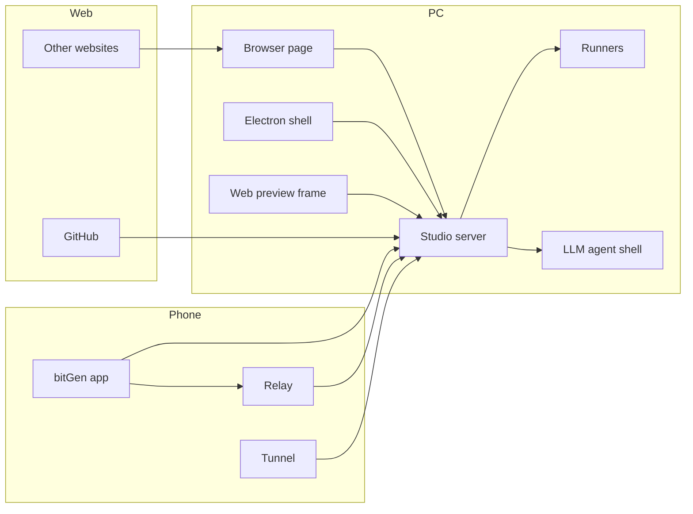

# bitGen Studio — threat model (2.925.0, 2026-11-23)

Method: OpenAI's `security-threat-model` skill (Apache-2.0), run against this repository. Every claim points at code.
Fixes for the findings marked *fixed* shipped in 2.926.0 (see the end).

## Executive summary

bitGen Studio is a single-user desktop app whose server (Express on `127.0.0.1:8311`) can run programs: the ComfyUI /
llama.cpp / Python paths in Settings, the LLM's folder commands, extensions, updates. So **whoever can send the server a
request it treats as "this computer" can run code on the PC.** The network side is well guarded (one paired device, a
sealed key, AES-GCM through the relay, the Cloudflare tunnel marked and limited). The weak spot was the other side:
requests from the PC itself were trusted with **no check of the Host or Origin**, so a web page open in any browser on
the PC could reach the API by DNS rebinding (or by simple cross-site requests), and a website being edited in the 🌐 Web
Editor ran its scripts **as the studio itself**. Next: the paired phone could change the program paths (a lost phone =
code on the PC), the desktop shell handed any link scheme to Windows, and auto-update (new in 2.925.0) runs whatever
reaches `main` on GitHub.

## Scope and assumptions

- In scope: `misc/server.js`, `routes/`, `lib/` (runtime), `static/` + `ext/` (the page), `electron/` (desktop shell),
  `mobile/` (the phone app, as a client). Out of scope: CI and `scripts/` tests; the community / website PHP (own repo);
  ComfyUI and model files themselves; physical access to the PC.
- Assumptions: one person uses the PC; Remote access is off unless switched on; when on, the phone is on the home Wi-Fi or
  comes through the relay / tunnel; the PC user browses the web on the same PC while bitGen Studio runs; installs come from
  this GitHub repo (git clone or zip).
- Open questions that would change the ranking: is bitGen ever run on a shared or office network (raises the LAN
  pairing threats)? Do testers install extensions or website templates from strangers (raises TM-002 / TM-008)?

## System model

### Primary components
- **Studio server** — Express, all routes mounted by `routes/index.js`; state and config in `lib/core.js`; listens on
  `lib/remote.js bindHost()` (127.0.0.1, or the LAN address with Remote access on).
- **The page** — `static/index.html` + `ext/*` dockers, served from the same origin, loaded by Electron or a browser.
- **Desktop shell** — `electron/main.js` (contextIsolation on, nodeIntegration off; `preload.js` exposes `h3shell`).
- **Runners** — ComfyUI, llama.cpp, Python workers, git / npm / Gradle, the LLM agent's shell (`lib/agentTools.js`).
- **Remote paths** — LAN (paired key), relay (`lib/relayLink.js`, `lib/relayBox.js`), Cloudflare tunnel (`lib/cfTunnel.js`).
- **Outbound** — web search / fetch (`lib/webTools.js`), downloads, RunPod / OpenRouter / API keys (`settings/keys.json`),
  GitHub updates (`lib/updater.js`, `lib/autoUpdate.js`).

### Data flows and trust boundaries
- Browser page on the PC → Studio server: HTTP on loopback; **trusted as "this computer"** (`lib/remoteGuard.js isLoopback`);
  before 2.926.0 no Host / Origin / Fetch-Metadata check; JSON parsed by `express.json()`.
- Other web origins in the same browser → Studio server: HTTP to 127.0.0.1; CORS answers only for the app's origins, but
  simple requests and DNS-rebound requests are not CORS-limited.
- Phone (LAN) → Studio server: HTTP; sealed session key (header / cookie `HttpOnly; SameSite=Lax` / `?bgk=` on GETs);
  one paired device (`lib/remote.js sessionOfToken`).
- Phone (away) → relay.php → Studio: AES-256-GCM boxes, nonce + 2-minute window (`lib/relayBox.js fresh`), the relay
  cannot read or change them; injected with `x-bitgen-via: relay`.
- Internet → cloudflared → local forwarder → Studio: forwarder overwrites `x-bitgen-via: tunnel` (`lib/cfTunnel.js`);
  key + "on the Wi-Fi in the last 6 h"; pairing refused.
- Studio → Runners: spawn with paths from config (`python`, `sd_cli`, `extra_args`, `engine.comfy.*`) — config is
  writable through `POST /api/config` (`routes/index.js`).
- LLM → agent tools: reads within one picked folder (`realpath`), writes / commands only after `POST /api/agent/answer`.
- Studio → GitHub: HTTPS git / zip; no signature check (`lib/updater.js`).
- Page → Electron: `window.open` → `shell.openExternal(url)` (`electron/main.js setWindowOpenHandler`).

#### Diagram

## Assets and security objectives

| Asset | Why it matters | Objective |
|---|---|---|
| Code execution on the PC | config paths, agent shell, extensions, updates all run programs | I |
| API keys (RunPod, OpenRouter, Brave, Civitai, HF, mail, FTP, Stripe) | spend money, read mail, change hosted sites | C |
| Projects, renders, mail, accounts books | the user's work and business records | C / I |
| The pairing / session key | equals full control of the studio | C |
| The installed code (git / zip) | auto-update runs it | I |
| GPU / queue | availability, power cost | A |

## Attacker model

### Capabilities
- Runs a website the user visits (any browser on the PC) — can DNS-rebind a hostname to 127.0.0.1, send simple POSTs.
- Supplies content bitGen shows or runs: a website template / project HTML, an email, a web page the LLM reads, a
  community message, a model or workflow file.
- Is on the same Wi-Fi (café, shared house) when Remote access is on.
- Finds or steals the paired phone.
- Compromises the GitHub account or the repo's `main`.

### Non-capabilities
- No local account on the PC, no physical access, no malware already running (then everything is lost anyway).
- Cannot read or forge relay boxes without the pairing key; cannot get through the tunnel without a key.
- Cannot run scripts in the mail pane (sandboxed frame, no `allow-scripts`).

## Entry points and attack surfaces

| Surface | How reached | Trust boundary | Notes | Evidence |
|---|---|---|---|---|
| Whole `/api/*` as "this computer" | loopback HTTP | browser → server | no Host / Origin check before 2.926.0 | `lib/remoteGuard.js isLoopback` |
| `POST /api/config` | page / anyone trusted | server → runners | sets `python`, `sd_cli`, `extra_args`, `engine.comfy` | `routes/index.js` |
| `POST /api/agent/answer` | page | server → agent shell | approves a pending command | `routes/agent.js` |
| `/web-preview/*` in `#wbPrev` | Web Editor 👁 | site HTML → studio origin | frame had `allow-scripts allow-same-origin` | `ext/webdock/dock.html`, `routes/webEditor.js` |
| `window.open` from the page / mail | click | page → OS | any scheme to `shell.openExternal` | `electron/main.js` |
| Main window navigation | link without target | page → external site in-app | no `will-navigate` guard; `h3shell` exposed | `electron/main.js`, `electron/preload.js` |
| Pairing (QR, 📶 lanpair) | LAN | network → server | PC user clicks Allow on a named device | `routes/lanPair.js` |
| Paired session | LAN / relay / tunnel | phone → server | full API incl. config | `lib/remoteGuard.js middleware` |
| File dialog routes | loopback only | server → disk | used own `isLoopback` that ignored tunnel / relay marks | `lib/fileDialog.js` |
| Web fetch / downloads | LLM tools | internet → server | private addresses blocked, media only | `lib/webTools.js isPrivateIp` |
| Auto-update | timer | GitHub → code | HTTPS only, repo not settable by API | `lib/updater.js`, `lib/autoUpdate.js` |

## Top abuse paths

1. Code on the PC from a web page: user visits a page → it rebinds `x.attacker.tld` to 127.0.0.1 → posts
   `/api/config {python: "<payload>"}` → the next render spawns it.
2. Same, by a website template: a downloaded site in `projects/
/www` → 👁 Preview runs its script with the studio's
   origin → the same `/api/config` call (no rebinding needed).
3. Approve the agent's command: page reaches loopback → `POST /api/agent/answer {ok: true, all: true}` on a pending ask.
4. Lost phone: finder opens the paired app → changes `python` in Settings over the API → code on the PC.
5. Link scheme: an email link `search-ms:` / `file:` / a `.url` → the Electron shell passes it to Windows → handler abuse.
6. In-app navigation: a link without `target` → an external page loads inside the app window with `h3shell` (screen
   capture, relaunch) exposed to it.
7. Supply chain: the GitHub account is taken → a bad commit on `main` → every install with auto-update on runs it within
   hours.
8. Wrong Allow: on a shared Wi-Fi someone requests to connect as "Galaxy Z Fold" → the user allows → full control.

## Threat model table

| Threat ID | Threat source | Prerequisites | Threat action | Impact | Impacted assets | Existing controls (evidence) | Gaps | Recommended mitigations | Detection ideas | Likelihood | Impact severity | Priority |
|---|---|---|---|---|---|---|---|---|---|---|---|---|
| TM-001 | Malicious website | User browses while bitGen runs | DNS rebinding / cross-site requests to loopback API | Code execution, key theft | Code execution, keys, projects | Loopback-only bind; CORS only for app origins (`lib/remoteGuard.js`) | No Host / Origin / Fetch-Metadata check | Loopback trusted only for Host 127.0.0.1 / localhost / ::1 / the PC's name; refuse foreign Origin and `Sec-Fetch-Site: cross-site` on `/api` (**fixed**, `lib/localGuard.js`) | Log refused requests with Host / Origin | medium | high | high |
| TM-002 | Malicious site HTML | A site in the project's www | Preview frame scripts act as the studio | Code execution | Code execution | WYSIWYG frame has no scripts | `#wbPrev` had `allow-scripts allow-same-origin` | Opaque origin (drop `allow-same-origin`), `/web-preview` readable cross-origin, POSTs from `Origin: null` refused (**fixed**) | — | medium | high | high |
| TM-003 | Lost / stolen phone, or a wrong Allow | A paired session | Change program paths, agent folder, extensions, updates over the API | Code execution | Code execution | One paired device; sealed key; 6 h away limit | Paired session = full API | Settings that run programs are PC-only (**fixed**, `lib/localGuard.js pcOnly`) | Log remote config attempts | low | high | medium |
| TM-004 | Email / page link | User clicks | Non-web scheme handed to Windows | Code execution via OS handlers | Code execution | Mail frame sandboxed | `shell.openExternal(url)` any scheme | Only http / https / mailto (**fixed**, `electron/safeLinks.js`) | — | low | high | medium |
| TM-005 | Link in rendered content | Link without target | External page inside the app window | Screen capture / relaunch via `h3shell` | Projects, privacy | contextIsolation, no nodeIntegration | No `will-navigate` guard | Keep the main window on the studio's origin, open the rest in the browser (**fixed**) | — | low | medium | medium |
| TM-006 | GitHub account / repo compromise | Auto-update on | Bad commit pulled and run | Code execution on every install | Installed code | HTTPS; repo not settable via API; auto-update off by default | No signature / tag check | Update only to signed tags (SSH / GPG-signed, verified with a key shipped in the install); 2FA on the account | Changelog diff shown before restart | low | high | medium |
| TM-007 | Someone on the same Wi-Fi | Remote access on, user clicks Allow | Pairs as a look-alike device | Full control | Everything | Allow / Deny prompt on the PC; QR pairing | Device name is the requester's own words | Show a 4-digit code on both the PC and the phone to compare before Allow | Notify on new pairing | low | high | low |
| TM-008 | Paired device via tunnel / relay | A paired session | File dialog routes accept tunnel / relay requests (land on 127.0.0.1) | Disk listing | Projects | Pairing key required | `lib/fileDialog.js isLoopback` ignored `x-bitgen-via` | Use the shared `remoteGuard.isLoopback` (**fixed**) | — | low | low | low |
| TM-009 | Local malware / backup thief | Read access to the install | Decrypt `settings/keys.json` with `settings/keys.master` beside it | Key theft | API keys | AES-256-GCM at rest | Key file next to the data | Windows DPAPI / OS keychain for the master key | — | low | medium | low |

## Criticality calibration

- **Critical**: code on the PC with no user action from the internet (e.g. an unauthenticated route on the tunnel that
  runs a program; a relay box forged without the key).
- **High**: code on the PC after an ordinary action (visiting a web page — TM-001; previewing a site — TM-002); theft of
  all API keys.
- **Medium**: code on the PC needing an unusual precondition (a lost phone — TM-003, a clicked odd link — TM-004, a
  compromised GitHub account — TM-006); reading one project.
- **Low**: needs a paired device already (TM-008), local disk access (TM-009), or the user to approve a stranger (TM-007).

## Focus paths for security review

| Path | Why it matters | Related Threat IDs |
|---|---|---|
| `lib/remoteGuard.js`, `lib/localGuard.js` | who counts as "this computer" | TM-001, TM-003, TM-008 |
| `routes/index.js` `/api/config` | config → program paths | TM-001, TM-003 |
| `routes/agent.js`, `lib/agentTools.js` | command approval | TM-001 |
| `ext/webdock/`, `routes/webEditor.js` | running site HTML | TM-002 |
| `electron/main.js`, `electron/preload.js` | OS handoff, exposed shell API | TM-004, TM-005 |
| `lib/updater.js`, `lib/autoUpdate.js` | code integrity | TM-006 |
| `routes/lanPair.js`, `lib/remote.js` | pairing | TM-007 |

## Notes on use

- Fixed in 2.926.0: TM-001, TM-002, TM-003, TM-004, TM-005, TM-008. Recommended, not done: TM-006 (signed tags need
  Tim's signing key), TM-007 (needs an app change), TM-009.
- Run again after anything that adds a way in (a new remote path, a new frame that runs content, a new spawn).
